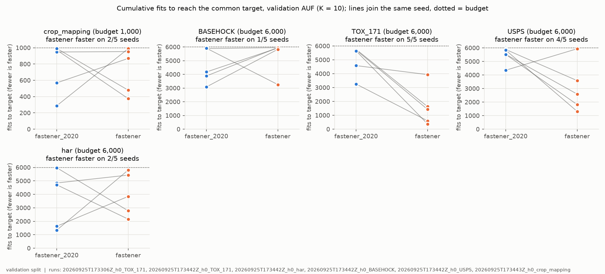
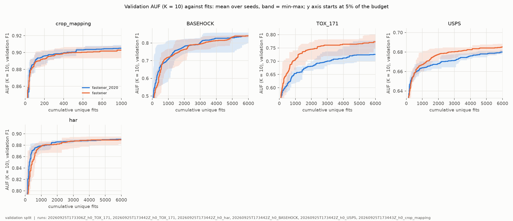
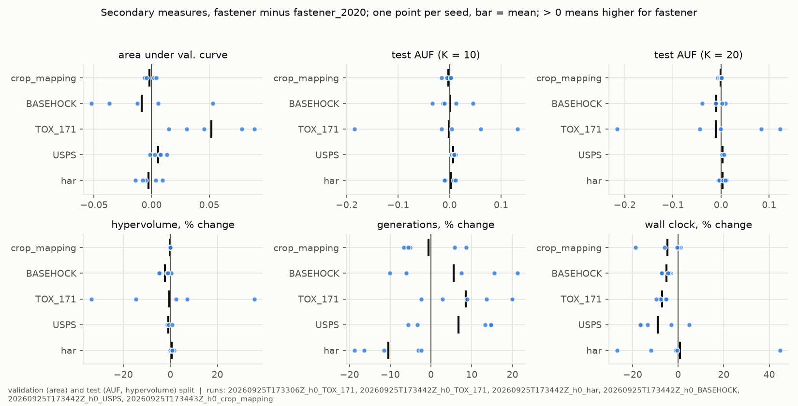
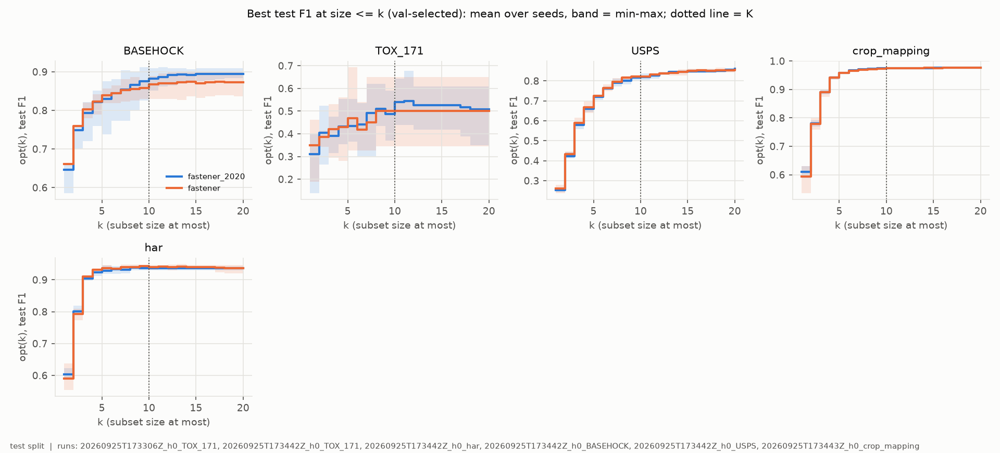

# H0-E01 -- report

## 1. Header

| field | content |
|---|---|
| Experiment ID | `H0-E01` |
| Hypothesis ID | H0 |
| Run IDs | `20260925T173306Z_h0_TOX_171` (no manifest, NOT evidence)<br>`20260925T173442Z_h0_TOX_171` (ok)<br>`20260925T173442Z_h0_har` (ok)<br>`20260925T173442Z_h0_BASEHOCK` (ok)<br>`20260925T173442Z_h0_USPS` (ok)<br>`20260925T173443Z_h0_crop_mapping` (ok) |
| Algorithm IDs | `fastener@1ce0622+564eb8a#2ef0`<br>`fastener@1ce0622+564eb8a#4371`<br>`fastener_2020@1ce0622+564eb8a#4bec`<br>`fastener_2020@1ce0622+564eb8a#757f` |
| Pre-registration | `experiments/HYPOTHESES.md` at `1ce0622` |
| Code commits | `1ce0622` |
| Dates | runs 2026-09-25T17:34:42.752422+00:00 to 2026-09-25T19:16:51.526743+00:00; report 2026-09-25 |
| Verdict | H0: **not supported** (the generator's mechanical reading agrees) |

## 2. Hypothesis

> ## H0 -- The bug-fixed FASTENER converges faster than the 2020 code
>
> **Claim.** The fixed FASTENER reaches a given low-k score in fewer fits than the
> 2020 code that produced the published results.

## 3. Evaluation criteria

### H0

> **Arms.**
>
> * `fastener` -- the fixed code, with the clone's defaults. This is **stock
>   FASTENER in H2-H6**.
> * `fastener_2020` -- the same code with `include_top_genes=True` and
>   `allow_self_mating=True`. The clone's README states that with both flags set a
>   run is identical to the original: the same fits and the same Pareto front for
>   the same seed. This arm is the published algorithm, not a variant of it.
>
> Both arms start from the same initial population for a given seed. Their random
> streams part at the first mating step.

> **Datasets, budgets and splits.** Five datasets, chosen to differ in domain and
> shape. Crop mapping is the one Earth-observation set. EOData, madelon and gina
> are left out. EOData is replaced by USPS, a much shorter set of handwritten
> digit images, which adds a third domain next to the sensor data of har and the
> text of BASEHOCK. TOX_171 adds gene expression, the very wide and very short
> shape of half the paper's benchmarks. It is the largest class-balanced gene set
> on disk; lung has more rows, but one of its classes gets a single validation
> row. Madelon and gina are both feature-selection challenge sets and add little
> variety next to these.
>
> | dataset | kind | rows | features | rows used: train / validation / test | budget per run |
> |---|---|---:|---:|---|---:|
> | **crop_mapping** | Earth observation, optical and radar | 325,834 | 174 | 40,000 / 10,000 / 50,000 (EO split, below) | **1,000 fits** |
> | **USPS** | handwritten digit images, 16x16 pixels; a paper benchmark | 9,298 | 256 | 5,578 / 1,860 / 1,860 (60/20/20) | **6,000 fits** |
> | **har** | smartphone sensor signals, several statistics each | 10,299 | 561 | 6,181 / 2,059 / 2,059 (60/20/20) | **6,000 fits** |
> | **BASEHOCK** | text, word features; a paper benchmark | 1,993 | 4,862 | 1,195 / 399 / 399 (60/20/20) | **6,000 fits** |
> | **TOX_171** | gene expression, toxicology microarray; a paper benchmark | 171 | 5,748 | 103 / 34 / 34 (60/20/20) | **6,000 fits** |
>
> *Budget.* Crop mapping gets 1,000 fits, the budget of the paper's own EO
> setting: Table 2 reports FASTENER at 1,000 model evaluations on EOData, and its
> AUF progress curve (Figure 9) has mostly levelled off within the first 800. Fits
> on crop mapping are also the most expensive in H0. The other three get the
> protocol's 6,000 fits. They are cheap to fit, and FASTENER on the
> paper's non-EO benchmarks ran for 11,000-17,000 evaluations, so they are not
> expected to settle as early. Each dataset is judged on its own, so budgets can
> differ between datasets. Within a dataset both arms always get the same budget.
>
> *EO split.* From crop mapping, a stratified subsample of 100,000
> rows is drawn once with `SPLIT_SEED`. It is halved, stratified, into 50,000
> **search** rows and 50,000 **test** rows. The search rows are split 80/20,
> stratified, into training and validation, the paper's 80:20 ratio. The search
> reads only training and validation. The 50,000 test rows are read once, at the
> end. The subsample keeps each class's share; the smallest class has about 175
> rows in each half.
>
> *Departures from the protocol table,* stated wherever H0 is reported: the
> 1,000-fit budget on crop mapping, and the EO split in place of the 50,000-row
> cap and the 60/20/20 split. USPS, har, BASEHOCK and TOX_171 run under the protocol as
> written.
>
> *Cost.* One decision-tree fit, measured on this machine, and one run at the
> budget above. The range runs from all fits at 20 features to all at 100. Crop
> mapping's fit times are scaled up from the 30,000-row training split measured to
> the 40,000 rows of the EO split.
>
> | dataset | one fit, 20 / 100 features | one run | H0 on it: 10 runs in series |
> |---|---|---|---|
> | crop_mapping | 1.0 / 6.1 s | 17 min to 1.7 h | 3 to 17 h |
> | USPS | 0.14 / 0.67 s | 14 min to 1.1 h | 2.3 to 11 h |
> | har | 0.11 / 0.59 s | 11 min to 1 h | 2 to 10 h |
> | BASEHOCK | 0.002 / 0.016 s | about 3 min | about 30 min |
> | TOX_171 | 0.002 / 0.004 s | about 3 min | about 30 min |
>
> On the two very wide sets the fit is not the cost. A smoke run on TOX_171 spent
> 17 s once, computing mutual information over all 5,748 features, then about
> 0.02 s per fit of FASTENER's own work. The rows above for BASEHOCK and TOX_171
> use that measured rate.
>
> *TOX_171 is noisy by construction.* Its validation split has 34 rows, 8 or 9
> per class, so one row moves F1 by about 0.03 and many subsets tie. The curve
> moves in coarse steps, and both arms can reach the target at the same snapshot.
> Such a seed is a tie under the criterion below. See *What the small sets can
> support*.

> **Primary metric: fits to a common target.** A fixed-target measure, read on
> fits as *Progress tracking* requires, and on validation only:
>
> 1. From every progress snapshot, compute AUF (K = 10) on validation F1 from the
>    front the snapshot stores. Over a run this gives a step curve of score
>    against cumulative unique fits.
> 2. Per dataset and seed, the **target** is the lower of the two arms' final
>    values at that dataset's budget. Both arms reach it by construction.
> 3. Each arm's result is the cumulative unique fits at the first snapshot whose
>    value is at or above the target. Fewer fits is faster.
>
> A common target keeps the comparison about speed. An arm's own final value
> would not work: a search that stalls early would look like it converged fast.

> **Falsification criterion.** H0 is supported if `fastener` reaches the target in
> **fewer fits** than `fastener_2020` in **at least 4 of 5 seeds**, on **crop
> mapping and on at least one of the other four datasets**. H0 does not run on
> EOData, so its result is not a statement about FASTENER's own dataset. An equal fit count is a tie and
> does not count toward the 4. Otherwise H0 is not supported. If `fastener_2020`
> meets the same criterion instead, the fixes slowed convergence, and that is
> recorded as the finding.
>
> **Reported beside it, as secondary:**
>
> * the area under the validation curve over the whole budget, which combines
>   speed and level in one number;
> * final test AUF (K = 10), AUF (K = 20) and hypervolume, to show whether faster
>   convergence cost the end result;
> * generations reached and wall clock, because fix 2 changes how many new
>   subsets a generation produces.
>
> A faster arm that ends lower on test AUF (K = 10) is reported as a trade-off,
> not as a better algorithm.

No revisions section in `experiments/HYPOTHESES.md` at `1ce0622`: the criteria are as pre-registered.

Secondary, shown for interpretation only: AUF at the other K, hypervolume, the smallest subset size on the front, fits and wall clock.

## 4. Summary

H0-E01 tested whether the bug-fixed FASTENER (`fastener`) reaches a common
validation AUF (K = 10) target in fewer fits than the 2020 code (`fastener_2020`),
on five datasets with 5 seeds each and equal fit budgets per dataset. It tests
fixes 1 and 2 only: fix 3 never fires at `pool_size=3`. **H0 is not
supported.** The criterion needs the fixed code to be faster in at least 4 of 5
seeds on crop mapping and on one other dataset. On crop mapping it was faster in
only 2 of 5 seeds: it needed 375 to 989 fits of the 1,000-fit budget, against 288
to 991 for the 2020 code. It did qualify on TOX_171 (5 of 5) and USPS (4 of 5),
but without crop mapping that does not meet the rule. The reverse outcome did
not occur either. The 2020 code qualified only on BASEHOCK (4 of 5), and not on
crop mapping. On har the split was 2 to 3.

The fixes do change the search, and by a lot on some datasets, but in a
direction that depends on the dataset. On TOX_171 the fixed code reached the
target in 378 to 3,933 fits, against 3,255 to 5,755. On BASEHOCK the 2020 code
was the faster one, at 3,086 to 5,908 fits against 3,254 to 5,954. Neither
direction changed where the search ended. Per dataset, the mean difference in
final test AUF (K = 10) is at most 0.0073, and that largest one favours the
fixed code, on USPS. No dataset shows the trade-off the pre-registration warns
of, a faster arm ending lower on test.

## 5. Description of the experiment

### Setup

**`20260925T173306Z_h0_TOX_171`** -- no manifest: the run ended before writing one, and contributes no data.

**`20260925T173442Z_h0_TOX_171`** -- dataset `TOX_171`: 5748 features, 103/34/34 train/val/test rows.

```
run_sota.py --dataset TOX_171 --split protocol --methods  --name h0_TOX_171 --fastener-arm none --fastener-arm 2020 --evaluations 6000 --experiment H0-E01
```

**`20260925T173442Z_h0_har`** -- dataset `har`: 561 features, 6181/2059/2059 train/val/test rows.

```
run_sota.py --dataset har --split protocol --methods  --name h0_har --fastener-arm none --fastener-arm 2020 --evaluations 6000 --experiment H0-E01
```

**`20260925T173442Z_h0_BASEHOCK`** -- dataset `BASEHOCK`: 4862 features, 1195/399/399 train/val/test rows.

```
run_sota.py --dataset BASEHOCK --split protocol --methods  --name h0_BASEHOCK --fastener-arm none --fastener-arm 2020 --evaluations 6000 --experiment H0-E01
```

**`20260925T173442Z_h0_USPS`** -- dataset `USPS`: 256 features, 5578/1860/1860 train/val/test rows.

```
run_sota.py --dataset USPS --split protocol --methods  --name h0_USPS --fastener-arm none --fastener-arm 2020 --evaluations 6000 --experiment H0-E01
```

**`20260925T173443Z_h0_crop_mapping`** -- dataset `crop_mapping`: 174 features, 40000/9999/50001 train/val/test rows.

```
run_sota.py --dataset crop_mapping --split eo --methods  --name h0_crop_mapping --fastener-arm none --fastener-arm 2020 --evaluations 1000 --experiment H0-E01
```

Parameters per run:

| parameter | 20260925T173442Z_h0_TOX_171 | 20260925T173442Z_h0_har | 20260925T173442Z_h0_BASEHOCK | 20260925T173442Z_h0_USPS | 20260925T173443Z_h0_crop_mapping |
|---|---|---|---|---|---|
| boruta_estimator | "protocol decision tree" | "protocol decision tree" | "protocol decision tree" | "protocol decision tree" | "protocol decision tree" |
| boruta_max_iter | 100 | 100 | 100 | 100 | 100 |
| dataset | "TOX_171" | "har" | "BASEHOCK" | "USPS" | "crop_mapping" |
| evaluation_budget_per_seed | 6000 | 6000 | 6000 | 6000 | 1000 |
| fastener_arms | ["none", "2020"] | ["none", "2020"] | ["none", "2020"] | ["none", "2020"] | ["none", "2020"] |
| fastener_max_fits | 6000 | 6000 | 6000 | 6000 | 1000 |
| fastener_rounds | 100000 | 100000 | 100000 | 100000 | 100000 |
| fs_sds_evaluations_per_k | 300 | 300 | 300 | 300 | 50 |
| fs_sds_evaluations_total | 6000 | 6000 | 6000 | 6000 | 1000 |
| fs_sds_iterations | null | null | null | null | null |
| fs_sds_k_range | [1, 2, 3, 4, 5, 6, 7, 8, 9, 10, 11, 12, 13, 14, 15, 16, 17, 18, 19, 20] | [1, 2, 3, 4, 5, 6, 7, 8, 9, 10, 11, 12, 13, 14, 15, 16, 17, 18, 19, 20] | [1, 2, 3, 4, 5, 6, 7, 8, 9, 10, 11, 12, 13, 14, 15, 16, 17, 18, 19, 20] | [1, 2, 3, 4, 5, 6, 7, 8, 9, 10, 11, 12, 13, 14, 15, 16, 17, 18, 19, 20] | [1, 2, 3, 4, 5, 6, 7, 8, 9, 10, 11, 12, 13, 14, 15, 16, 17, 18, 19, 20] |
| fs_sds_population | null | null | null | null | null |
| k_grid | [1, 2, 3, 4, 5, 6, 7, 8, 9, 10, 11, 12, 13, 14, 15, 16, 17, 18, 19, 20, 25, 30, 50, 100, 200, 500] | [1, 2, 3, 4, 5, 6, 7, 8, 9, 10, 11, 12, 13, 14, 15, 16, 17, 18, 19, 20, 25, 30, 50, 100, 200, 500] | [1, 2, 3, 4, 5, 6, 7, 8, 9, 10, 11, 12, 13, 14, 15, 16, 17, 18, 19, 20, 25, 30, 50, 100, 200, 500] | [1, 2, 3, 4, 5, 6, 7, 8, 9, 10, 11, 12, 13, 14, 15, 16, 17, 18, 19, 20, 25, 30, 50, 100, 200] | [1, 2, 3, 4, 5, 6, 7, 8, 9, 10, 11, 12, 13, 14, 15, 16, 17, 18, 19, 20, 25, 30, 50, 100] |
| max_rows | null | 50000 | null | null | 100000 |
| methods | [] | [] | [] | [] | [] |
| model | "DecisionTreeClassifier" | "DecisionTreeClassifier" | "DecisionTreeClassifier" | "DecisionTreeClassifier" | "DecisionTreeClassifier" |
| model_seed | 20200 | 20200 | 20200 | 20200 | 20200 |
| n_rows_used | 171 | 10299 | 1993 | 9298 | 100000 |
| nsgaii_miip_init | "obl" | "obl" | "obl" | "obl" | "obl" |
| poss_k | 50 | 50 | 50 | 50 | 50 |
| primary_metric | "f1_weighted" | "f1_weighted" | "f1_weighted" | "f1_weighted" | "f1_weighted" |
| quick | false | false | false | false | false |
| seeds | [2020, 2021, 2022, 2023, 2024] | [2020, 2021, 2022, 2023, 2024] | [2020, 2021, 2022, 2023, 2024] | [2020, 2021, 2022, 2023, 2024] | [2020, 2021, 2022, 2023, 2024] |
| split | "protocol" | "protocol" | "protocol" | "protocol" | "eo" |
| with_fastener | true | true | true | true | true |

Arms:

| arm | algorithm ID | what distinguishes it |
|---|---|---|
| fastener | `fastener@1ce0622+564eb8a#2ef0`<br>`fastener@1ce0622+564eb8a#4371` | The fixed mating: the clone's defaults at `564eb8a`. Weighted information-gain mating starts from the plain intersection of the parents and adds only the sample weighted by mutual information, and the mating pool is drawn without replacement, so no item is mated with itself. No swap operator. The two IDs differ only in the budget in the config: `#2ef0` is 6,000 fits, `#4371` is 1,000 fits (crop mapping). |
| fastener_2020 | `fastener_2020@1ce0622+564eb8a#4bec`<br>`fastener_2020@1ce0622+564eb8a#757f` | The same code with `include_top_genes=True` and `allow_self_mating=True`, which the clone's README states reproduces the 2020 mating exactly. Every child therefore contains the top-k genes by mutual information, and the pool is drawn with replacement. `#4bec` is 6,000 fits, `#757f` is 1,000 fits (crop mapping). |

Both arms use the protocol's decision tree (`model_seed` 20200), weighted F1,
seeds 2020 to 2024, and stop on the fit budget: `fastener_rounds` is set to
100,000 so that the round limit never binds. Both arms of a seed share the
initial population.

**Deviations from the protocol:**

* **As pre-registered for H0, not deviations from it:** the 1,000-fit budget
  on crop mapping, and the EO split in place of the 50,000-row cap and the
  60/20/20 split. USPS, har, BASEHOCK and TOX_171 ran under the protocol as
  written.
* **crop mapping's split is 40,000 / 9,999 / 50,001 rows,** not 40,000 /
  10,000 / 50,000. Stratified rounding moved one row from validation to test.
  It does not affect the comparison: both arms use the same split.
* Nothing else.

### What happened

| run | status | started (UTC) | ended (UTC) | elapsed (s) | results file |
|---|---|---|---|---|---|
| `20260925T173306Z_h0_TOX_171` | -- | -- | -- | -- | none |
| `20260925T173442Z_h0_TOX_171` | ok | 2026-09-25T17:34:42.752422+00:00 | 2026-09-25T18:00:44.347696+00:00 | 1561.5950 | raw_results.json |
| `20260925T173442Z_h0_har` | ok | 2026-09-25T17:34:42.766279+00:00 | 2026-09-25T18:46:51.636703+00:00 | 4328.8700 | raw_results.json |
| `20260925T173442Z_h0_BASEHOCK` | ok | 2026-09-25T17:34:42.846933+00:00 | 2026-09-25T18:00:24.052924+00:00 | 1541.2060 | raw_results.json |
| `20260925T173442Z_h0_USPS` | ok | 2026-09-25T17:34:42.855747+00:00 | 2026-09-25T19:16:51.526743+00:00 | 6128.6710 | raw_results.json |
| `20260925T173443Z_h0_crop_mapping` | ok | 2026-09-25T17:34:43.704347+00:00 | 2026-09-25T19:14:29.320607+00:00 | 5985.6160 | raw_results.json |

Run keys (50; full list in [tables/run_keys.csv](tables/run_keys.csv)):

| dataset | arm | seed | AUF K=10 | AUF K=20 | hypervolume | min subset | fits | seconds | stopped on |
|---|---|---|---|---|---|---|---|---|---|
| TOX_171 | fastener | 2020 | 0.5804 | 0.6155 | 3983.3980 | 1 | 6000 | 153.6700 | "fit_budget" |
| TOX_171 | fastener | 2021 | 0.4162 | 0.4084 | 2877.4144 | 1 | 6000 | 149.9700 | "fit_budget" |
| TOX_171 | fastener | 2022 | 0.3405 | 0.3422 | 2317.0711 | 1 | 6000 | 146.8700 | "fit_budget" |
| TOX_171 | fastener | 2023 | 0.4051 | 0.5062 | 3488.1780 | 1 | 6000 | 146.7500 | "fit_budget" |
| TOX_171 | fastener | 2024 | 0.4726 | 0.4881 | 3046.2970 | 1 | 6000 | 153.6200 | "fit_budget" |
| TOX_171 | fastener_2020 | 2020 | 0.4488 | 0.5318 | 3886.4828 | 1 | 6000 | 161.6600 | "fit_budget" |
| TOX_171 | fastener_2020 | 2021 | 0.4122 | 0.4095 | 2683.0167 | 1 | 6000 | 163.1400 | "fit_budget" |
| TOX_171 | fastener_2020 | 2022 | 0.5258 | 0.5583 | 3483.5512 | 1 | 6000 | 158.9400 | "fit_budget" |
| TOX_171 | fastener_2020 | 2023 | 0.3450 | 0.3836 | 2568.8982 | 1 | 6000 | 162.2300 | "fit_budget" |
| TOX_171 | fastener_2020 | 2024 | 0.4886 | 0.5318 | 3567.5739 | 1 | 6000 | 162.2500 | "fit_budget" |
| har | fastener | 2020 | 0.8794 | 0.9081 | 528.0925 | 1 | 6000 | 401.4200 | "fit_budget" |
| har | fastener | 2021 | 0.8927 | 0.9198 | 531.1626 | 1 | 6000 | 397.4500 | "fit_budget" |
| har | fastener | 2022 | 0.8793 | 0.9103 | 528.9107 | 1 | 6000 | 449.0300 | "fit_budget" |
| har | fastener | 2023 | 0.8858 | 0.9081 | 524.1675 | 1 | 6000 | 540.5600 | "fit_budget" |
| har | fastener | 2024 | 0.8923 | 0.9167 | 526.8703 | 1 | 6000 | 357.1100 | "fit_budget" |
| har | fastener_2020 | 2020 | 0.8873 | 0.9143 | 528.2171 | 1 | 6000 | 405.4300 | "fit_budget" |
| har | fastener_2020 | 2021 | 0.8827 | 0.9088 | 523.0574 | 1 | 6000 | 399.0900 | "fit_budget" |
| har | fastener_2020 | 2022 | 0.8895 | 0.9141 | 528.7384 | 1 | 6000 | 509.6900 | "fit_budget" |
| har | fastener_2020 | 2023 | 0.8783 | 0.9039 | 520.0964 | 1 | 6000 | 373.4700 | "fit_budget" |
| har | fastener_2020 | 2024 | 0.8805 | 0.9077 | 523.0030 | 1 | 6000 | 487.9900 | "fit_budget" |
| BASEHOCK | fastener | 2020 | 0.8333 | 0.8659 | 4368.6929 | 1 | 6000 | 151.5600 | "fit_budget" |
| BASEHOCK | fastener | 2021 | 0.8224 | 0.8609 | 4382.6151 | 1 | 6000 | 146.7300 | "fit_budget" |
| BASEHOCK | fastener | 2022 | 0.8298 | 0.8556 | 4308.9669 | 1 | 6000 | 146.7600 | "fit_budget" |
| BASEHOCK | fastener | 2023 | 0.7983 | 0.8230 | 4169.1749 | 1 | 6000 | 147.5400 | "fit_budget" |
| BASEHOCK | fastener | 2024 | 0.7983 | 0.8166 | 4092.2367 | 1 | 6000 | 155.2600 | "fit_budget" |
| BASEHOCK | fastener_2020 | 2020 | 0.8462 | 0.8777 | 4431.4405 | 1 | 6000 | 156.7600 | "fit_budget" |
| BASEHOCK | fastener_2020 | 2021 | 0.8096 | 0.8512 | 4370.4109 | 1 | 6000 | 157.6800 | "fit_budget" |
| BASEHOCK | fastener_2020 | 2022 | 0.8400 | 0.8666 | 4356.2435 | 1 | 6000 | 152.7000 | "fit_budget" |
| BASEHOCK | fastener_2020 | 2023 | 0.8313 | 0.8623 | 4357.0678 | 1 | 6000 | 159.0200 | "fit_budget" |
| BASEHOCK | fastener_2020 | 2024 | 0.7530 | 0.8143 | 4294.2279 | 1 | 6000 | 162.5300 | "fit_budget" |
| USPS | fastener | 2020 | 0.6735 | 0.7586 | 217.1322 | 1 | 6000 | 612.6000 | "fit_budget" |
| USPS | fastener | 2021 | 0.6661 | 0.7555 | 217.9219 | 1 | 6000 | 557.5800 | "fit_budget" |
| USPS | fastener | 2022 | 0.6670 | 0.7544 | 215.3639 | 1 | 6000 | 531.3200 | "fit_budget" |
| USPS | fastener | 2023 | 0.6700 | 0.7593 | 217.5381 | 1 | 6000 | 538.8900 | "fit_budget" |
| USPS | fastener | 2024 | 0.6732 | 0.7637 | 220.6755 | 1 | 6000 | 670.8300 | "fit_budget" |
| USPS | fastener_2020 | 2020 | 0.6619 | 0.7548 | 221.0126 | 1 | 6000 | 632.1500 | "fit_budget" |
| USPS | fastener_2020 | 2021 | 0.6622 | 0.7512 | 221.0968 | 1 | 6000 | 643.2500 | "fit_budget" |
| USPS | fastener_2020 | 2022 | 0.6628 | 0.7535 | 218.2084 | 1 | 6000 | 634.4100 | "fit_budget" |
| USPS | fastener_2020 | 2023 | 0.6625 | 0.7567 | 219.1411 | 1 | 6000 | 646.4000 | "fit_budget" |
| USPS | fastener_2020 | 2024 | 0.6641 | 0.7578 | 218.8395 | 1 | 6000 | 640.1000 | "fit_budget" |
| crop_mapping | fastener | 2020 | 0.9075 | 0.9412 | 168.3904 | 1 | 1000 | 616.2900 | "fit_budget" |
| crop_mapping | fastener | 2021 | 0.8920 | 0.9347 | 168.2618 | 1 | 1000 | 654.6500 | "fit_budget" |
| crop_mapping | fastener | 2022 | 0.9002 | 0.9380 | 168.2640 | 1 | 1000 | 496.6700 | "fit_budget" |
| crop_mapping | fastener | 2023 | 0.9049 | 0.9400 | 168.1139 | 1 | 1000 | 511.6700 | "fit_budget" |
| crop_mapping | fastener | 2024 | 0.9046 | 0.9402 | 168.1783 | 1 | 1000 | 601.1100 | "fit_budget" |
| crop_mapping | fastener_2020 | 2020 | 0.9048 | 0.9401 | 168.2219 | 1 | 1000 | 609.4600 | "fit_budget" |
| crop_mapping | fastener_2020 | 2021 | 0.9072 | 0.9411 | 168.2730 | 1 | 1000 | 653.5100 | "fit_budget" |
| crop_mapping | fastener_2020 | 2022 | 0.9053 | 0.9407 | 168.4725 | 1 | 1000 | 610.6100 | "fit_budget" |
| crop_mapping | fastener_2020 | 2023 | 0.9024 | 0.9395 | 168.2465 | 1 | 1000 | 514.3600 | "fit_budget" |
| crop_mapping | fastener_2020 | 2024 | 0.9022 | 0.9388 | 168.2940 | 1 | 1000 | 638.6800 | "fit_budget" |

Progress curves: every run key's trajectory is in its run's `trajectories/` directory.

**Timeline (UTC, 2026-09-25).**

* 17:33:06: `20260925T173306Z_h0_TOX_171` started on its own. It was stopped
  84.5 s later, 3,019 fits into its first unit (`fastener`, seed 2020), before
  it wrote a manifest or any results. The run records no reason. It contributes
  no data. It is listed in the header, the ledger and the figure footers only
  because the ledger holds every run started under `H0-E01`.
* 17:34:42 to 17:34:43: `experiments/run_h0.py` started the five datasets as
  five parallel processes. Its status file and per-dataset logs are in
  `results/H0-E01/`.
* 18:00: TOX_171 and BASEHOCK finished. 18:46: har. 19:14: crop mapping.
  19:16: USPS. The whole experiment took 1 h 42 min.

**What ran.** All five runs ended with status `ok` and `evidence: true`. Every
one of the 50 run keys stopped on `fit_budget` with exactly its budget spent
(table above). No run key was missing, duplicated or excluded.

**Dirty flag.** The manifests record the experiments repository as `dirty`, but
the only changes were untracked files that are not code:
`experiments/EXPERIMENTS.md`, `results/H0-E01/` and the stopped run's folder.
`code_dirty` is false for both repositories, which is why the runs count as
evidence. The FASTENER clone was clean at `564eb8a`.

**Wall clock is not a clean measure of cost here.** The five datasets ran in
parallel on one machine. Within each run, all five `fastener` seeds ran before
any `fastener_2020` seed. On har, USPS and crop mapping, the fixed arm therefore
ran partly while all five processes were competing. Their 2020 arm ran only
after TOX_171 and BASEHOCK had ended at 18:00, under less load. Only on TOX_171
and BASEHOCK did both arms run under the same five-way load.

**Anomalies.**

* The runs were much faster than the pre-registered cost table predicted, even
  under parallel load. For example, crop mapping's 10 runs took 5,986 s, while
  the table put the serial cost at 3 to 17 h. The estimate assumed fits at 20
  to 100 features, and the searches evidently fit smaller subsets. This did not
  affect the result: every run key spent its full budget.
* Every final front, in both arms and on every dataset, contains a
  single-feature subset (*min subset* = 1 in the table above).
* On TOX_171, the pre-registration expected ties, because its 34-row validation
  split moves F1 in coarse steps. None occurred: all 25 comparisons had a
  winner.

## 6. Findings

### Finding 1 -- H0 is not supported: the fixed code is faster in at least 4 of 5 seeds on TOX_171 and USPS, but on crop mapping in only 2 of 5

**Claim.** Under the pre-registered criterion, `fastener` does not reach the
common target in fewer fits than `fastener_2020` in at least 4 of 5 seeds on
crop mapping. H0 is therefore not supported, whatever the other four datasets
show. The reverse outcome, that the fixes slowed convergence, is not met either:
`fastener_2020` qualifies on BASEHOCK but not on crop mapping.

**Evidence.** Per dataset ([tables/H0_per_dataset.csv](tables/H0_per_dataset.csv)),
then per seed ([tables/H0_per_seed.csv](tables/H0_per_seed.csv)). The target is
validation AUF (K = 10), and the fit counts are cumulative unique fits at the
first snapshot at or above it. There were no ties. The criterion is a per-seed
sign rule, with no test statistic, so no p-value is computed.

| dataset | seeds | fastener faster | fastener_2020 faster | ties | counts for |
|---|---|---|---|---|---|
| crop_mapping | 5 | 2 | 3 | 0 | neither |
| BASEHOCK | 5 | 1 | 4 | 0 | fastener_2020 |
| TOX_171 | 5 | 5 | 0 | 0 | fastener |
| USPS | 5 | 4 | 1 | 0 | fastener |
| har | 5 | 2 | 3 | 0 | neither |

| dataset | seed | target (val. AUF) | fits, fastener_2020 | fits, fastener | faster |
|---|---|---|---|---|---|
| crop_mapping | 2020 | 0.9055 | 972 | 375 | fastener |
| crop_mapping | 2021 | 0.8935 | 288 | 989 | fastener_2020 |
| crop_mapping | 2022 | 0.9024 | 569 | 869 | fastener_2020 |
| crop_mapping | 2023 | 0.9020 | 948 | 953 | fastener_2020 |
| crop_mapping | 2024 | 0.9031 | 991 | 479 | fastener |
| BASEHOCK | 2020 | 0.8488 | 3884 | 5954 | fastener_2020 |
| BASEHOCK | 2021 | 0.8366 | 5886 | 5954 | fastener_2020 |
| BASEHOCK | 2022 | 0.8447 | 4176 | 5927 | fastener_2020 |
| BASEHOCK | 2023 | 0.8368 | 3086 | 5830 | fastener_2020 |
| BASEHOCK | 2024 | 0.7987 | 5908 | 3254 | fastener |
| TOX_171 | 2020 | 0.7034 | 3255 | 604 | fastener |
| TOX_171 | 2021 | 0.7002 | 5755 | 1628 | fastener |
| TOX_171 | 2022 | 0.7720 | 4584 | 3933 | fastener |
| TOX_171 | 2023 | 0.7320 | 5709 | 1430 | fastener |
| TOX_171 | 2024 | 0.7104 | 5645 | 378 | fastener |
| USPS | 2020 | 0.6787 | 5882 | 3585 | fastener |
| USPS | 2021 | 0.6797 | 4352 | 5936 | fastener_2020 |
| USPS | 2022 | 0.6800 | 5528 | 2589 | fastener |
| USPS | 2023 | 0.6821 | 5833 | 1312 | fastener |
| USPS | 2024 | 0.6777 | 5515 | 1814 | fastener |
| har | 2020 | 0.8820 | 1343 | 5806 | fastener_2020 |
| har | 2021 | 0.8896 | 5975 | 2779 | fastener |
| har | 2022 | 0.8857 | 1633 | 3846 | fastener_2020 |
| har | 2023 | 0.8903 | 4845 | 5431 | fastener_2020 |
| har | 2024 | 0.8881 | 4708 | 2158 | fastener |



*Figure 1.* Fits to the common target per seed, one panel per dataset, with
crop mapping first because the criterion depends on it. Left column:
`fastener_2020`. Right column: `fastener`. Grey lines join the two arms of the
same seed, so a line falling to the right means the fixed code was faster. The
dotted line is the budget. Validation split. The first run ID in the footer,
`20260925T173306Z_h0_TOX_171`, contributes no data (see *What happened*).
 Runs: `20260925T173306Z_h0_TOX_171`, `20260925T173442Z_h0_TOX_171`, `20260925T173442Z_h0_har`, `20260925T173442Z_h0_BASEHOCK`, `20260925T173442Z_h0_USPS`, `20260925T173443Z_h0_crop_mapping`.

**Bearing on the hypothesis.** Contradicts it as stated. The claim holds on
TOX_171 and USPS. It fails on crop mapping, the one dataset the criterion
requires, and on har. On BASEHOCK the opposite holds.

### Finding 2 (secondary) -- The fixes' effect on the validation curve depends on the dataset: ahead on TOX_171 and USPS, level or behind elsewhere

**Claim.** Over the whole budget, the fixed code's validation AUF (K = 10) curve
encloses more area than the 2020 code's on TOX_171 in every seed and on USPS in
4 of 5. On crop mapping, har and BASEHOCK it does so in only 2 of 5 seeds, and
the mean difference is negative.

**Evidence.** The area under the validation curve, which is a pre-registered
secondary measure (Finding 3 has the full table). Fixed minus 2020, per
dataset: TOX_171 is higher in 5 of 5 seeds (mean +0.0517, range +0.0149 to
+0.0893), USPS in 4 of 5 (mean +0.0058). Crop mapping is higher in 2 of 5
(mean −0.0020), har in 2 of 5 (mean −0.0029), and BASEHOCK in 2 of 5 (mean
−0.0085, range −0.0521 to +0.0530). In Figure 2 the TOX_171 and USPS curves
separate early and stay apart. The 2020 code leads during har's early rise.
BASEHOCK's curves cross several times inside wide bands, and crop mapping's
overlap almost everywhere.



*Figure 2.* Validation AUF (K = 10) against cumulative unique fits, one panel
per dataset. The line is the mean over 5 seeds of each arm's step curve, and
the band is the min to max over seeds. The y axis starts at the lowest value
seen after 5% of the budget, which hides the initial rise. Validation split. Runs: `20260925T173306Z_h0_TOX_171`, `20260925T173442Z_h0_TOX_171`, `20260925T173442Z_h0_har`, `20260925T173442Z_h0_BASEHOCK`, `20260925T173442Z_h0_USPS`, `20260925T173443Z_h0_crop_mapping`.

**Bearing on the hypothesis.** Consistent with Finding 1, and it adds that the
dataset-by-dataset outcome is not an artefact of the target construction:
the measure that combines speed and level gives the same picture. It neither
supports nor rescues the claim on crop mapping.

### Finding 3 (secondary) -- The fixes do not cost the end result: no dataset shows a speed-for-quality trade-off on test AUF (K = 10)

**Claim.** On every dataset, the mean per-seed difference in final test AUF
(K = 10) is at most 0.0073 in absolute value. On USPS, where the fixed code was
faster, it also ended higher on test AUF (K = 10) in 5 of 5 seeds.

**Evidence.** In the table below:

* **USPS:** test AUF (K = 10) is higher for the fixed code in 5 of 5 seeds
  (mean +0.0073, range +0.0039 to +0.0116).
* **TOX_171:** test AUF (K = 10) swings from −0.1853 to +0.1316 around a mean of
  −0.0011. Its test split has 34 rows.
* **BASEHOCK:** the 2020 code, the faster arm there, ends slightly ahead beyond
  K = 10. Test AUF (K = 20) is −0.0100 in mean, and hypervolume is higher for
  the fixed code in only 1 of 5 seeds (mean −2.25%).
* **Generations:** the fixed code ran more generations in the same fits on
  TOX_171 (mean +8.5%), USPS (+6.8%) and BASEHOCK (+5.6%), and fewer on har in
  every seed (mean −10.4%).
* **Wall clock:** on TOX_171 and BASEHOCK, the only datasets where both arms
  ran under the same load, the fixed code was faster in 5 of 5 seeds (mean
  −7.1% and −5.2%).

fastener minus fastener_2020 per seed, summarised per dataset (percent for relative measures):

| dataset | measure | seeds | fastener higher | mean | min | max |
|---|---|---|---|---|---|---|
| crop_mapping | area under val. curve | 5 | 2 | -0.0020 | -0.0061 | 0.0040 |
| crop_mapping | test AUF (K = 10) | 5 | 3 | -0.0025 | -0.0152 | 0.0027 |
| crop_mapping | test AUF (K = 20) | 5 | 3 | -0.0012 | -0.0064 | 0.0014 |
| crop_mapping | hypervolume, % change | 5 | 1 | -0.0356 | -0.1237 | 0.1002 |
| crop_mapping | generations, % change | 5 | 2 | -0.5586 | -6.6667 | 8.6957 |
| crop_mapping | wall clock, % change | 5 | 2 | -4.7566 | -18.6603 | 1.1102 |
| BASEHOCK | area under val. curve | 5 | 2 | -0.0085 | -0.0521 | 0.0530 |
| BASEHOCK | test AUF (K = 10) | 5 | 2 | 0.0004 | -0.0331 | 0.0453 |
| BASEHOCK | test AUF (K = 20) | 5 | 2 | -0.0100 | -0.0393 | 0.0097 |
| BASEHOCK | hypervolume, % change | 5 | 1 | -2.2476 | -4.7038 | 0.2792 |
| BASEHOCK | generations, % change | 5 | 3 | 5.5809 | -10.1382 | 21.1940 |
| BASEHOCK | wall clock, % change | 5 | 0 | -5.1675 | -7.2180 | -3.3140 |
| TOX_171 | area under val. curve | 5 | 5 | 0.0517 | 0.0149 | 0.0893 |
| TOX_171 | test AUF (K = 10) | 5 | 3 | -0.0011 | -0.1853 | 0.1316 |
| TOX_171 | test AUF (K = 20) | 5 | 2 | -0.0109 | -0.2160 | 0.1226 |
| TOX_171 | hypervolume, % change | 5 | 3 | -0.5146 | -33.4854 | 35.7850 |
| TOX_171 | generations, % change | 5 | 4 | 8.5472 | -2.3973 | 19.8925 |
| TOX_171 | wall clock, % change | 5 | 0 | -7.0944 | -9.5460 | -4.9414 |
| USPS | area under val. curve | 5 | 4 | 0.0058 | -0.0014 | 0.0133 |
| USPS | test AUF (K = 10) | 5 | 5 | 0.0073 | 0.0039 | 0.0116 |
| USPS | test AUF (K = 20) | 5 | 5 | 0.0035 | 0.0010 | 0.0059 |
| USPS | hypervolume, % change | 5 | 1 | -0.8776 | -1.7557 | 0.8390 |
| USPS | generations, % change | 5 | 3 | 6.7725 | -5.6380 | 14.7541 |
| USPS | wall clock, % change | 5 | 1 | -8.8980 | -16.6327 | 4.8027 |
| har | area under val. curve | 5 | 2 | -0.0029 | -0.0139 | 0.0093 |
| har | test AUF (K = 10) | 5 | 3 | 0.0023 | -0.0102 | 0.0118 |
| har | test AUF (K = 20) | 5 | 3 | 0.0028 | -0.0063 | 0.0110 |
| har | hypervolume, % change | 5 | 4 | 0.6162 | -0.0236 | 1.5496 |
| har | generations, % change | 5 | 0 | -10.4468 | -18.8192 | -2.4341 |
| har | wall clock, % change | 5 | 1 | 0.9204 | -26.8211 | 44.7418 |



*Figure 3.* Six secondary measures, `fastener` minus `fastener_2020` per seed.
Each point is one seed, the bar is the mean, and the vertical line is zero.
Area under the curve and the two test AUFs are absolute differences.
Hypervolume, generations and wall clock are percent changes, because their
scale differs between datasets. Area is on the validation split. The AUFs and
hypervolume are on the test split. Wall clock is confounded on har, USPS and
crop mapping (see *What happened*). Runs: `20260925T173306Z_h0_TOX_171`, `20260925T173442Z_h0_TOX_171`, `20260925T173442Z_h0_har`, `20260925T173442Z_h0_BASEHOCK`, `20260925T173442Z_h0_USPS`, `20260925T173443Z_h0_crop_mapping`.

**Bearing on the hypothesis.** Neutral to the claim, which is about speed. It
rules out the reading the pre-registration guards against: where the fixed code
is faster, it did not buy that speed with a worse end result.

### Finding 4 (exploratory) -- On test, the two arms' final fronts are indistinguishable at every subset size up to 20

**Claim.** At every k from 1 to 20, the seed bands of the two arms' test
opt(k) curves overlap on all five datasets. The fixes change the path the
search takes, not where it ends at these budgets.

**Evidence.** Figure 4. The largest visible gap between the means is on
BASEHOCK above k = 8, where `fastener_2020` is ahead. This is the same
difference that Finding 3 measures as test AUF (K = 20), and it lies inside
both arms' bands.



*Figure 4.* opt(k) on the final front: the test F1 of the subset of size at
most k that is best on validation. The line is the mean over 5 seeds, the band
is the min to max, and the dotted line is K = 10. Test split. This figure is
exploratory: opt(k) at single k was not a pre-registered measure. Runs: `20260925T173306Z_h0_TOX_171`, `20260925T173442Z_h0_TOX_171`, `20260925T173442Z_h0_har`, `20260925T173442Z_h0_BASEHOCK`, `20260925T173442Z_h0_USPS`, `20260925T173443Z_h0_crop_mapping`.

**Bearing on the hypothesis.** Neutral. It supports carrying the fixed code
into H2 to H6 without expecting different end results from that choice alone.

## 7. Limitations and open questions

* **Five seeds decide by one seed.** The rule needs 4 of 5, so crop mapping
  (2 of 5) and har (2 of 5) are two seeds short, and BASEHOCK went the other way
  by 4 of 5. A per-dataset direction this experiment reports can flip with the
  next seed. It cannot measure effect sizes with any precision.
* **On crop mapping, the budget and the target construction leave little room.**
  The target is the lower of the two final values. By construction, the arm
  with the lower final value reaches it only at its last improvement. On crop
  mapping, 5 of the 10 fit counts are 948 or more out of 1,000, and Figure 2
  shows both curves nearly flat after the first few hundred fits. Its 2 to 3
  split compares late, small improvements. That is weak evidence either way, not
  evidence that the fixes do nothing on Earth-observation data.
* **Not EOData.** As pre-registered, H0 says nothing about FASTENER's own
  dataset.
* **Fix 3 is untested here.** It never fires at `pool_size=3`.
* **Wall clock is confounded** on three of the five datasets by run order and
  parallel load (*What happened*). A cost comparison needs serial runs, or
  arms interleaved by seed.
* **Open: why the direction depends on the dataset.** Width alone does not
  explain it. TOX_171 and BASEHOCK are the two widest sets and go opposite
  ways. The generation counts also point in different directions by dataset,
  which the mechanism in the pre-registration (fix 2 frees crossover slots) does
  not predict on its own. Logging child sizes and the share of new subsets per
  generation would show which of the two fixes drives each case.
* **For H4.** The effect on speed is large on the three paper benchmarks here:
  TOX_171 and USPS for the fixed code, BASEHOCK for the 2020 code. The effect
  on the end result is small. Per the pre-registration, the H4 write-up states
  both next to its ordering result.
* H2 to H6 use the fixed code regardless, as fixed before this result. A second
  H0 attempt (`H0-E02`) would only be worth running with more seeds, or a larger
  budget on crop mapping.

## 8. Reproduction

From a clean checkout of both repositories at the commits in the header. The
five runs were started together by `experiments/run_h0.py` (one process per
dataset). The commands below are the ones it issued, taken from the manifests.
They can also be run one at a time.

```
python experiments/run_sota.py --dataset TOX_171 --split protocol --methods  --name h0_TOX_171 --fastener-arm none --fastener-arm 2020 --evaluations 6000 --experiment H0-E01
python experiments/run_sota.py --dataset har --split protocol --methods  --name h0_har --fastener-arm none --fastener-arm 2020 --evaluations 6000 --experiment H0-E01
python experiments/run_sota.py --dataset BASEHOCK --split protocol --methods  --name h0_BASEHOCK --fastener-arm none --fastener-arm 2020 --evaluations 6000 --experiment H0-E01
python experiments/run_sota.py --dataset USPS --split protocol --methods  --name h0_USPS --fastener-arm none --fastener-arm 2020 --evaluations 6000 --experiment H0-E01
python experiments/run_sota.py --dataset crop_mapping --split eo --methods  --name h0_crop_mapping --fastener-arm none --fastener-arm 2020 --evaluations 1000 --experiment H0-E01
python experiments/h0_convergence.py results/20260925T173442Z_h0_TOX_171 results/20260925T173442Z_h0_har results/20260925T173442Z_h0_BASEHOCK results/20260925T173442Z_h0_USPS results/20260925T173443Z_h0_crop_mapping --out results/H0-E01
python experiments/make_report.py --experiment H0-E01 --runs 20260925T173306Z_h0_TOX_171 20260925T173442Z_h0_TOX_171 20260925T173442Z_h0_har 20260925T173442Z_h0_BASEHOCK 20260925T173442Z_h0_USPS 20260925T173443Z_h0_crop_mapping
```
