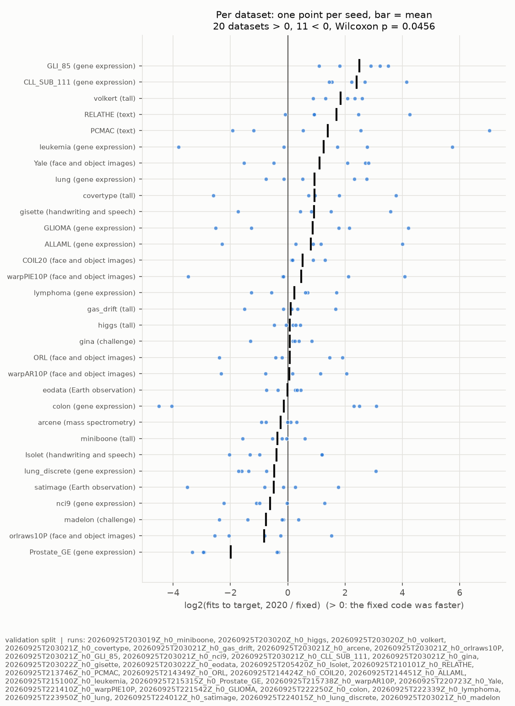
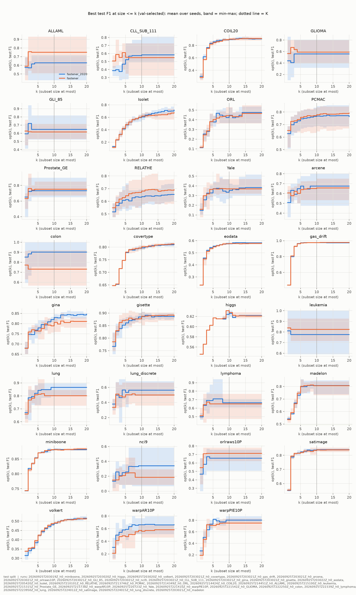

# H0-E02 -- report

## 1. Header

| field | content |
|---|---|
| Experiment ID | `H0-E02` |
| Hypothesis ID | H0 |
| Run IDs | `20260925T203019Z_h0_miniboone` (ok)<br>`20260925T203020Z_h0_higgs` (ok)<br>`20260925T203020Z_h0_volkert` (ok)<br>`20260925T203021Z_h0_covertype` (ok)<br>`20260925T203021Z_h0_gas_drift` (ok)<br>`20260925T203021Z_h0_arcene` (ok)<br>`20260925T203021Z_h0_orlraws10P` (ok)<br>`20260925T203021Z_h0_GLI_85` (ok)<br>`20260925T203021Z_h0_nci9` (ok)<br>`20260925T203021Z_h0_CLL_SUB_111` (ok)<br>`20260925T203021Z_h0_gina` (ok)<br>`20260925T203022Z_h0_gisette` (ok)<br>`20260925T203022Z_h0_eodata` (ok)<br>`20260925T205420Z_h0_Isolet` (ok)<br>`20260925T210101Z_h0_RELATHE` (ok)<br>`20260925T213746Z_h0_PCMAC` (ok)<br>`20260925T214349Z_h0_ORL` (ok)<br>`20260925T214424Z_h0_COIL20` (ok)<br>`20260925T214451Z_h0_ALLAML` (ok)<br>`20260925T215100Z_h0_leukemia` (ok)<br>`20260925T215315Z_h0_Prostate_GE` (ok)<br>`20260925T215738Z_h0_warpAR10P` (ok)<br>`20260925T220723Z_h0_Yale` (ok)<br>`20260925T221410Z_h0_warpPIE10P` (ok)<br>`20260925T221542Z_h0_GLIOMA` (ok)<br>`20260925T222250Z_h0_colon` (ok)<br>`20260925T222339Z_h0_lymphoma` (ok)<br>`20260925T223950Z_h0_lung` (ok)<br>`20260925T224012Z_h0_satimage` (ok)<br>`20260925T224015Z_h0_lung_discrete` (ok)<br>`20260925T203021Z_h0_madelon` (ok) |
| Algorithm IDs | `fastener@b1a51d3+144621c#2ef0`<br>`fastener@b1a51d3+144621c#4371`<br>`fastener_2020@b1a51d3+144621c#4bec`<br>`fastener_2020@b1a51d3+144621c#757f` |
| Pre-registration | `experiments/HYPOTHESES.md` at `b1a51d3` |
| Code commits | `b1a51d3` |
| Dates | runs 2026-09-25T20:30:19.735312+00:00 to 2026-09-26T04:11:05.987844+00:00; report 2026-09-26 |
| Verdict | H0-E02: **supported, narrowly** (the generator's mechanical reading agrees). Wilcoxon p = 0.0456 against alpha = 0.05; see Finding 1 for how fragile that is. H0-E01, on its own criterion, was not supported. |

## 2. Hypothesis

> ## H0 -- The bug-fixed FASTENER converges faster than the 2020 code
>
> **Claim.** The fixed FASTENER reaches a given low-k score in fewer fits than the
> 2020 code that produced the published results.

## 3. Evaluation criteria

### H0

This experiment is *H0 on every other dataset*; it takes H0's arms and measure unchanged:

> **Arms.**
>
> * `fastener` -- the fixed code, with the clone's defaults. This is **stock
>   FASTENER in H2-H6**.
> * `fastener_2020` -- the same code with `include_top_genes=True` and
>   `allow_self_mating=True`. The clone's README states that with both flags set a
>   run is identical to the original: the same fits and the same Pareto front for
>   the same seed. This arm is the published algorithm, not a variant of it.
>
> Both arms start from the same initial population for a given seed. Their random
> streams part at the first mating step.

> **Primary metric: fits to a common target.** A fixed-target measure, read on
> fits as *Progress tracking* requires, and on validation only:
>
> 1. From every progress snapshot, compute AUF (K = 10) on validation F1 from the
>    front the snapshot stores. Over a run this gives a step curve of score
>    against cumulative unique fits.
> 2. Per dataset and seed, the **target** is the lower of the two arms' final
>    values at that dataset's budget. Both arms reach it by construction.
> 3. Each arm's result is the cumulative unique fits at the first snapshot whose
>    value is at or above the target. Fewer fits is faster.
>
> A common target keeps the comparison about speed. An arm's own final value
> would not work: a search that stalls early would look like it converged fast.

> ### H0 on every other dataset (second experiment, H0-E02)

> **Which datasets: all 31 others.** Every dataset `datasets.load` knows except
> H0-E01's five. Taking all of them, rather than choosing, is what keeps a choice
> made after seeing results from steering the outcome.
>
> | group | datasets | budget per run | split |
> |---|---|---:|---|
> | Earth observation | eodata | 1,000 fits | EO split, as crop mapping in H0 |
> | Earth observation, small | satimage (6,430 rows) | 1,000 fits | protocol 60/20/20; too few rows for the EO split |
> | other tall sets | covertype, miniboone, higgs, volkert, gas_drift | 6,000 fits | 50,000-row cap, 60/20/20 |
> | challenge sets | madelon, gina | 6,000 fits | protocol 60/20/20 |
> | paper benchmarks | the other 22 of the 25 | 6,000 fits | protocol 60/20/20 |
>
> The budget rule is H0's: Earth-observation sets get the paper's EO budget of
> 1,000 fits, every other set gets 6,000. Arms, seeds, the fixed-target measure
> and the target itself are exactly as in H0.

> **Primary analysis: datasets as the unit.** With 31 datasets the per-dataset
> 4-of-5 rule is no longer the useful test; the question is whether the datasets
> lean one way. Per dataset and seed, the effect is log2 of the ratio of the fits
> each arm needed to reach the common target, 2020 over fixed. It is positive when
> the fixed code was faster, zero on a tie. Per dataset, the effect is the mean
> of its 5 seeds.

> **Falsification criterion.** Supported if the per-dataset effects are
> positive on more datasets than negative **and** a two-sided Wilcoxon
> signed-rank test over the per-dataset effects is significant at alpha = 0.05.
> Reversed -- the fixes slowed convergence -- if the same holds with the signs
> swapped. Otherwise not supported: no consistent difference is detected over
> these datasets. Datasets with a zero effect drop out of the test, as the
> Wilcoxon test requires, and their count is reported.

> **Incomplete datasets.** A dataset whose runs fail, or have fewer than 5 seeds
> for both arms when the experiment is stopped, is left out of the test and
> listed. If more than 6 of the 31 are left out, the result is reported as
> incomplete rather than as a verdict.
>
> **Reported beside it, as secondary:** H0's per-dataset 4-of-5 counts for every
> dataset; the effect per dataset group from the table above; the same test over
> all 36 datasets, H0-E01's five included, labelled as including datasets seen
> before this experiment was registered; and final test AUF (K = 10) per arm.

> **How it runs.** Several datasets at once, so the whole experiment fits in a
> weekend. Runs then compete for the CPU, so wall clock is not comparable
> between arms or datasets. Fits, which decide the result, are not affected.
> Every tiny paper benchmark carries the caveat of *What the small sets can
> support*: on the smallest, validation is 10-20 rows, and ties are common.

> ## Revisions
>
> **2026-09-25 -- H0 on every other dataset (H0-E02) added.** Added after
> H0-E01 had finished and been reported as not supported, with its datasets split
> (fixed code faster on TOX_171 and USPS, 2020 code on BASEHOCK, neither on crop
> mapping and har). H0's own criterion, datasets and verdict are unchanged. The
> new experiment takes every remaining dataset rather than a chosen subset, and
> its criterion is written here before any of its runs started.

Secondary, shown for interpretation only: AUF at the other K, hypervolume, the smallest subset size on the front, fits and wall clock.

## 4. Summary

H0-E02 asked H0's question on every dataset on disk that H0-E01 did not use:
31 datasets, 5 seeds each, the bug-fixed FASTENER (`fastener`) against the 2020
code (`fastener_2020`) at equal fit budgets. Per dataset, the effect is the mean
over seeds of log2 of the ratio of fits each arm needed to reach the common
validation AUF (K = 10) target, 2020 over fixed; it is positive when the fixed
code was faster. **Under the registered criterion, H0 is supported, narrowly.**
The effect is positive on 20 datasets and negative on 11, with no ties, and a
two-sided Wilcoxon signed-rank test over the 31 effects gives p = 0.0456,
against alpha = 0.05. The typical effect is small: the median dataset effect is
0.096, meaning the 2020 code needed about 7% more fits than the fixed code to
reach the same score. The spread is large: per-dataset effects run from -1.98
(Prostate_GE, the 2020 code about four times faster) to +2.50 (GLI_85, the
fixed code about six times faster), and seed-level effects within one dataset
often have both signs. The result is fragile. Leaving out any one of 14 of
the 31 datasets moves p above 0.05, and a sign test on the same 20-to-11 split
is not significant (p = 0.15); both checks are exploratory. The fixes do not
change the end result: final test AUF (K = 10) is higher for the fixed code on
16 datasets and lower on 15, with a median difference of 0.0001.

## 5. Description of the experiment

### Setup

**`20260925T203019Z_h0_miniboone`** -- dataset `miniboone`: 50 features, 30000/10000/10000 train/val/test rows.

```
run_sota.py --dataset miniboone --split protocol --methods  --name h0_miniboone --fastener-arm none --fastener-arm 2020 --evaluations 6000 --experiment H0-E02
```

**`20260925T203020Z_h0_higgs`** -- dataset `higgs`: 28 features, 30000/10000/10000 train/val/test rows.

```
run_sota.py --dataset higgs --split protocol --methods  --name h0_higgs --fastener-arm none --fastener-arm 2020 --evaluations 6000 --experiment H0-E02
```

**`20260925T203020Z_h0_volkert`** -- dataset `volkert`: 180 features, 30002/9998/9998 train/val/test rows.

```
run_sota.py --dataset volkert --split protocol --methods  --name h0_volkert --fastener-arm none --fastener-arm 2020 --evaluations 6000 --experiment H0-E02
```

**`20260925T203021Z_h0_covertype`** -- dataset `covertype`: 54 features, 30002/9999/9999 train/val/test rows.

```
run_sota.py --dataset covertype --split protocol --methods  --name h0_covertype --fastener-arm none --fastener-arm 2020 --evaluations 6000 --experiment H0-E02
```

**`20260925T203021Z_h0_gas_drift`** -- dataset `gas_drift`: 128 features, 8346/2782/2782 train/val/test rows.

```
run_sota.py --dataset gas_drift --split protocol --methods  --name h0_gas_drift --fastener-arm none --fastener-arm 2020 --evaluations 6000 --experiment H0-E02
```

**`20260925T203021Z_h0_arcene`** -- dataset `arcene`: 10000 features, 120/40/40 train/val/test rows.

```
run_sota.py --dataset arcene --split protocol --methods  --name h0_arcene --fastener-arm none --fastener-arm 2020 --evaluations 6000 --experiment H0-E02
```

**`20260925T203021Z_h0_orlraws10P`** -- dataset `orlraws10P`: 10304 features, 60/20/20 train/val/test rows.

```
run_sota.py --dataset orlraws10P --split protocol --methods  --name h0_orlraws10P --fastener-arm none --fastener-arm 2020 --evaluations 6000 --experiment H0-E02
```

**`20260925T203021Z_h0_GLI_85`** -- dataset `GLI_85`: 22283 features, 51/17/17 train/val/test rows.

```
run_sota.py --dataset GLI_85 --split protocol --methods  --name h0_GLI_85 --fastener-arm none --fastener-arm 2020 --evaluations 6000 --experiment H0-E02
```

**`20260925T203021Z_h0_nci9`** -- dataset `nci9`: 9712 features, 34/12/12 train/val/test rows.

```
run_sota.py --dataset nci9 --split protocol --methods  --name h0_nci9 --fastener-arm none --fastener-arm 2020 --evaluations 6000 --experiment H0-E02
```

**`20260925T203021Z_h0_CLL_SUB_111`** -- dataset `CLL_SUB_111`: 11340 features, 67/22/22 train/val/test rows.

```
run_sota.py --dataset CLL_SUB_111 --split protocol --methods  --name h0_CLL_SUB_111 --fastener-arm none --fastener-arm 2020 --evaluations 6000 --experiment H0-E02
```

**`20260925T203021Z_h0_gina`** -- dataset `gina`: 970 features, 2080/694/694 train/val/test rows.

```
run_sota.py --dataset gina --split protocol --methods  --name h0_gina --fastener-arm none --fastener-arm 2020 --evaluations 6000 --experiment H0-E02
```

**`20260925T203022Z_h0_gisette`** -- dataset `gisette`: 5000 features, 4200/1400/1400 train/val/test rows.

```
run_sota.py --dataset gisette --split protocol --methods  --name h0_gisette --fastener-arm none --fastener-arm 2020 --evaluations 6000 --experiment H0-E02
```

**`20260925T203022Z_h0_eodata`** -- dataset `eodata`: 182 features, 39984/10008/49992 train/val/test rows.

```
run_sota.py --dataset eodata --split eo --methods  --name h0_eodata --fastener-arm none --fastener-arm 2020 --evaluations 1000 --experiment H0-E02
```

**`20260925T205420Z_h0_Isolet`** -- dataset `Isolet`: 617 features, 936/312/312 train/val/test rows.

```
run_sota.py --dataset Isolet --split protocol --methods  --name h0_Isolet --fastener-arm none --fastener-arm 2020 --evaluations 6000 --experiment H0-E02
```

**`20260925T210101Z_h0_RELATHE`** -- dataset `RELATHE`: 4322 features, 855/286/286 train/val/test rows.

```
run_sota.py --dataset RELATHE --split protocol --methods  --name h0_RELATHE --fastener-arm none --fastener-arm 2020 --evaluations 6000 --experiment H0-E02
```

**`20260925T213746Z_h0_PCMAC`** -- dataset `PCMAC`: 3289 features, 1167/388/388 train/val/test rows.

```
run_sota.py --dataset PCMAC --split protocol --methods  --name h0_PCMAC --fastener-arm none --fastener-arm 2020 --evaluations 6000 --experiment H0-E02
```

**`20260925T214349Z_h0_ORL`** -- dataset `ORL`: 1024 features, 240/80/80 train/val/test rows.

```
run_sota.py --dataset ORL --split protocol --methods  --name h0_ORL --fastener-arm none --fastener-arm 2020 --evaluations 6000 --experiment H0-E02
```

**`20260925T214424Z_h0_COIL20`** -- dataset `COIL20`: 1024 features, 880/280/280 train/val/test rows.

```
run_sota.py --dataset COIL20 --split protocol --methods  --name h0_COIL20 --fastener-arm none --fastener-arm 2020 --evaluations 6000 --experiment H0-E02
```

**`20260925T214451Z_h0_ALLAML`** -- dataset `ALLAML`: 7129 features, 44/14/14 train/val/test rows.

```
run_sota.py --dataset ALLAML --split protocol --methods  --name h0_ALLAML --fastener-arm none --fastener-arm 2020 --evaluations 6000 --experiment H0-E02
```

**`20260925T215100Z_h0_leukemia`** -- dataset `leukemia`: 7070 features, 44/14/14 train/val/test rows.

```
run_sota.py --dataset leukemia --split protocol --methods  --name h0_leukemia --fastener-arm none --fastener-arm 2020 --evaluations 6000 --experiment H0-E02
```

**`20260925T215315Z_h0_Prostate_GE`** -- dataset `Prostate_GE`: 5966 features, 62/20/20 train/val/test rows.

```
run_sota.py --dataset Prostate_GE --split protocol --methods  --name h0_Prostate_GE --fastener-arm none --fastener-arm 2020 --evaluations 6000 --experiment H0-E02
```

**`20260925T215738Z_h0_warpAR10P`** -- dataset `warpAR10P`: 2400 features, 70/30/30 train/val/test rows.

```
run_sota.py --dataset warpAR10P --split protocol --methods  --name h0_warpAR10P --fastener-arm none --fastener-arm 2020 --evaluations 6000 --experiment H0-E02
```

**`20260925T220723Z_h0_Yale`** -- dataset `Yale`: 1024 features, 105/30/30 train/val/test rows.

```
run_sota.py --dataset Yale --split protocol --methods  --name h0_Yale --fastener-arm none --fastener-arm 2020 --evaluations 6000 --experiment H0-E02
```

**`20260925T221410Z_h0_warpPIE10P`** -- dataset `warpPIE10P`: 2420 features, 130/40/40 train/val/test rows.

```
run_sota.py --dataset warpPIE10P --split protocol --methods  --name h0_warpPIE10P --fastener-arm none --fastener-arm 2020 --evaluations 6000 --experiment H0-E02
```

**`20260925T221542Z_h0_GLIOMA`** -- dataset `GLIOMA`: 4434 features, 30/10/10 train/val/test rows.

```
run_sota.py --dataset GLIOMA --split protocol --methods  --name h0_GLIOMA --fastener-arm none --fastener-arm 2020 --evaluations 6000 --experiment H0-E02
```

**`20260925T222250Z_h0_colon`** -- dataset `colon`: 2000 features, 38/12/12 train/val/test rows.

```
run_sota.py --dataset colon --split protocol --methods  --name h0_colon --fastener-arm none --fastener-arm 2020 --evaluations 6000 --experiment H0-E02
```

**`20260925T222339Z_h0_lymphoma`** -- dataset `lymphoma`: 4026 features, 54/17/17 train/val/test rows.

```
run_sota.py --dataset lymphoma --split protocol --methods  --name h0_lymphoma --fastener-arm none --fastener-arm 2020 --evaluations 6000 --experiment H0-E02
```

**`20260925T223950Z_h0_lung`** -- dataset `lung`: 3312 features, 123/40/40 train/val/test rows.

```
run_sota.py --dataset lung --split protocol --methods  --name h0_lung --fastener-arm none --fastener-arm 2020 --evaluations 6000 --experiment H0-E02
```

**`20260925T224012Z_h0_satimage`** -- dataset `satimage`: 36 features, 3858/1286/1286 train/val/test rows.

```
run_sota.py --dataset satimage --split protocol --methods  --name h0_satimage --fastener-arm none --fastener-arm 2020 --evaluations 1000 --experiment H0-E02
```

**`20260925T224015Z_h0_lung_discrete`** -- dataset `lung_discrete`: 325 features, 45/14/14 train/val/test rows.

```
run_sota.py --dataset lung_discrete --split protocol --methods  --name h0_lung_discrete --fastener-arm none --fastener-arm 2020 --evaluations 6000 --experiment H0-E02
```

**`20260925T203021Z_h0_madelon`** -- dataset `madelon`: 500 features, 1560/520/520 train/val/test rows.

```
run_sota.py --dataset madelon --split protocol --methods  --name h0_madelon --fastener-arm none --fastener-arm 2020 --evaluations 6000 --experiment H0-E02
```

Parameters per run:

| parameter | 20260925T203019Z_h0_miniboone | 20260925T203020Z_h0_higgs | 20260925T203020Z_h0_volkert | 20260925T203021Z_h0_covertype | 20260925T203021Z_h0_gas_drift | 20260925T203021Z_h0_arcene | 20260925T203021Z_h0_orlraws10P | 20260925T203021Z_h0_GLI_85 | 20260925T203021Z_h0_nci9 | 20260925T203021Z_h0_CLL_SUB_111 | 20260925T203021Z_h0_gina | 20260925T203022Z_h0_gisette | 20260925T203022Z_h0_eodata | 20260925T205420Z_h0_Isolet | 20260925T210101Z_h0_RELATHE | 20260925T213746Z_h0_PCMAC | 20260925T214349Z_h0_ORL | 20260925T214424Z_h0_COIL20 | 20260925T214451Z_h0_ALLAML | 20260925T215100Z_h0_leukemia | 20260925T215315Z_h0_Prostate_GE | 20260925T215738Z_h0_warpAR10P | 20260925T220723Z_h0_Yale | 20260925T221410Z_h0_warpPIE10P | 20260925T221542Z_h0_GLIOMA | 20260925T222250Z_h0_colon | 20260925T222339Z_h0_lymphoma | 20260925T223950Z_h0_lung | 20260925T224012Z_h0_satimage | 20260925T224015Z_h0_lung_discrete | 20260925T203021Z_h0_madelon |
|---|---|---|---|---|---|---|---|---|---|---|---|---|---|---|---|---|---|---|---|---|---|---|---|---|---|---|---|---|---|---|---|
| boruta_estimator | "protocol decision tree" | "protocol decision tree" | "protocol decision tree" | "protocol decision tree" | "protocol decision tree" | "protocol decision tree" | "protocol decision tree" | "protocol decision tree" | "protocol decision tree" | "protocol decision tree" | "protocol decision tree" | "protocol decision tree" | "protocol decision tree" | "protocol decision tree" | "protocol decision tree" | "protocol decision tree" | "protocol decision tree" | "protocol decision tree" | "protocol decision tree" | "protocol decision tree" | "protocol decision tree" | "protocol decision tree" | "protocol decision tree" | "protocol decision tree" | "protocol decision tree" | "protocol decision tree" | "protocol decision tree" | "protocol decision tree" | "protocol decision tree" | "protocol decision tree" | "protocol decision tree" |
| boruta_max_iter | 100 | 100 | 100 | 100 | 100 | 100 | 100 | 100 | 100 | 100 | 100 | 100 | 100 | 100 | 100 | 100 | 100 | 100 | 100 | 100 | 100 | 100 | 100 | 100 | 100 | 100 | 100 | 100 | 100 | 100 | 100 |
| dataset | "miniboone" | "higgs" | "volkert" | "covertype" | "gas_drift" | "arcene" | "orlraws10P" | "GLI_85" | "nci9" | "CLL_SUB_111" | "gina" | "gisette" | "eodata" | "Isolet" | "RELATHE" | "PCMAC" | "ORL" | "COIL20" | "ALLAML" | "leukemia" | "Prostate_GE" | "warpAR10P" | "Yale" | "warpPIE10P" | "GLIOMA" | "colon" | "lymphoma" | "lung" | "satimage" | "lung_discrete" | "madelon" |
| evaluation_budget_per_seed | 6000 | 6000 | 6000 | 6000 | 6000 | 6000 | 6000 | 6000 | 6000 | 6000 | 6000 | 6000 | 1000 | 6000 | 6000 | 6000 | 6000 | 6000 | 6000 | 6000 | 6000 | 6000 | 6000 | 6000 | 6000 | 6000 | 6000 | 6000 | 1000 | 6000 | 6000 |
| fastener_arms | ["none", "2020"] | ["none", "2020"] | ["none", "2020"] | ["none", "2020"] | ["none", "2020"] | ["none", "2020"] | ["none", "2020"] | ["none", "2020"] | ["none", "2020"] | ["none", "2020"] | ["none", "2020"] | ["none", "2020"] | ["none", "2020"] | ["none", "2020"] | ["none", "2020"] | ["none", "2020"] | ["none", "2020"] | ["none", "2020"] | ["none", "2020"] | ["none", "2020"] | ["none", "2020"] | ["none", "2020"] | ["none", "2020"] | ["none", "2020"] | ["none", "2020"] | ["none", "2020"] | ["none", "2020"] | ["none", "2020"] | ["none", "2020"] | ["none", "2020"] | ["none", "2020"] |
| fastener_max_fits | 6000 | 6000 | 6000 | 6000 | 6000 | 6000 | 6000 | 6000 | 6000 | 6000 | 6000 | 6000 | 1000 | 6000 | 6000 | 6000 | 6000 | 6000 | 6000 | 6000 | 6000 | 6000 | 6000 | 6000 | 6000 | 6000 | 6000 | 6000 | 1000 | 6000 | 6000 |
| fastener_rounds | 100000 | 100000 | 100000 | 100000 | 100000 | 100000 | 100000 | 100000 | 100000 | 100000 | 100000 | 100000 | 100000 | 100000 | 100000 | 100000 | 100000 | 100000 | 100000 | 100000 | 100000 | 100000 | 100000 | 100000 | 100000 | 100000 | 100000 | 100000 | 100000 | 100000 | 100000 |
| fs_sds_evaluations_per_k | 300 | 300 | 300 | 300 | 300 | 300 | 300 | 300 | 300 | 300 | 300 | 300 | 50 | 300 | 300 | 300 | 300 | 300 | 300 | 300 | 300 | 300 | 300 | 300 | 300 | 300 | 300 | 300 | 50 | 300 | 300 |
| fs_sds_evaluations_total | 6000 | 6000 | 6000 | 6000 | 6000 | 6000 | 6000 | 6000 | 6000 | 6000 | 6000 | 6000 | 1000 | 6000 | 6000 | 6000 | 6000 | 6000 | 6000 | 6000 | 6000 | 6000 | 6000 | 6000 | 6000 | 6000 | 6000 | 6000 | 1000 | 6000 | 6000 |
| fs_sds_iterations | null | null | null | null | null | null | null | null | null | null | null | null | null | null | null | null | null | null | null | null | null | null | null | null | null | null | null | null | null | null | null |
| fs_sds_k_range | [1, 2, 3, 4, 5, 6, 7, 8, 9, 10, 11, 12, 13, 14, 15, 16, 17, 18, 19, 20] | [1, 2, 3, 4, 5, 6, 7, 8, 9, 10, 11, 12, 13, 14, 15, 16, 17, 18, 19, 20] | [1, 2, 3, 4, 5, 6, 7, 8, 9, 10, 11, 12, 13, 14, 15, 16, 17, 18, 19, 20] | [1, 2, 3, 4, 5, 6, 7, 8, 9, 10, 11, 12, 13, 14, 15, 16, 17, 18, 19, 20] | [1, 2, 3, 4, 5, 6, 7, 8, 9, 10, 11, 12, 13, 14, 15, 16, 17, 18, 19, 20] | [1, 2, 3, 4, 5, 6, 7, 8, 9, 10, 11, 12, 13, 14, 15, 16, 17, 18, 19, 20] | [1, 2, 3, 4, 5, 6, 7, 8, 9, 10, 11, 12, 13, 14, 15, 16, 17, 18, 19, 20] | [1, 2, 3, 4, 5, 6, 7, 8, 9, 10, 11, 12, 13, 14, 15, 16, 17, 18, 19, 20] | [1, 2, 3, 4, 5, 6, 7, 8, 9, 10, 11, 12, 13, 14, 15, 16, 17, 18, 19, 20] | [1, 2, 3, 4, 5, 6, 7, 8, 9, 10, 11, 12, 13, 14, 15, 16, 17, 18, 19, 20] | [1, 2, 3, 4, 5, 6, 7, 8, 9, 10, 11, 12, 13, 14, 15, 16, 17, 18, 19, 20] | [1, 2, 3, 4, 5, 6, 7, 8, 9, 10, 11, 12, 13, 14, 15, 16, 17, 18, 19, 20] | [1, 2, 3, 4, 5, 6, 7, 8, 9, 10, 11, 12, 13, 14, 15, 16, 17, 18, 19, 20] | [1, 2, 3, 4, 5, 6, 7, 8, 9, 10, 11, 12, 13, 14, 15, 16, 17, 18, 19, 20] | [1, 2, 3, 4, 5, 6, 7, 8, 9, 10, 11, 12, 13, 14, 15, 16, 17, 18, 19, 20] | [1, 2, 3, 4, 5, 6, 7, 8, 9, 10, 11, 12, 13, 14, 15, 16, 17, 18, 19, 20] | [1, 2, 3, 4, 5, 6, 7, 8, 9, 10, 11, 12, 13, 14, 15, 16, 17, 18, 19, 20] | [1, 2, 3, 4, 5, 6, 7, 8, 9, 10, 11, 12, 13, 14, 15, 16, 17, 18, 19, 20] | [1, 2, 3, 4, 5, 6, 7, 8, 9, 10, 11, 12, 13, 14, 15, 16, 17, 18, 19, 20] | [1, 2, 3, 4, 5, 6, 7, 8, 9, 10, 11, 12, 13, 14, 15, 16, 17, 18, 19, 20] | [1, 2, 3, 4, 5, 6, 7, 8, 9, 10, 11, 12, 13, 14, 15, 16, 17, 18, 19, 20] | [1, 2, 3, 4, 5, 6, 7, 8, 9, 10, 11, 12, 13, 14, 15, 16, 17, 18, 19, 20] | [1, 2, 3, 4, 5, 6, 7, 8, 9, 10, 11, 12, 13, 14, 15, 16, 17, 18, 19, 20] | [1, 2, 3, 4, 5, 6, 7, 8, 9, 10, 11, 12, 13, 14, 15, 16, 17, 18, 19, 20] | [1, 2, 3, 4, 5, 6, 7, 8, 9, 10, 11, 12, 13, 14, 15, 16, 17, 18, 19, 20] | [1, 2, 3, 4, 5, 6, 7, 8, 9, 10, 11, 12, 13, 14, 15, 16, 17, 18, 19, 20] | [1, 2, 3, 4, 5, 6, 7, 8, 9, 10, 11, 12, 13, 14, 15, 16, 17, 18, 19, 20] | [1, 2, 3, 4, 5, 6, 7, 8, 9, 10, 11, 12, 13, 14, 15, 16, 17, 18, 19, 20] | [1, 2, 3, 4, 5, 6, 7, 8, 9, 10, 11, 12, 13, 14, 15, 16, 17, 18, 19, 20] | [1, 2, 3, 4, 5, 6, 7, 8, 9, 10, 11, 12, 13, 14, 15, 16, 17, 18, 19, 20] | [1, 2, 3, 4, 5, 6, 7, 8, 9, 10, 11, 12, 13, 14, 15, 16, 17, 18, 19, 20] |
| fs_sds_population | null | null | null | null | null | null | null | null | null | null | null | null | null | null | null | null | null | null | null | null | null | null | null | null | null | null | null | null | null | null | null |
| k_grid | [1, 2, 3, 4, 5, 6, 7, 8, 9, 10, 11, 12, 13, 14, 15, 16, 17, 18, 19, 20, 25, 30, 50] | [1, 2, 3, 4, 5, 6, 7, 8, 9, 10, 11, 12, 13, 14, 15, 16, 17, 18, 19, 20, 25] | [1, 2, 3, 4, 5, 6, 7, 8, 9, 10, 11, 12, 13, 14, 15, 16, 17, 18, 19, 20, 25, 30, 50, 100] | [1, 2, 3, 4, 5, 6, 7, 8, 9, 10, 11, 12, 13, 14, 15, 16, 17, 18, 19, 20, 25, 30, 50] | [1, 2, 3, 4, 5, 6, 7, 8, 9, 10, 11, 12, 13, 14, 15, 16, 17, 18, 19, 20, 25, 30, 50, 100] | [1, 2, 3, 4, 5, 6, 7, 8, 9, 10, 11, 12, 13, 14, 15, 16, 17, 18, 19, 20, 25, 30, 50, 100, 200, 500] | [1, 2, 3, 4, 5, 6, 7, 8, 9, 10, 11, 12, 13, 14, 15, 16, 17, 18, 19, 20, 25, 30, 50, 100, 200, 500] | [1, 2, 3, 4, 5, 6, 7, 8, 9, 10, 11, 12, 13, 14, 15, 16, 17, 18, 19, 20, 25, 30, 50, 100, 200, 500] | [1, 2, 3, 4, 5, 6, 7, 8, 9, 10, 11, 12, 13, 14, 15, 16, 17, 18, 19, 20, 25, 30, 50, 100, 200, 500] | [1, 2, 3, 4, 5, 6, 7, 8, 9, 10, 11, 12, 13, 14, 15, 16, 17, 18, 19, 20, 25, 30, 50, 100, 200, 500] | [1, 2, 3, 4, 5, 6, 7, 8, 9, 10, 11, 12, 13, 14, 15, 16, 17, 18, 19, 20, 25, 30, 50, 100, 200, 500] | [1, 2, 3, 4, 5, 6, 7, 8, 9, 10, 11, 12, 13, 14, 15, 16, 17, 18, 19, 20, 25, 30, 50, 100, 200, 500] | [1, 2, 3, 4, 5, 6, 7, 8, 9, 10, 11, 12, 13, 14, 15, 16, 17, 18, 19, 20, 25, 30, 50, 100] | [1, 2, 3, 4, 5, 6, 7, 8, 9, 10, 11, 12, 13, 14, 15, 16, 17, 18, 19, 20, 25, 30, 50, 100, 200, 500] | [1, 2, 3, 4, 5, 6, 7, 8, 9, 10, 11, 12, 13, 14, 15, 16, 17, 18, 19, 20, 25, 30, 50, 100, 200, 500] | [1, 2, 3, 4, 5, 6, 7, 8, 9, 10, 11, 12, 13, 14, 15, 16, 17, 18, 19, 20, 25, 30, 50, 100, 200, 500] | [1, 2, 3, 4, 5, 6, 7, 8, 9, 10, 11, 12, 13, 14, 15, 16, 17, 18, 19, 20, 25, 30, 50, 100, 200, 500] | [1, 2, 3, 4, 5, 6, 7, 8, 9, 10, 11, 12, 13, 14, 15, 16, 17, 18, 19, 20, 25, 30, 50, 100, 200, 500] | [1, 2, 3, 4, 5, 6, 7, 8, 9, 10, 11, 12, 13, 14, 15, 16, 17, 18, 19, 20, 25, 30, 50, 100, 200, 500] | [1, 2, 3, 4, 5, 6, 7, 8, 9, 10, 11, 12, 13, 14, 15, 16, 17, 18, 19, 20, 25, 30, 50, 100, 200, 500] | [1, 2, 3, 4, 5, 6, 7, 8, 9, 10, 11, 12, 13, 14, 15, 16, 17, 18, 19, 20, 25, 30, 50, 100, 200, 500] | [1, 2, 3, 4, 5, 6, 7, 8, 9, 10, 11, 12, 13, 14, 15, 16, 17, 18, 19, 20, 25, 30, 50, 100, 200, 500] | [1, 2, 3, 4, 5, 6, 7, 8, 9, 10, 11, 12, 13, 14, 15, 16, 17, 18, 19, 20, 25, 30, 50, 100, 200, 500] | [1, 2, 3, 4, 5, 6, 7, 8, 9, 10, 11, 12, 13, 14, 15, 16, 17, 18, 19, 20, 25, 30, 50, 100, 200, 500] | [1, 2, 3, 4, 5, 6, 7, 8, 9, 10, 11, 12, 13, 14, 15, 16, 17, 18, 19, 20, 25, 30, 50, 100, 200, 500] | [1, 2, 3, 4, 5, 6, 7, 8, 9, 10, 11, 12, 13, 14, 15, 16, 17, 18, 19, 20, 25, 30, 50, 100, 200, 500] | [1, 2, 3, 4, 5, 6, 7, 8, 9, 10, 11, 12, 13, 14, 15, 16, 17, 18, 19, 20, 25, 30, 50, 100, 200, 500] | [1, 2, 3, 4, 5, 6, 7, 8, 9, 10, 11, 12, 13, 14, 15, 16, 17, 18, 19, 20, 25, 30, 50, 100, 200, 500] | [1, 2, 3, 4, 5, 6, 7, 8, 9, 10, 11, 12, 13, 14, 15, 16, 17, 18, 19, 20, 25, 30] | [1, 2, 3, 4, 5, 6, 7, 8, 9, 10, 11, 12, 13, 14, 15, 16, 17, 18, 19, 20, 25, 30, 50, 100, 200] | [1, 2, 3, 4, 5, 6, 7, 8, 9, 10, 11, 12, 13, 14, 15, 16, 17, 18, 19, 20, 25, 30, 50, 100, 200, 500] |
| max_rows | 50000 | 50000 | 50000 | 50000 | 50000 | null | null | null | null | null | null | null | 100000 | null | null | null | null | null | null | null | null | null | null | null | null | null | null | null | 50000 | null | null |
| methods | [] | [] | [] | [] | [] | [] | [] | [] | [] | [] | [] | [] | [] | [] | [] | [] | [] | [] | [] | [] | [] | [] | [] | [] | [] | [] | [] | [] | [] | [] | [] |
| model | "DecisionTreeClassifier" | "DecisionTreeClassifier" | "DecisionTreeClassifier" | "DecisionTreeClassifier" | "DecisionTreeClassifier" | "DecisionTreeClassifier" | "DecisionTreeClassifier" | "DecisionTreeClassifier" | "DecisionTreeClassifier" | "DecisionTreeClassifier" | "DecisionTreeClassifier" | "DecisionTreeClassifier" | "DecisionTreeClassifier" | "DecisionTreeClassifier" | "DecisionTreeClassifier" | "DecisionTreeClassifier" | "DecisionTreeClassifier" | "DecisionTreeClassifier" | "DecisionTreeClassifier" | "DecisionTreeClassifier" | "DecisionTreeClassifier" | "DecisionTreeClassifier" | "DecisionTreeClassifier" | "DecisionTreeClassifier" | "DecisionTreeClassifier" | "DecisionTreeClassifier" | "DecisionTreeClassifier" | "DecisionTreeClassifier" | "DecisionTreeClassifier" | "DecisionTreeClassifier" | "DecisionTreeClassifier" |
| model_seed | 20200 | 20200 | 20200 | 20200 | 20200 | 20200 | 20200 | 20200 | 20200 | 20200 | 20200 | 20200 | 20200 | 20200 | 20200 | 20200 | 20200 | 20200 | 20200 | 20200 | 20200 | 20200 | 20200 | 20200 | 20200 | 20200 | 20200 | 20200 | 20200 | 20200 | 20200 |
| n_rows_used | 50000 | 50000 | 49998 | 50000 | 13910 | 200 | 100 | 85 | 58 | 111 | 3468 | 7000 | 99984 | 1560 | 1427 | 1943 | 400 | 1440 | 72 | 72 | 102 | 130 | 165 | 210 | 50 | 62 | 88 | 203 | 6430 | 73 | 2600 |
| nsgaii_miip_init | "obl" | "obl" | "obl" | "obl" | "obl" | "obl" | "obl" | "obl" | "obl" | "obl" | "obl" | "obl" | "obl" | "obl" | "obl" | "obl" | "obl" | "obl" | "obl" | "obl" | "obl" | "obl" | "obl" | "obl" | "obl" | "obl" | "obl" | "obl" | "obl" | "obl" | "obl" |
| poss_k | 50 | 28 | 50 | 50 | 50 | 50 | 50 | 50 | 50 | 50 | 50 | 50 | 50 | 50 | 50 | 50 | 50 | 50 | 50 | 50 | 50 | 50 | 50 | 50 | 50 | 50 | 50 | 50 | 36 | 50 | 50 |
| primary_metric | "f1_weighted" | "f1_weighted" | "f1_weighted" | "f1_weighted" | "f1_weighted" | "f1_weighted" | "f1_weighted" | "f1_weighted" | "f1_weighted" | "f1_weighted" | "f1_weighted" | "f1_weighted" | "f1_weighted" | "f1_weighted" | "f1_weighted" | "f1_weighted" | "f1_weighted" | "f1_weighted" | "f1_weighted" | "f1_weighted" | "f1_weighted" | "f1_weighted" | "f1_weighted" | "f1_weighted" | "f1_weighted" | "f1_weighted" | "f1_weighted" | "f1_weighted" | "f1_weighted" | "f1_weighted" | "f1_weighted" |
| quick | false | false | false | false | false | false | false | false | false | false | false | false | false | false | false | false | false | false | false | false | false | false | false | false | false | false | false | false | false | false | false |
| seeds | [2020, 2021, 2022, 2023, 2024] | [2020, 2021, 2022, 2023, 2024] | [2020, 2021, 2022, 2023, 2024] | [2020, 2021, 2022, 2023, 2024] | [2020, 2021, 2022, 2023, 2024] | [2020, 2021, 2022, 2023, 2024] | [2020, 2021, 2022, 2023, 2024] | [2020, 2021, 2022, 2023, 2024] | [2020, 2021, 2022, 2023, 2024] | [2020, 2021, 2022, 2023, 2024] | [2020, 2021, 2022, 2023, 2024] | [2020, 2021, 2022, 2023, 2024] | [2020, 2021, 2022, 2023, 2024] | [2020, 2021, 2022, 2023, 2024] | [2020, 2021, 2022, 2023, 2024] | [2020, 2021, 2022, 2023, 2024] | [2020, 2021, 2022, 2023, 2024] | [2020, 2021, 2022, 2023, 2024] | [2020, 2021, 2022, 2023, 2024] | [2020, 2021, 2022, 2023, 2024] | [2020, 2021, 2022, 2023, 2024] | [2020, 2021, 2022, 2023, 2024] | [2020, 2021, 2022, 2023, 2024] | [2020, 2021, 2022, 2023, 2024] | [2020, 2021, 2022, 2023, 2024] | [2020, 2021, 2022, 2023, 2024] | [2020, 2021, 2022, 2023, 2024] | [2020, 2021, 2022, 2023, 2024] | [2020, 2021, 2022, 2023, 2024] | [2020, 2021, 2022, 2023, 2024] | [2020, 2021, 2022, 2023, 2024] |
| split | "protocol" | "protocol" | "protocol" | "protocol" | "protocol" | "protocol" | "protocol" | "protocol" | "protocol" | "protocol" | "protocol" | "protocol" | "eo" | "protocol" | "protocol" | "protocol" | "protocol" | "protocol" | "protocol" | "protocol" | "protocol" | "protocol" | "protocol" | "protocol" | "protocol" | "protocol" | "protocol" | "protocol" | "protocol" | "protocol" | "protocol" |
| with_fastener | true | true | true | true | true | true | true | true | true | true | true | true | true | true | true | true | true | true | true | true | true | true | true | true | true | true | true | true | true | true | true |

Arms:

| arm | algorithm ID | what distinguishes it |
|---|---|---|
| fastener | `fastener@b1a51d3+144621c#2ef0`<br>`fastener@b1a51d3+144621c#4371` | The fixed mating: the clone's defaults. Weighted information-gain mating starts from the plain intersection of the parents and adds only the sample weighted by mutual information, and the mating pool is drawn without replacement, so no item is mated with itself. No swap operator. `#2ef0` is the 6,000-fit budget, `#4371` the 1,000-fit budget (eodata and satimage). The same configurations as in H0-E01; only the experiments commit differs. |
| fastener_2020 | `fastener_2020@b1a51d3+144621c#4bec`<br>`fastener_2020@b1a51d3+144621c#757f` | The same code with `include_top_genes=True` and `allow_self_mating=True`, which the clone's README states reproduces the 2020 mating exactly: every child contains the top-k genes by mutual information, and the pool is drawn with replacement. `#4bec` is 6,000 fits, `#757f` 1,000 fits. |

**Deviations from the protocol:**

* **As registered for this experiment, not deviations from it:** 1,000 fits on
  the two Earth-observation sets, the EO split on eodata, and the protocol
  split on satimage, which has too few rows for the EO split. Every other
  dataset ran under the protocol as written: 6,000 fits, the 50,000-row cap
  where it applies (covertype, miniboone, higgs, volkert), and 60/20/20.
* **eodata's split is 40,000 / 9,999 / 50,001 rows,** not exactly 40,000 /
  10,000 / 50,000, because the stratified split rounds per class. The same
  rounding appeared on crop mapping in H0-E01.
* **The FASTENER clone moved from `564eb8a` (H0-E01) to `144621c`.** The only
  changes are to its README and a new CHANGELOG; no Python file differs, so
  both experiments ran the same algorithm code.
* None otherwise.

### What happened

| run | status | started (UTC) | ended (UTC) | elapsed (s) | results file |
|---|---|---|---|---|---|
| `20260925T203019Z_h0_miniboone` | ok | 2026-09-25T20:30:19.735312+00:00 | 2026-09-26T04:11:05.987844+00:00 | 27646.2530 | raw_results.json |
| `20260925T203020Z_h0_higgs` | ok | 2026-09-25T20:30:20.294263+00:00 | 2026-09-26T02:41:49.323865+00:00 | 22289.0300 | raw_results.json |
| `20260925T203020Z_h0_volkert` | ok | 2026-09-25T20:30:20.972919+00:00 | 2026-09-26T04:03:12.769425+00:00 | 27171.7970 | raw_results.json |
| `20260925T203021Z_h0_covertype` | ok | 2026-09-25T20:30:21.342437+00:00 | 2026-09-26T00:12:14.893399+00:00 | 13313.5510 | raw_results.json |
| `20260925T203021Z_h0_gas_drift` | ok | 2026-09-25T20:30:21.459397+00:00 | 2026-09-25T22:40:00.056624+00:00 | 7778.5970 | raw_results.json |
| `20260925T203021Z_h0_arcene` | ok | 2026-09-25T20:30:21.768948+00:00 | 2026-09-25T21:44:12.048362+00:00 | 4430.2790 | raw_results.json |
| `20260925T203021Z_h0_orlraws10P` | ok | 2026-09-25T20:30:21.770453+00:00 | 2026-09-25T21:50:49.369625+00:00 | 4827.5990 | raw_results.json |
| `20260925T203021Z_h0_GLI_85` | ok | 2026-09-25T20:30:21.768948+00:00 | 2026-09-25T22:57:59.921051+00:00 | 8858.1520 | raw_results.json |
| `20260925T203021Z_h0_nci9` | ok | 2026-09-25T20:30:21.856640+00:00 | 2026-09-25T21:44:42.449136+00:00 | 4460.5920 | raw_results.json |
| `20260925T203021Z_h0_CLL_SUB_111` | ok | 2026-09-25T20:30:21.864206+00:00 | 2026-09-25T21:53:03.249025+00:00 | 4961.3850 | raw_results.json |
| `20260925T203021Z_h0_gina` | ok | 2026-09-25T20:30:21.968191+00:00 | 2026-09-25T21:00:47.213022+00:00 | 1825.2450 | raw_results.json |
| `20260925T203022Z_h0_gisette` | ok | 2026-09-25T20:30:22.297837+00:00 | 2026-09-25T21:57:17.696580+00:00 | 5215.3990 | raw_results.json |
| `20260925T203022Z_h0_eodata` | ok | 2026-09-25T20:30:22.498570+00:00 | 2026-09-25T23:07:04.634933+00:00 | 9402.1360 | raw_results.json |
| `20260925T205420Z_h0_Isolet` | ok | 2026-09-25T20:54:20.647569+00:00 | 2026-09-25T21:37:18.699232+00:00 | 2578.0520 | raw_results.json |
| `20260925T210101Z_h0_RELATHE` | ok | 2026-09-25T21:01:01.148355+00:00 | 2026-09-25T21:43:35.551547+00:00 | 2554.4030 | raw_results.json |
| `20260925T213746Z_h0_PCMAC` | ok | 2026-09-25T21:37:46.370388+00:00 | 2026-09-25T22:13:58.135178+00:00 | 2171.7650 | raw_results.json |
| `20260925T214349Z_h0_ORL` | ok | 2026-09-25T21:43:49.032170+00:00 | 2026-09-25T22:07:11.127352+00:00 | 1402.0950 | raw_results.json |
| `20260925T214424Z_h0_COIL20` | ok | 2026-09-25T21:44:24.311284+00:00 | 2026-09-25T22:15:31.770638+00:00 | 1867.4590 | raw_results.json |
| `20260925T214451Z_h0_ALLAML` | ok | 2026-09-25T21:44:51.546775+00:00 | 2026-09-25T22:39:39.030840+00:00 | 3287.4840 | raw_results.json |
| `20260925T215100Z_h0_leukemia` | ok | 2026-09-25T21:51:00.263429+00:00 | 2026-09-25T22:45:40.105725+00:00 | 3279.8420 | raw_results.json |
| `20260925T215315Z_h0_Prostate_GE` | ok | 2026-09-25T21:53:15.835583+00:00 | 2026-09-25T22:40:05.527891+00:00 | 2809.6920 | raw_results.json |
| `20260925T215738Z_h0_warpAR10P` | ok | 2026-09-25T21:57:38.338655+00:00 | 2026-09-25T22:22:39.008352+00:00 | 1500.6700 | raw_results.json |
| `20260925T220723Z_h0_Yale` | ok | 2026-09-25T22:07:23.185732+00:00 | 2026-09-25T22:23:30.279576+00:00 | 967.0940 | raw_results.json |
| `20260925T221410Z_h0_warpPIE10P` | ok | 2026-09-25T22:14:10.509525+00:00 | 2026-09-25T22:41:41.938506+00:00 | 1651.4290 | raw_results.json |
| `20260925T221542Z_h0_GLIOMA` | ok | 2026-09-25T22:15:42.475218+00:00 | 2026-09-25T22:51:36.414154+00:00 | 2153.9390 | raw_results.json |
| `20260925T222250Z_h0_colon` | ok | 2026-09-25T22:22:50.174166+00:00 | 2026-09-25T22:44:01.728727+00:00 | 1271.5550 | raw_results.json |
| `20260925T222339Z_h0_lymphoma` | ok | 2026-09-25T22:23:39.807428+00:00 | 2026-09-25T22:54:48.914866+00:00 | 1869.1070 | raw_results.json |
| `20260925T223950Z_h0_lung` | ok | 2026-09-25T22:39:50.571471+00:00 | 2026-09-25T23:02:04.721226+00:00 | 1334.1500 | raw_results.json |
| `20260925T224012Z_h0_satimage` | ok | 2026-09-25T22:40:12.813333+00:00 | 2026-09-25T22:45:08.325241+00:00 | 295.5120 | raw_results.json |
| `20260925T224015Z_h0_lung_discrete` | ok | 2026-09-25T22:40:15.048588+00:00 | 2026-09-25T22:48:33.519966+00:00 | 498.4710 | raw_results.json |
| `20260925T203021Z_h0_madelon` | ok | 2026-09-25T20:30:21.771059+00:00 | 2026-09-25T20:54:04.849035+00:00 | 1423.0780 | raw_results.json |

Run keys (310; full list in [tables/run_keys.csv](tables/run_keys.csv)):

| dataset | arm | seed | AUF K=10 | AUF K=20 | hypervolume | min subset | fits | seconds | stopped on |
|---|---|---|---|---|---|---|---|---|---|
| miniboone | fastener | 2020 | 0.8517 | 0.8687 | 43.1221 | 1 | 6000 | 4143.4400 | "fit_budget" |
| miniboone | fastener | 2021 | 0.8482 | 0.8629 | 42.7659 | 1 | 6000 | 3501.3000 | "fit_budget" |
| miniboone | fastener | 2022 | 0.8527 | 0.8685 | 43.1437 | 1 | 6000 | 2697.7300 | "fit_budget" |
| miniboone | fastener | 2023 | 0.8524 | 0.8679 | 43.0028 | 1 | 6000 | 2512.6000 | "fit_budget" |
| miniboone | fastener | 2024 | 0.8489 | 0.8653 | 43.0032 | 1 | 6000 | 2282.8100 | "fit_budget" |
| miniboone | fastener_2020 | 2020 | 0.8509 | 0.8655 | 42.9054 | 1 | 6000 | 2514.4400 | "fit_budget" |
| miniboone | fastener_2020 | 2021 | 0.8493 | 0.8658 | 42.9522 | 1 | 6000 | 2532.5600 | "fit_budget" |
| miniboone | fastener_2020 | 2022 | 0.8525 | 0.8671 | 43.1345 | 1 | 6000 | 2386.2800 | "fit_budget" |
| miniboone | fastener_2020 | 2023 | 0.8526 | 0.8670 | 43.1400 | 1 | 6000 | 2631.2900 | "fit_budget" |
| miniboone | fastener_2020 | 2024 | 0.8504 | 0.8665 | 42.9306 | 1 | 6000 | 2392.7900 | "fit_budget" |
| higgs | fastener | 2020 | 0.6028 | 0.6111 | 16.7670 | 1 | 6000 | 3048.0200 | "fit_budget" |
| higgs | fastener | 2021 | 0.6028 | 0.6113 | 16.7670 | 1 | 6000 | 3073.0800 | "fit_budget" |
| higgs | fastener | 2022 | 0.6026 | 0.6098 | 16.7670 | 1 | 6000 | 2704.9100 | "fit_budget" |
| higgs | fastener | 2023 | 0.6035 | 0.6152 | 16.7707 | 1 | 6000 | 1854.2300 | "fit_budget" |
| higgs | fastener | 2024 | 0.6035 | 0.6123 | 16.7707 | 1 | 6000 | 1988.6100 | "fit_budget" |
| higgs | fastener_2020 | 2020 | 0.6019 | 0.6109 | 16.6713 | 1 | 6000 | 1931.1400 | "fit_budget" |
| higgs | fastener_2020 | 2021 | 0.6013 | 0.6119 | 16.6954 | 1 | 6000 | 1934.6500 | "fit_budget" |
| higgs | fastener_2020 | 2022 | 0.6013 | 0.6108 | 16.6362 | 1 | 6000 | 1967.3500 | "fit_budget" |
| higgs | fastener_2020 | 2023 | 0.6038 | 0.6126 | 16.7707 | 1 | 6000 | 1884.3400 | "fit_budget" |
| higgs | fastener_2020 | 2024 | 0.6017 | 0.6115 | 16.6362 | 1 | 6000 | 1862.4300 | "fit_budget" |
| volkert | fastener | 2020 | 0.4209 | 0.4647 | 91.6267 | 1 | 6000 | 3458.3900 | "fit_budget" |
| volkert | fastener | 2021 | 0.4241 | 0.4648 | 91.6700 | 1 | 6000 | 3816.9400 | "fit_budget" |
| volkert | fastener | 2022 | 0.4227 | 0.4660 | 91.5084 | 1 | 6000 | 2914.2900 | "fit_budget" |
| volkert | fastener | 2023 | 0.4232 | 0.4680 | 92.2277 | 1 | 6000 | 2110.0900 | "fit_budget" |
| volkert | fastener | 2024 | 0.4261 | 0.4653 | 90.4158 | 1 | 6000 | 2155.4400 | "fit_budget" |
| volkert | fastener_2020 | 2020 | 0.4160 | 0.4637 | 91.0176 | 1 | 6000 | 2151.3700 | "fit_budget" |
| volkert | fastener_2020 | 2021 | 0.4080 | 0.4550 | 91.0446 | 1 | 6000 | 2850.7600 | "fit_budget" |
| volkert | fastener_2020 | 2022 | 0.4172 | 0.4616 | 92.0906 | 1 | 6000 | 2579.6700 | "fit_budget" |
| volkert | fastener_2020 | 2023 | 0.4182 | 0.4638 | 92.6771 | 1 | 6000 | 2641.7300 | "fit_budget" |
| volkert | fastener_2020 | 2024 | 0.4199 | 0.4686 | 93.1212 | 1 | 6000 | 2420.8300 | "fit_budget" |
| covertype | fastener | 2020 | 0.7531 | 0.7834 | 42.7432 | 1 | 6000 | 1556.4800 | "fit_budget" |
| covertype | fastener | 2021 | 0.7466 | 0.7769 | 42.5600 | 1 | 6000 | 1536.7700 | "fit_budget" |
| covertype | fastener | 2022 | 0.7539 | 0.7817 | 42.6927 | 1 | 6000 | 1558.6800 | "fit_budget" |
| covertype | fastener | 2023 | 0.7541 | 0.7807 | 42.4607 | 1 | 6000 | 1605.4100 | "fit_budget" |
| covertype | fastener | 2024 | 0.7507 | 0.7767 | 42.1501 | 1 | 6000 | 1448.7100 | "fit_budget" |
| covertype | fastener_2020 | 2020 | 0.7488 | 0.7777 | 42.4210 | 1 | 6000 | 1373.7600 | "fit_budget" |
| covertype | fastener_2020 | 2021 | 0.7516 | 0.7800 | 42.3828 | 1 | 6000 | 981.3100 | "fit_budget" |
| covertype | fastener_2020 | 2022 | 0.7536 | 0.7796 | 42.3927 | 1 | 6000 | 1031.3800 | "fit_budget" |
| covertype | fastener_2020 | 2023 | 0.7492 | 0.7801 | 42.5762 | 1 | 6000 | 1013.3200 | "fit_budget" |
| covertype | fastener_2020 | 2024 | 0.7480 | 0.7755 | 42.1853 | 1 | 6000 | 1161.3400 | "fit_budget" |
| gas_drift | fastener | 2020 | 0.8992 | 0.9379 | 123.2595 | 1 | 6000 | 616.8000 | "fit_budget" |
| gas_drift | fastener | 2021 | 0.8988 | 0.9374 | 123.4784 | 1 | 6000 | 802.7200 | "fit_budget" |
| gas_drift | fastener | 2022 | 0.8991 | 0.9388 | 123.4694 | 1 | 6000 | 722.8300 | "fit_budget" |
| gas_drift | fastener | 2023 | 0.8961 | 0.9371 | 123.3999 | 1 | 6000 | 815.4900 | "fit_budget" |
| gas_drift | fastener | 2024 | 0.8990 | 0.9378 | 123.7287 | 1 | 6000 | 683.2200 | "fit_budget" |
| gas_drift | fastener_2020 | 2020 | 0.9008 | 0.9386 | 123.5324 | 1 | 6000 | 920.4300 | "fit_budget" |
| gas_drift | fastener_2020 | 2021 | 0.8973 | 0.9345 | 123.7036 | 1 | 6000 | 823.5400 | "fit_budget" |
| gas_drift | fastener_2020 | 2022 | 0.9013 | 0.9381 | 123.2486 | 1 | 6000 | 843.0000 | "fit_budget" |
| gas_drift | fastener_2020 | 2023 | 0.8961 | 0.9360 | 123.1453 | 1 | 6000 | 705.0100 | "fit_budget" |
| gas_drift | fastener_2020 | 2024 | 0.8964 | 0.9332 | 123.3442 | 1 | 6000 | 832.5000 | "fit_budget" |
| arcene | fastener | 2020 | 0.6383 | 0.6482 | 6755.4526 | 1 | 6000 | 427.8300 | "fit_budget" |
| arcene | fastener | 2021 | 0.6104 | 0.6122 | 6705.2563 | 1 | 6000 | 427.4300 | "fit_budget" |
| arcene | fastener | 2022 | 0.6770 | 0.7138 | 7504.8243 | 1 | 6000 | 426.3900 | "fit_budget" |
| arcene | fastener | 2023 | 0.5463 | 0.5392 | 6009.4241 | 1 | 6000 | 416.6000 | "fit_budget" |
| arcene | fastener | 2024 | 0.6780 | 0.7017 | 7254.0017 | 1 | 6000 | 425.2000 | "fit_budget" |
| arcene | fastener_2020 | 2020 | 0.7320 | 0.7537 | 7753.0574 | 1 | 6000 | 452.4500 | "fit_budget" |
| arcene | fastener_2020 | 2021 | 0.6856 | 0.7428 | 7998.1560 | 1 | 6000 | 463.4600 | "fit_budget" |
| arcene | fastener_2020 | 2022 | 0.6189 | 0.6194 | 6738.8906 | 1 | 6000 | 462.0700 | "fit_budget" |
| arcene | fastener_2020 | 2023 | 0.6449 | 0.6724 | 6998.8551 | 1 | 6000 | 455.5600 | "fit_budget" |
| arcene | fastener_2020 | 2024 | 0.5026 | 0.4893 | 6705.1228 | 1 | 6000 | 468.6500 | "fit_budget" |
| orlraws10P | fastener | 2020 | 0.7637 | 0.7718 | 8036.1767 | 1 | 6000 | 465.5100 | "fit_budget" |
| orlraws10P | fastener | 2021 | 0.6195 | 0.6307 | 7349.1067 | 1 | 6000 | 455.1800 | "fit_budget" |
| orlraws10P | fastener | 2022 | 0.7264 | 0.7415 | 7795.6338 | 1 | 6000 | 467.1200 | "fit_budget" |
| orlraws10P | fastener | 2023 | 0.6249 | 0.6227 | 7486.6786 | 1 | 6000 | 455.8300 | "fit_budget" |
| orlraws10P | fastener | 2024 | 0.7474 | 0.7589 | 7937.9886 | 1 | 6000 | 458.0300 | "fit_budget" |
| orlraws10P | fastener_2020 | 2020 | 0.7160 | 0.7363 | 7898.5300 | 1 | 6000 | 503.2800 | "fit_budget" |
| orlraws10P | fastener_2020 | 2021 | 0.5257 | 0.5162 | 6319.1733 | 1 | 6000 | 499.1000 | "fit_budget" |
| orlraws10P | fastener_2020 | 2022 | 0.6353 | 0.6560 | 7451.9500 | 1 | 6000 | 506.4800 | "fit_budget" |
| orlraws10P | fastener_2020 | 2023 | 0.6023 | 0.6245 | 6662.1633 | 1 | 6000 | 507.3200 | "fit_budget" |
| orlraws10P | fastener_2020 | 2024 | 0.6813 | 0.6890 | 7486.7067 | 1 | 6000 | 506.0900 | "fit_budget" |
| GLI_85 | fastener | 2020 | 0.7140 | 0.7135 | 16016.5378 | 1 | 6000 | 885.1300 | "fit_budget" |
| GLI_85 | fastener | 2021 | 0.5216 | 0.5255 | 11796.2753 | 1 | 6000 | 873.9700 | "fit_budget" |
| GLI_85 | fastener | 2022 | 0.5253 | 0.5274 | 11796.3122 | 1 | 6000 | 865.1600 | "fit_budget" |
| GLI_85 | fastener | 2023 | 0.6972 | 0.6963 | 15883.8903 | 1 | 6000 | 883.1200 | "fit_budget" |
| GLI_85 | fastener | 2024 | 0.6313 | 0.6239 | 17039.1765 | 1 | 6000 | 874.6000 | "fit_budget" |
| GLI_85 | fastener_2020 | 2020 | 0.5975 | 0.5684 | 21002.1543 | 1 | 6000 | 970.3800 | "fit_budget" |
| GLI_85 | fastener_2020 | 2021 | 0.5960 | 0.6063 | 13737.0011 | 1 | 6000 | 989.8600 | "fit_budget" |
| GLI_85 | fastener_2020 | 2022 | 0.7467 | 0.7455 | 18209.9519 | 1 | 6000 | 965.0900 | "fit_budget" |
| GLI_85 | fastener_2020 | 2023 | 0.7900 | 0.8036 | 18209.8015 | 1 | 6000 | 923.8800 | "fit_budget" |
| GLI_85 | fastener_2020 | 2024 | 0.5189 | 0.5209 | 11650.6792 | 1 | 6000 | 623.9800 | "fit_budget" |
| nci9 | fastener | 2020 | 0.2447 | 0.2529 | 2940.1889 | 1 | 6000 | 432.9500 | "fit_budget" |
| nci9 | fastener | 2021 | 0.2660 | 0.2788 | 3101.8102 | 1 | 6000 | 428.2100 | "fit_budget" |
| nci9 | fastener | 2022 | 0.2655 | 0.2078 | 4369.0885 | 1 | 6000 | 435.9800 | "fit_budget" |
| nci9 | fastener | 2023 | 0.1569 | 0.1479 | 2670.3250 | 1 | 6000 | 427.5400 | "fit_budget" |
| nci9 | fastener | 2024 | 0.0667 | 0.0750 | 809.0833 | 1 | 6000 | 423.2500 | "fit_budget" |
| nci9 | fastener_2020 | 2020 | 0.3339 | 0.3753 | 4045.7778 | 1 | 6000 | 456.6900 | "fit_budget" |
| nci9 | fastener_2020 | 2021 | 0.0737 | 0.0702 | 944.1171 | 1 | 6000 | 458.6500 | "fit_budget" |
| nci9 | fastener_2020 | 2022 | 0.3159 | 0.3226 | 3290.7870 | 1 | 6000 | 469.3000 | "fit_budget" |
| nci9 | fastener_2020 | 2023 | 0.2725 | 0.2918 | 3020.9722 | 1 | 6000 | 458.6200 | "fit_budget" |
| nci9 | fastener_2020 | 2024 | 0.3944 | 0.4889 | 5662.8611 | 1 | 6000 | 465.8000 | "fit_budget" |
| CLL_SUB_111 | fastener | 2020 | 0.4272 | 0.4113 | 6617.1102 | 1 | 6000 | 481.0100 | "fit_budget" |
| CLL_SUB_111 | fastener | 2021 | 0.6576 | 0.6924 | 8245.8486 | 1 | 6000 | 478.5300 | "fit_budget" |
| CLL_SUB_111 | fastener | 2022 | 0.6864 | 0.7011 | 8755.2629 | 1 | 6000 | 477.1100 | "fit_budget" |
| CLL_SUB_111 | fastener | 2023 | 0.5683 | 0.5749 | 6593.5351 | 1 | 6000 | 471.6100 | "fit_budget" |
| CLL_SUB_111 | fastener | 2024 | 0.4374 | 0.3804 | 7215.5941 | 1 | 6000 | 468.0900 | "fit_budget" |
| CLL_SUB_111 | fastener_2020 | 2020 | 0.6396 | 0.7243 | 9170.3490 | 1 | 6000 | 503.4800 | "fit_budget" |
| CLL_SUB_111 | fastener_2020 | 2021 | 0.3918 | 0.4415 | 5569.1699 | 1 | 6000 | 524.7300 | "fit_budget" |
| CLL_SUB_111 | fastener_2020 | 2022 | 0.4855 | 0.5149 | 6658.0029 | 1 | 6000 | 519.3600 | "fit_budget" |
| CLL_SUB_111 | fastener_2020 | 2023 | 0.4800 | 0.5041 | 5988.2119 | 1 | 6000 | 514.6400 | "fit_budget" |
| CLL_SUB_111 | fastener_2020 | 2024 | 0.5136 | 0.5263 | 6642.6086 | 1 | 6000 | 519.1000 | "fit_budget" |
| gina | fastener | 2020 | 0.7411 | 0.7689 | 774.3386 | 1 | 6000 | 172.9400 | "fit_budget" |
| gina | fastener | 2021 | 0.7869 | 0.8077 | 824.5061 | 1 | 6000 | 172.2600 | "fit_budget" |
| gina | fastener | 2022 | 0.7843 | 0.8021 | 805.2488 | 1 | 6000 | 179.6800 | "fit_budget" |
| gina | fastener | 2023 | 0.7520 | 0.7650 | 760.7203 | 1 | 6000 | 165.8200 | "fit_budget" |
| gina | fastener | 2024 | 0.7843 | 0.8021 | 795.5034 | 1 | 6000 | 150.6900 | "fit_budget" |
| gina | fastener_2020 | 2020 | 0.7893 | 0.8114 | 818.9910 | 1 | 6000 | 182.9300 | "fit_budget" |
| gina | fastener_2020 | 2021 | 0.7845 | 0.8169 | 828.6697 | 1 | 6000 | 177.1400 | "fit_budget" |
| gina | fastener_2020 | 2022 | 0.7694 | 0.8106 | 835.3370 | 1 | 6000 | 202.6700 | "fit_budget" |
| gina | fastener_2020 | 2023 | 0.7795 | 0.8086 | 821.6442 | 1 | 6000 | 189.8900 | "fit_budget" |
| gina | fastener_2020 | 2024 | 0.7618 | 0.7990 | 835.1162 | 1 | 6000 | 222.0300 | "fit_budget" |
| gisette | fastener | 2020 | 0.8824 | 0.8923 | 4545.2714 | 1 | 6000 | 419.8100 | "fit_budget" |
| gisette | fastener | 2021 | 0.8474 | 0.8573 | 4345.3570 | 1 | 6000 | 454.6600 | "fit_budget" |
| gisette | fastener | 2022 | 0.8533 | 0.8745 | 4520.0039 | 1 | 6000 | 531.1400 | "fit_budget" |
| gisette | fastener | 2023 | 0.8499 | 0.8707 | 4548.2047 | 1 | 6000 | 565.4600 | "fit_budget" |
| gisette | fastener | 2024 | 0.8752 | 0.8844 | 4506.0047 | 1 | 6000 | 514.5300 | "fit_budget" |
| gisette | fastener_2020 | 2020 | 0.8681 | 0.8795 | 4502.3475 | 1 | 6000 | 556.6100 | "fit_budget" |
| gisette | fastener_2020 | 2021 | 0.8475 | 0.8674 | 4519.9683 | 1 | 6000 | 564.3500 | "fit_budget" |
| gisette | fastener_2020 | 2022 | 0.8693 | 0.8774 | 4455.9479 | 1 | 6000 | 477.4400 | "fit_budget" |
| gisette | fastener_2020 | 2023 | 0.8434 | 0.8702 | 4491.3569 | 1 | 6000 | 541.2100 | "fit_budget" |
| gisette | fastener_2020 | 2024 | 0.8400 | 0.8575 | 4401.7790 | 1 | 6000 | 579.6400 | "fit_budget" |
| eodata | fastener | 2020 | 0.5019 | 0.5387 | 103.8635 | 1 | 1000 | 1012.6900 | "fit_budget" |
| eodata | fastener | 2021 | 0.5129 | 0.5407 | 102.8823 | 1 | 1000 | 909.8400 | "fit_budget" |
| eodata | fastener | 2022 | 0.5165 | 0.5485 | 104.9413 | 1 | 1000 | 971.4500 | "fit_budget" |
| eodata | fastener | 2023 | 0.5133 | 0.5477 | 105.2842 | 1 | 1000 | 986.8700 | "fit_budget" |
| eodata | fastener | 2024 | 0.5167 | 0.5466 | 103.7482 | 1 | 1000 | 780.6800 | "fit_budget" |
| eodata | fastener_2020 | 2020 | 0.5146 | 0.5484 | 104.7396 | 1 | 1000 | 1008.9500 | "fit_budget" |
| eodata | fastener_2020 | 2021 | 0.5137 | 0.5490 | 105.0568 | 1 | 1000 | 1029.2000 | "fit_budget" |
| eodata | fastener_2020 | 2022 | 0.5169 | 0.5514 | 105.5253 | 1 | 1000 | 1077.3000 | "fit_budget" |
| eodata | fastener_2020 | 2023 | 0.5155 | 0.5466 | 104.7270 | 1 | 1000 | 885.8900 | "fit_budget" |
| eodata | fastener_2020 | 2024 | 0.5174 | 0.5495 | 104.6375 | 1 | 1000 | 649.3300 | "fit_budget" |
| Isolet | fastener | 2020 | 0.4318 | 0.5397 | 417.7420 | 1 | 6000 | 236.6800 | "fit_budget" |
| Isolet | fastener | 2021 | 0.4316 | 0.5465 | 440.9262 | 1 | 6000 | 267.8200 | "fit_budget" |
| Isolet | fastener | 2022 | 0.4681 | 0.5736 | 474.0774 | 1 | 6000 | 279.4600 | "fit_budget" |
| Isolet | fastener | 2023 | 0.4366 | 0.5474 | 421.1687 | 1 | 6000 | 256.8100 | "fit_budget" |
| Isolet | fastener | 2024 | 0.4677 | 0.5187 | 371.2541 | 1 | 6000 | 209.3700 | "fit_budget" |
| Isolet | fastener_2020 | 2020 | 0.4176 | 0.5421 | 462.6995 | 1 | 6000 | 247.0400 | "fit_budget" |
| Isolet | fastener_2020 | 2021 | 0.4559 | 0.5717 | 440.2616 | 1 | 6000 | 239.7200 | "fit_budget" |
| Isolet | fastener_2020 | 2022 | 0.4544 | 0.5922 | 484.8718 | 1 | 6000 | 282.1700 | "fit_budget" |
| Isolet | fastener_2020 | 2023 | 0.4404 | 0.5372 | 417.5290 | 1 | 6000 | 278.7400 | "fit_budget" |
| Isolet | fastener_2020 | 2024 | 0.4543 | 0.5712 | 475.1140 | 1 | 6000 | 266.1500 | "fit_budget" |
| RELATHE | fastener | 2020 | 0.5428 | 0.5637 | 2671.6575 | 1 | 6000 | 250.9000 | "fit_budget" |
| RELATHE | fastener | 2021 | 0.7024 | 0.7356 | 3347.8825 | 1 | 6000 | 236.5100 | "fit_budget" |
| RELATHE | fastener | 2022 | 0.7177 | 0.7487 | 3532.4966 | 1 | 6000 | 240.4000 | "fit_budget" |
| RELATHE | fastener | 2023 | 0.6012 | 0.6180 | 2847.2785 | 1 | 6000 | 251.6400 | "fit_budget" |
| RELATHE | fastener | 2024 | 0.6252 | 0.6495 | 2942.5805 | 1 | 6000 | 261.3900 | "fit_budget" |
| RELATHE | fastener_2020 | 2020 | 0.5987 | 0.6136 | 2840.8663 | 1 | 6000 | 262.3700 | "fit_budget" |
| RELATHE | fastener_2020 | 2021 | 0.6022 | 0.6254 | 2832.1879 | 1 | 6000 | 256.0700 | "fit_budget" |
| RELATHE | fastener_2020 | 2022 | 0.6798 | 0.6981 | 3216.4721 | 1 | 6000 | 260.7400 | "fit_budget" |
| RELATHE | fastener_2020 | 2023 | 0.5896 | 0.6229 | 2874.6131 | 1 | 6000 | 267.2000 | "fit_budget" |
| RELATHE | fastener_2020 | 2024 | 0.5415 | 0.5636 | 2585.6443 | 1 | 6000 | 258.4700 | "fit_budget" |
| PCMAC | fastener | 2020 | 0.7181 | 0.7400 | 2537.1770 | 1 | 6000 | 211.7200 | "fit_budget" |
| PCMAC | fastener | 2021 | 0.7936 | 0.8185 | 2779.4041 | 1 | 6000 | 201.2100 | "fit_budget" |
| PCMAC | fastener | 2022 | 0.6258 | 0.6438 | 2248.7965 | 1 | 6000 | 233.7100 | "fit_budget" |
| PCMAC | fastener | 2023 | 0.7957 | 0.8138 | 2753.3288 | 1 | 6000 | 208.8500 | "fit_budget" |
| PCMAC | fastener | 2024 | 0.7952 | 0.8131 | 2736.8463 | 1 | 6000 | 201.9900 | "fit_budget" |
| PCMAC | fastener_2020 | 2020 | 0.7551 | 0.7688 | 2606.9063 | 1 | 6000 | 210.9300 | "fit_budget" |
| PCMAC | fastener_2020 | 2021 | 0.6505 | 0.6677 | 2271.5832 | 1 | 6000 | 217.3000 | "fit_budget" |
| PCMAC | fastener_2020 | 2022 | 0.7923 | 0.8078 | 2708.2613 | 1 | 6000 | 209.6400 | "fit_budget" |
| PCMAC | fastener_2020 | 2023 | 0.6632 | 0.6832 | 2337.5370 | 1 | 6000 | 245.5300 | "fit_budget" |
| PCMAC | fastener_2020 | 2024 | 0.7967 | 0.8248 | 2807.2442 | 1 | 6000 | 221.1400 | "fit_budget" |
| ORL | fastener | 2020 | 0.3625 | 0.4202 | 540.9666 | 1 | 6000 | 135.7000 | "fit_budget" |
| ORL | fastener | 2021 | 0.3811 | 0.4428 | 526.2442 | 1 | 6000 | 133.3400 | "fit_budget" |
| ORL | fastener | 2022 | 0.3448 | 0.3845 | 451.9762 | 1 | 6000 | 138.5800 | "fit_budget" |
| ORL | fastener | 2023 | 0.3496 | 0.3555 | 476.3813 | 1 | 6000 | 127.8200 | "fit_budget" |
| ORL | fastener | 2024 | 0.3611 | 0.4361 | 560.3980 | 1 | 6000 | 135.5100 | "fit_budget" |
| ORL | fastener_2020 | 2020 | 0.3263 | 0.3465 | 417.2273 | 1 | 6000 | 139.0300 | "fit_budget" |
| ORL | fastener_2020 | 2021 | 0.3996 | 0.4515 | 522.3654 | 1 | 6000 | 147.9600 | "fit_budget" |
| ORL | fastener_2020 | 2022 | 0.3660 | 0.4337 | 547.8559 | 1 | 6000 | 148.0600 | "fit_budget" |
| ORL | fastener_2020 | 2023 | 0.3606 | 0.4376 | 544.0108 | 1 | 6000 | 146.3300 | "fit_budget" |
| ORL | fastener_2020 | 2024 | 0.3606 | 0.3918 | 475.6594 | 1 | 6000 | 144.1800 | "fit_budget" |
| COIL20 | fastener | 2020 | 0.7527 | 0.8333 | 936.9659 | 1 | 6000 | 173.4500 | "fit_budget" |
| COIL20 | fastener | 2021 | 0.7646 | 0.8363 | 929.9647 | 1 | 6000 | 189.9200 | "fit_budget" |
| COIL20 | fastener | 2022 | 0.7791 | 0.8533 | 958.9850 | 1 | 6000 | 174.3100 | "fit_budget" |
| COIL20 | fastener | 2023 | 0.7820 | 0.8481 | 947.5287 | 1 | 6000 | 180.5100 | "fit_budget" |
| COIL20 | fastener | 2024 | 0.7655 | 0.8216 | 940.0759 | 1 | 6000 | 169.0600 | "fit_budget" |
| COIL20 | fastener_2020 | 2020 | 0.7734 | 0.8400 | 954.8385 | 1 | 6000 | 228.4300 | "fit_budget" |
| COIL20 | fastener_2020 | 2021 | 0.7875 | 0.8437 | 919.6892 | 1 | 6000 | 184.5900 | "fit_budget" |
| COIL20 | fastener_2020 | 2022 | 0.7774 | 0.8422 | 951.3759 | 1 | 6000 | 201.4500 | "fit_budget" |
| COIL20 | fastener_2020 | 2023 | 0.7876 | 0.8425 | 922.1124 | 1 | 6000 | 172.6400 | "fit_budget" |
| COIL20 | fastener_2020 | 2024 | 0.7764 | 0.8462 | 957.1548 | 1 | 6000 | 187.0200 | "fit_budget" |
| ALLAML | fastener | 2020 | 0.6929 | 0.6929 | 4938.6857 | 1 | 6000 | 316.3600 | "fit_budget" |
| ALLAML | fastener | 2021 | 0.8987 | 0.9126 | 6603.6920 | 1 | 6000 | 310.6500 | "fit_budget" |
| ALLAML | fastener | 2022 | 0.8796 | 0.9047 | 6626.5241 | 1 | 6000 | 309.7500 | "fit_budget" |
| ALLAML | fastener | 2023 | 0.6929 | 0.6929 | 4938.6857 | 1 | 6000 | 308.8700 | "fit_budget" |
| ALLAML | fastener | 2024 | 0.5089 | 0.5085 | 3843.9747 | 1 | 6000 | 316.7800 | "fit_budget" |
| ALLAML | fastener_2020 | 2020 | 0.6450 | 0.6450 | 4597.7143 | 1 | 6000 | 349.4000 | "fit_budget" |
| ALLAML | fastener_2020 | 2021 | 0.6498 | 0.6474 | 4938.6857 | 1 | 6000 | 339.7100 | "fit_budget" |
| ALLAML | fastener_2020 | 2022 | 0.6782 | 0.6962 | 5091.0678 | 1 | 6000 | 345.2600 | "fit_budget" |
| ALLAML | fastener_2020 | 2023 | 0.4429 | 0.4357 | 4073.1429 | 1 | 6000 | 341.9200 | "fit_budget" |
| ALLAML | fastener_2020 | 2024 | 0.6685 | 0.6914 | 5090.9708 | 1 | 6000 | 344.9700 | "fit_budget" |
| leukemia | fastener | 2020 | 0.7275 | 0.7209 | 5983.4036 | 1 | 6000 | 305.7000 | "fit_budget" |
| leukemia | fastener | 2021 | 0.8571 | 0.8571 | 6059.1429 | 1 | 6000 | 344.1200 | "fit_budget" |
| leukemia | fastener | 2022 | 0.9265 | 0.9265 | 6549.3074 | 1 | 6000 | 302.9300 | "fit_budget" |
| leukemia | fastener | 2023 | 0.7794 | 0.7794 | 5509.9223 | 1 | 6000 | 309.6200 | "fit_budget" |
| leukemia | fastener | 2024 | 0.8397 | 0.8431 | 5983.3366 | 1 | 6000 | 309.0400 | "fit_budget" |
| leukemia | fastener_2020 | 2020 | 0.9926 | 0.9963 | 7068.9265 | 1 | 6000 | 340.8400 | "fit_budget" |
| leukemia | fastener_2020 | 2021 | 0.7770 | 0.7782 | 5509.8980 | 1 | 6000 | 342.4500 | "fit_budget" |
| leukemia | fastener_2020 | 2022 | 0.7575 | 0.7563 | 5509.9223 | 1 | 6000 | 339.8000 | "fit_budget" |
| leukemia | fastener_2020 | 2023 | 0.7796 | 0.7673 | 7069.0000 | 1 | 6000 | 341.0700 | "fit_budget" |
| leukemia | fastener_2020 | 2024 | 0.5918 | 0.5918 | 4183.6939 | 1 | 6000 | 341.2000 | "fit_budget" |
| Prostate_GE | fastener | 2020 | 0.7983 | 0.8240 | 5067.4946 | 1 | 6000 | 267.0500 | "fit_budget" |
| Prostate_GE | fastener | 2021 | 0.7933 | 0.7967 | 5665.6360 | 1 | 6000 | 264.5700 | "fit_budget" |
| Prostate_GE | fastener | 2022 | 0.6720 | 0.6712 | 4100.9375 | 1 | 6000 | 265.4400 | "fit_budget" |
| Prostate_GE | fastener | 2023 | 0.6973 | 0.6971 | 4175.5000 | 1 | 6000 | 269.1300 | "fit_budget" |
| Prostate_GE | fastener | 2024 | 0.7386 | 0.7414 | 4439.3678 | 1 | 6000 | 267.1000 | "fit_budget" |
| Prostate_GE | fastener_2020 | 2020 | 0.7288 | 0.7310 | 4374.2875 | 1 | 6000 | 294.9800 | "fit_budget" |
| Prostate_GE | fastener_2020 | 2021 | 0.6542 | 0.6517 | 4175.5000 | 1 | 6000 | 292.7200 | "fit_budget" |
| Prostate_GE | fastener_2020 | 2022 | 0.6183 | 0.6337 | 3871.7092 | 1 | 6000 | 296.0900 | "fit_budget" |
| Prostate_GE | fastener_2020 | 2023 | 0.8883 | 0.8936 | 5362.3674 | 1 | 6000 | 290.6100 | "fit_budget" |
| Prostate_GE | fastener_2020 | 2024 | 0.7288 | 0.7310 | 4374.2875 | 1 | 6000 | 298.5000 | "fit_budget" |
| warpAR10P | fastener | 2020 | 0.4825 | 0.5603 | 1529.3625 | 1 | 6000 | 145.0500 | "fit_budget" |
| warpAR10P | fastener | 2021 | 0.5197 | 0.5393 | 1418.3360 | 1 | 6000 | 146.2000 | "fit_budget" |
| warpAR10P | fastener | 2022 | 0.3464 | 0.4026 | 1233.5969 | 1 | 6000 | 145.0400 | "fit_budget" |
| warpAR10P | fastener | 2023 | 0.5239 | 0.5898 | 1571.8778 | 1 | 6000 | 144.2700 | "fit_budget" |
| warpAR10P | fastener | 2024 | 0.5039 | 0.5451 | 1445.2893 | 1 | 6000 | 151.4200 | "fit_budget" |
| warpAR10P | fastener_2020 | 2020 | 0.4957 | 0.5041 | 1658.8818 | 1 | 6000 | 153.6200 | "fit_budget" |
| warpAR10P | fastener_2020 | 2021 | 0.5853 | 0.6250 | 1795.2634 | 1 | 6000 | 148.4900 | "fit_budget" |
| warpAR10P | fastener_2020 | 2022 | 0.6092 | 0.6353 | 1645.5581 | 1 | 6000 | 154.4700 | "fit_budget" |
| warpAR10P | fastener_2020 | 2023 | 0.6212 | 0.7077 | 1910.6859 | 1 | 6000 | 153.4500 | "fit_budget" |
| warpAR10P | fastener_2020 | 2024 | 0.5798 | 0.6299 | 1630.3498 | 1 | 6000 | 153.3900 | "fit_budget" |
| Yale | fastener | 2020 | 0.3643 | 0.3777 | 422.8994 | 1 | 6000 | 94.5400 | "fit_budget" |
| Yale | fastener | 2021 | 0.2984 | 0.3125 | 388.2460 | 1 | 6000 | 87.6300 | "fit_budget" |
| Yale | fastener | 2022 | 0.2836 | 0.3018 | 327.1768 | 1 | 6000 | 90.4700 | "fit_budget" |
| Yale | fastener | 2023 | 0.4108 | 0.4398 | 535.5978 | 1 | 6000 | 93.6100 | "fit_budget" |
| Yale | fastener | 2024 | 0.3200 | 0.3289 | 395.3000 | 1 | 6000 | 89.9800 | "fit_budget" |
| Yale | fastener_2020 | 2020 | 0.3746 | 0.3753 | 503.6835 | 1 | 6000 | 101.7000 | "fit_budget" |
| Yale | fastener_2020 | 2021 | 0.2716 | 0.3809 | 525.4146 | 1 | 6000 | 107.2900 | "fit_budget" |
| Yale | fastener_2020 | 2022 | 0.2914 | 0.2946 | 383.8248 | 1 | 6000 | 97.1900 | "fit_budget" |
| Yale | fastener_2020 | 2023 | 0.3417 | 0.3564 | 440.3511 | 1 | 6000 | 99.4100 | "fit_budget" |
| Yale | fastener_2020 | 2024 | 0.3216 | 0.3387 | 453.9479 | 1 | 6000 | 101.0600 | "fit_budget" |
| warpPIE10P | fastener | 2020 | 0.6820 | 0.7415 | 1936.1974 | 1 | 6000 | 156.7700 | "fit_budget" |
| warpPIE10P | fastener | 2021 | 0.5748 | 0.6022 | 1758.5581 | 1 | 6000 | 161.5400 | "fit_budget" |
| warpPIE10P | fastener | 2022 | 0.6390 | 0.6935 | 1839.1737 | 1 | 6000 | 158.1200 | "fit_budget" |
| warpPIE10P | fastener | 2023 | 0.6748 | 0.7510 | 1999.2138 | 1 | 6000 | 159.3200 | "fit_budget" |
| warpPIE10P | fastener | 2024 | 0.6973 | 0.7216 | 1998.4021 | 1 | 6000 | 161.6000 | "fit_budget" |
| warpPIE10P | fastener_2020 | 2020 | 0.6722 | 0.7713 | 2103.9777 | 1 | 6000 | 172.2100 | "fit_budget" |
| warpPIE10P | fastener_2020 | 2021 | 0.7017 | 0.7503 | 1931.6096 | 1 | 6000 | 167.9000 | "fit_budget" |
| warpPIE10P | fastener_2020 | 2022 | 0.7188 | 0.7671 | 1982.7773 | 1 | 6000 | 165.9200 | "fit_budget" |
| warpPIE10P | fastener_2020 | 2023 | 0.7035 | 0.7346 | 1934.9737 | 1 | 6000 | 171.6200 | "fit_budget" |
| warpPIE10P | fastener_2020 | 2024 | 0.6529 | 0.7114 | 2015.1670 | 1 | 6000 | 172.3100 | "fit_budget" |
| GLIOMA | fastener | 2020 | 0.7081 | 0.7098 | 3153.7300 | 1 | 6000 | 210.8300 | "fit_budget" |
| GLIOMA | fastener | 2021 | 0.4388 | 0.4151 | 2947.7714 | 1 | 6000 | 210.7200 | "fit_budget" |
| GLIOMA | fastener | 2022 | 0.8038 | 0.8038 | 3563.2876 | 1 | 6000 | 253.2900 | "fit_budget" |
| GLIOMA | fastener | 2023 | 0.6607 | 0.6589 | 3435.2571 | 1 | 6000 | 213.1400 | "fit_budget" |
| GLIOMA | fastener | 2024 | 0.3913 | 0.3914 | 1735.2014 | 1 | 6000 | 213.3500 | "fit_budget" |
| GLIOMA | fastener_2020 | 2020 | 0.7255 | 0.7661 | 3575.2800 | 1 | 6000 | 233.1500 | "fit_budget" |
| GLIOMA | fastener_2020 | 2021 | 0.5797 | 0.5899 | 2659.5971 | 1 | 6000 | 235.1100 | "fit_budget" |
| GLIOMA | fastener_2020 | 2022 | 0.5031 | 0.5073 | 2659.5400 | 1 | 6000 | 227.3900 | "fit_budget" |
| GLIOMA | fastener_2020 | 2023 | 0.2783 | 0.2975 | 1403.4000 | 1 | 6000 | 189.0500 | "fit_budget" |
| GLIOMA | fastener_2020 | 2024 | 0.5590 | 0.5520 | 3799.7143 | 1 | 6000 | 165.2200 | "fit_budget" |
| colon | fastener | 2020 | 0.7395 | 0.7395 | 1478.2521 | 1 | 6000 | 158.6100 | "fit_budget" |
| colon | fastener | 2021 | 0.6882 | 0.6915 | 1388.7138 | 1 | 6000 | 117.6300 | "fit_budget" |
| colon | fastener | 2022 | 0.6006 | 0.5832 | 1825.4174 | 1 | 6000 | 114.7800 | "fit_budget" |
| colon | fastener | 2023 | 0.9100 | 0.9143 | 1836.0333 | 1 | 6000 | 122.0300 | "fit_budget" |
| colon | fastener | 2024 | 0.7395 | 0.7395 | 1478.2521 | 1 | 6000 | 124.5900 | "fit_budget" |
| colon | fastener_2020 | 2020 | 0.8333 | 0.8333 | 1665.8333 | 1 | 6000 | 123.0900 | "fit_budget" |
| colon | fastener_2020 | 2021 | 0.7301 | 0.7427 | 1509.4830 | 1 | 6000 | 128.0600 | "fit_budget" |
| colon | fastener_2020 | 2022 | 1.0000 | 1.0000 | 1999.0000 | 1 | 6000 | 123.8000 | "fit_budget" |
| colon | fastener_2020 | 2023 | 0.9100 | 0.9143 | 1836.0333 | 1 | 6000 | 129.4500 | "fit_budget" |
| colon | fastener_2020 | 2024 | 1.0000 | 1.0000 | 1999.0000 | 1 | 6000 | 126.3000 | "fit_budget" |
| lymphoma | fastener | 2020 | 0.5762 | 0.5850 | 2832.4060 | 1 | 6000 | 205.5900 | "fit_budget" |
| lymphoma | fastener | 2021 | 0.6836 | 0.6889 | 2793.7184 | 1 | 6000 | 197.5400 | "fit_budget" |
| lymphoma | fastener | 2022 | 0.7412 | 0.7547 | 3091.7939 | 1 | 6000 | 197.8300 | "fit_budget" |
| lymphoma | fastener | 2023 | 0.6860 | 0.7037 | 2902.8337 | 1 | 6000 | 197.7300 | "fit_budget" |
| lymphoma | fastener | 2024 | 0.4996 | 0.4860 | 2998.7469 | 1 | 6000 | 200.0400 | "fit_budget" |
| lymphoma | fastener_2020 | 2020 | 0.5869 | 0.5974 | 2477.5677 | 1 | 6000 | 219.9200 | "fit_budget" |
| lymphoma | fastener_2020 | 2021 | 0.6502 | 0.6646 | 2839.1870 | 1 | 6000 | 186.4100 | "fit_budget" |
| lymphoma | fastener_2020 | 2022 | 0.7820 | 0.7443 | 3787.3477 | 1 | 6000 | 171.9500 | "fit_budget" |
| lymphoma | fastener_2020 | 2023 | 0.6213 | 0.6195 | 2904.9660 | 1 | 6000 | 147.4400 | "fit_budget" |
| lymphoma | fastener_2020 | 2024 | 0.6722 | 0.6871 | 2825.0941 | 1 | 6000 | 142.3300 | "fit_budget" |
| lung | fastener | 2020 | 0.7654 | 0.7792 | 2624.8759 | 1 | 6000 | 180.7500 | "fit_budget" |
| lung | fastener | 2021 | 0.7262 | 0.7246 | 2572.8759 | 1 | 6000 | 167.7400 | "fit_budget" |
| lung | fastener | 2022 | 0.8409 | 0.8428 | 3073.7102 | 1 | 6000 | 154.8000 | "fit_budget" |
| lung | fastener | 2023 | 0.7919 | 0.8085 | 2911.3177 | 1 | 6000 | 131.0100 | "fit_budget" |
| lung | fastener | 2024 | 0.8013 | 0.8091 | 2896.9000 | 1 | 6000 | 121.1800 | "fit_budget" |
| lung | fastener_2020 | 2020 | 0.8462 | 0.8713 | 2967.5803 | 1 | 6000 | 127.5500 | "fit_budget" |
| lung | fastener_2020 | 2021 | 0.7485 | 0.7742 | 2648.4215 | 1 | 6000 | 117.1700 | "fit_budget" |
| lung | fastener_2020 | 2022 | 0.8567 | 0.8703 | 2928.5625 | 1 | 6000 | 114.5800 | "fit_budget" |
| lung | fastener_2020 | 2023 | 0.7975 | 0.8349 | 2887.7706 | 1 | 6000 | 109.0800 | "fit_budget" |
| lung | fastener_2020 | 2024 | 0.8439 | 0.8581 | 2887.6932 | 1 | 6000 | 107.5800 | "fit_budget" |
| satimage | fastener | 2020 | 0.7880 | 0.8055 | 28.7339 | 1 | 1000 | 24.2100 | "fit_budget" |
| satimage | fastener | 2021 | 0.7994 | 0.8221 | 29.1234 | 1 | 1000 | 26.8100 | "fit_budget" |
| satimage | fastener | 2022 | 0.7987 | 0.8182 | 29.0584 | 1 | 1000 | 27.3100 | "fit_budget" |
| satimage | fastener | 2023 | 0.7944 | 0.8138 | 28.8399 | 1 | 1000 | 29.8000 | "fit_budget" |
| satimage | fastener | 2024 | 0.7990 | 0.8263 | 29.3296 | 1 | 1000 | 26.8300 | "fit_budget" |
| satimage | fastener_2020 | 2020 | 0.7975 | 0.8141 | 29.1768 | 1 | 1000 | 29.8400 | "fit_budget" |
| satimage | fastener_2020 | 2021 | 0.7979 | 0.8211 | 29.1292 | 1 | 1000 | 30.0800 | "fit_budget" |
| satimage | fastener_2020 | 2022 | 0.7978 | 0.8184 | 28.9632 | 1 | 1000 | 30.7500 | "fit_budget" |
| satimage | fastener_2020 | 2023 | 0.7974 | 0.8223 | 29.1724 | 1 | 1000 | 30.2100 | "fit_budget" |
| satimage | fastener_2020 | 2024 | 0.7933 | 0.8153 | 28.8838 | 1 | 1000 | 32.8200 | "fit_budget" |
| lung_discrete | fastener | 2020 | 0.4158 | 0.3877 | 189.6364 | 1 | 6000 | 54.3600 | "fit_budget" |
| lung_discrete | fastener | 2021 | 0.6178 | 0.6404 | 215.4616 | 1 | 6000 | 54.2400 | "fit_budget" |
| lung_discrete | fastener | 2022 | 0.3685 | 0.3790 | 126.0611 | 1 | 6000 | 53.6900 | "fit_budget" |
| lung_discrete | fastener | 2023 | 0.4351 | 0.4577 | 155.2361 | 1 | 6000 | 54.4200 | "fit_budget" |
| lung_discrete | fastener | 2024 | 0.5705 | 0.5853 | 194.1327 | 1 | 6000 | 49.2000 | "fit_budget" |
| lung_discrete | fastener_2020 | 2020 | 0.5350 | 0.5264 | 228.8582 | 1 | 6000 | 49.5100 | "fit_budget" |
| lung_discrete | fastener_2020 | 2021 | 0.5710 | 0.5925 | 198.6554 | 1 | 6000 | 46.0800 | "fit_budget" |
| lung_discrete | fastener_2020 | 2022 | 0.6205 | 0.6504 | 228.5454 | 1 | 6000 | 42.2100 | "fit_budget" |
| lung_discrete | fastener_2020 | 2023 | 0.4839 | 0.4983 | 165.8444 | 1 | 6000 | 46.6300 | "fit_budget" |
| lung_discrete | fastener_2020 | 2024 | 0.4143 | 0.4500 | 157.1571 | 1 | 6000 | 45.4000 | "fit_budget" |
| madelon | fastener | 2020 | 0.7004 | 0.7156 | 377.5641 | 1 | 6000 | 140.5100 | "fit_budget" |
| madelon | fastener | 2021 | 0.7465 | 0.7896 | 414.6489 | 1 | 6000 | 125.9900 | "fit_budget" |
| madelon | fastener | 2022 | 0.7453 | 0.7842 | 409.9327 | 1 | 6000 | 135.4100 | "fit_budget" |
| madelon | fastener | 2023 | 0.7623 | 0.8014 | 425.2270 | 1 | 6000 | 129.9000 | "fit_budget" |
| madelon | fastener | 2024 | 0.7335 | 0.7687 | 400.4224 | 1 | 6000 | 140.4100 | "fit_budget" |
| madelon | fastener_2020 | 2020 | 0.7396 | 0.7794 | 410.8377 | 1 | 6000 | 143.0800 | "fit_budget" |
| madelon | fastener_2020 | 2021 | 0.7557 | 0.8009 | 421.3264 | 1 | 6000 | 137.5600 | "fit_budget" |
| madelon | fastener_2020 | 2022 | 0.7579 | 0.8030 | 427.0786 | 1 | 6000 | 156.8100 | "fit_budget" |
| madelon | fastener_2020 | 2023 | 0.7186 | 0.7506 | 389.8910 | 1 | 6000 | 160.0800 | "fit_budget" |
| madelon | fastener_2020 | 2024 | 0.7022 | 0.7202 | 391.7164 | 1 | 6000 | 146.2300 | "fit_budget" |

Progress curves: every run key's trajectory is in its run's `trajectories/` directory.

**Timeline (UTC).**

* 2026-09-25 20:30:19 to 20:30:22: `experiments/run_h0.py --plan extension
  --jobs 14` started the first 14 datasets, the longest first. Its status file
  and per-dataset logs are in `results/H0-E02/`. The other 17 started as slots
  freed; the last started at 22:40.
* 20:54: madelon finished first. By 22:58, the 22 paper benchmarks, the
  challenge sets, satimage and gas_drift had finished.
* 23:08 eodata; on 2026-09-26, 00:12 covertype, 02:42 higgs, 04:03 volkert,
  and 04:11:05 miniboone, the last. The whole experiment took 7 h 41 min.

**What ran.** All 31 runs ended with status `ok` and `evidence: true`, at
experiments commit `b1a51d3` and clone commit `144621c`. Every one of the 310
run keys stopped on `fit_budget` with exactly its budget spent. No run key was
missing, duplicated or excluded, so the rule for incomplete datasets did not
apply.

**Dirty flag.** The manifests record the experiments repository as `dirty`,
but only because of untracked files that are not code (the ledger, H0-E01's
report and results, this experiment's results). `code_dirty` is false for both
repositories.

**Anomaly: one run was missing from the ledger.** The 14 runs that started
together each rewrote `experiments/EXPERIMENTS.md` at the same moment, and
madelon's entry was overwritten. The run itself was unaffected: its manifest
records `H0-E02`, `status: ok` and `evidence: true`. The entry was restored by
hand during the run, and commit `ae016ae` added a lock around every ledger
write so this cannot recur. The analysis reads the ledger, so madelon is in it.

**Wall clock is not a clean measure of cost here.** Up to 14 runs shared one
16-core machine, and within each dataset all five `fastener` seeds ran before
any `fastener_2020` seed, so the two arms usually ran under different load.
Wall clock is reported in `tables/run_keys.csv` but not interpreted.

## 6. Findings

### Finding 1 -- H0-E02 is supported, narrowly: the fixed code needs fewer fits on 20 of 31 datasets, Wilcoxon p = 0.0456

**Claim.** Under the criterion registered for this experiment, the fixed
FASTENER reaches the common validation target in fewer fits than the 2020 code
on more datasets than not, and the Wilcoxon signed-rank test over the 31
per-dataset effects is significant at alpha = 0.05. The effect is small at the
median and varies widely between datasets, and the significance rests on a
margin that one dataset can remove.

**Evidence.** The registered primary reading first, then the tables it
comes from ([tables/H0_per_dataset.csv](tables/H0_per_dataset.csv),
[tables/H0_per_seed.csv](tables/H0_per_seed.csv),
[tables/H0_by_group.csv](tables/H0_by_group.csv)). Checks beyond the
registration, all exploratory, computed from the same per-dataset effects:

* **Fragility.** Leaving out one dataset at a time gives p from 0.016 to
  0.077; for 14 of the 31 datasets, leaving it out puts p above 0.05.
* **A sign test** on the 20-to-11 split gives p = 0.15. The Wilcoxon test is
  significant where the sign test is not because the positive effects are the
  larger ones: mean effect +0.39, median +0.10.
* **Seeds.** The fixed code was faster in 88 of 155 seeds, the 2020 code in 67.
  H0-E01's 4-of-5 rule would count 9 datasets for the fixed code and 6 for the
  2020 code.
* **Size.** The effect is not explained by dataset shape: its Spearman
  correlation with feature count is 0.22 (p = 0.24) and with training rows
  0.04 (p = 0.84).

Primary: 20 datasets favour the fixed code, 11 the 2020 code, 0 tie; median effect 0.096; two-sided Wilcoxon p = 0.0456 over n = 31 datasets.

| dataset | group | effect (mean log2) | seeds | fastener faster | fastener_2020 faster | ties | test AUF fastener | test AUF fastener_2020 |
|---|---|---|---|---|---|---|---|---|
| GLI_85 | gene expression | 2.505 | 5 | 5 | 0 | 0 | 0.6179 | 0.6498 |
| CLL_SUB_111 | gene expression | 2.409 | 5 | 5 | 0 | 0 | 0.5554 | 0.5021 |
| volkert | tall | 1.844 | 5 | 5 | 0 | 0 | 0.4234 | 0.4159 |
| RELATHE | text | 1.695 | 5 | 4 | 1 | 0 | 0.6378 | 0.6024 |
| PCMAC | text | 1.398 | 5 | 3 | 2 | 0 | 0.7457 | 0.7316 |
| leukemia | gene expression | 1.257 | 5 | 3 | 2 | 0 | 0.8261 | 0.7797 |
| Yale | face and object images | 1.117 | 5 | 3 | 2 | 0 | 0.3354 | 0.3202 |
| lung | gene expression | 0.939 | 5 | 3 | 2 | 0 | 0.7851 | 0.8186 |
| covertype | tall | 0.928 | 5 | 4 | 1 | 0 | 0.7517 | 0.7503 |
| gisette | handwriting and speech | 0.924 | 5 | 4 | 1 | 0 | 0.8616 | 0.8536 |
| GLIOMA | gene expression | 0.866 | 5 | 3 | 2 | 0 | 0.6005 | 0.5291 |
| ALLAML | gene expression | 0.808 | 5 | 4 | 1 | 0 | 0.7346 | 0.6169 |
| COIL20 | face and object images | 0.520 | 5 | 5 | 0 | 0 | 0.7688 | 0.7805 |
| warpPIE10P | face and object images | 0.473 | 5 | 2 | 3 | 0 | 0.6536 | 0.6898 |
| lymphoma | gene expression | 0.232 | 5 | 3 | 2 | 0 | 0.6373 | 0.6625 |
| gas_drift | tall | 0.096 | 5 | 3 | 2 | 0 | 0.8985 | 0.8984 |
| higgs | tall | 0.073 | 5 | 3 | 2 | 0 | 0.6030 | 0.6020 |
| gina | challenge | 0.071 | 5 | 4 | 1 | 0 | 0.7697 | 0.7769 |
| ORL | face and object images | 0.070 | 5 | 2 | 3 | 0 | 0.3598 | 0.3626 |
| warpAR10P | face and object images | 0.049 | 5 | 3 | 2 | 0 | 0.4753 | 0.5782 |
| eodata | Earth observation | -0.014 | 5 | 3 | 2 | 0 | 0.5123 | 0.5156 |
| colon | gene expression | -0.130 | 5 | 3 | 2 | 0 | 0.7356 | 0.8947 |
| arcene | mass spectrometry | -0.256 | 5 | 2 | 3 | 0 | 0.6300 | 0.6368 |
| miniboone | tall | -0.354 | 5 | 1 | 4 | 0 | 0.8508 | 0.8512 |
| Isolet | handwriting and speech | -0.390 | 5 | 2 | 3 | 0 | 0.4472 | 0.4445 |
| lung_discrete | gene expression | -0.473 | 5 | 1 | 4 | 0 | 0.4816 | 0.5249 |
| satimage | Earth observation | -0.490 | 5 | 2 | 3 | 0 | 0.7959 | 0.7968 |
| nci9 | gene expression | -0.611 | 5 | 1 | 4 | 0 | 0.2000 | 0.2781 |
| madelon | challenge | -0.754 | 5 | 1 | 4 | 0 | 0.7376 | 0.7348 |
| orlraws10P | face and object images | -0.829 | 5 | 1 | 4 | 0 | 0.6964 | 0.6321 |
| Prostate_GE | gene expression | -1.984 | 5 | 0 | 5 | 0 | 0.7399 | 0.7237 |

Secondary, by dataset group:

| group | datasets | mean effect | > 0 | < 0 |
|---|---|---|---|---|
| Earth observation | 2 | -0.252 | 0 | 2 |
| challenge | 2 | -0.342 | 1 | 1 |
| face and object images | 6 | 0.233 | 5 | 1 |
| gene expression | 11 | 0.529 | 7 | 4 |
| handwriting and speech | 2 | 0.267 | 1 | 1 |
| mass spectrometry | 1 | -0.256 | 0 | 1 |
| tall | 5 | 0.518 | 4 | 1 |
| text | 2 | 1.546 | 2 | 0 |

Secondary, all datasets including H0-E01's five (seen before this experiment was registered): 23 > 0, 13 < 0, Wilcoxon p = 0.0321 over n = 36.



*Figure 1.* The effect per dataset: log2 of the fits `fastener_2020`
needed to reach the common target over the fits `fastener` needed. Each point
is one seed and the black bar is the mean over 5 seeds, the per-dataset effect
the test uses. Datasets are sorted by that mean, with their group in brackets.
Right of zero, the fixed code was faster. Validation split.
 Runs: `20260925T203019Z_h0_miniboone`, `20260925T203020Z_h0_higgs`, `20260925T203020Z_h0_volkert`, `20260925T203021Z_h0_covertype`, `20260925T203021Z_h0_gas_drift`, `20260925T203021Z_h0_arcene`, `20260925T203021Z_h0_orlraws10P`, `20260925T203021Z_h0_GLI_85`, `20260925T203021Z_h0_nci9`, `20260925T203021Z_h0_CLL_SUB_111`, `20260925T203021Z_h0_gina`, `20260925T203022Z_h0_gisette`, `20260925T203022Z_h0_eodata`, `20260925T205420Z_h0_Isolet`, `20260925T210101Z_h0_RELATHE`, `20260925T213746Z_h0_PCMAC`, `20260925T214349Z_h0_ORL`, `20260925T214424Z_h0_COIL20`, `20260925T214451Z_h0_ALLAML`, `20260925T215100Z_h0_leukemia`, `20260925T215315Z_h0_Prostate_GE`, `20260925T215738Z_h0_warpAR10P`, `20260925T220723Z_h0_Yale`, `20260925T221410Z_h0_warpPIE10P`, `20260925T221542Z_h0_GLIOMA`, `20260925T222250Z_h0_colon`, `20260925T222339Z_h0_lymphoma`, `20260925T223950Z_h0_lung`, `20260925T224012Z_h0_satimage`, `20260925T224015Z_h0_lung_discrete`, `20260925T203021Z_h0_madelon`.

**Bearing on the hypothesis.** Supports it, weakly. Over a broad set of
datasets the fixes lean towards faster convergence, and the registered test
crosses its threshold. But the typical gain is a few percent of fits, the
direction flips on a third of the datasets, and the verdict would not survive
the loss of many single datasets. Read together with H0-E01, which was not
supported on its own criterion, the evidence is that the fixes speed
convergence a little on average, not that they speed it reliably on any given
dataset.

### Finding 2 (secondary and exploratory) -- The fixes do not change the end result: final test scores are level on 31 datasets

**Claim.** Whichever arm converges faster, the two end in the same place.
Final test AUF (K = 10), a registered secondary measure, is higher for the
fixed code on 16 datasets and lower on 15, with a median difference of 0.0001.

**Evidence.** Per-dataset test AUF (K = 10) is in the Finding 1 table. The
largest differences are all on sets with tens of test rows, where one row
moves F1 by several points: colon -0.159, ALLAML +0.118, warpAR10P -0.103,
nci9 -0.078, GLIOMA +0.071. On the tall sets, the differences are at most
0.008 (gisette +0.008, volkert +0.008, eodata -0.003). A Wilcoxon test on the
per-dataset differences, not registered, gives p = 0.98. In Figure 2 the two
arms' opt(k) curves lie inside each other's seed bands on every dataset, and
on the tall sets they coincide.



*Figure 2.* opt(k) on the final front: the test F1 of the subset of size at
most k that is best on validation, for k up to 20. The line is the mean over 5
seeds, the band is the min to max, and the dotted line is K = 10. Test split.
Exploratory: opt(k) at single k was not a registered measure. Runs: `20260925T203019Z_h0_miniboone`, `20260925T203020Z_h0_higgs`, `20260925T203020Z_h0_volkert`, `20260925T203021Z_h0_covertype`, `20260925T203021Z_h0_gas_drift`, `20260925T203021Z_h0_arcene`, `20260925T203021Z_h0_orlraws10P`, `20260925T203021Z_h0_GLI_85`, `20260925T203021Z_h0_nci9`, `20260925T203021Z_h0_CLL_SUB_111`, `20260925T203021Z_h0_gina`, `20260925T203022Z_h0_gisette`, `20260925T203022Z_h0_eodata`, `20260925T205420Z_h0_Isolet`, `20260925T210101Z_h0_RELATHE`, `20260925T213746Z_h0_PCMAC`, `20260925T214349Z_h0_ORL`, `20260925T214424Z_h0_COIL20`, `20260925T214451Z_h0_ALLAML`, `20260925T215100Z_h0_leukemia`, `20260925T215315Z_h0_Prostate_GE`, `20260925T215738Z_h0_warpAR10P`, `20260925T220723Z_h0_Yale`, `20260925T221410Z_h0_warpPIE10P`, `20260925T221542Z_h0_GLIOMA`, `20260925T222250Z_h0_colon`, `20260925T222339Z_h0_lymphoma`, `20260925T223950Z_h0_lung`, `20260925T224012Z_h0_satimage`, `20260925T224015Z_h0_lung_discrete`, `20260925T203021Z_h0_madelon`.

**Bearing on the hypothesis.** Neutral to the claim, which is about speed.
It rules out the trade-off the registration guards against: where the fixed
code is faster, it did not buy that speed with a worse end result, and where
it is slower it did not end better. Together with H0-E01's Finding 3, this is
now established on 36 datasets.

## 7. Limitations and open questions

* **The verdict rests on a thin margin.** p = 0.0456 against 0.05, and 14
  single datasets can each move it above the threshold. A replication on new
  datasets, or with more seeds per dataset to shrink each dataset's noise,
  would be needed before the claim is stated without qualification.
* **Registered after H0-E01's results.** This experiment was added once
  H0-E01 had finished and been reported as not supported. Taking every
  remaining dataset, rather than a chosen subset, limits how much that
  knowledge could steer the outcome, and the criterion was written before any
  run. It does not remove the fact that a second attempt was made because the
  first was inconclusive, which is recorded in the Revisions section of
  `HYPOTHESES.md`.
* **Small effect, large spread.** The median dataset shows about 7% fewer
  fits. The seed-level effects on one dataset often span several log2 units
  and both signs, so a user of FASTENER should not expect a speed-up on any
  particular dataset.
* **The tiny benchmarks are noisy.** Twelve of the 22 paper benchmarks have
  under 110 rows, with 10 to 20 validation rows; ties in validation F1 are
  common and the target is reached in coarse steps. They make up over a
  third of the test's datasets.
* **Why the direction differs by dataset is still open.** Neither feature
  count nor row count predicts it. Logging which fix changes each child, and
  how often a mating produces a subset already seen, would separate fix 1
  from fix 2.
* **Wall clock is confounded** by parallel load and arm order (*What
  happened*); a cost comparison needs serial or interleaved runs.
* **The secondary test over all 36 datasets** (+23 / -13, p = 0.032) includes
  H0-E01's five, which were seen before this experiment was registered, and is
  shown for interpretation only.
* **Fix 3** never fires at `pool_size=3` and is untested by either
  experiment.
* **For H2 to H6** nothing changes: they use the fixed code, as registered
  before either result. **For H4**, the fixes shift speed by dataset in both
  directions and leave end results level, which the H4 write-up states next to
  its ordering result.

## 8. Reproduction

From a clean checkout of both repositories at the commits in the header:

```
python experiments/run_sota.py --dataset miniboone --split protocol --methods  --name h0_miniboone --fastener-arm none --fastener-arm 2020 --evaluations 6000 --experiment H0-E02
python experiments/run_sota.py --dataset higgs --split protocol --methods  --name h0_higgs --fastener-arm none --fastener-arm 2020 --evaluations 6000 --experiment H0-E02
python experiments/run_sota.py --dataset volkert --split protocol --methods  --name h0_volkert --fastener-arm none --fastener-arm 2020 --evaluations 6000 --experiment H0-E02
python experiments/run_sota.py --dataset covertype --split protocol --methods  --name h0_covertype --fastener-arm none --fastener-arm 2020 --evaluations 6000 --experiment H0-E02
python experiments/run_sota.py --dataset gas_drift --split protocol --methods  --name h0_gas_drift --fastener-arm none --fastener-arm 2020 --evaluations 6000 --experiment H0-E02
python experiments/run_sota.py --dataset arcene --split protocol --methods  --name h0_arcene --fastener-arm none --fastener-arm 2020 --evaluations 6000 --experiment H0-E02
python experiments/run_sota.py --dataset orlraws10P --split protocol --methods  --name h0_orlraws10P --fastener-arm none --fastener-arm 2020 --evaluations 6000 --experiment H0-E02
python experiments/run_sota.py --dataset GLI_85 --split protocol --methods  --name h0_GLI_85 --fastener-arm none --fastener-arm 2020 --evaluations 6000 --experiment H0-E02
python experiments/run_sota.py --dataset nci9 --split protocol --methods  --name h0_nci9 --fastener-arm none --fastener-arm 2020 --evaluations 6000 --experiment H0-E02
python experiments/run_sota.py --dataset CLL_SUB_111 --split protocol --methods  --name h0_CLL_SUB_111 --fastener-arm none --fastener-arm 2020 --evaluations 6000 --experiment H0-E02
python experiments/run_sota.py --dataset gina --split protocol --methods  --name h0_gina --fastener-arm none --fastener-arm 2020 --evaluations 6000 --experiment H0-E02
python experiments/run_sota.py --dataset gisette --split protocol --methods  --name h0_gisette --fastener-arm none --fastener-arm 2020 --evaluations 6000 --experiment H0-E02
python experiments/run_sota.py --dataset eodata --split eo --methods  --name h0_eodata --fastener-arm none --fastener-arm 2020 --evaluations 1000 --experiment H0-E02
python experiments/run_sota.py --dataset Isolet --split protocol --methods  --name h0_Isolet --fastener-arm none --fastener-arm 2020 --evaluations 6000 --experiment H0-E02
python experiments/run_sota.py --dataset RELATHE --split protocol --methods  --name h0_RELATHE --fastener-arm none --fastener-arm 2020 --evaluations 6000 --experiment H0-E02
python experiments/run_sota.py --dataset PCMAC --split protocol --methods  --name h0_PCMAC --fastener-arm none --fastener-arm 2020 --evaluations 6000 --experiment H0-E02
python experiments/run_sota.py --dataset ORL --split protocol --methods  --name h0_ORL --fastener-arm none --fastener-arm 2020 --evaluations 6000 --experiment H0-E02
python experiments/run_sota.py --dataset COIL20 --split protocol --methods  --name h0_COIL20 --fastener-arm none --fastener-arm 2020 --evaluations 6000 --experiment H0-E02
python experiments/run_sota.py --dataset ALLAML --split protocol --methods  --name h0_ALLAML --fastener-arm none --fastener-arm 2020 --evaluations 6000 --experiment H0-E02
python experiments/run_sota.py --dataset leukemia --split protocol --methods  --name h0_leukemia --fastener-arm none --fastener-arm 2020 --evaluations 6000 --experiment H0-E02
python experiments/run_sota.py --dataset Prostate_GE --split protocol --methods  --name h0_Prostate_GE --fastener-arm none --fastener-arm 2020 --evaluations 6000 --experiment H0-E02
python experiments/run_sota.py --dataset warpAR10P --split protocol --methods  --name h0_warpAR10P --fastener-arm none --fastener-arm 2020 --evaluations 6000 --experiment H0-E02
python experiments/run_sota.py --dataset Yale --split protocol --methods  --name h0_Yale --fastener-arm none --fastener-arm 2020 --evaluations 6000 --experiment H0-E02
python experiments/run_sota.py --dataset warpPIE10P --split protocol --methods  --name h0_warpPIE10P --fastener-arm none --fastener-arm 2020 --evaluations 6000 --experiment H0-E02
python experiments/run_sota.py --dataset GLIOMA --split protocol --methods  --name h0_GLIOMA --fastener-arm none --fastener-arm 2020 --evaluations 6000 --experiment H0-E02
python experiments/run_sota.py --dataset colon --split protocol --methods  --name h0_colon --fastener-arm none --fastener-arm 2020 --evaluations 6000 --experiment H0-E02
python experiments/run_sota.py --dataset lymphoma --split protocol --methods  --name h0_lymphoma --fastener-arm none --fastener-arm 2020 --evaluations 6000 --experiment H0-E02
python experiments/run_sota.py --dataset lung --split protocol --methods  --name h0_lung --fastener-arm none --fastener-arm 2020 --evaluations 6000 --experiment H0-E02
python experiments/run_sota.py --dataset satimage --split protocol --methods  --name h0_satimage --fastener-arm none --fastener-arm 2020 --evaluations 1000 --experiment H0-E02
python experiments/run_sota.py --dataset lung_discrete --split protocol --methods  --name h0_lung_discrete --fastener-arm none --fastener-arm 2020 --evaluations 6000 --experiment H0-E02
python experiments/run_sota.py --dataset madelon --split protocol --methods  --name h0_madelon --fastener-arm none --fastener-arm 2020 --evaluations 6000 --experiment H0-E02
# or all at once: python experiments/run_h0.py --experiment H0-E02 --plan extension --jobs 14
python experiments/make_report.py --experiment H0-E02 --runs 20260925T203019Z_h0_miniboone 20260925T203020Z_h0_higgs 20260925T203020Z_h0_volkert 20260925T203021Z_h0_covertype 20260925T203021Z_h0_gas_drift 20260925T203021Z_h0_arcene 20260925T203021Z_h0_orlraws10P 20260925T203021Z_h0_GLI_85 20260925T203021Z_h0_nci9 20260925T203021Z_h0_CLL_SUB_111 20260925T203021Z_h0_gina 20260925T203022Z_h0_gisette 20260925T203022Z_h0_eodata 20260925T205420Z_h0_Isolet 20260925T210101Z_h0_RELATHE 20260925T213746Z_h0_PCMAC 20260925T214349Z_h0_ORL 20260925T214424Z_h0_COIL20 20260925T214451Z_h0_ALLAML 20260925T215100Z_h0_leukemia 20260925T215315Z_h0_Prostate_GE 20260925T215738Z_h0_warpAR10P 20260925T220723Z_h0_Yale 20260925T221410Z_h0_warpPIE10P 20260925T221542Z_h0_GLIOMA 20260925T222250Z_h0_colon 20260925T222339Z_h0_lymphoma 20260925T223950Z_h0_lung 20260925T224012Z_h0_satimage 20260925T224015Z_h0_lung_discrete 20260925T203021Z_h0_madelon
```
