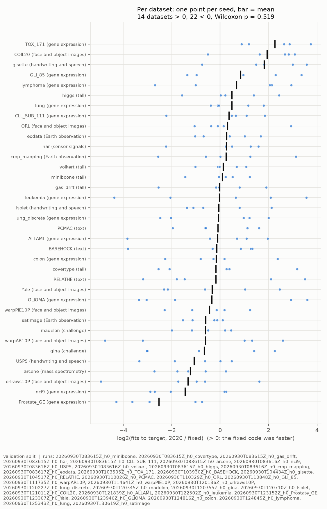
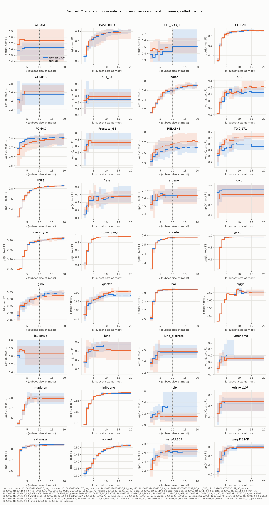
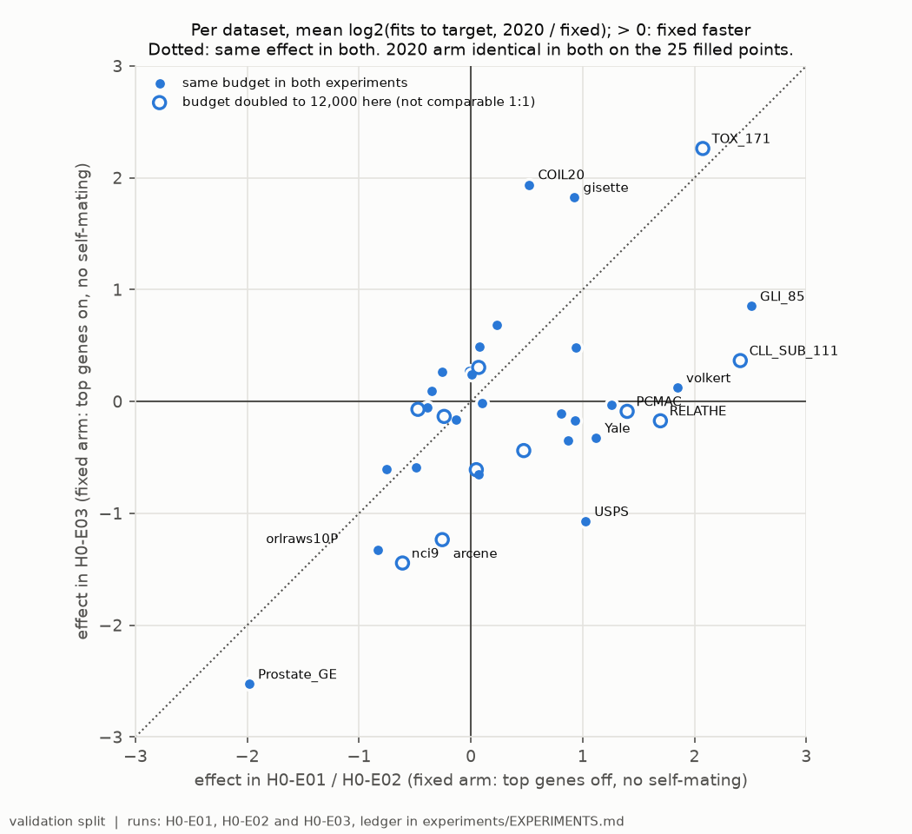

# H0-E03 -- report

## 1. Header

| field | content |
|---|---|
| Experiment ID | `H0-E03` |
| Hypothesis ID | H0 |
| Run IDs | `20260930T083615Z_h0_miniboone` (ok)<br>`20260930T083615Z_h0_covertype` (ok)<br>`20260930T083615Z_h0_gas_drift` (ok)<br>`20260930T083615Z_h0_har` (ok)<br>`20260930T083615Z_h0_CLL_SUB_111` (ok)<br>`20260930T083615Z_h0_arcene` (ok)<br>`20260930T083616Z_h0_nci9` (ok)<br>`20260930T083616Z_h0_USPS` (ok)<br>`20260930T083616Z_h0_volkert` (ok)<br>`20260930T083615Z_h0_higgs` (ok)<br>`20260930T083616Z_h0_crop_mapping` (ok)<br>`20260930T083617Z_h0_eodata` (ok)<br>`20260930T103505Z_h0_TOX_171` (ok)<br>`20260930T103930Z_h0_BASEHOCK` (ok)<br>`20260930T104434Z_h0_gisette` (ok)<br>`20260930T104517Z_h0_RELATHE` (ok)<br>`20260930T110026Z_h0_PCMAC` (ok)<br>`20260930T110329Z_h0_ORL` (ok)<br>`20260930T110848Z_h0_GLI_85` (ok)<br>`20260930T111735Z_h0_warpAR10P` (ok)<br>`20260930T114641Z_h0_warpPIE10P` (ok)<br>`20260930T120136Z_h0_orlraws10P` (ok)<br>`20260930T120227Z_h0_lung_discrete` (ok)<br>`20260930T120345Z_h0_madelon` (ok)<br>`20260930T120355Z_h0_gina` (ok)<br>`20260930T120710Z_h0_Isolet` (ok)<br>`20260930T121011Z_h0_COIL20` (ok)<br>`20260930T121839Z_h0_ALLAML` (ok)<br>`20260930T122502Z_h0_leukemia` (ok)<br>`20260930T123152Z_h0_Prostate_GE` (ok)<br>`20260930T123307Z_h0_Yale` (ok)<br>`20260930T123946Z_h0_GLIOMA` (ok)<br>`20260930T124816Z_h0_colon` (ok)<br>`20260930T124845Z_h0_lymphoma` (ok)<br>`20260930T125343Z_h0_lung` (ok)<br>`20260930T130619Z_h0_satimage` (ok) |
| Algorithm IDs | `fastener@3776df7+08e6acd#2ef0`<br>`fastener@3776df7+08e6acd#4371`<br>`fastener@6ef80c0+08e6acd#2ef0`<br>`fastener@6ef80c0+08e6acd#ee8f`<br>`fastener@827702d+08e6acd#2ef0`<br>`fastener@f381469+08e6acd#2ef0`<br>`fastener@f381469+08e6acd#4371`<br>`fastener@f381469+08e6acd#ee8f`<br>`fastener_2020@3776df7+08e6acd#4bec`<br>`fastener_2020@3776df7+08e6acd#757f`<br>`fastener_2020@6ef80c0+08e6acd#372e`<br>`fastener_2020@6ef80c0+08e6acd#4bec`<br>`fastener_2020@827702d+08e6acd#4bec`<br>`fastener_2020@f381469+08e6acd#372e`<br>`fastener_2020@f381469+08e6acd#4bec`<br>`fastener_2020@f381469+08e6acd#757f` |
| Pre-registration | `experiments/HYPOTHESES.md` at `f381469` |
| Code commits | `3776df7`, `6ef80c0`, `827702d`, `f381469` |
| Dates | runs 2026-09-30T08:36:15.470200+00:00 to 2026-09-30T16:59:00.321540+00:00; report 2026-10-07 |
| Verdict | H0-E03: **not supported** (the generator's mechanical reading agrees). 14 datasets favour the fixed code, 22 the 2020 code; Wilcoxon p = 0.519 against alpha = 0.05. This is about the current fixed code, which differs from the 2020 code only in no self-mating. H0-E01 (not supported) and H0-E02 (supported, narrowly) tested the earlier fixed code. |


## 2. Hypothesis

> ## H0 -- The bug-fixed FASTENER converges faster than the 2020 code
>
> **Claim.** The fixed FASTENER reaches a given low-k score in fewer fits than the
> 2020 code that produced the published results.

## 3. Evaluation criteria

### H0

This experiment is *H0 repeated with the top genes kept*; it takes H0's measure unchanged:

> **Primary metric: fits to a common target.** A fixed-target measure, read on
> fits as *Progress tracking* requires, and on validation only:
>
> 1. From every progress snapshot, compute AUF (K = 10) on validation F1 from the
>    front the snapshot stores. Over a run this gives a step curve of score
>    against cumulative unique fits.
> 2. Per dataset and seed, the **target** is the lower of the two arms' final
>    values at that dataset's budget. Both arms reach it by construction.
> 3. Each arm's result is the cumulative unique fits at the first snapshot whose
>    value is at or above the target. Fewer fits is faster.
>
> A common target keeps the comparison about speed. An arm's own final value
> would not work: a search that stalls early would look like it converged fast.

> ### H0 repeated with the top genes kept (third experiment, H0-E03)

> **Arms.** `fastener`, now `include_top_genes=True, allow_self_mating=False`:
> it differs from the 2020 code only in drawing the mating pool without
> replacement, so no item is mated with itself. `fastener_2020` is unchanged.
> The claim tested is therefore narrower than H0-E02's: that removing
> self-mating alone makes FASTENER converge faster.
>
> **Datasets: all 36 of H0-E01 and H0-E02**, with their splits. Budgets: the three
> Earth-observation sets that had 1,000 fits keep 1,000 (crop_mapping, eodata
> and satimage); every other dataset gets `protocol.fit_budget`, which is 12,000
> fits on the 11 in `protocol.LONG_BUDGET_DATASETS` and 6,000 on the rest.
> Seeds, the fixed-target measure and the target are exactly as in H0.

> **Primary analysis and falsification criterion.** As in H0-E02, over all 36
> datasets: the per-dataset effect is the mean over 5 seeds of log2(fits the
> 2020 arm needed / fits the fixed arm needed). Supported if the effects are
> positive on more datasets than negative **and** a two-sided Wilcoxon
> signed-rank test over them is significant at alpha = 0.05; reversed if the same
> holds with the signs swapped; otherwise not supported. Zero effects drop out of
> the test and are counted.

> **Incomplete datasets.** As in H0-E02. If more than 7 of the 36 are left out
> (the same one in five), the result is reported as incomplete.
>
> **Reported beside it, as secondary:** H0's per-dataset 4-of-5 counts; the
> effect per dataset group; final test AUF (K = 10) per arm; and, labelled as
> comparisons across experiments and not as tests, each dataset's effect here
> beside its effect in H0-E01 or H0-E02. On the 11 long-budget datasets the
> budget differs from the earlier experiments, so their effects are not
> comparable one to one.

> **How it runs.** As H0-E02: several datasets at once, so wall clock is not
> comparable between arms; fits are unaffected.

> ## Revisions
>
> **2026-09-25 -- H0 on every other dataset (H0-E02) added.** Added after
> H0-E01 had finished and been reported as not supported, with its datasets split
> (fixed code faster on TOX_171 and USPS, 2020 code on BASEHOCK, neither on crop
> mapping and har). H0's own criterion, datasets and verdict are unchanged. The
> new experiment takes every remaining dataset rather than a chosen subset, and
> its criterion is written here before any of its runs started.
>
> **2026-09-30 -- The fixed arm keeps the top genes.** After H0-E01 and H0-E02
> were reported, `include_top_genes` became `True` in the clone's defaults and in
> the `fastener` arm, so the fixed code now differs from the 2020 code only in
> `allow_self_mating`. H0-E01 and H0-E02 tested the fixed code with both flags
> off; their verdicts are about that code, not this one. Stock FASTENER in H2-H6
> is the new default. The arm's algorithm ID changes with its configuration, so
> runs of the two are never pooled.
>
> **2026-09-30 -- Twice the budget where the search had not converged.** Decided
> after H0-E01 and H0-E02 were reported, from their validation curves only (test
> scores played no part). A dataset counts as not converged when the mean
> validation AUF at K = 10 of at least one H0 arm rose by 0.005 or more over the
> last quarter of its budget (4,500 to 6,000 fits). Eleven datasets meet it:
>
> | dataset | rise over the last quarter, fixed / 2020 |
> |---|---|
> | BASEHOCK | 0.025 / 0.014 |
> | nci9 | 0.024 / 0.001 |
> | lung_discrete | 0.013 / 0.015 |
> | PCMAC | 0.006 / 0.013 |
> | warpAR10P | 0.013 / 0.001 |
> | TOX_171 | 0.009 / 0.005 |
> | arcene | 0.006 / 0.008 |
> | ORL | 0.004 / 0.007 |
> | RELATHE | 0.001 / 0.007 |
> | warpPIE10P | 0.003 / 0.005 |
> | CLL_SUB_111 | 0.003 / 0.005 |
>
> These get 12,000 fits per run in H1-H6, for every arm (`protocol.fit_budget`);
> every other dataset keeps 6,000, and the EO sets in H0 keep 1,000. On the
> smallest of the eleven (nci9, lung_discrete, TOX_171) the validation split has
> 12-34 rows, so part of the late rise can be the search fitting validation noise
> rather than finding better subsets; the extra budget gives it room either way,
> and test scores will show which. H0's verdicts are unchanged: its budgets were
> fixed before its runs.

Secondary, shown for interpretation only: AUF at the other K, hypervolume, the smallest subset size on the front, fits and wall clock.

## 4. Summary

H0-E03 asked H0's question of the current code: after the fixed arm was
changed to keep the top genes (DEC-23 in `DECISIONS.md`), the only difference
left between `fastener` and `fastener_2020` is that the fixed code never mates
an item with itself. Both arms ran on all 36 datasets of H0-E01 and H0-E02, 5
seeds each, at equal fit budgets: 1,000 fits on the three Earth-observation
sets, 12,000 on the 11 datasets whose search had not converged in H0 (DEC-24),
and 6,000 on the rest. Per dataset, the effect is the mean over seeds of log2
of the fits each arm needed to reach the common validation AUF (K = 10)
target, 2020 over fixed; it is positive when the fixed code was faster.
**Under the registered criterion, H0 is not supported.** The effect is
positive on 14 datasets and negative on 22, with no ties, and the two-sided
Wilcoxon test over the 36 effects gives p = 0.519. The median effect is
-0.080: at the median dataset the fixed code needed about 6% *more* fits than
the 2020 code. Seeds split almost evenly, 91 of 180 to the fixed code and 89 to
the 2020 code, and per-dataset effects run from -2.53 (Prostate_GE) to +2.26
(TOX_171). Final results are level too: the best final F1 is higher for the
fixed code on 18 datasets and lower on 18. Removing self-mating, on its own,
changes neither how fast FASTENER converges nor where it ends.

## 5. Description of the experiment

### Setup

**`20260930T083615Z_h0_miniboone`** -- dataset `miniboone`: 50 features, 30000/10000/10000 train/val/test rows.

```
run_sota.py --dataset miniboone --split protocol --methods  --name h0_miniboone --fastener-arm none --fastener-arm 2020 --evaluations 6000 --experiment H0-E03
```

**`20260930T083615Z_h0_covertype`** -- dataset `covertype`: 54 features, 30002/9999/9999 train/val/test rows.

```
run_sota.py --dataset covertype --split protocol --methods  --name h0_covertype --fastener-arm none --fastener-arm 2020 --evaluations 6000 --experiment H0-E03
```

**`20260930T083615Z_h0_gas_drift`** -- dataset `gas_drift`: 128 features, 8346/2782/2782 train/val/test rows.

```
run_sota.py --dataset gas_drift --split protocol --methods  --name h0_gas_drift --fastener-arm none --fastener-arm 2020 --evaluations 6000 --experiment H0-E03
```

**`20260930T083615Z_h0_har`** -- dataset `har`: 561 features, 6181/2059/2059 train/val/test rows.

```
run_sota.py --dataset har --split protocol --methods  --name h0_har --fastener-arm none --fastener-arm 2020 --evaluations 6000 --experiment H0-E03
```

**`20260930T083615Z_h0_CLL_SUB_111`** -- dataset `CLL_SUB_111`: 11340 features, 67/22/22 train/val/test rows.

```
run_sota.py --dataset CLL_SUB_111 --split protocol --methods  --name h0_CLL_SUB_111 --fastener-arm none --fastener-arm 2020 --evaluations 12000 --experiment H0-E03
```

**`20260930T083615Z_h0_arcene`** -- dataset `arcene`: 10000 features, 120/40/40 train/val/test rows.

```
run_sota.py --dataset arcene --split protocol --methods  --name h0_arcene --fastener-arm none --fastener-arm 2020 --evaluations 12000 --experiment H0-E03
```

**`20260930T083616Z_h0_nci9`** -- dataset `nci9`: 9712 features, 34/12/12 train/val/test rows.

```
run_sota.py --dataset nci9 --split protocol --methods  --name h0_nci9 --fastener-arm none --fastener-arm 2020 --evaluations 12000 --experiment H0-E03
```

**`20260930T083616Z_h0_USPS`** -- dataset `USPS`: 256 features, 5578/1860/1860 train/val/test rows.

```
run_sota.py --dataset USPS --split protocol --methods  --name h0_USPS --fastener-arm none --fastener-arm 2020 --evaluations 6000 --experiment H0-E03
```

**`20260930T083616Z_h0_volkert`** -- dataset `volkert`: 180 features, 30002/9998/9998 train/val/test rows.

```
run_sota.py --dataset volkert --split protocol --methods  --name h0_volkert --fastener-arm none --fastener-arm 2020 --evaluations 6000 --experiment H0-E03
```

**`20260930T083615Z_h0_higgs`** -- dataset `higgs`: 28 features, 30000/10000/10000 train/val/test rows.

```
run_sota.py --dataset higgs --split protocol --methods  --name h0_higgs --fastener-arm none --fastener-arm 2020 --evaluations 6000 --experiment H0-E03
```

**`20260930T083616Z_h0_crop_mapping`** -- dataset `crop_mapping`: 174 features, 40000/9999/50001 train/val/test rows.

```
run_sota.py --dataset crop_mapping --split eo --methods  --name h0_crop_mapping --fastener-arm none --fastener-arm 2020 --evaluations 1000 --experiment H0-E03
```

**`20260930T083617Z_h0_eodata`** -- dataset `eodata`: 182 features, 39984/10008/49992 train/val/test rows.

```
run_sota.py --dataset eodata --split eo --methods  --name h0_eodata --fastener-arm none --fastener-arm 2020 --evaluations 1000 --experiment H0-E03
```

**`20260930T103505Z_h0_TOX_171`** -- dataset `TOX_171`: 5748 features, 103/34/34 train/val/test rows.

```
run_sota.py --dataset TOX_171 --split protocol --methods  --name h0_TOX_171 --fastener-arm none --fastener-arm 2020 --evaluations 12000 --experiment H0-E03
```

**`20260930T103930Z_h0_BASEHOCK`** -- dataset `BASEHOCK`: 4862 features, 1195/399/399 train/val/test rows.

```
run_sota.py --dataset BASEHOCK --split protocol --methods  --name h0_BASEHOCK --fastener-arm none --fastener-arm 2020 --evaluations 12000 --experiment H0-E03
```

**`20260930T104434Z_h0_gisette`** -- dataset `gisette`: 5000 features, 4200/1400/1400 train/val/test rows.

```
run_sota.py --dataset gisette --split protocol --methods  --name h0_gisette --fastener-arm none --fastener-arm 2020 --evaluations 6000 --experiment H0-E03
```

**`20260930T104517Z_h0_RELATHE`** -- dataset `RELATHE`: 4322 features, 855/286/286 train/val/test rows.

```
run_sota.py --dataset RELATHE --split protocol --methods  --name h0_RELATHE --fastener-arm none --fastener-arm 2020 --evaluations 12000 --experiment H0-E03
```

**`20260930T110026Z_h0_PCMAC`** -- dataset `PCMAC`: 3289 features, 1167/388/388 train/val/test rows.

```
run_sota.py --dataset PCMAC --split protocol --methods  --name h0_PCMAC --fastener-arm none --fastener-arm 2020 --evaluations 12000 --experiment H0-E03
```

**`20260930T110329Z_h0_ORL`** -- dataset `ORL`: 1024 features, 240/80/80 train/val/test rows.

```
run_sota.py --dataset ORL --split protocol --methods  --name h0_ORL --fastener-arm none --fastener-arm 2020 --evaluations 12000 --experiment H0-E03
```

**`20260930T110848Z_h0_GLI_85`** -- dataset `GLI_85`: 22283 features, 51/17/17 train/val/test rows.

```
run_sota.py --dataset GLI_85 --split protocol --methods  --name h0_GLI_85 --fastener-arm none --fastener-arm 2020 --evaluations 6000 --experiment H0-E03
```

**`20260930T111735Z_h0_warpAR10P`** -- dataset `warpAR10P`: 2400 features, 70/30/30 train/val/test rows.

```
run_sota.py --dataset warpAR10P --split protocol --methods  --name h0_warpAR10P --fastener-arm none --fastener-arm 2020 --evaluations 12000 --experiment H0-E03
```

**`20260930T114641Z_h0_warpPIE10P`** -- dataset `warpPIE10P`: 2420 features, 130/40/40 train/val/test rows.

```
run_sota.py --dataset warpPIE10P --split protocol --methods  --name h0_warpPIE10P --fastener-arm none --fastener-arm 2020 --evaluations 12000 --experiment H0-E03
```

**`20260930T120136Z_h0_orlraws10P`** -- dataset `orlraws10P`: 10304 features, 60/20/20 train/val/test rows.

```
run_sota.py --dataset orlraws10P --split protocol --methods  --name h0_orlraws10P --fastener-arm none --fastener-arm 2020 --evaluations 6000 --experiment H0-E03
```

**`20260930T120227Z_h0_lung_discrete`** -- dataset `lung_discrete`: 325 features, 45/14/14 train/val/test rows.

```
run_sota.py --dataset lung_discrete --split protocol --methods  --name h0_lung_discrete --fastener-arm none --fastener-arm 2020 --evaluations 12000 --experiment H0-E03
```

**`20260930T120345Z_h0_madelon`** -- dataset `madelon`: 500 features, 1560/520/520 train/val/test rows.

```
run_sota.py --dataset madelon --split protocol --methods  --name h0_madelon --fastener-arm none --fastener-arm 2020 --evaluations 6000 --experiment H0-E03
```

**`20260930T120355Z_h0_gina`** -- dataset `gina`: 970 features, 2080/694/694 train/val/test rows.

```
run_sota.py --dataset gina --split protocol --methods  --name h0_gina --fastener-arm none --fastener-arm 2020 --evaluations 6000 --experiment H0-E03
```

**`20260930T120710Z_h0_Isolet`** -- dataset `Isolet`: 617 features, 936/312/312 train/val/test rows.

```
run_sota.py --dataset Isolet --split protocol --methods  --name h0_Isolet --fastener-arm none --fastener-arm 2020 --evaluations 6000 --experiment H0-E03
```

**`20260930T121011Z_h0_COIL20`** -- dataset `COIL20`: 1024 features, 880/280/280 train/val/test rows.

```
run_sota.py --dataset COIL20 --split protocol --methods  --name h0_COIL20 --fastener-arm none --fastener-arm 2020 --evaluations 6000 --experiment H0-E03
```

**`20260930T121839Z_h0_ALLAML`** -- dataset `ALLAML`: 7129 features, 44/14/14 train/val/test rows.

```
run_sota.py --dataset ALLAML --split protocol --methods  --name h0_ALLAML --fastener-arm none --fastener-arm 2020 --evaluations 6000 --experiment H0-E03
```

**`20260930T122502Z_h0_leukemia`** -- dataset `leukemia`: 7070 features, 44/14/14 train/val/test rows.

```
run_sota.py --dataset leukemia --split protocol --methods  --name h0_leukemia --fastener-arm none --fastener-arm 2020 --evaluations 6000 --experiment H0-E03
```

**`20260930T123152Z_h0_Prostate_GE`** -- dataset `Prostate_GE`: 5966 features, 62/20/20 train/val/test rows.

```
run_sota.py --dataset Prostate_GE --split protocol --methods  --name h0_Prostate_GE --fastener-arm none --fastener-arm 2020 --evaluations 6000 --experiment H0-E03
```

**`20260930T123307Z_h0_Yale`** -- dataset `Yale`: 1024 features, 105/30/30 train/val/test rows.

```
run_sota.py --dataset Yale --split protocol --methods  --name h0_Yale --fastener-arm none --fastener-arm 2020 --evaluations 6000 --experiment H0-E03
```

**`20260930T123946Z_h0_GLIOMA`** -- dataset `GLIOMA`: 4434 features, 30/10/10 train/val/test rows.

```
run_sota.py --dataset GLIOMA --split protocol --methods  --name h0_GLIOMA --fastener-arm none --fastener-arm 2020 --evaluations 6000 --experiment H0-E03
```

**`20260930T124816Z_h0_colon`** -- dataset `colon`: 2000 features, 38/12/12 train/val/test rows.

```
run_sota.py --dataset colon --split protocol --methods  --name h0_colon --fastener-arm none --fastener-arm 2020 --evaluations 6000 --experiment H0-E03
```

**`20260930T124845Z_h0_lymphoma`** -- dataset `lymphoma`: 4026 features, 54/17/17 train/val/test rows.

```
run_sota.py --dataset lymphoma --split protocol --methods  --name h0_lymphoma --fastener-arm none --fastener-arm 2020 --evaluations 6000 --experiment H0-E03
```

**`20260930T125343Z_h0_lung`** -- dataset `lung`: 3312 features, 123/40/40 train/val/test rows.

```
run_sota.py --dataset lung --split protocol --methods  --name h0_lung --fastener-arm none --fastener-arm 2020 --evaluations 6000 --experiment H0-E03
```

**`20260930T130619Z_h0_satimage`** -- dataset `satimage`: 36 features, 3858/1286/1286 train/val/test rows.

```
run_sota.py --dataset satimage --split protocol --methods  --name h0_satimage --fastener-arm none --fastener-arm 2020 --evaluations 1000 --experiment H0-E03
```

Parameters per run:

| parameter | 20260930T083615Z_h0_miniboone | 20260930T083615Z_h0_covertype | 20260930T083615Z_h0_gas_drift | 20260930T083615Z_h0_har | 20260930T083615Z_h0_CLL_SUB_111 | 20260930T083615Z_h0_arcene | 20260930T083616Z_h0_nci9 | 20260930T083616Z_h0_USPS | 20260930T083616Z_h0_volkert | 20260930T083615Z_h0_higgs | 20260930T083616Z_h0_crop_mapping | 20260930T083617Z_h0_eodata | 20260930T103505Z_h0_TOX_171 | 20260930T103930Z_h0_BASEHOCK | 20260930T104434Z_h0_gisette | 20260930T104517Z_h0_RELATHE | 20260930T110026Z_h0_PCMAC | 20260930T110329Z_h0_ORL | 20260930T110848Z_h0_GLI_85 | 20260930T111735Z_h0_warpAR10P | 20260930T114641Z_h0_warpPIE10P | 20260930T120136Z_h0_orlraws10P | 20260930T120227Z_h0_lung_discrete | 20260930T120345Z_h0_madelon | 20260930T120355Z_h0_gina | 20260930T120710Z_h0_Isolet | 20260930T121011Z_h0_COIL20 | 20260930T121839Z_h0_ALLAML | 20260930T122502Z_h0_leukemia | 20260930T123152Z_h0_Prostate_GE | 20260930T123307Z_h0_Yale | 20260930T123946Z_h0_GLIOMA | 20260930T124816Z_h0_colon | 20260930T124845Z_h0_lymphoma | 20260930T125343Z_h0_lung | 20260930T130619Z_h0_satimage |
|---|---|---|---|---|---|---|---|---|---|---|---|---|---|---|---|---|---|---|---|---|---|---|---|---|---|---|---|---|---|---|---|---|---|---|---|---|
| boruta_estimator | "protocol decision tree" | "protocol decision tree" | "protocol decision tree" | "protocol decision tree" | "protocol decision tree" | "protocol decision tree" | "protocol decision tree" | "protocol decision tree" | "protocol decision tree" | "protocol decision tree" | "protocol decision tree" | "protocol decision tree" | "protocol decision tree" | "protocol decision tree" | "protocol decision tree" | "protocol decision tree" | "protocol decision tree" | "protocol decision tree" | "protocol decision tree" | "protocol decision tree" | "protocol decision tree" | "protocol decision tree" | "protocol decision tree" | "protocol decision tree" | "protocol decision tree" | "protocol decision tree" | "protocol decision tree" | "protocol decision tree" | "protocol decision tree" | "protocol decision tree" | "protocol decision tree" | "protocol decision tree" | "protocol decision tree" | "protocol decision tree" | "protocol decision tree" | "protocol decision tree" |
| boruta_max_iter | 100 | 100 | 100 | 100 | 100 | 100 | 100 | 100 | 100 | 100 | 100 | 100 | 100 | 100 | 100 | 100 | 100 | 100 | 100 | 100 | 100 | 100 | 100 | 100 | 100 | 100 | 100 | 100 | 100 | 100 | 100 | 100 | 100 | 100 | 100 | 100 |
| dataset | "miniboone" | "covertype" | "gas_drift" | "har" | "CLL_SUB_111" | "arcene" | "nci9" | "USPS" | "volkert" | "higgs" | "crop_mapping" | "eodata" | "TOX_171" | "BASEHOCK" | "gisette" | "RELATHE" | "PCMAC" | "ORL" | "GLI_85" | "warpAR10P" | "warpPIE10P" | "orlraws10P" | "lung_discrete" | "madelon" | "gina" | "Isolet" | "COIL20" | "ALLAML" | "leukemia" | "Prostate_GE" | "Yale" | "GLIOMA" | "colon" | "lymphoma" | "lung" | "satimage" |
| evaluation_budget_per_seed | 6000 | 6000 | 6000 | 6000 | 12000 | 12000 | 12000 | 6000 | 6000 | 6000 | 1000 | 1000 | 12000 | 12000 | 6000 | 12000 | 12000 | 12000 | 6000 | 12000 | 12000 | 6000 | 12000 | 6000 | 6000 | 6000 | 6000 | 6000 | 6000 | 6000 | 6000 | 6000 | 6000 | 6000 | 6000 | 1000 |
| fastener_arms | ["none", "2020"] | ["none", "2020"] | ["none", "2020"] | ["none", "2020"] | ["none", "2020"] | ["none", "2020"] | ["none", "2020"] | ["none", "2020"] | ["none", "2020"] | ["none", "2020"] | ["none", "2020"] | ["none", "2020"] | ["none", "2020"] | ["none", "2020"] | ["none", "2020"] | ["none", "2020"] | ["none", "2020"] | ["none", "2020"] | ["none", "2020"] | ["none", "2020"] | ["none", "2020"] | ["none", "2020"] | ["none", "2020"] | ["none", "2020"] | ["none", "2020"] | ["none", "2020"] | ["none", "2020"] | ["none", "2020"] | ["none", "2020"] | ["none", "2020"] | ["none", "2020"] | ["none", "2020"] | ["none", "2020"] | ["none", "2020"] | ["none", "2020"] | ["none", "2020"] |
| fastener_max_fits | 6000 | 6000 | 6000 | 6000 | 12000 | 12000 | 12000 | 6000 | 6000 | 6000 | 1000 | 1000 | 12000 | 12000 | 6000 | 12000 | 12000 | 12000 | 6000 | 12000 | 12000 | 6000 | 12000 | 6000 | 6000 | 6000 | 6000 | 6000 | 6000 | 6000 | 6000 | 6000 | 6000 | 6000 | 6000 | 1000 |
| fastener_rounds | 100000 | 100000 | 100000 | 100000 | 100000 | 100000 | 100000 | 100000 | 100000 | 100000 | 100000 | 100000 | 100000 | 100000 | 100000 | 100000 | 100000 | 100000 | 100000 | 100000 | 100000 | 100000 | 100000 | 100000 | 100000 | 100000 | 100000 | 100000 | 100000 | 100000 | 100000 | 100000 | 100000 | 100000 | 100000 | 100000 |
| fs_sds_evaluations_per_k | 300 | 300 | 300 | 300 | 600 | 600 | 600 | 300 | 300 | 300 | 50 | 50 | 600 | 600 | 300 | 600 | 600 | 600 | 300 | 600 | 600 | 300 | 600 | 300 | 300 | 300 | 300 | 300 | 300 | 300 | 300 | 300 | 300 | 300 | 300 | 50 |
| fs_sds_evaluations_total | 6000 | 6000 | 6000 | 6000 | 12000 | 12000 | 12000 | 6000 | 6000 | 6000 | 1000 | 1000 | 12000 | 12000 | 6000 | 12000 | 12000 | 12000 | 6000 | 12000 | 12000 | 6000 | 12000 | 6000 | 6000 | 6000 | 6000 | 6000 | 6000 | 6000 | 6000 | 6000 | 6000 | 6000 | 6000 | 1000 |
| fs_sds_iterations | null | null | null | null | null | null | null | null | null | null | null | null | null | null | null | null | null | null | null | null | null | null | null | null | null | null | null | null | null | null | null | null | null | null | null | null |
| fs_sds_k_range | [1, 2, 3, 4, 5, 6, 7, 8, 9, 10, 11, 12, 13, 14, 15, 16, 17, 18, 19, 20] | [1, 2, 3, 4, 5, 6, 7, 8, 9, 10, 11, 12, 13, 14, 15, 16, 17, 18, 19, 20] | [1, 2, 3, 4, 5, 6, 7, 8, 9, 10, 11, 12, 13, 14, 15, 16, 17, 18, 19, 20] | [1, 2, 3, 4, 5, 6, 7, 8, 9, 10, 11, 12, 13, 14, 15, 16, 17, 18, 19, 20] | [1, 2, 3, 4, 5, 6, 7, 8, 9, 10, 11, 12, 13, 14, 15, 16, 17, 18, 19, 20] | [1, 2, 3, 4, 5, 6, 7, 8, 9, 10, 11, 12, 13, 14, 15, 16, 17, 18, 19, 20] | [1, 2, 3, 4, 5, 6, 7, 8, 9, 10, 11, 12, 13, 14, 15, 16, 17, 18, 19, 20] | [1, 2, 3, 4, 5, 6, 7, 8, 9, 10, 11, 12, 13, 14, 15, 16, 17, 18, 19, 20] | [1, 2, 3, 4, 5, 6, 7, 8, 9, 10, 11, 12, 13, 14, 15, 16, 17, 18, 19, 20] | [1, 2, 3, 4, 5, 6, 7, 8, 9, 10, 11, 12, 13, 14, 15, 16, 17, 18, 19, 20] | [1, 2, 3, 4, 5, 6, 7, 8, 9, 10, 11, 12, 13, 14, 15, 16, 17, 18, 19, 20] | [1, 2, 3, 4, 5, 6, 7, 8, 9, 10, 11, 12, 13, 14, 15, 16, 17, 18, 19, 20] | [1, 2, 3, 4, 5, 6, 7, 8, 9, 10, 11, 12, 13, 14, 15, 16, 17, 18, 19, 20] | [1, 2, 3, 4, 5, 6, 7, 8, 9, 10, 11, 12, 13, 14, 15, 16, 17, 18, 19, 20] | [1, 2, 3, 4, 5, 6, 7, 8, 9, 10, 11, 12, 13, 14, 15, 16, 17, 18, 19, 20] | [1, 2, 3, 4, 5, 6, 7, 8, 9, 10, 11, 12, 13, 14, 15, 16, 17, 18, 19, 20] | [1, 2, 3, 4, 5, 6, 7, 8, 9, 10, 11, 12, 13, 14, 15, 16, 17, 18, 19, 20] | [1, 2, 3, 4, 5, 6, 7, 8, 9, 10, 11, 12, 13, 14, 15, 16, 17, 18, 19, 20] | [1, 2, 3, 4, 5, 6, 7, 8, 9, 10, 11, 12, 13, 14, 15, 16, 17, 18, 19, 20] | [1, 2, 3, 4, 5, 6, 7, 8, 9, 10, 11, 12, 13, 14, 15, 16, 17, 18, 19, 20] | [1, 2, 3, 4, 5, 6, 7, 8, 9, 10, 11, 12, 13, 14, 15, 16, 17, 18, 19, 20] | [1, 2, 3, 4, 5, 6, 7, 8, 9, 10, 11, 12, 13, 14, 15, 16, 17, 18, 19, 20] | [1, 2, 3, 4, 5, 6, 7, 8, 9, 10, 11, 12, 13, 14, 15, 16, 17, 18, 19, 20] | [1, 2, 3, 4, 5, 6, 7, 8, 9, 10, 11, 12, 13, 14, 15, 16, 17, 18, 19, 20] | [1, 2, 3, 4, 5, 6, 7, 8, 9, 10, 11, 12, 13, 14, 15, 16, 17, 18, 19, 20] | [1, 2, 3, 4, 5, 6, 7, 8, 9, 10, 11, 12, 13, 14, 15, 16, 17, 18, 19, 20] | [1, 2, 3, 4, 5, 6, 7, 8, 9, 10, 11, 12, 13, 14, 15, 16, 17, 18, 19, 20] | [1, 2, 3, 4, 5, 6, 7, 8, 9, 10, 11, 12, 13, 14, 15, 16, 17, 18, 19, 20] | [1, 2, 3, 4, 5, 6, 7, 8, 9, 10, 11, 12, 13, 14, 15, 16, 17, 18, 19, 20] | [1, 2, 3, 4, 5, 6, 7, 8, 9, 10, 11, 12, 13, 14, 15, 16, 17, 18, 19, 20] | [1, 2, 3, 4, 5, 6, 7, 8, 9, 10, 11, 12, 13, 14, 15, 16, 17, 18, 19, 20] | [1, 2, 3, 4, 5, 6, 7, 8, 9, 10, 11, 12, 13, 14, 15, 16, 17, 18, 19, 20] | [1, 2, 3, 4, 5, 6, 7, 8, 9, 10, 11, 12, 13, 14, 15, 16, 17, 18, 19, 20] | [1, 2, 3, 4, 5, 6, 7, 8, 9, 10, 11, 12, 13, 14, 15, 16, 17, 18, 19, 20] | [1, 2, 3, 4, 5, 6, 7, 8, 9, 10, 11, 12, 13, 14, 15, 16, 17, 18, 19, 20] | [1, 2, 3, 4, 5, 6, 7, 8, 9, 10, 11, 12, 13, 14, 15, 16, 17, 18, 19, 20] |
| fs_sds_population | null | null | null | null | null | null | null | null | null | null | null | null | null | null | null | null | null | null | null | null | null | null | null | null | null | null | null | null | null | null | null | null | null | null | null | null |
| k_grid | [1, 2, 3, 4, 5, 6, 7, 8, 9, 10, 11, 12, 13, 14, 15, 16, 17, 18, 19, 20, 25, 30, 50] | [1, 2, 3, 4, 5, 6, 7, 8, 9, 10, 11, 12, 13, 14, 15, 16, 17, 18, 19, 20, 25, 30, 50] | [1, 2, 3, 4, 5, 6, 7, 8, 9, 10, 11, 12, 13, 14, 15, 16, 17, 18, 19, 20, 25, 30, 50, 100] | [1, 2, 3, 4, 5, 6, 7, 8, 9, 10, 11, 12, 13, 14, 15, 16, 17, 18, 19, 20, 25, 30, 50, 100, 200, 500] | [1, 2, 3, 4, 5, 6, 7, 8, 9, 10, 11, 12, 13, 14, 15, 16, 17, 18, 19, 20, 25, 30, 50, 100, 200, 500] | [1, 2, 3, 4, 5, 6, 7, 8, 9, 10, 11, 12, 13, 14, 15, 16, 17, 18, 19, 20, 25, 30, 50, 100, 200, 500] | [1, 2, 3, 4, 5, 6, 7, 8, 9, 10, 11, 12, 13, 14, 15, 16, 17, 18, 19, 20, 25, 30, 50, 100, 200, 500] | [1, 2, 3, 4, 5, 6, 7, 8, 9, 10, 11, 12, 13, 14, 15, 16, 17, 18, 19, 20, 25, 30, 50, 100, 200] | [1, 2, 3, 4, 5, 6, 7, 8, 9, 10, 11, 12, 13, 14, 15, 16, 17, 18, 19, 20, 25, 30, 50, 100] | [1, 2, 3, 4, 5, 6, 7, 8, 9, 10, 11, 12, 13, 14, 15, 16, 17, 18, 19, 20, 25] | [1, 2, 3, 4, 5, 6, 7, 8, 9, 10, 11, 12, 13, 14, 15, 16, 17, 18, 19, 20, 25, 30, 50, 100] | [1, 2, 3, 4, 5, 6, 7, 8, 9, 10, 11, 12, 13, 14, 15, 16, 17, 18, 19, 20, 25, 30, 50, 100] | [1, 2, 3, 4, 5, 6, 7, 8, 9, 10, 11, 12, 13, 14, 15, 16, 17, 18, 19, 20, 25, 30, 50, 100, 200, 500] | [1, 2, 3, 4, 5, 6, 7, 8, 9, 10, 11, 12, 13, 14, 15, 16, 17, 18, 19, 20, 25, 30, 50, 100, 200, 500] | [1, 2, 3, 4, 5, 6, 7, 8, 9, 10, 11, 12, 13, 14, 15, 16, 17, 18, 19, 20, 25, 30, 50, 100, 200, 500] | [1, 2, 3, 4, 5, 6, 7, 8, 9, 10, 11, 12, 13, 14, 15, 16, 17, 18, 19, 20, 25, 30, 50, 100, 200, 500] | [1, 2, 3, 4, 5, 6, 7, 8, 9, 10, 11, 12, 13, 14, 15, 16, 17, 18, 19, 20, 25, 30, 50, 100, 200, 500] | [1, 2, 3, 4, 5, 6, 7, 8, 9, 10, 11, 12, 13, 14, 15, 16, 17, 18, 19, 20, 25, 30, 50, 100, 200, 500] | [1, 2, 3, 4, 5, 6, 7, 8, 9, 10, 11, 12, 13, 14, 15, 16, 17, 18, 19, 20, 25, 30, 50, 100, 200, 500] | [1, 2, 3, 4, 5, 6, 7, 8, 9, 10, 11, 12, 13, 14, 15, 16, 17, 18, 19, 20, 25, 30, 50, 100, 200, 500] | [1, 2, 3, 4, 5, 6, 7, 8, 9, 10, 11, 12, 13, 14, 15, 16, 17, 18, 19, 20, 25, 30, 50, 100, 200, 500] | [1, 2, 3, 4, 5, 6, 7, 8, 9, 10, 11, 12, 13, 14, 15, 16, 17, 18, 19, 20, 25, 30, 50, 100, 200, 500] | [1, 2, 3, 4, 5, 6, 7, 8, 9, 10, 11, 12, 13, 14, 15, 16, 17, 18, 19, 20, 25, 30, 50, 100, 200] | [1, 2, 3, 4, 5, 6, 7, 8, 9, 10, 11, 12, 13, 14, 15, 16, 17, 18, 19, 20, 25, 30, 50, 100, 200, 500] | [1, 2, 3, 4, 5, 6, 7, 8, 9, 10, 11, 12, 13, 14, 15, 16, 17, 18, 19, 20, 25, 30, 50, 100, 200, 500] | [1, 2, 3, 4, 5, 6, 7, 8, 9, 10, 11, 12, 13, 14, 15, 16, 17, 18, 19, 20, 25, 30, 50, 100, 200, 500] | [1, 2, 3, 4, 5, 6, 7, 8, 9, 10, 11, 12, 13, 14, 15, 16, 17, 18, 19, 20, 25, 30, 50, 100, 200, 500] | [1, 2, 3, 4, 5, 6, 7, 8, 9, 10, 11, 12, 13, 14, 15, 16, 17, 18, 19, 20, 25, 30, 50, 100, 200, 500] | [1, 2, 3, 4, 5, 6, 7, 8, 9, 10, 11, 12, 13, 14, 15, 16, 17, 18, 19, 20, 25, 30, 50, 100, 200, 500] | [1, 2, 3, 4, 5, 6, 7, 8, 9, 10, 11, 12, 13, 14, 15, 16, 17, 18, 19, 20, 25, 30, 50, 100, 200, 500] | [1, 2, 3, 4, 5, 6, 7, 8, 9, 10, 11, 12, 13, 14, 15, 16, 17, 18, 19, 20, 25, 30, 50, 100, 200, 500] | [1, 2, 3, 4, 5, 6, 7, 8, 9, 10, 11, 12, 13, 14, 15, 16, 17, 18, 19, 20, 25, 30, 50, 100, 200, 500] | [1, 2, 3, 4, 5, 6, 7, 8, 9, 10, 11, 12, 13, 14, 15, 16, 17, 18, 19, 20, 25, 30, 50, 100, 200, 500] | [1, 2, 3, 4, 5, 6, 7, 8, 9, 10, 11, 12, 13, 14, 15, 16, 17, 18, 19, 20, 25, 30, 50, 100, 200, 500] | [1, 2, 3, 4, 5, 6, 7, 8, 9, 10, 11, 12, 13, 14, 15, 16, 17, 18, 19, 20, 25, 30, 50, 100, 200, 500] | [1, 2, 3, 4, 5, 6, 7, 8, 9, 10, 11, 12, 13, 14, 15, 16, 17, 18, 19, 20, 25, 30] |
| max_rows | 50000 | 50000 | 50000 | 50000 | null | null | null | null | 50000 | 50000 | 100000 | 100000 | null | null | null | null | null | null | null | null | null | null | null | null | null | null | null | null | null | null | null | null | null | null | null | 50000 |
| methods | [] | [] | [] | [] | [] | [] | [] | [] | [] | [] | [] | [] | [] | [] | [] | [] | [] | [] | [] | [] | [] | [] | [] | [] | [] | [] | [] | [] | [] | [] | [] | [] | [] | [] | [] | [] |
| model | "DecisionTreeClassifier" | "DecisionTreeClassifier" | "DecisionTreeClassifier" | "DecisionTreeClassifier" | "DecisionTreeClassifier" | "DecisionTreeClassifier" | "DecisionTreeClassifier" | "DecisionTreeClassifier" | "DecisionTreeClassifier" | "DecisionTreeClassifier" | "DecisionTreeClassifier" | "DecisionTreeClassifier" | "DecisionTreeClassifier" | "DecisionTreeClassifier" | "DecisionTreeClassifier" | "DecisionTreeClassifier" | "DecisionTreeClassifier" | "DecisionTreeClassifier" | "DecisionTreeClassifier" | "DecisionTreeClassifier" | "DecisionTreeClassifier" | "DecisionTreeClassifier" | "DecisionTreeClassifier" | "DecisionTreeClassifier" | "DecisionTreeClassifier" | "DecisionTreeClassifier" | "DecisionTreeClassifier" | "DecisionTreeClassifier" | "DecisionTreeClassifier" | "DecisionTreeClassifier" | "DecisionTreeClassifier" | "DecisionTreeClassifier" | "DecisionTreeClassifier" | "DecisionTreeClassifier" | "DecisionTreeClassifier" | "DecisionTreeClassifier" |
| model_seed | 20200 | 20200 | 20200 | 20200 | 20200 | 20200 | 20200 | 20200 | 20200 | 20200 | 20200 | 20200 | 20200 | 20200 | 20200 | 20200 | 20200 | 20200 | 20200 | 20200 | 20200 | 20200 | 20200 | 20200 | 20200 | 20200 | 20200 | 20200 | 20200 | 20200 | 20200 | 20200 | 20200 | 20200 | 20200 | 20200 |
| n_rows_used | 50000 | 50000 | 13910 | 10299 | 111 | 200 | 58 | 9298 | 49998 | 50000 | 100000 | 99984 | 171 | 1993 | 7000 | 1427 | 1943 | 400 | 85 | 130 | 210 | 100 | 73 | 2600 | 3468 | 1560 | 1440 | 72 | 72 | 102 | 165 | 50 | 62 | 88 | 203 | 6430 |
| nsgaii_miip_init | "obl" | "obl" | "obl" | "obl" | "obl" | "obl" | "obl" | "obl" | "obl" | "obl" | "obl" | "obl" | "obl" | "obl" | "obl" | "obl" | "obl" | "obl" | "obl" | "obl" | "obl" | "obl" | "obl" | "obl" | "obl" | "obl" | "obl" | "obl" | "obl" | "obl" | "obl" | "obl" | "obl" | "obl" | "obl" | "obl" |
| poss_k | 50 | 50 | 50 | 50 | 50 | 50 | 50 | 50 | 50 | 28 | 50 | 50 | 50 | 50 | 50 | 50 | 50 | 50 | 50 | 50 | 50 | 50 | 50 | 50 | 50 | 50 | 50 | 50 | 50 | 50 | 50 | 50 | 50 | 50 | 50 | 36 |
| primary_metric | "f1_weighted" | "f1_weighted" | "f1_weighted" | "f1_weighted" | "f1_weighted" | "f1_weighted" | "f1_weighted" | "f1_weighted" | "f1_weighted" | "f1_weighted" | "f1_weighted" | "f1_weighted" | "f1_weighted" | "f1_weighted" | "f1_weighted" | "f1_weighted" | "f1_weighted" | "f1_weighted" | "f1_weighted" | "f1_weighted" | "f1_weighted" | "f1_weighted" | "f1_weighted" | "f1_weighted" | "f1_weighted" | "f1_weighted" | "f1_weighted" | "f1_weighted" | "f1_weighted" | "f1_weighted" | "f1_weighted" | "f1_weighted" | "f1_weighted" | "f1_weighted" | "f1_weighted" | "f1_weighted" |
| quick | false | false | false | false | false | false | false | false | false | false | false | false | false | false | false | false | false | false | false | false | false | false | false | false | false | false | false | false | false | false | false | false | false | false | false | false |
| seeds | [2020, 2021, 2022, 2023, 2024] | [2020, 2021, 2022, 2023, 2024] | [2020, 2021, 2022, 2023, 2024] | [2020, 2021, 2022, 2023, 2024] | [2020, 2021, 2022, 2023, 2024] | [2020, 2021, 2022, 2023, 2024] | [2020, 2021, 2022, 2023, 2024] | [2020, 2021, 2022, 2023, 2024] | [2020, 2021, 2022, 2023, 2024] | [2020, 2021, 2022, 2023, 2024] | [2020, 2021, 2022, 2023, 2024] | [2020, 2021, 2022, 2023, 2024] | [2020, 2021, 2022, 2023, 2024] | [2020, 2021, 2022, 2023, 2024] | [2020, 2021, 2022, 2023, 2024] | [2020, 2021, 2022, 2023, 2024] | [2020, 2021, 2022, 2023, 2024] | [2020, 2021, 2022, 2023, 2024] | [2020, 2021, 2022, 2023, 2024] | [2020, 2021, 2022, 2023, 2024] | [2020, 2021, 2022, 2023, 2024] | [2020, 2021, 2022, 2023, 2024] | [2020, 2021, 2022, 2023, 2024] | [2020, 2021, 2022, 2023, 2024] | [2020, 2021, 2022, 2023, 2024] | [2020, 2021, 2022, 2023, 2024] | [2020, 2021, 2022, 2023, 2024] | [2020, 2021, 2022, 2023, 2024] | [2020, 2021, 2022, 2023, 2024] | [2020, 2021, 2022, 2023, 2024] | [2020, 2021, 2022, 2023, 2024] | [2020, 2021, 2022, 2023, 2024] | [2020, 2021, 2022, 2023, 2024] | [2020, 2021, 2022, 2023, 2024] | [2020, 2021, 2022, 2023, 2024] | [2020, 2021, 2022, 2023, 2024] |
| split | "protocol" | "protocol" | "protocol" | "protocol" | "protocol" | "protocol" | "protocol" | "protocol" | "protocol" | "protocol" | "eo" | "eo" | "protocol" | "protocol" | "protocol" | "protocol" | "protocol" | "protocol" | "protocol" | "protocol" | "protocol" | "protocol" | "protocol" | "protocol" | "protocol" | "protocol" | "protocol" | "protocol" | "protocol" | "protocol" | "protocol" | "protocol" | "protocol" | "protocol" | "protocol" | "protocol" |
| with_fastener | true | true | true | true | true | true | true | true | true | true | true | true | true | true | true | true | true | true | true | true | true | true | true | true | true | true | true | true | true | true | true | true | true | true | true | true |

Arms:

| arm | algorithm ID | what distinguishes it |
|---|---|---|
| fastener | `fastener@3776df7+08e6acd#2ef0`<br>`fastener@3776df7+08e6acd#4371`<br>`fastener@6ef80c0+08e6acd#2ef0`<br>`fastener@6ef80c0+08e6acd#ee8f`<br>`fastener@827702d+08e6acd#2ef0`<br>`fastener@f381469+08e6acd#2ef0`<br>`fastener@f381469+08e6acd#4371`<br>`fastener@f381469+08e6acd#ee8f` | The current fixed mating, `include_top_genes=True, allow_self_mating=False`: weighted information-gain mating adds the parents' top-k genes by mutual information and then k weighted draws, as in 2020, but the mating pool is drawn without replacement, so no item is mated with itself. No swap operator. `#2ef0` is the 6,000-fit budget, `#ee8f` 12,000 and `#4371` 1,000. The config hash records only the mating version's name, so `#2ef0` and `#4371` are the same hashes as H0-E02's fixed arm, which had `include_top_genes=False`; the two are told apart by the FASTENER commit (`08e6acd` here, `144621c` there). From 2026-10-07 the config records both flags (DEC-27). Four experiments commits appear; see *What happened*. |
| fastener_2020 | `fastener_2020@3776df7+08e6acd#4bec`<br>`fastener_2020@3776df7+08e6acd#757f`<br>`fastener_2020@6ef80c0+08e6acd#372e`<br>`fastener_2020@6ef80c0+08e6acd#4bec`<br>`fastener_2020@827702d+08e6acd#4bec`<br>`fastener_2020@f381469+08e6acd#372e`<br>`fastener_2020@f381469+08e6acd#4bec`<br>`fastener_2020@f381469+08e6acd#757f` | The 2020 mating, `include_top_genes=True, allow_self_mating=True`, unchanged from H0-E01 and H0-E02: the pool is drawn with replacement, so an item can be mated with itself. `#4bec` is 6,000 fits, `#372e` 12,000 and `#757f` 1,000. On the 25 datasets whose budget did not change, its final fronts are identical, seed for seed, to those of H0-E01 and H0-E02. |

**Deviations from the protocol:**

* **As registered for this experiment, not deviations from it:** 1,000 fits
  on crop_mapping, eodata and satimage, with the EO split on the first two and
  the protocol split on satimage; 12,000 fits on the 11 datasets in
  `protocol.LONG_BUDGET_DATASETS`; 6,000 on the rest, with the 50,000-row cap
  where it applies (covertype, miniboone, higgs, volkert) and 60/20/20.
* **None otherwise.** Every run finished at its fit budget, on all 5 seeds.

### What happened

| run | status | started (UTC) | ended (UTC) | elapsed (s) | results file |
|---|---|---|---|---|---|
| `20260930T083615Z_h0_miniboone` | ok | 2026-09-30T08:36:15.470200+00:00 | 2026-09-30T16:58:00.442398+00:00 | 30104.9730 | raw_results.json |
| `20260930T083615Z_h0_covertype` | ok | 2026-09-30T08:36:15.671189+00:00 | 2026-09-30T12:53:30.724275+00:00 | 15435.0530 | raw_results.json |
| `20260930T083615Z_h0_gas_drift` | ok | 2026-09-30T08:36:15.514676+00:00 | 2026-09-30T10:39:16.745119+00:00 | 7381.2300 | raw_results.json |
| `20260930T083615Z_h0_har` | ok | 2026-09-30T08:36:15.727535+00:00 | 2026-09-30T10:22:30.190513+00:00 | 6374.4630 | raw_results.json |
| `20260930T083615Z_h0_CLL_SUB_111` | ok | 2026-09-30T08:36:15.898080+00:00 | 2026-09-30T11:03:20.491124+00:00 | 8824.5930 | raw_results.json |
| `20260930T083615Z_h0_arcene` | ok | 2026-09-30T08:36:15.987824+00:00 | 2026-09-30T10:44:21.704268+00:00 | 7685.7160 | raw_results.json |
| `20260930T083616Z_h0_nci9` | ok | 2026-09-30T08:36:16.008129+00:00 | 2026-09-30T10:45:02.037799+00:00 | 7726.0300 | raw_results.json |
| `20260930T083616Z_h0_USPS` | ok | 2026-09-30T08:36:16.086393+00:00 | 2026-09-30T11:08:31.490673+00:00 | 9135.4040 | raw_results.json |
| `20260930T083616Z_h0_volkert` | ok | 2026-09-30T08:36:16.179736+00:00 | 2026-09-30T16:59:00.321540+00:00 | 30164.1420 | raw_results.json |
| `20260930T083615Z_h0_higgs` | ok | 2026-09-30T08:36:15.962011+00:00 | 2026-09-30T15:21:27.640490+00:00 | 24311.6780 | raw_results.json |
| `20260930T083616Z_h0_crop_mapping` | ok | 2026-09-30T08:36:16.664523+00:00 | 2026-09-30T11:00:11.683664+00:00 | 8635.0190 | raw_results.json |
| `20260930T083617Z_h0_eodata` | ok | 2026-09-30T08:36:17.141465+00:00 | 2026-09-30T11:17:23.400776+00:00 | 9666.2590 | raw_results.json |
| `20260930T103505Z_h0_TOX_171` | ok | 2026-09-30T10:35:05.938240+00:00 | 2026-09-30T12:01:27.386157+00:00 | 5181.4480 | raw_results.json |
| `20260930T103930Z_h0_BASEHOCK` | ok | 2026-09-30T10:39:30.390342+00:00 | 2026-09-30T12:03:32.804083+00:00 | 5042.4140 | raw_results.json |
| `20260930T104434Z_h0_gisette` | ok | 2026-09-30T10:44:34.180860+00:00 | 2026-09-30T12:09:52.505192+00:00 | 5118.3240 | raw_results.json |
| `20260930T104517Z_h0_RELATHE` | ok | 2026-09-30T10:45:17.443378+00:00 | 2026-09-30T12:03:44.920144+00:00 | 4707.4790 | raw_results.json |
| `20260930T110026Z_h0_PCMAC` | ok | 2026-09-30T11:00:26.352963+00:00 | 2026-09-30T12:07:00.279326+00:00 | 3993.9260 | raw_results.json |
| `20260930T110329Z_h0_ORL` | ok | 2026-09-30T11:03:29.438546+00:00 | 2026-09-30T11:46:26.470294+00:00 | 2577.0320 | raw_results.json |
| `20260930T110848Z_h0_GLI_85` | ok | 2026-09-30T11:08:48.981662+00:00 | 2026-09-30T13:23:33.039688+00:00 | 8084.0580 | raw_results.json |
| `20260930T111735Z_h0_warpAR10P` | ok | 2026-09-30T11:17:35.577936+00:00 | 2026-09-30T12:02:19.256026+00:00 | 2683.6780 | raw_results.json |
| `20260930T114641Z_h0_warpPIE10P` | ok | 2026-09-30T11:46:41.978656+00:00 | 2026-09-30T12:32:59.653201+00:00 | 2777.6750 | raw_results.json |
| `20260930T120136Z_h0_orlraws10P` | ok | 2026-09-30T12:01:36.037623+00:00 | 2026-09-30T13:15:24.555240+00:00 | 4428.5180 | raw_results.json |
| `20260930T120227Z_h0_lung_discrete` | ok | 2026-09-30T12:02:27.890797+00:00 | 2026-09-30T12:18:29.533458+00:00 | 961.6430 | raw_results.json |
| `20260930T120345Z_h0_madelon` | ok | 2026-09-30T12:03:45.378266+00:00 | 2026-09-30T12:24:54.093098+00:00 | 1268.7150 | raw_results.json |
| `20260930T120355Z_h0_gina` | ok | 2026-09-30T12:03:55.796122+00:00 | 2026-09-30T12:31:41.436630+00:00 | 1665.6410 | raw_results.json |
| `20260930T120710Z_h0_Isolet` | ok | 2026-09-30T12:07:10.694054+00:00 | 2026-09-30T12:48:00.578142+00:00 | 2449.8840 | raw_results.json |
| `20260930T121011Z_h0_COIL20` | ok | 2026-09-30T12:10:11.938763+00:00 | 2026-09-30T12:39:34.329328+00:00 | 1762.3910 | raw_results.json |
| `20260930T121839Z_h0_ALLAML` | ok | 2026-09-30T12:18:39.184171+00:00 | 2026-09-30T13:09:09.194867+00:00 | 3030.0110 | raw_results.json |
| `20260930T122502Z_h0_leukemia` | ok | 2026-09-30T12:25:02.246483+00:00 | 2026-09-30T13:14:18.602060+00:00 | 2956.3560 | raw_results.json |
| `20260930T123152Z_h0_Prostate_GE` | ok | 2026-09-30T12:31:52.559243+00:00 | 2026-09-30T13:14:21.591268+00:00 | 2549.0320 | raw_results.json |
| `20260930T123307Z_h0_Yale` | ok | 2026-09-30T12:33:07.601225+00:00 | 2026-09-30T12:48:35.658354+00:00 | 928.0570 | raw_results.json |
| `20260930T123946Z_h0_GLIOMA` | ok | 2026-09-30T12:39:46.824263+00:00 | 2026-09-30T13:13:46.199958+00:00 | 2039.3760 | raw_results.json |
| `20260930T124816Z_h0_colon` | ok | 2026-09-30T12:48:16.019446+00:00 | 2026-09-30T13:06:10.808492+00:00 | 1074.7890 | raw_results.json |
| `20260930T124845Z_h0_lymphoma` | ok | 2026-09-30T12:48:45.504361+00:00 | 2026-09-30T13:18:09.898805+00:00 | 1764.3940 | raw_results.json |
| `20260930T125343Z_h0_lung` | ok | 2026-09-30T12:53:43.488028+00:00 | 2026-09-30T13:18:42.706280+00:00 | 1499.2180 | raw_results.json |
| `20260930T130619Z_h0_satimage` | ok | 2026-09-30T13:06:19.451317+00:00 | 2026-09-30T13:10:58.434133+00:00 | 278.9830 | raw_results.json |

Run keys (360; full list in [tables/run_keys.csv](tables/run_keys.csv)):

| dataset | arm | seed | AUF K=10 | AUF K=20 | hypervolume | min subset | fits | seconds | stopped on |
|---|---|---|---|---|---|---|---|---|---|
| miniboone | fastener | 2020 | 0.8512 | 0.8685 | 43.1116 | 1 | 6000 | 3299.5500 | "fit_budget" |
| miniboone | fastener | 2021 | 0.8494 | 0.8679 | 43.1438 | 1 | 6000 | 3578.6000 | "fit_budget" |
| miniboone | fastener | 2022 | 0.8520 | 0.8684 | 43.1019 | 1 | 6000 | 3850.8100 | "fit_budget" |
| miniboone | fastener | 2023 | 0.8510 | 0.8663 | 42.9910 | 1 | 6000 | 3858.4700 | "fit_budget" |
| miniboone | fastener | 2024 | 0.8512 | 0.8696 | 43.1759 | 1 | 6000 | 3299.9100 | "fit_budget" |
| miniboone | fastener_2020 | 2020 | 0.8509 | 0.8655 | 42.9054 | 1 | 6000 | 2519.1900 | "fit_budget" |
| miniboone | fastener_2020 | 2021 | 0.8493 | 0.8658 | 42.9522 | 1 | 6000 | 2470.5100 | "fit_budget" |
| miniboone | fastener_2020 | 2022 | 0.8525 | 0.8671 | 43.1345 | 1 | 6000 | 2339.2600 | "fit_budget" |
| miniboone | fastener_2020 | 2023 | 0.8526 | 0.8670 | 43.1400 | 1 | 6000 | 2562.4700 | "fit_budget" |
| miniboone | fastener_2020 | 2024 | 0.8504 | 0.8665 | 42.9306 | 1 | 6000 | 2270.7300 | "fit_budget" |
| covertype | fastener | 2020 | 0.7528 | 0.7814 | 42.4933 | 1 | 6000 | 1430.6200 | "fit_budget" |
| covertype | fastener | 2021 | 0.7489 | 0.7808 | 42.6291 | 1 | 6000 | 1463.2500 | "fit_budget" |
| covertype | fastener | 2022 | 0.7493 | 0.7748 | 42.2889 | 1 | 6000 | 1646.1200 | "fit_budget" |
| covertype | fastener | 2023 | 0.7543 | 0.7811 | 42.4087 | 1 | 6000 | 1469.9600 | "fit_budget" |
| covertype | fastener | 2024 | 0.7518 | 0.7813 | 42.7177 | 1 | 6000 | 1516.1100 | "fit_budget" |
| covertype | fastener_2020 | 2020 | 0.7488 | 0.7777 | 42.4210 | 1 | 6000 | 1634.8200 | "fit_budget" |
| covertype | fastener_2020 | 2021 | 0.7516 | 0.7800 | 42.3828 | 1 | 6000 | 1497.4900 | "fit_budget" |
| covertype | fastener_2020 | 2022 | 0.7536 | 0.7796 | 42.3927 | 1 | 6000 | 1511.7400 | "fit_budget" |
| covertype | fastener_2020 | 2023 | 0.7492 | 0.7801 | 42.5762 | 1 | 6000 | 1487.4000 | "fit_budget" |
| covertype | fastener_2020 | 2024 | 0.7480 | 0.7755 | 42.1853 | 1 | 6000 | 1724.9400 | "fit_budget" |
| gas_drift | fastener | 2020 | 0.8999 | 0.9390 | 123.5618 | 1 | 6000 | 633.8400 | "fit_budget" |
| gas_drift | fastener | 2021 | 0.8974 | 0.9354 | 122.8636 | 1 | 6000 | 639.2900 | "fit_budget" |
| gas_drift | fastener | 2022 | 0.8995 | 0.9379 | 123.2245 | 1 | 6000 | 619.8800 | "fit_budget" |
| gas_drift | fastener | 2023 | 0.9001 | 0.9406 | 123.8538 | 1 | 6000 | 798.8600 | "fit_budget" |
| gas_drift | fastener | 2024 | 0.8938 | 0.9345 | 123.0398 | 1 | 6000 | 710.1000 | "fit_budget" |
| gas_drift | fastener_2020 | 2020 | 0.9008 | 0.9386 | 123.5324 | 1 | 6000 | 914.0000 | "fit_budget" |
| gas_drift | fastener_2020 | 2021 | 0.8973 | 0.9345 | 123.7036 | 1 | 6000 | 733.8400 | "fit_budget" |
| gas_drift | fastener_2020 | 2022 | 0.9013 | 0.9381 | 123.2486 | 1 | 6000 | 743.9900 | "fit_budget" |
| gas_drift | fastener_2020 | 2023 | 0.8961 | 0.9360 | 123.1453 | 1 | 6000 | 686.6300 | "fit_budget" |
| gas_drift | fastener_2020 | 2024 | 0.8964 | 0.9332 | 123.3442 | 1 | 6000 | 880.9300 | "fit_budget" |
| har | fastener | 2020 | 0.8919 | 0.9151 | 526.3635 | 1 | 6000 | 572.3600 | "fit_budget" |
| har | fastener | 2021 | 0.8894 | 0.9142 | 526.8695 | 1 | 6000 | 562.5800 | "fit_budget" |
| har | fastener | 2022 | 0.8870 | 0.9143 | 530.8520 | 1 | 6000 | 592.6900 | "fit_budget" |
| har | fastener | 2023 | 0.8896 | 0.9201 | 532.4792 | 1 | 6000 | 672.3200 | "fit_budget" |
| har | fastener | 2024 | 0.8734 | 0.9065 | 526.1736 | 1 | 6000 | 665.2500 | "fit_budget" |
| har | fastener_2020 | 2020 | 0.8873 | 0.9143 | 528.2171 | 1 | 6000 | 712.8900 | "fit_budget" |
| har | fastener_2020 | 2021 | 0.8827 | 0.9088 | 523.0574 | 1 | 6000 | 568.4600 | "fit_budget" |
| har | fastener_2020 | 2022 | 0.8895 | 0.9141 | 528.7384 | 1 | 6000 | 743.5900 | "fit_budget" |
| har | fastener_2020 | 2023 | 0.8783 | 0.9039 | 520.0964 | 1 | 6000 | 534.7600 | "fit_budget" |
| har | fastener_2020 | 2024 | 0.8805 | 0.9077 | 523.0030 | 1 | 6000 | 729.4600 | "fit_budget" |
| CLL_SUB_111 | fastener | 2020 | 0.5323 | 0.5118 | 7043.8561 | 1 | 12000 | 873.9600 | "fit_budget" |
| CLL_SUB_111 | fastener | 2021 | 0.4452 | 0.4906 | 6077.4646 | 1 | 12000 | 872.8900 | "fit_budget" |
| CLL_SUB_111 | fastener | 2022 | 0.4579 | 0.4448 | 6132.8332 | 1 | 12000 | 860.8600 | "fit_budget" |
| CLL_SUB_111 | fastener | 2023 | 0.4067 | 0.4072 | 5034.2023 | 1 | 12000 | 870.3900 | "fit_budget" |
| CLL_SUB_111 | fastener | 2024 | 0.5250 | 0.5772 | 7135.3053 | 1 | 12000 | 892.2400 | "fit_budget" |
| CLL_SUB_111 | fastener_2020 | 2020 | 0.4609 | 0.6132 | 8677.6841 | 1 | 12000 | 868.5200 | "fit_budget" |
| CLL_SUB_111 | fastener_2020 | 2021 | 0.3918 | 0.4415 | 5569.1699 | 1 | 12000 | 870.8800 | "fit_budget" |
| CLL_SUB_111 | fastener_2020 | 2022 | 0.4864 | 0.5154 | 6658.0029 | 1 | 12000 | 853.5400 | "fit_budget" |
| CLL_SUB_111 | fastener_2020 | 2023 | 0.3122 | 0.2925 | 5148.7726 | 1 | 12000 | 932.0800 | "fit_budget" |
| CLL_SUB_111 | fastener_2020 | 2024 | 0.4312 | 0.4449 | 5199.9909 | 1 | 12000 | 926.2900 | "fit_budget" |
| arcene | fastener | 2020 | 0.5921 | 0.5710 | 6499.3500 | 1 | 12000 | 771.9400 | "fit_budget" |
| arcene | fastener | 2021 | 0.5988 | 0.6672 | 7504.4528 | 1 | 12000 | 762.4200 | "fit_budget" |
| arcene | fastener | 2022 | 0.6689 | 0.6464 | 7753.0127 | 1 | 12000 | 756.8500 | "fit_budget" |
| arcene | fastener | 2023 | 0.5605 | 0.5432 | 6499.2520 | 1 | 12000 | 768.4000 | "fit_budget" |
| arcene | fastener | 2024 | 0.6207 | 0.6731 | 7253.4744 | 1 | 12000 | 784.8300 | "fit_budget" |
| arcene | fastener_2020 | 2020 | 0.6469 | 0.6484 | 6999.1919 | 1 | 12000 | 772.5200 | "fit_budget" |
| arcene | fastener_2020 | 2021 | 0.6422 | 0.6838 | 7253.6262 | 1 | 12000 | 752.2100 | "fit_budget" |
| arcene | fastener_2020 | 2022 | 0.5994 | 0.5747 | 6999.2360 | 1 | 12000 | 762.4300 | "fit_budget" |
| arcene | fastener_2020 | 2023 | 0.6629 | 0.6815 | 6999.0355 | 1 | 12000 | 744.6900 | "fit_budget" |
| arcene | fastener_2020 | 2024 | 0.5686 | 0.5722 | 6705.1228 | 1 | 12000 | 805.8800 | "fit_budget" |
| nci9 | fastener | 2020 | 0.2090 | 0.2128 | 2535.5087 | 1 | 12000 | 770.0300 | "fit_budget" |
| nci9 | fastener | 2021 | 0.1731 | 0.1838 | 1888.0741 | 1 | 12000 | 775.9100 | "fit_budget" |
| nci9 | fastener | 2022 | 0.0730 | 0.0603 | 1834.0556 | 1 | 12000 | 772.4600 | "fit_budget" |
| nci9 | fastener | 2023 | 0.1681 | 0.1813 | 1888.0481 | 1 | 12000 | 760.3100 | "fit_budget" |
| nci9 | fastener | 2024 | 0.1265 | 0.1085 | 2130.8762 | 1 | 12000 | 779.4600 | "fit_budget" |
| nci9 | fastener_2020 | 2020 | 0.2589 | 0.2822 | 3506.3472 | 1 | 12000 | 766.4000 | "fit_budget" |
| nci9 | fastener_2020 | 2021 | 0.0814 | 0.0740 | 1078.9504 | 1 | 12000 | 769.5800 | "fit_budget" |
| nci9 | fastener_2020 | 2022 | 0.3112 | 0.3203 | 3290.7630 | 1 | 12000 | 774.0000 | "fit_budget" |
| nci9 | fastener_2020 | 2023 | 0.2670 | 0.3210 | 3640.5448 | 1 | 12000 | 748.1100 | "fit_budget" |
| nci9 | fastener_2020 | 2024 | 0.3944 | 0.4889 | 5662.8611 | 1 | 12000 | 806.6600 | "fit_budget" |
| USPS | fastener | 2020 | 0.6787 | 0.7614 | 216.5384 | 1 | 6000 | 814.8600 | "fit_budget" |
| USPS | fastener | 2021 | 0.6518 | 0.7514 | 216.6429 | 1 | 6000 | 750.2600 | "fit_budget" |
| USPS | fastener | 2022 | 0.6758 | 0.7679 | 220.4110 | 1 | 6000 | 942.6800 | "fit_budget" |
| USPS | fastener | 2023 | 0.6591 | 0.7432 | 216.9865 | 1 | 6000 | 991.6000 | "fit_budget" |
| USPS | fastener | 2024 | 0.6545 | 0.7509 | 218.1030 | 1 | 6000 | 923.3500 | "fit_budget" |
| USPS | fastener_2020 | 2020 | 0.6619 | 0.7548 | 221.0126 | 1 | 6000 | 905.9500 | "fit_budget" |
| USPS | fastener_2020 | 2021 | 0.6622 | 0.7512 | 221.0968 | 1 | 6000 | 915.5700 | "fit_budget" |
| USPS | fastener_2020 | 2022 | 0.6628 | 0.7535 | 218.2084 | 1 | 6000 | 910.2400 | "fit_budget" |
| USPS | fastener_2020 | 2023 | 0.6625 | 0.7567 | 219.1411 | 1 | 6000 | 1000.1800 | "fit_budget" |
| USPS | fastener_2020 | 2024 | 0.6641 | 0.7578 | 218.8395 | 1 | 6000 | 950.5800 | "fit_budget" |
| volkert | fastener | 2020 | 0.4207 | 0.4640 | 90.7289 | 1 | 6000 | 3404.7700 | "fit_budget" |
| volkert | fastener | 2021 | 0.4198 | 0.4626 | 91.2199 | 1 | 6000 | 3504.4900 | "fit_budget" |
| volkert | fastener | 2022 | 0.4151 | 0.4626 | 92.1397 | 1 | 6000 | 3732.0300 | "fit_budget" |
| volkert | fastener | 2023 | 0.4231 | 0.4639 | 92.9999 | 1 | 6000 | 3584.6100 | "fit_budget" |
| volkert | fastener | 2024 | 0.4187 | 0.4646 | 92.1758 | 1 | 6000 | 3201.7900 | "fit_budget" |
| volkert | fastener_2020 | 2020 | 0.4160 | 0.4637 | 91.0176 | 1 | 6000 | 2135.7400 | "fit_budget" |
| volkert | fastener_2020 | 2021 | 0.4080 | 0.4550 | 91.0446 | 1 | 6000 | 2827.0000 | "fit_budget" |
| volkert | fastener_2020 | 2022 | 0.4172 | 0.4616 | 92.0906 | 1 | 6000 | 2565.1500 | "fit_budget" |
| volkert | fastener_2020 | 2023 | 0.4182 | 0.4638 | 92.6771 | 1 | 6000 | 2668.9000 | "fit_budget" |
| volkert | fastener_2020 | 2024 | 0.4199 | 0.4686 | 93.1212 | 1 | 6000 | 2450.7800 | "fit_budget" |
| higgs | fastener | 2020 | 0.6021 | 0.6118 | 16.6713 | 1 | 6000 | 2766.6800 | "fit_budget" |
| higgs | fastener | 2021 | 0.6017 | 0.6129 | 16.6362 | 1 | 6000 | 2598.7900 | "fit_budget" |
| higgs | fastener | 2022 | 0.6019 | 0.6082 | 16.7670 | 1 | 6000 | 2730.6800 | "fit_budget" |
| higgs | fastener | 2023 | 0.6021 | 0.6106 | 16.6713 | 1 | 6000 | 2778.8100 | "fit_budget" |
| higgs | fastener | 2024 | 0.6028 | 0.6151 | 16.7670 | 1 | 6000 | 2838.3500 | "fit_budget" |
| higgs | fastener_2020 | 2020 | 0.6019 | 0.6109 | 16.6713 | 1 | 6000 | 2923.1600 | "fit_budget" |
| higgs | fastener_2020 | 2021 | 0.6013 | 0.6119 | 16.6954 | 1 | 6000 | 1951.8700 | "fit_budget" |
| higgs | fastener_2020 | 2022 | 0.6013 | 0.6108 | 16.6362 | 1 | 6000 | 1953.5100 | "fit_budget" |
| higgs | fastener_2020 | 2023 | 0.6038 | 0.6126 | 16.7707 | 1 | 6000 | 1877.4000 | "fit_budget" |
| higgs | fastener_2020 | 2024 | 0.6017 | 0.6115 | 16.6362 | 1 | 6000 | 1851.3000 | "fit_budget" |
| crop_mapping | fastener | 2020 | 0.9115 | 0.9445 | 168.4663 | 1 | 1000 | 764.6500 | "fit_budget" |
| crop_mapping | fastener | 2021 | 0.8976 | 0.9373 | 168.4311 | 1 | 1000 | 865.0100 | "fit_budget" |
| crop_mapping | fastener | 2022 | 0.9043 | 0.9401 | 168.2382 | 1 | 1000 | 841.5500 | "fit_budget" |
| crop_mapping | fastener | 2023 | 0.8957 | 0.9363 | 168.3486 | 1 | 1000 | 764.0200 | "fit_budget" |
| crop_mapping | fastener | 2024 | 0.9073 | 0.9423 | 168.4933 | 1 | 1000 | 768.0100 | "fit_budget" |
| crop_mapping | fastener_2020 | 2020 | 0.9048 | 0.9401 | 168.2219 | 1 | 1000 | 890.5600 | "fit_budget" |
| crop_mapping | fastener_2020 | 2021 | 0.9072 | 0.9411 | 168.2730 | 1 | 1000 | 955.1200 | "fit_budget" |
| crop_mapping | fastener_2020 | 2022 | 0.9053 | 0.9407 | 168.4725 | 1 | 1000 | 887.8700 | "fit_budget" |
| crop_mapping | fastener_2020 | 2023 | 0.9024 | 0.9395 | 168.2465 | 1 | 1000 | 777.4500 | "fit_budget" |
| crop_mapping | fastener_2020 | 2024 | 0.9022 | 0.9388 | 168.2940 | 1 | 1000 | 1012.6700 | "fit_budget" |
| eodata | fastener | 2020 | 0.5047 | 0.5443 | 105.0703 | 1 | 1000 | 915.5300 | "fit_budget" |
| eodata | fastener | 2021 | 0.5175 | 0.5512 | 105.2012 | 1 | 1000 | 916.4900 | "fit_budget" |
| eodata | fastener | 2022 | 0.5127 | 0.5446 | 103.8559 | 1 | 1000 | 1089.5900 | "fit_budget" |
| eodata | fastener | 2023 | 0.5207 | 0.5486 | 104.4171 | 1 | 1000 | 929.5100 | "fit_budget" |
| eodata | fastener | 2024 | 0.5178 | 0.5490 | 104.4037 | 1 | 1000 | 936.2400 | "fit_budget" |
| eodata | fastener_2020 | 2020 | 0.5146 | 0.5484 | 104.7396 | 1 | 1000 | 912.5100 | "fit_budget" |
| eodata | fastener_2020 | 2021 | 0.5137 | 0.5490 | 105.0568 | 1 | 1000 | 908.7800 | "fit_budget" |
| eodata | fastener_2020 | 2022 | 0.5169 | 0.5514 | 105.5253 | 1 | 1000 | 1009.0900 | "fit_budget" |
| eodata | fastener_2020 | 2023 | 0.5155 | 0.5466 | 104.7270 | 1 | 1000 | 1019.6200 | "fit_budget" |
| eodata | fastener_2020 | 2024 | 0.5174 | 0.5495 | 104.6375 | 1 | 1000 | 943.0700 | "fit_budget" |
| TOX_171 | fastener | 2020 | 0.5734 | 0.6279 | 3921.2153 | 1 | 12000 | 507.2300 | "fit_budget" |
| TOX_171 | fastener | 2021 | 0.5087 | 0.5592 | 3503.6261 | 1 | 12000 | 547.7300 | "fit_budget" |
| TOX_171 | fastener | 2022 | 0.5620 | 0.6048 | 3740.3079 | 1 | 12000 | 517.6400 | "fit_budget" |
| TOX_171 | fastener | 2023 | 0.5193 | 0.5534 | 3375.3487 | 1 | 12000 | 513.4200 | "fit_budget" |
| TOX_171 | fastener | 2024 | 0.5189 | 0.5661 | 3698.9576 | 1 | 12000 | 524.3200 | "fit_budget" |
| TOX_171 | fastener_2020 | 2020 | 0.4643 | 0.4675 | 3493.5119 | 1 | 12000 | 530.5000 | "fit_budget" |
| TOX_171 | fastener_2020 | 2021 | 0.3959 | 0.4017 | 2714.9262 | 1 | 12000 | 522.5600 | "fit_budget" |
| TOX_171 | fastener_2020 | 2022 | 0.5265 | 0.5192 | 3394.2644 | 1 | 12000 | 508.2500 | "fit_budget" |
| TOX_171 | fastener_2020 | 2023 | 0.3727 | 0.3923 | 3098.5865 | 1 | 12000 | 503.4700 | "fit_budget" |
| TOX_171 | fastener_2020 | 2024 | 0.4846 | 0.5298 | 3567.5091 | 1 | 12000 | 502.0300 | "fit_budget" |
| BASEHOCK | fastener | 2020 | 0.8403 | 0.8691 | 4394.8212 | 1 | 12000 | 510.0400 | "fit_budget" |
| BASEHOCK | fastener | 2021 | 0.8491 | 0.8832 | 4468.8424 | 1 | 12000 | 503.1400 | "fit_budget" |
| BASEHOCK | fastener | 2022 | 0.8442 | 0.8795 | 4505.8063 | 1 | 12000 | 489.3400 | "fit_budget" |
| BASEHOCK | fastener | 2023 | 0.7518 | 0.7853 | 4006.7228 | 1 | 12000 | 554.4600 | "fit_budget" |
| BASEHOCK | fastener | 2024 | 0.8411 | 0.8712 | 4419.2428 | 1 | 12000 | 506.2900 | "fit_budget" |
| BASEHOCK | fastener_2020 | 2020 | 0.8483 | 0.8831 | 4468.8356 | 1 | 12000 | 510.7300 | "fit_budget" |
| BASEHOCK | fastener_2020 | 2021 | 0.8302 | 0.8638 | 4407.7169 | 1 | 12000 | 492.9500 | "fit_budget" |
| BASEHOCK | fastener_2020 | 2022 | 0.8370 | 0.8720 | 4443.6569 | 1 | 12000 | 483.5000 | "fit_budget" |
| BASEHOCK | fastener_2020 | 2023 | 0.8344 | 0.8743 | 4468.1313 | 1 | 12000 | 493.6700 | "fit_budget" |
| BASEHOCK | fastener_2020 | 2024 | 0.7487 | 0.8096 | 4381.5502 | 1 | 12000 | 490.0300 | "fit_budget" |
| gisette | fastener | 2020 | 0.8619 | 0.8824 | 4519.9813 | 1 | 6000 | 447.7600 | "fit_budget" |
| gisette | fastener | 2021 | 0.8418 | 0.8689 | 4491.1886 | 1 | 6000 | 432.6800 | "fit_budget" |
| gisette | fastener | 2022 | 0.8635 | 0.8875 | 4584.2336 | 1 | 6000 | 509.0300 | "fit_budget" |
| gisette | fastener | 2023 | 0.8559 | 0.8803 | 4587.6026 | 1 | 6000 | 663.5400 | "fit_budget" |
| gisette | fastener | 2024 | 0.8784 | 0.8970 | 4623.6057 | 1 | 6000 | 494.1900 | "fit_budget" |
| gisette | fastener_2020 | 2020 | 0.8681 | 0.8795 | 4502.3475 | 1 | 6000 | 533.1800 | "fit_budget" |
| gisette | fastener_2020 | 2021 | 0.8475 | 0.8674 | 4519.9683 | 1 | 6000 | 509.8400 | "fit_budget" |
| gisette | fastener_2020 | 2022 | 0.8693 | 0.8774 | 4455.9479 | 1 | 6000 | 514.2500 | "fit_budget" |
| gisette | fastener_2020 | 2023 | 0.8434 | 0.8702 | 4491.3569 | 1 | 6000 | 505.1000 | "fit_budget" |
| gisette | fastener_2020 | 2024 | 0.8400 | 0.8575 | 4401.7790 | 1 | 6000 | 500.5400 | "fit_budget" |
| RELATHE | fastener | 2020 | 0.7205 | 0.7537 | 3410.7667 | 1 | 12000 | 467.2000 | "fit_budget" |
| RELATHE | fastener | 2021 | 0.6321 | 0.6567 | 3079.6178 | 1 | 12000 | 462.0100 | "fit_budget" |
| RELATHE | fastener | 2022 | 0.6146 | 0.6549 | 3087.9948 | 1 | 12000 | 461.8300 | "fit_budget" |
| RELATHE | fastener | 2023 | 0.6743 | 0.6982 | 3187.2996 | 1 | 12000 | 507.1000 | "fit_budget" |
| RELATHE | fastener | 2024 | 0.5778 | 0.6117 | 2860.1036 | 1 | 12000 | 498.1600 | "fit_budget" |
| RELATHE | fastener_2020 | 2020 | 0.6039 | 0.6236 | 2866.3716 | 1 | 12000 | 464.4800 | "fit_budget" |
| RELATHE | fastener_2020 | 2021 | 0.6013 | 0.6260 | 2864.0602 | 1 | 12000 | 461.6600 | "fit_budget" |
| RELATHE | fastener_2020 | 2022 | 0.6870 | 0.6920 | 3103.4886 | 1 | 12000 | 453.1800 | "fit_budget" |
| RELATHE | fastener_2020 | 2023 | 0.5896 | 0.6268 | 2986.5709 | 1 | 12000 | 479.0300 | "fit_budget" |
| RELATHE | fastener_2020 | 2024 | 0.5512 | 0.5742 | 2680.8003 | 1 | 12000 | 444.1500 | "fit_budget" |
| PCMAC | fastener | 2020 | 0.7915 | 0.8112 | 2755.2509 | 1 | 12000 | 362.3600 | "fit_budget" |
| PCMAC | fastener | 2021 | 0.6508 | 0.7024 | 2544.4791 | 1 | 12000 | 459.9000 | "fit_budget" |
| PCMAC | fastener | 2022 | 0.6559 | 0.6868 | 2435.4739 | 1 | 12000 | 380.2900 | "fit_budget" |
| PCMAC | fastener | 2023 | 0.7933 | 0.8209 | 2814.2707 | 1 | 12000 | 389.6000 | "fit_budget" |
| PCMAC | fastener | 2024 | 0.7788 | 0.7910 | 2670.3072 | 1 | 12000 | 397.5000 | "fit_budget" |
| PCMAC | fastener_2020 | 2020 | 0.7927 | 0.8058 | 2788.0627 | 1 | 12000 | 382.5400 | "fit_budget" |
| PCMAC | fastener_2020 | 2021 | 0.7239 | 0.7233 | 2431.7727 | 1 | 12000 | 391.5200 | "fit_budget" |
| PCMAC | fastener_2020 | 2022 | 0.7916 | 0.8068 | 2728.4915 | 1 | 12000 | 390.7200 | "fit_budget" |
| PCMAC | fastener_2020 | 2023 | 0.7996 | 0.8144 | 2742.8323 | 1 | 12000 | 429.4900 | "fit_budget" |
| PCMAC | fastener_2020 | 2024 | 0.7891 | 0.8150 | 2842.1360 | 1 | 12000 | 401.6300 | "fit_budget" |
| ORL | fastener | 2020 | 0.4038 | 0.4461 | 546.0934 | 1 | 12000 | 256.6300 | "fit_budget" |
| ORL | fastener | 2021 | 0.3777 | 0.4843 | 602.7153 | 1 | 12000 | 269.8600 | "fit_budget" |
| ORL | fastener | 2022 | 0.3573 | 0.4298 | 533.8846 | 1 | 12000 | 275.7100 | "fit_budget" |
| ORL | fastener | 2023 | 0.3586 | 0.4145 | 510.8869 | 1 | 12000 | 262.1300 | "fit_budget" |
| ORL | fastener | 2024 | 0.3876 | 0.4268 | 488.7492 | 1 | 12000 | 248.2100 | "fit_budget" |
| ORL | fastener_2020 | 2020 | 0.3414 | 0.3540 | 469.5889 | 1 | 12000 | 239.0800 | "fit_budget" |
| ORL | fastener_2020 | 2021 | 0.3752 | 0.3642 | 514.7378 | 1 | 12000 | 266.9400 | "fit_budget" |
| ORL | fastener_2020 | 2022 | 0.3689 | 0.4262 | 551.2982 | 1 | 12000 | 259.9700 | "fit_budget" |
| ORL | fastener_2020 | 2023 | 0.3812 | 0.4255 | 532.1020 | 1 | 12000 | 251.3800 | "fit_budget" |
| ORL | fastener_2020 | 2024 | 0.3650 | 0.4140 | 475.6638 | 1 | 12000 | 241.1900 | "fit_budget" |
| GLI_85 | fastener | 2020 | 0.6219 | 0.6192 | 15883.8903 | 1 | 6000 | 900.9000 | "fit_budget" |
| GLI_85 | fastener | 2021 | 0.7242 | 0.7445 | 17038.7717 | 1 | 6000 | 866.7800 | "fit_budget" |
| GLI_85 | fastener | 2022 | 0.6845 | 0.6938 | 15665.8705 | 1 | 6000 | 857.9100 | "fit_budget" |
| GLI_85 | fastener | 2023 | 0.7516 | 0.7480 | 18210.0737 | 1 | 6000 | 830.3800 | "fit_budget" |
| GLI_85 | fastener | 2024 | 0.6471 | 0.6471 | 14417.7647 | 1 | 6000 | 771.0300 | "fit_budget" |
| GLI_85 | fastener_2020 | 2020 | 0.5975 | 0.5684 | 21002.1543 | 1 | 6000 | 867.3800 | "fit_budget" |
| GLI_85 | fastener_2020 | 2021 | 0.5960 | 0.6063 | 13737.0011 | 1 | 6000 | 901.6200 | "fit_budget" |
| GLI_85 | fastener_2020 | 2022 | 0.7467 | 0.7455 | 18209.9519 | 1 | 6000 | 863.5300 | "fit_budget" |
| GLI_85 | fastener_2020 | 2023 | 0.7900 | 0.8036 | 18209.8015 | 1 | 6000 | 754.5400 | "fit_budget" |
| GLI_85 | fastener_2020 | 2024 | 0.5189 | 0.5209 | 11650.6792 | 1 | 6000 | 466.7900 | "fit_budget" |
| warpAR10P | fastener | 2020 | 0.5514 | 0.6021 | 1571.2352 | 1 | 12000 | 279.7800 | "fit_budget" |
| warpAR10P | fastener | 2021 | 0.6188 | 0.6906 | 1827.5810 | 1 | 12000 | 274.6300 | "fit_budget" |
| warpAR10P | fastener | 2022 | 0.4829 | 0.5162 | 1398.6479 | 1 | 12000 | 273.1500 | "fit_budget" |
| warpAR10P | fastener | 2023 | 0.5256 | 0.5695 | 1474.6001 | 1 | 12000 | 265.2000 | "fit_budget" |
| warpAR10P | fastener | 2024 | 0.5600 | 0.6618 | 1904.5681 | 1 | 12000 | 270.8200 | "fit_budget" |
| warpAR10P | fastener_2020 | 2020 | 0.5099 | 0.5111 | 1658.8818 | 1 | 12000 | 262.4800 | "fit_budget" |
| warpAR10P | fastener_2020 | 2021 | 0.5377 | 0.5730 | 1458.8271 | 1 | 12000 | 257.8800 | "fit_budget" |
| warpAR10P | fastener_2020 | 2022 | 0.5780 | 0.6100 | 1634.9757 | 1 | 12000 | 268.5900 | "fit_budget" |
| warpAR10P | fastener_2020 | 2023 | 0.6116 | 0.6639 | 1910.6859 | 1 | 12000 | 263.9400 | "fit_budget" |
| warpAR10P | fastener_2020 | 2024 | 0.5645 | 0.5840 | 1630.3498 | 1 | 12000 | 263.1700 | "fit_budget" |
| warpPIE10P | fastener | 2020 | 0.6376 | 0.6956 | 1821.9204 | 1 | 12000 | 276.7600 | "fit_budget" |
| warpPIE10P | fastener | 2021 | 0.7463 | 0.7969 | 2049.1881 | 1 | 12000 | 274.3700 | "fit_budget" |
| warpPIE10P | fastener | 2022 | 0.7147 | 0.7532 | 1923.9002 | 1 | 12000 | 282.3400 | "fit_budget" |
| warpPIE10P | fastener | 2023 | 0.6415 | 0.6979 | 1823.5363 | 1 | 12000 | 268.8600 | "fit_budget" |
| warpPIE10P | fastener | 2024 | 0.7170 | 0.7563 | 1987.0260 | 1 | 12000 | 271.6400 | "fit_budget" |
| warpPIE10P | fastener_2020 | 2020 | 0.6137 | 0.7421 | 2103.1145 | 1 | 12000 | 285.0300 | "fit_budget" |
| warpPIE10P | fastener_2020 | 2021 | 0.7073 | 0.7531 | 1931.6663 | 1 | 12000 | 274.6300 | "fit_budget" |
| warpPIE10P | fastener_2020 | 2022 | 0.7188 | 0.7671 | 1982.7773 | 1 | 12000 | 286.6800 | "fit_budget" |
| warpPIE10P | fastener_2020 | 2023 | 0.7205 | 0.7431 | 2045.2777 | 1 | 12000 | 272.6900 | "fit_budget" |
| warpPIE10P | fastener_2020 | 2024 | 0.6477 | 0.7088 | 1861.2170 | 1 | 12000 | 280.7800 | "fit_budget" |
| orlraws10P | fastener | 2020 | 0.4977 | 0.5055 | 5632.0833 | 1 | 6000 | 434.0500 | "fit_budget" |
| orlraws10P | fastener | 2021 | 0.8180 | 0.8373 | 8825.8500 | 1 | 6000 | 441.1600 | "fit_budget" |
| orlraws10P | fastener | 2022 | 0.6930 | 0.7317 | 7937.4414 | 1 | 6000 | 458.5500 | "fit_budget" |
| orlraws10P | fastener | 2023 | 0.5597 | 0.5501 | 6834.1471 | 1 | 6000 | 445.1200 | "fit_budget" |
| orlraws10P | fastener | 2024 | 0.7320 | 0.7377 | 7658.4505 | 1 | 6000 | 461.3500 | "fit_budget" |
| orlraws10P | fastener_2020 | 2020 | 0.7160 | 0.7363 | 7898.5300 | 1 | 6000 | 458.4700 | "fit_budget" |
| orlraws10P | fastener_2020 | 2021 | 0.5257 | 0.5162 | 6319.1733 | 1 | 6000 | 444.3000 | "fit_budget" |
| orlraws10P | fastener_2020 | 2022 | 0.6353 | 0.6560 | 7451.9500 | 1 | 6000 | 454.7600 | "fit_budget" |
| orlraws10P | fastener_2020 | 2023 | 0.6023 | 0.6245 | 6662.1633 | 1 | 6000 | 454.3400 | "fit_budget" |
| orlraws10P | fastener_2020 | 2024 | 0.6813 | 0.6890 | 7486.7067 | 1 | 6000 | 373.8300 | "fit_budget" |
| lung_discrete | fastener | 2020 | 0.4971 | 0.5050 | 191.8013 | 1 | 12000 | 96.3700 | "fit_budget" |
| lung_discrete | fastener | 2021 | 0.5320 | 0.5779 | 201.2293 | 1 | 12000 | 91.5500 | "fit_budget" |
| lung_discrete | fastener | 2022 | 0.5699 | 0.5611 | 247.8826 | 1 | 12000 | 95.6300 | "fit_budget" |
| lung_discrete | fastener | 2023 | 0.5428 | 0.5571 | 184.8565 | 1 | 12000 | 92.5400 | "fit_budget" |
| lung_discrete | fastener | 2024 | 0.4632 | 0.5263 | 189.8636 | 1 | 12000 | 106.7500 | "fit_budget" |
| lung_discrete | fastener_2020 | 2020 | 0.5010 | 0.5094 | 228.3724 | 1 | 12000 | 96.2800 | "fit_budget" |
| lung_discrete | fastener_2020 | 2021 | 0.5710 | 0.5925 | 198.6554 | 1 | 12000 | 95.0200 | "fit_budget" |
| lung_discrete | fastener_2020 | 2022 | 0.6205 | 0.6504 | 228.5454 | 1 | 12000 | 93.6400 | "fit_budget" |
| lung_discrete | fastener_2020 | 2023 | 0.4839 | 0.4983 | 165.8444 | 1 | 12000 | 92.8500 | "fit_budget" |
| lung_discrete | fastener_2020 | 2024 | 0.4345 | 0.4422 | 145.7786 | 1 | 12000 | 97.7800 | "fit_budget" |
| madelon | fastener | 2020 | 0.7065 | 0.7320 | 380.3356 | 1 | 6000 | 115.3600 | "fit_budget" |
| madelon | fastener | 2021 | 0.7388 | 0.7790 | 407.9812 | 1 | 6000 | 125.9600 | "fit_budget" |
| madelon | fastener | 2022 | 0.7432 | 0.7706 | 407.1397 | 1 | 6000 | 119.5400 | "fit_budget" |
| madelon | fastener | 2023 | 0.7400 | 0.7767 | 405.1823 | 1 | 6000 | 124.4300 | "fit_budget" |
| madelon | fastener | 2024 | 0.7201 | 0.7437 | 419.3440 | 1 | 6000 | 118.1900 | "fit_budget" |
| madelon | fastener_2020 | 2020 | 0.7396 | 0.7794 | 410.8377 | 1 | 6000 | 125.2000 | "fit_budget" |
| madelon | fastener_2020 | 2021 | 0.7557 | 0.8009 | 421.3264 | 1 | 6000 | 122.3400 | "fit_budget" |
| madelon | fastener_2020 | 2022 | 0.7579 | 0.8030 | 427.0786 | 1 | 6000 | 142.9600 | "fit_budget" |
| madelon | fastener_2020 | 2023 | 0.7186 | 0.7506 | 389.8910 | 1 | 6000 | 138.9200 | "fit_budget" |
| madelon | fastener_2020 | 2024 | 0.7022 | 0.7202 | 391.7164 | 1 | 6000 | 128.5000 | "fit_budget" |
| gina | fastener | 2020 | 0.7651 | 0.8097 | 848.9852 | 1 | 6000 | 171.1800 | "fit_budget" |
| gina | fastener | 2021 | 0.7881 | 0.8079 | 812.1395 | 1 | 6000 | 149.7800 | "fit_budget" |
| gina | fastener | 2022 | 0.7891 | 0.8208 | 832.7891 | 1 | 6000 | 159.9400 | "fit_budget" |
| gina | fastener | 2023 | 0.7528 | 0.7734 | 775.9605 | 1 | 6000 | 156.0400 | "fit_budget" |
| gina | fastener | 2024 | 0.7765 | 0.7839 | 781.4572 | 1 | 6000 | 143.2800 | "fit_budget" |
| gina | fastener_2020 | 2020 | 0.7893 | 0.8114 | 818.9910 | 1 | 6000 | 172.8700 | "fit_budget" |
| gina | fastener_2020 | 2021 | 0.7845 | 0.8169 | 828.6697 | 1 | 6000 | 164.5600 | "fit_budget" |
| gina | fastener_2020 | 2022 | 0.7694 | 0.8106 | 835.3370 | 1 | 6000 | 192.4900 | "fit_budget" |
| gina | fastener_2020 | 2023 | 0.7795 | 0.8086 | 821.6442 | 1 | 6000 | 163.0300 | "fit_budget" |
| gina | fastener_2020 | 2024 | 0.7618 | 0.7990 | 835.1162 | 1 | 6000 | 185.3800 | "fit_budget" |
| Isolet | fastener | 2020 | 0.4352 | 0.5586 | 460.8135 | 1 | 6000 | 241.1100 | "fit_budget" |
| Isolet | fastener | 2021 | 0.4219 | 0.5496 | 435.3687 | 1 | 6000 | 231.9400 | "fit_budget" |
| Isolet | fastener | 2022 | 0.4646 | 0.5734 | 447.0772 | 1 | 6000 | 234.1400 | "fit_budget" |
| Isolet | fastener | 2023 | 0.4963 | 0.6176 | 471.9644 | 1 | 6000 | 221.3600 | "fit_budget" |
| Isolet | fastener | 2024 | 0.4539 | 0.5520 | 437.3294 | 1 | 6000 | 244.1400 | "fit_budget" |
| Isolet | fastener_2020 | 2020 | 0.4176 | 0.5421 | 462.6995 | 1 | 6000 | 247.3100 | "fit_budget" |
| Isolet | fastener_2020 | 2021 | 0.4559 | 0.5717 | 440.2616 | 1 | 6000 | 248.8600 | "fit_budget" |
| Isolet | fastener_2020 | 2022 | 0.4544 | 0.5922 | 484.8718 | 1 | 6000 | 265.3300 | "fit_budget" |
| Isolet | fastener_2020 | 2023 | 0.4404 | 0.5372 | 417.5290 | 1 | 6000 | 264.0800 | "fit_budget" |
| Isolet | fastener_2020 | 2024 | 0.4543 | 0.5712 | 475.1140 | 1 | 6000 | 239.4700 | "fit_budget" |
| COIL20 | fastener | 2020 | 0.7888 | 0.8538 | 943.7008 | 1 | 6000 | 154.7200 | "fit_budget" |
| COIL20 | fastener | 2021 | 0.7918 | 0.8573 | 946.7434 | 1 | 6000 | 168.0600 | "fit_budget" |
| COIL20 | fastener | 2022 | 0.7871 | 0.8494 | 935.0395 | 1 | 6000 | 170.9200 | "fit_budget" |
| COIL20 | fastener | 2023 | 0.7847 | 0.8453 | 950.7689 | 1 | 6000 | 193.8300 | "fit_budget" |
| COIL20 | fastener | 2024 | 0.7635 | 0.8355 | 939.8918 | 1 | 6000 | 176.8000 | "fit_budget" |
| COIL20 | fastener_2020 | 2020 | 0.7734 | 0.8400 | 954.8385 | 1 | 6000 | 202.1600 | "fit_budget" |
| COIL20 | fastener_2020 | 2021 | 0.7875 | 0.8437 | 919.6892 | 1 | 6000 | 169.6500 | "fit_budget" |
| COIL20 | fastener_2020 | 2022 | 0.7774 | 0.8422 | 951.3759 | 1 | 6000 | 179.4100 | "fit_budget" |
| COIL20 | fastener_2020 | 2023 | 0.7876 | 0.8425 | 922.1124 | 1 | 6000 | 166.7100 | "fit_budget" |
| COIL20 | fastener_2020 | 2024 | 0.7764 | 0.8462 | 957.1548 | 1 | 6000 | 174.3700 | "fit_budget" |
| ALLAML | fastener | 2020 | 0.9297 | 0.9297 | 6627.0252 | 1 | 6000 | 303.8900 | "fit_budget" |
| ALLAML | fastener | 2021 | 0.7926 | 0.7739 | 6603.9699 | 1 | 6000 | 289.8000 | "fit_budget" |
| ALLAML | fastener | 2022 | 0.8389 | 0.8495 | 6130.7168 | 1 | 6000 | 298.5200 | "fit_budget" |
| ALLAML | fastener | 2023 | 0.7531 | 0.7711 | 5624.7150 | 1 | 6000 | 312.0300 | "fit_budget" |
| ALLAML | fastener | 2024 | 0.3957 | 0.3907 | 3459.7895 | 1 | 6000 | 311.3200 | "fit_budget" |
| ALLAML | fastener_2020 | 2020 | 0.6450 | 0.6450 | 4597.7143 | 1 | 6000 | 306.0500 | "fit_budget" |
| ALLAML | fastener_2020 | 2021 | 0.6498 | 0.6474 | 4938.6857 | 1 | 6000 | 299.4700 | "fit_budget" |
| ALLAML | fastener_2020 | 2022 | 0.6782 | 0.6962 | 5091.0678 | 1 | 6000 | 302.5500 | "fit_budget" |
| ALLAML | fastener_2020 | 2023 | 0.4429 | 0.4357 | 4073.1429 | 1 | 6000 | 299.4800 | "fit_budget" |
| ALLAML | fastener_2020 | 2024 | 0.6685 | 0.6914 | 5090.9708 | 1 | 6000 | 303.3400 | "fit_budget" |
| leukemia | fastener | 2020 | 0.7567 | 0.7248 | 6572.1719 | 1 | 6000 | 286.9200 | "fit_budget" |
| leukemia | fastener | 2021 | 0.8571 | 0.8571 | 6059.1429 | 1 | 6000 | 298.2600 | "fit_budget" |
| leukemia | fastener | 2022 | 0.8571 | 0.8571 | 6059.1429 | 1 | 6000 | 315.4500 | "fit_budget" |
| leukemia | fastener | 2023 | 0.8571 | 0.8571 | 6059.1429 | 1 | 6000 | 294.0600 | "fit_budget" |
| leukemia | fastener | 2024 | 0.9147 | 0.9222 | 6572.0216 | 1 | 6000 | 296.4100 | "fit_budget" |
| leukemia | fastener_2020 | 2020 | 0.9926 | 0.9963 | 7068.9265 | 1 | 6000 | 298.3000 | "fit_budget" |
| leukemia | fastener_2020 | 2021 | 0.7770 | 0.7782 | 5509.8980 | 1 | 6000 | 301.5700 | "fit_budget" |
| leukemia | fastener_2020 | 2022 | 0.7575 | 0.7563 | 5509.9223 | 1 | 6000 | 297.3700 | "fit_budget" |
| leukemia | fastener_2020 | 2023 | 0.7796 | 0.7673 | 7069.0000 | 1 | 6000 | 300.1700 | "fit_budget" |
| leukemia | fastener_2020 | 2024 | 0.5918 | 0.5918 | 4183.6939 | 1 | 6000 | 265.1100 | "fit_budget" |
| Prostate_GE | fastener | 2020 | 0.6724 | 0.6847 | 4469.6097 | 1 | 6000 | 263.3200 | "fit_budget" |
| Prostate_GE | fastener | 2021 | 0.7249 | 0.7371 | 4469.7674 | 1 | 6000 | 265.5900 | "fit_budget" |
| Prostate_GE | fastener | 2022 | 0.7288 | 0.7310 | 4374.2875 | 1 | 6000 | 252.6200 | "fit_budget" |
| Prostate_GE | fastener | 2023 | 0.7813 | 0.7865 | 4722.1875 | 1 | 6000 | 255.5900 | "fit_budget" |
| Prostate_GE | fastener | 2024 | 0.7886 | 0.7933 | 5368.1000 | 1 | 6000 | 252.2500 | "fit_budget" |
| Prostate_GE | fastener_2020 | 2020 | 0.7288 | 0.7310 | 4374.2875 | 1 | 6000 | 258.3600 | "fit_budget" |
| Prostate_GE | fastener_2020 | 2021 | 0.6542 | 0.6517 | 4175.5000 | 1 | 6000 | 260.0800 | "fit_budget" |
| Prostate_GE | fastener_2020 | 2022 | 0.6183 | 0.6337 | 3871.7092 | 1 | 6000 | 257.6000 | "fit_budget" |
| Prostate_GE | fastener_2020 | 2023 | 0.8883 | 0.8936 | 5362.3674 | 1 | 6000 | 261.8000 | "fit_budget" |
| Prostate_GE | fastener_2020 | 2024 | 0.7288 | 0.7310 | 4374.2875 | 1 | 6000 | 218.8400 | "fit_budget" |
| Yale | fastener | 2020 | 0.3114 | 0.3213 | 465.9054 | 1 | 6000 | 98.0000 | "fit_budget" |
| Yale | fastener | 2021 | 0.3765 | 0.4089 | 483.5175 | 1 | 6000 | 98.6800 | "fit_budget" |
| Yale | fastener | 2022 | 0.3110 | 0.3711 | 440.1656 | 1 | 6000 | 91.4200 | "fit_budget" |
| Yale | fastener | 2023 | 0.3681 | 0.3818 | 535.5600 | 1 | 6000 | 93.3300 | "fit_budget" |
| Yale | fastener | 2024 | 0.2888 | 0.2811 | 425.9511 | 1 | 6000 | 93.0200 | "fit_budget" |
| Yale | fastener_2020 | 2020 | 0.3746 | 0.3753 | 503.6835 | 1 | 6000 | 92.7600 | "fit_budget" |
| Yale | fastener_2020 | 2021 | 0.2716 | 0.3809 | 525.4146 | 1 | 6000 | 93.2300 | "fit_budget" |
| Yale | fastener_2020 | 2022 | 0.2914 | 0.2946 | 383.8248 | 1 | 6000 | 86.2100 | "fit_budget" |
| Yale | fastener_2020 | 2023 | 0.3417 | 0.3564 | 440.3511 | 1 | 6000 | 89.2300 | "fit_budget" |
| Yale | fastener_2020 | 2024 | 0.3216 | 0.3387 | 453.9479 | 1 | 6000 | 88.3700 | "fit_budget" |
| GLIOMA | fastener | 2020 | 0.7240 | 0.7445 | 3390.8350 | 1 | 6000 | 210.6900 | "fit_budget" |
| GLIOMA | fastener | 2021 | 0.5776 | 0.6174 | 2912.3186 | 1 | 6000 | 205.4200 | "fit_budget" |
| GLIOMA | fastener | 2022 | 0.4763 | 0.5239 | 2532.3114 | 1 | 6000 | 204.3400 | "fit_budget" |
| GLIOMA | fastener | 2023 | 0.5783 | 0.5891 | 2659.5829 | 1 | 6000 | 203.5400 | "fit_budget" |
| GLIOMA | fastener | 2024 | 0.4960 | 0.5180 | 2393.3800 | 1 | 6000 | 207.2100 | "fit_budget" |
| GLIOMA | fastener_2020 | 2020 | 0.7255 | 0.7661 | 3575.2800 | 1 | 6000 | 207.8100 | "fit_budget" |
| GLIOMA | fastener_2020 | 2021 | 0.5797 | 0.5899 | 2659.5971 | 1 | 6000 | 205.7800 | "fit_budget" |
| GLIOMA | fastener_2020 | 2022 | 0.5031 | 0.5073 | 2659.5400 | 1 | 6000 | 207.1900 | "fit_budget" |
| GLIOMA | fastener_2020 | 2023 | 0.2783 | 0.2975 | 1403.4000 | 1 | 6000 | 208.2200 | "fit_budget" |
| GLIOMA | fastener_2020 | 2024 | 0.5590 | 0.5520 | 3799.7143 | 1 | 6000 | 176.2600 | "fit_budget" |
| colon | fastener | 2020 | 0.9833 | 0.9917 | 1998.8333 | 1 | 6000 | 106.9100 | "fit_budget" |
| colon | fastener | 2021 | 1.0000 | 1.0000 | 1999.0000 | 1 | 6000 | 107.3200 | "fit_budget" |
| colon | fastener | 2022 | 1.0000 | 1.0000 | 1999.0000 | 1 | 6000 | 104.7000 | "fit_budget" |
| colon | fastener | 2023 | 0.5836 | 0.5881 | 1332.4289 | 1 | 6000 | 108.6900 | "fit_budget" |
| colon | fastener | 2024 | 0.4352 | 0.4398 | 888.3524 | 1 | 6000 | 106.5900 | "fit_budget" |
| colon | fastener_2020 | 2020 | 0.8333 | 0.8333 | 1665.8333 | 1 | 6000 | 106.4100 | "fit_budget" |
| colon | fastener_2020 | 2021 | 0.7301 | 0.7427 | 1509.4830 | 1 | 6000 | 109.0400 | "fit_budget" |
| colon | fastener_2020 | 2022 | 1.0000 | 1.0000 | 1999.0000 | 1 | 6000 | 106.6400 | "fit_budget" |
| colon | fastener_2020 | 2023 | 0.9100 | 0.9143 | 1836.0333 | 1 | 6000 | 107.6700 | "fit_budget" |
| colon | fastener_2020 | 2024 | 1.0000 | 1.0000 | 1999.0000 | 1 | 6000 | 107.4000 | "fit_budget" |
| lymphoma | fastener | 2020 | 0.6208 | 0.6359 | 2619.8938 | 1 | 6000 | 193.6400 | "fit_budget" |
| lymphoma | fastener | 2021 | 0.6214 | 0.6212 | 2952.4621 | 1 | 6000 | 193.1800 | "fit_budget" |
| lymphoma | fastener | 2022 | 0.6269 | 0.6393 | 2622.7338 | 1 | 6000 | 194.8600 | "fit_budget" |
| lymphoma | fastener | 2023 | 0.6709 | 0.6884 | 2840.8271 | 1 | 6000 | 196.5400 | "fit_budget" |
| lymphoma | fastener | 2024 | 0.6214 | 0.6379 | 3061.6203 | 1 | 6000 | 197.1000 | "fit_budget" |
| lymphoma | fastener_2020 | 2020 | 0.5869 | 0.5974 | 2477.5677 | 1 | 6000 | 195.2500 | "fit_budget" |
| lymphoma | fastener_2020 | 2021 | 0.6502 | 0.6646 | 2839.1870 | 1 | 6000 | 192.0400 | "fit_budget" |
| lymphoma | fastener_2020 | 2022 | 0.7820 | 0.7443 | 3787.3477 | 1 | 6000 | 164.6500 | "fit_budget" |
| lymphoma | fastener_2020 | 2023 | 0.6213 | 0.6195 | 2904.9660 | 1 | 6000 | 119.7200 | "fit_budget" |
| lymphoma | fastener_2020 | 2024 | 0.6722 | 0.6871 | 2825.0941 | 1 | 6000 | 115.1200 | "fit_budget" |
| lung | fastener | 2020 | 0.7176 | 0.7107 | 2509.1977 | 1 | 6000 | 170.0100 | "fit_budget" |
| lung | fastener | 2021 | 0.7146 | 0.7340 | 2601.1894 | 1 | 6000 | 174.1300 | "fit_budget" |
| lung | fastener | 2022 | 0.8493 | 0.8603 | 2951.9897 | 1 | 6000 | 168.2800 | "fit_budget" |
| lung | fastener | 2023 | 0.8698 | 0.8816 | 3032.9567 | 1 | 6000 | 172.5600 | "fit_budget" |
| lung | fastener | 2024 | 0.8186 | 0.8142 | 2979.5877 | 1 | 6000 | 167.9300 | "fit_budget" |
| lung | fastener_2020 | 2020 | 0.8462 | 0.8713 | 2967.5803 | 1 | 6000 | 173.6900 | "fit_budget" |
| lung | fastener_2020 | 2021 | 0.7485 | 0.7742 | 2648.4215 | 1 | 6000 | 145.5200 | "fit_budget" |
| lung | fastener_2020 | 2022 | 0.8567 | 0.8703 | 2928.5625 | 1 | 6000 | 122.7100 | "fit_budget" |
| lung | fastener_2020 | 2023 | 0.7975 | 0.8349 | 2887.7706 | 1 | 6000 | 101.3300 | "fit_budget" |
| lung | fastener_2020 | 2024 | 0.8439 | 0.8581 | 2887.6932 | 1 | 6000 | 100.0200 | "fit_budget" |
| satimage | fastener | 2020 | 0.7983 | 0.8173 | 29.0553 | 1 | 1000 | 23.7200 | "fit_budget" |
| satimage | fastener | 2021 | 0.7990 | 0.8222 | 29.1812 | 1 | 1000 | 25.6700 | "fit_budget" |
| satimage | fastener | 2022 | 0.7936 | 0.8173 | 28.9721 | 1 | 1000 | 23.9500 | "fit_budget" |
| satimage | fastener | 2023 | 0.7983 | 0.8146 | 28.9464 | 1 | 1000 | 27.3900 | "fit_budget" |
| satimage | fastener | 2024 | 0.7978 | 0.8132 | 29.1630 | 1 | 1000 | 29.9200 | "fit_budget" |
| satimage | fastener_2020 | 2020 | 0.7975 | 0.8141 | 29.1768 | 1 | 1000 | 25.2400 | "fit_budget" |
| satimage | fastener_2020 | 2021 | 0.7979 | 0.8211 | 29.1292 | 1 | 1000 | 28.3200 | "fit_budget" |
| satimage | fastener_2020 | 2022 | 0.7978 | 0.8184 | 28.9632 | 1 | 1000 | 25.9300 | "fit_budget" |
| satimage | fastener_2020 | 2023 | 0.7974 | 0.8223 | 29.1724 | 1 | 1000 | 30.3600 | "fit_budget" |
| satimage | fastener_2020 | 2024 | 0.7933 | 0.8153 | 28.8838 | 1 | 1000 | 31.4400 | "fit_budget" |

Progress curves: every run key's trajectory is in its run's `trajectories/` directory.

* **Timeline.** Started 2026-09-30 08:36 UTC with 12 datasets at a time;
  the last run, miniboone, finished at 16:59 UTC. 36 of 36 datasets finished,
  none failed.
* **The driver crashed four minutes in.** At 08:40 UTC `run_h0.py` stopped
  with a `PermissionError`: on Windows its status file cannot be replaced
  while another process is reading it, and `monitor.py` was. Its 12 runs
  carried on without it; har finished at 10:22 UTC. No new dataset was
  started until the driver was resumed at 10:35 UTC, after the fix in
  `6ef80c0`. The resumed driver adopted the 11 runs still in progress instead
  of starting them again (DEC-26), so no run was repeated or cut short. The
  cost was small: no slot came free until har finished at 10:22 UTC, so the
  only loss was that slot standing idle for 13 minutes.
* **Four experiments commits.** Each run records the commit it started from:
  `f381469` for the 12 started before the crash, then `6ef80c0` (16 runs),
  `827702d` (3) and `3776df7` (5) as later commits landed during the run.
  Between `f381469` and `3776df7` only `run_h0.py`, `monitor.py` and
  documentation changed; `run_sota.py`, `run_fastener.py`, `protocol.py`,
  `datasets.py` and the FASTENER clone (`08e6acd`) are identical. The arms
  are the same algorithm at every commit, which the identical 2020 fronts
  confirm.
* **Wall clock is not comparable** between arms or datasets: runs shared the
  CPU, 12 at a time, and each arm ran its seeds in turn.

## 6. Findings

### Finding 1 -- H0-E03 is not supported: without self-mating, the fixed code is faster on 14 of 36 datasets and slower on 22, Wilcoxon p = 0.519

**Claim.** Under the criterion registered for this experiment, the current
fixed FASTENER does not reach the common validation target in fewer fits than
the 2020 code. More datasets lean the other way, but not significantly: no
consistent difference is detected over the 36 datasets.

**Evidence.** The registered primary reading first, then the tables it
comes from ([tables/H0_per_dataset.csv](tables/H0_per_dataset.csv),
[tables/H0_per_seed.csv](tables/H0_per_seed.csv),
[tables/H0_by_group.csv](tables/H0_by_group.csv)). Checks beyond the
registration, all exploratory, computed from the same effects:

* **A sign test** on the 14-to-22 split gives p = 0.24; the mean effect is
  -0.055 and the median -0.080. Neither direction is close to significance.
* **Seeds.** The fixed code was faster in 91 of 180 seeds, the 2020 code in
  89. H0-E01's 4-of-5 rule would count TOX_171, COIL20, gisette, higgs,
  CLL_SUB_111 and har for the fixed code, and satimage, arcene, orlraws10P and
  Prostate_GE for the 2020 code.
* **Budget.** On the 11 datasets with 12,000 fits the fixed code was faster on
  3 and slower on 8 (median -0.13); on the other 25, faster on 11 and slower on
  14 (median -0.03). The extra budget did not favour the fixed code.
* **Groups.** No dataset group leans consistently either way; the two
  challenge sets and three text sets all lean to the 2020 code, the five tall
  sets 3 to 2 to the fixed code. With one to twelve datasets per group, none
  of this is evidence.

Primary: 14 datasets favour the fixed code, 22 the 2020 code, 0 tie; median effect -0.080; two-sided Wilcoxon p = 0.5189 over n = 36 datasets.

| dataset | group | budget | effect (mean log2) | effect in H0-E01/E02 | seeds | fastener faster | fastener_2020 faster | ties | test AUF fastener | test AUF fastener_2020 | best F1 fastener | best F1 fastener_2020 |
|---|---|---|---|---|---|---|---|---|---|---|---|---|
| TOX_171 | gene expression | 12000 | 2.262 | 2.074 | 5 | 5 | 0 | 0 | 0.5365 | 0.4488 | 0.6294 | 0.4618 |
| COIL20 | face and object images | 6000 | 1.939 | 0.520 | 5 | 4 | 1 | 0 | 0.7832 | 0.7805 | 0.9140 | 0.9073 |
| gisette | handwriting and speech | 6000 | 1.825 | 0.924 | 5 | 4 | 1 | 0 | 0.8603 | 0.8536 | 0.9094 | 0.8853 |
| GLI_85 | gene expression | 6000 | 0.851 | 2.505 | 5 | 3 | 2 | 0 | 0.6859 | 0.6498 | 0.6951 | 0.6480 |
| lymphoma | gene expression | 6000 | 0.685 | 0.232 | 5 | 3 | 2 | 0 | 0.6323 | 0.6625 | 0.6567 | 0.6626 |
| higgs | tall | 6000 | 0.492 | 0.073 | 5 | 4 | 1 | 0 | 0.6021 | 0.6020 | 0.6211 | 0.6215 |
| lung | gene expression | 6000 | 0.482 | 0.939 | 5 | 2 | 3 | 0 | 0.7940 | 0.8186 | 0.8056 | 0.8650 |
| CLL_SUB_111 | gene expression | 12000 | 0.365 | 2.409 | 5 | 4 | 1 | 0 | 0.4734 | 0.4165 | 0.4992 | 0.5065 |
| ORL | face and object images | 12000 | 0.304 | 0.070 | 5 | 2 | 3 | 0 | 0.3770 | 0.3663 | 0.5068 | 0.4281 |
| eodata | Earth observation | 1000 | 0.271 | -0.014 | 5 | 3 | 2 | 0 | 0.5147 | 0.5156 | 0.5804 | 0.5819 |
| har | sensor signals | 6000 | 0.263 | -0.257 | 5 | 4 | 1 | 0 | 0.8863 | 0.8836 | 0.9419 | 0.9359 |
| crop_mapping | Earth observation | 1000 | 0.244 | 0.005 | 5 | 3 | 2 | 0 | 0.9033 | 0.9044 | 0.9776 | 0.9768 |
| volkert | tall | 6000 | 0.122 | 1.844 | 5 | 2 | 3 | 0 | 0.4195 | 0.4159 | 0.5164 | 0.5192 |
| miniboone | tall | 6000 | 0.091 | -0.354 | 5 | 3 | 2 | 0 | 0.8510 | 0.8512 | 0.8864 | 0.8818 |
| gas_drift | tall | 6000 | -0.015 | 0.096 | 5 | 2 | 3 | 0 | 0.8981 | 0.8984 | 0.9768 | 0.9735 |
| leukemia | gene expression | 6000 | -0.027 | 1.257 | 5 | 3 | 2 | 0 | 0.8486 | 0.7797 | 0.8388 | 0.7763 |
| Isolet | handwriting and speech | 6000 | -0.050 | -0.390 | 5 | 2 | 3 | 0 | 0.4544 | 0.4445 | 0.7079 | 0.7264 |
| lung_discrete | gene expression | 12000 | -0.071 | -0.473 | 5 | 3 | 2 | 0 | 0.5210 | 0.5222 | 0.5700 | 0.5550 |
| PCMAC | text | 12000 | -0.089 | 1.398 | 5 | 2 | 3 | 0 | 0.7341 | 0.7794 | 0.8009 | 0.8150 |
| ALLAML | gene expression | 6000 | -0.107 | 0.808 | 5 | 3 | 2 | 0 | 0.7420 | 0.6169 | 0.7440 | 0.6294 |
| BASEHOCK | text | 12000 | -0.134 | -0.239 | 5 | 3 | 2 | 0 | 0.8253 | 0.8197 | 0.8862 | 0.9014 |
| colon | gene expression | 6000 | -0.165 | -0.130 | 5 | 2 | 3 | 0 | 0.8004 | 0.8947 | 0.8074 | 0.9014 |
| covertype | tall | 6000 | -0.169 | 0.928 | 5 | 3 | 2 | 0 | 0.7514 | 0.7503 | 0.8134 | 0.8123 |
| RELATHE | text | 12000 | -0.173 | 1.695 | 5 | 2 | 3 | 0 | 0.6438 | 0.6066 | 0.7175 | 0.6660 |
| Yale | face and object images | 6000 | -0.327 | 1.117 | 5 | 2 | 3 | 0 | 0.3312 | 0.3202 | 0.3749 | 0.3828 |
| GLIOMA | gene expression | 6000 | -0.347 | 0.866 | 5 | 2 | 3 | 0 | 0.5704 | 0.5291 | 0.6267 | 0.5560 |
| warpPIE10P | face and object images | 12000 | -0.439 | 0.473 | 5 | 2 | 3 | 0 | 0.6914 | 0.6816 | 0.7885 | 0.8041 |
| satimage | Earth observation | 1000 | -0.588 | -0.490 | 5 | 1 | 4 | 0 | 0.7974 | 0.7968 | 0.8382 | 0.8397 |
| madelon | challenge | 6000 | -0.605 | -0.754 | 5 | 2 | 3 | 0 | 0.7297 | 0.7348 | 0.7911 | 0.8069 |
| warpAR10P | face and object images | 12000 | -0.611 | 0.049 | 5 | 3 | 2 | 0 | 0.5477 | 0.5603 | 0.6683 | 0.6178 |
| gina | challenge | 6000 | -0.654 | 0.071 | 5 | 2 | 3 | 0 | 0.7743 | 0.7769 | 0.8277 | 0.8441 |
| USPS | handwriting and speech | 6000 | -1.073 | 1.024 | 5 | 2 | 3 | 0 | 0.6640 | 0.6627 | 0.8613 | 0.8666 |
| arcene | mass spectrometry | 12000 | -1.236 | -0.256 | 5 | 1 | 4 | 0 | 0.6082 | 0.6240 | 0.6352 | 0.6403 |
| orlraws10P | face and object images | 6000 | -1.331 | -0.829 | 5 | 1 | 4 | 0 | 0.6601 | 0.6321 | 0.6849 | 0.6567 |
| nci9 | gene expression | 12000 | -1.445 | -0.611 | 5 | 2 | 3 | 0 | 0.1500 | 0.2626 | 0.1487 | 0.3320 |
| Prostate_GE | gene expression | 6000 | -2.528 | -1.984 | 5 | 0 | 5 | 0 | 0.7392 | 0.7237 | 0.7539 | 0.7328 |

Best F1: test weighted F1 of the subset with the best validation score on the final front, mean over seeds. Shown for interpretation, not part of the criterion.

Secondary, by dataset group:

| group | datasets | mean effect | > 0 | < 0 |
|---|---|---|---|---|
| Earth observation | 3 | -0.024 | 2 | 1 |
| challenge | 2 | -0.630 | 0 | 2 |
| face and object images | 6 | -0.077 | 2 | 4 |
| gene expression | 12 | -0.004 | 5 | 7 |
| handwriting and speech | 3 | 0.234 | 1 | 2 |
| mass spectrometry | 1 | -1.236 | 0 | 1 |
| sensor signals | 1 | 0.263 | 1 | 0 |
| tall | 5 | 0.104 | 3 | 2 |
| text | 3 | -0.132 | 0 | 3 |



*Figure 1.* The effect per dataset: log2 of the fits `fastener_2020`
needed to reach the common target over the fits `fastener` needed. Each point
is one seed and the black bar is the mean over 5 seeds, the per-dataset effect
the test uses. Datasets are sorted by that mean, with their group in brackets.
Right of zero, the fixed code was faster. Validation split.
 Runs: `20260930T083615Z_h0_miniboone`, `20260930T083615Z_h0_covertype`, `20260930T083615Z_h0_gas_drift`, `20260930T083615Z_h0_har`, `20260930T083615Z_h0_CLL_SUB_111`, `20260930T083615Z_h0_arcene`, `20260930T083616Z_h0_nci9`, `20260930T083616Z_h0_USPS`, `20260930T083616Z_h0_volkert`, `20260930T083615Z_h0_higgs`, `20260930T083616Z_h0_crop_mapping`, `20260930T083617Z_h0_eodata`, `20260930T103505Z_h0_TOX_171`, `20260930T103930Z_h0_BASEHOCK`, `20260930T104434Z_h0_gisette`, `20260930T104517Z_h0_RELATHE`, `20260930T110026Z_h0_PCMAC`, `20260930T110329Z_h0_ORL`, `20260930T110848Z_h0_GLI_85`, `20260930T111735Z_h0_warpAR10P`, `20260930T114641Z_h0_warpPIE10P`, `20260930T120136Z_h0_orlraws10P`, `20260930T120227Z_h0_lung_discrete`, `20260930T120345Z_h0_madelon`, `20260930T120355Z_h0_gina`, `20260930T120710Z_h0_Isolet`, `20260930T121011Z_h0_COIL20`, `20260930T121839Z_h0_ALLAML`, `20260930T122502Z_h0_leukemia`, `20260930T123152Z_h0_Prostate_GE`, `20260930T123307Z_h0_Yale`, `20260930T123946Z_h0_GLIOMA`, `20260930T124816Z_h0_colon`, `20260930T124845Z_h0_lymphoma`, `20260930T125343Z_h0_lung`, `20260930T130619Z_h0_satimage`.

**Bearing on the hypothesis.** Contradicts it, for the code as it now
stands. With the top genes kept, the one remaining fix, no self-mating, does
not make FASTENER converge faster: the datasets split 14 to 22 the other way,
far from significance, and the seeds split evenly. It is not evidence that the
fix slows convergence either. Finding 3 shows where H0-E02's narrow speed-up
most likely came from.

Candidate figures for further (exploratory) findings. Delete the ones no finding uses; a finding without a figure is not a finding.

### Finding 2 (secondary and exploratory) -- The end result is level: best final F1 is higher for the fixed code on 18 datasets and lower on 18

**Claim.** Neither arm ends better. The best final F1 and the final test AUF
(K = 10), a registered secondary measure, show no consistent difference over
the 36 datasets.

**Evidence.** Per-dataset values are in the Finding 1 table. Best final F1
is the test weighted F1 of the subset with the best validation score on the
final front, mean over 5 seeds.

* **Best final F1:** fixed code higher on 18 datasets, lower on 18; median
  difference +0.0002, mean +0.008; Wilcoxon p = 0.50 (not registered).
* **Final test AUF (K = 10):** fixed code higher on 22, lower on 14; median
  difference +0.002, mean +0.006; Wilcoxon p = 0.15 (not registered).
* **Where the differences are.** The largest best-F1 differences are on
  datasets with tens of test rows, where one row moves F1 by several points:
  nci9 -0.183, TOX_171 +0.168, ALLAML +0.115, colon -0.094, ORL +0.079. On the
  nine tall, Earth-observation and sensor datasets, with thousands of test
  rows, they are all within 0.006 (har +0.006, miniboone +0.005, eodata
  -0.002).
* In Figure 2 the two arms' opt(k) curves lie inside each other's seed bands
  on nearly every dataset, and coincide on the tall sets.



*Figure 2.* opt(k) on the final front: the test F1 of the subset of size at
most k that is best on validation, for k up to 20. `fastener` is orange and
`fastener_2020` blue; the line is the mean over 5 seeds, the band is the min
to max, and the dotted line is K = 10. Test split. Exploratory: opt(k) at
single k was not a registered measure. Runs: `20260930T083615Z_h0_miniboone`, `20260930T083615Z_h0_covertype`, `20260930T083615Z_h0_gas_drift`, `20260930T083615Z_h0_har`, `20260930T083615Z_h0_CLL_SUB_111`, `20260930T083615Z_h0_arcene`, `20260930T083616Z_h0_nci9`, `20260930T083616Z_h0_USPS`, `20260930T083616Z_h0_volkert`, `20260930T083615Z_h0_higgs`, `20260930T083616Z_h0_crop_mapping`, `20260930T083617Z_h0_eodata`, `20260930T103505Z_h0_TOX_171`, `20260930T103930Z_h0_BASEHOCK`, `20260930T104434Z_h0_gisette`, `20260930T104517Z_h0_RELATHE`, `20260930T110026Z_h0_PCMAC`, `20260930T110329Z_h0_ORL`, `20260930T110848Z_h0_GLI_85`, `20260930T111735Z_h0_warpAR10P`, `20260930T114641Z_h0_warpPIE10P`, `20260930T120136Z_h0_orlraws10P`, `20260930T120227Z_h0_lung_discrete`, `20260930T120345Z_h0_madelon`, `20260930T120355Z_h0_gina`, `20260930T120710Z_h0_Isolet`, `20260930T121011Z_h0_COIL20`, `20260930T121839Z_h0_ALLAML`, `20260930T122502Z_h0_leukemia`, `20260930T123152Z_h0_Prostate_GE`, `20260930T123307Z_h0_Yale`, `20260930T123946Z_h0_GLIOMA`, `20260930T124816Z_h0_colon`, `20260930T124845Z_h0_lymphoma`, `20260930T125343Z_h0_lung`, `20260930T130619Z_h0_satimage`.

**Bearing on the hypothesis.** Neutral to the claim, which is about speed.
It rules out a trade-off: where one arm converged faster, it did not pay for
it in the end result. The earlier hint that the 2020 code ended more accurate
where the search was still improving late (an exploratory reading of H0-E02)
does not reappear as a consistent difference here.

### Finding 3 (exploratory) -- H0-E02's speed-up came with dropping the top genes, not with the self-mating fix

**Claim.** Across experiments, the datasets lean towards the fixed code less
once it keeps the top genes. The 2020 arm is identical in both experiments,
so the shift comes from the fixed arm's one changed flag. This is a
comparison between experiments, as registered, not a test.

**Evidence.** The effect in H0-E01 or H0-E02 is in the Finding 1 table beside
the effect here.

* **The 2020 arm reproduces exactly.** On the 25 datasets whose budget did not
  change, `fastener_2020`'s final fronts in H0-E03 are identical, seed for
  seed and subset for subset, to those in H0-E01 and H0-E02. The harness is
  deterministic, and on those datasets everything that differs between the
  experiments is the fixed arm's `include_top_genes`.
* **On those 25 datasets** the fixed code was faster on 16 before and on 11
  now. The median effect moved from +0.096 to -0.027; per dataset, the effect
  fell on 15 of 25 (median change -0.11, Wilcoxon p = 0.09, not registered).
* **Over all 36 datasets** the count went from 23 for the fixed code and 13
  against to 14 and 22. The 11 long-budget datasets ran at 6,000 fits before
  and 12,000 now, so their effects are not comparable one to one.
* **The dataset pattern partly persists.** The per-dataset effects of the two
  experiments correlate (Spearman 0.46, p = 0.005), and 21 of 36 keep their
  direction. TOX_171 favours the fixed code in both, by about 4x;
  Prostate_GE, orlraws10P, nci9 and arcene favour the 2020 code in both.
* **The comparison is approximate.** The common target is the lower of the
  two arms' final values, so it moves when the fixed arm changes, even where
  the 2020 arm's curve does not.



*Figure 3.* Per dataset, the effect in H0-E01 or H0-E02 (fixed arm: top
genes off) against the effect here (top genes on); both without self-mating.
Filled points are the 25 datasets with the same budget in both experiments,
where the 2020 arm is identical; hollow points are the 11 that had 6,000 fits
before and 12,000 here. On the dotted line the effect is unchanged; above it
the current fixed code compares better with the 2020 code than the earlier
one did. Validation split. Exploratory. Runs: `20260930T083615Z_h0_miniboone`, `20260930T083615Z_h0_covertype`, `20260930T083615Z_h0_gas_drift`, `20260930T083615Z_h0_har`, `20260930T083615Z_h0_CLL_SUB_111`, `20260930T083615Z_h0_arcene`, `20260930T083616Z_h0_nci9`, `20260930T083616Z_h0_USPS`, `20260930T083616Z_h0_volkert`, `20260930T083615Z_h0_higgs`, `20260930T083616Z_h0_crop_mapping`, `20260930T083617Z_h0_eodata`, `20260930T103505Z_h0_TOX_171`, `20260930T103930Z_h0_BASEHOCK`, `20260930T104434Z_h0_gisette`, `20260930T104517Z_h0_RELATHE`, `20260930T110026Z_h0_PCMAC`, `20260930T110329Z_h0_ORL`, `20260930T110848Z_h0_GLI_85`, `20260930T111735Z_h0_warpAR10P`, `20260930T114641Z_h0_warpPIE10P`, `20260930T120136Z_h0_orlraws10P`, `20260930T120227Z_h0_lung_discrete`, `20260930T120345Z_h0_madelon`, `20260930T120355Z_h0_gina`, `20260930T120710Z_h0_Isolet`, `20260930T121011Z_h0_COIL20`, `20260930T121839Z_h0_ALLAML`, `20260930T122502Z_h0_leukemia`, `20260930T123152Z_h0_Prostate_GE`, `20260930T123307Z_h0_Yale`, `20260930T123946Z_h0_GLIOMA`, `20260930T124816Z_h0_colon`, `20260930T124845Z_h0_lymphoma`, `20260930T125343Z_h0_lung`, `20260930T130619Z_h0_satimage`.

**Bearing on the hypothesis.** Neutral to H0-E03's verdict, which stands on
its own criterion. It qualifies H0-E02's: the narrow speed-up found there
belongs to the change that dropped the forced top genes, which is no longer
in the fixed code, rather than to the self-mating fix. That reading rests on
a comparison between experiments with a moving target; a registered
experiment with the two flags crossed (four arms) would test it directly.

## 7. Limitations and open questions

* **Registered after two earlier results.** H0-E03, the change to the fixed
  arm (DEC-23) and the doubled budgets (DEC-24) were all decided after H0-E01
  and H0-E02 were reported. Its criterion and datasets were written before any
  of its runs, and it takes every dataset rather than a chosen subset, but it
  is the third attempt at the same claim.
* **The two fixes are separated only across experiments.** H0-E03 tests no
  self-mating alone; that dropping the top genes carried H0-E02's speed-up
  (Finding 3) is a comparison between experiments with a moving target. Four
  arms in one experiment, with `include_top_genes` and `allow_self_mating`
  crossed, would test each flag and their interaction directly.
* **Five seeds per dataset.** Seed-level effects on one dataset often span
  several log2 units and both signs (leukemia from -4.4 to +3.6). The per-dataset winners are noisy; the
  verdict is about the datasets taken together.
* **The tiny benchmarks are noisy.** Twelve paper benchmarks have under 110
  rows, with 10 to 20 validation rows; the target is reached in coarse steps
  and test F1 moves by several points per row.
* **The long-budget datasets** ran at 12,000 fits here and 6,000 before. Their
  verdict counts are valid within this experiment, but not comparable one to
  one with H0-E01 and H0-E02.
* **Wall clock is confounded** by parallel load, and by the driver crash and
  resume (*What happened*). A cost comparison needs serial or interleaved runs.
* **Fix 3** (`pool_size=None`) never fires at `pool_size=3` and is untested.
* **For H1 to H6.** Stock FASTENER is now the current default, which this
  experiment finds equivalent to the 2020 code in speed and in end result. A
  result for stock FASTENER in H4 to H6 can therefore be read as a result for
  the published algorithm too, with this experiment as the reason.

## 8. Reproduction

From a clean checkout of both repositories at the commits in the header:

```
python experiments/run_sota.py --dataset miniboone --split protocol --methods  --name h0_miniboone --fastener-arm none --fastener-arm 2020 --evaluations 6000 --experiment H0-E03
python experiments/run_sota.py --dataset covertype --split protocol --methods  --name h0_covertype --fastener-arm none --fastener-arm 2020 --evaluations 6000 --experiment H0-E03
python experiments/run_sota.py --dataset gas_drift --split protocol --methods  --name h0_gas_drift --fastener-arm none --fastener-arm 2020 --evaluations 6000 --experiment H0-E03
python experiments/run_sota.py --dataset har --split protocol --methods  --name h0_har --fastener-arm none --fastener-arm 2020 --evaluations 6000 --experiment H0-E03
python experiments/run_sota.py --dataset CLL_SUB_111 --split protocol --methods  --name h0_CLL_SUB_111 --fastener-arm none --fastener-arm 2020 --evaluations 12000 --experiment H0-E03
python experiments/run_sota.py --dataset arcene --split protocol --methods  --name h0_arcene --fastener-arm none --fastener-arm 2020 --evaluations 12000 --experiment H0-E03
python experiments/run_sota.py --dataset nci9 --split protocol --methods  --name h0_nci9 --fastener-arm none --fastener-arm 2020 --evaluations 12000 --experiment H0-E03
python experiments/run_sota.py --dataset USPS --split protocol --methods  --name h0_USPS --fastener-arm none --fastener-arm 2020 --evaluations 6000 --experiment H0-E03
python experiments/run_sota.py --dataset volkert --split protocol --methods  --name h0_volkert --fastener-arm none --fastener-arm 2020 --evaluations 6000 --experiment H0-E03
python experiments/run_sota.py --dataset higgs --split protocol --methods  --name h0_higgs --fastener-arm none --fastener-arm 2020 --evaluations 6000 --experiment H0-E03
python experiments/run_sota.py --dataset crop_mapping --split eo --methods  --name h0_crop_mapping --fastener-arm none --fastener-arm 2020 --evaluations 1000 --experiment H0-E03
python experiments/run_sota.py --dataset eodata --split eo --methods  --name h0_eodata --fastener-arm none --fastener-arm 2020 --evaluations 1000 --experiment H0-E03
python experiments/run_sota.py --dataset TOX_171 --split protocol --methods  --name h0_TOX_171 --fastener-arm none --fastener-arm 2020 --evaluations 12000 --experiment H0-E03
python experiments/run_sota.py --dataset BASEHOCK --split protocol --methods  --name h0_BASEHOCK --fastener-arm none --fastener-arm 2020 --evaluations 12000 --experiment H0-E03
python experiments/run_sota.py --dataset gisette --split protocol --methods  --name h0_gisette --fastener-arm none --fastener-arm 2020 --evaluations 6000 --experiment H0-E03
python experiments/run_sota.py --dataset RELATHE --split protocol --methods  --name h0_RELATHE --fastener-arm none --fastener-arm 2020 --evaluations 12000 --experiment H0-E03
python experiments/run_sota.py --dataset PCMAC --split protocol --methods  --name h0_PCMAC --fastener-arm none --fastener-arm 2020 --evaluations 12000 --experiment H0-E03
python experiments/run_sota.py --dataset ORL --split protocol --methods  --name h0_ORL --fastener-arm none --fastener-arm 2020 --evaluations 12000 --experiment H0-E03
python experiments/run_sota.py --dataset GLI_85 --split protocol --methods  --name h0_GLI_85 --fastener-arm none --fastener-arm 2020 --evaluations 6000 --experiment H0-E03
python experiments/run_sota.py --dataset warpAR10P --split protocol --methods  --name h0_warpAR10P --fastener-arm none --fastener-arm 2020 --evaluations 12000 --experiment H0-E03
python experiments/run_sota.py --dataset warpPIE10P --split protocol --methods  --name h0_warpPIE10P --fastener-arm none --fastener-arm 2020 --evaluations 12000 --experiment H0-E03
python experiments/run_sota.py --dataset orlraws10P --split protocol --methods  --name h0_orlraws10P --fastener-arm none --fastener-arm 2020 --evaluations 6000 --experiment H0-E03
python experiments/run_sota.py --dataset lung_discrete --split protocol --methods  --name h0_lung_discrete --fastener-arm none --fastener-arm 2020 --evaluations 12000 --experiment H0-E03
python experiments/run_sota.py --dataset madelon --split protocol --methods  --name h0_madelon --fastener-arm none --fastener-arm 2020 --evaluations 6000 --experiment H0-E03
python experiments/run_sota.py --dataset gina --split protocol --methods  --name h0_gina --fastener-arm none --fastener-arm 2020 --evaluations 6000 --experiment H0-E03
python experiments/run_sota.py --dataset Isolet --split protocol --methods  --name h0_Isolet --fastener-arm none --fastener-arm 2020 --evaluations 6000 --experiment H0-E03
python experiments/run_sota.py --dataset COIL20 --split protocol --methods  --name h0_COIL20 --fastener-arm none --fastener-arm 2020 --evaluations 6000 --experiment H0-E03
python experiments/run_sota.py --dataset ALLAML --split protocol --methods  --name h0_ALLAML --fastener-arm none --fastener-arm 2020 --evaluations 6000 --experiment H0-E03
python experiments/run_sota.py --dataset leukemia --split protocol --methods  --name h0_leukemia --fastener-arm none --fastener-arm 2020 --evaluations 6000 --experiment H0-E03
python experiments/run_sota.py --dataset Prostate_GE --split protocol --methods  --name h0_Prostate_GE --fastener-arm none --fastener-arm 2020 --evaluations 6000 --experiment H0-E03
python experiments/run_sota.py --dataset Yale --split protocol --methods  --name h0_Yale --fastener-arm none --fastener-arm 2020 --evaluations 6000 --experiment H0-E03
python experiments/run_sota.py --dataset GLIOMA --split protocol --methods  --name h0_GLIOMA --fastener-arm none --fastener-arm 2020 --evaluations 6000 --experiment H0-E03
python experiments/run_sota.py --dataset colon --split protocol --methods  --name h0_colon --fastener-arm none --fastener-arm 2020 --evaluations 6000 --experiment H0-E03
python experiments/run_sota.py --dataset lymphoma --split protocol --methods  --name h0_lymphoma --fastener-arm none --fastener-arm 2020 --evaluations 6000 --experiment H0-E03
python experiments/run_sota.py --dataset lung --split protocol --methods  --name h0_lung --fastener-arm none --fastener-arm 2020 --evaluations 6000 --experiment H0-E03
python experiments/run_sota.py --dataset satimage --split protocol --methods  --name h0_satimage --fastener-arm none --fastener-arm 2020 --evaluations 1000 --experiment H0-E03
# or all at once: python experiments/run_h0.py --experiment H0-E03 --plan repeat --jobs 12
python experiments/make_report.py --experiment H0-E03 --runs 20260930T083615Z_h0_miniboone 20260930T083615Z_h0_covertype 20260930T083615Z_h0_gas_drift 20260930T083615Z_h0_har 20260930T083615Z_h0_CLL_SUB_111 20260930T083615Z_h0_arcene 20260930T083616Z_h0_nci9 20260930T083616Z_h0_USPS 20260930T083616Z_h0_volkert 20260930T083615Z_h0_higgs 20260930T083616Z_h0_crop_mapping 20260930T083617Z_h0_eodata 20260930T103505Z_h0_TOX_171 20260930T103930Z_h0_BASEHOCK 20260930T104434Z_h0_gisette 20260930T104517Z_h0_RELATHE 20260930T110026Z_h0_PCMAC 20260930T110329Z_h0_ORL 20260930T110848Z_h0_GLI_85 20260930T111735Z_h0_warpAR10P 20260930T114641Z_h0_warpPIE10P 20260930T120136Z_h0_orlraws10P 20260930T120227Z_h0_lung_discrete 20260930T120345Z_h0_madelon 20260930T120355Z_h0_gina 20260930T120710Z_h0_Isolet 20260930T121011Z_h0_COIL20 20260930T121839Z_h0_ALLAML 20260930T122502Z_h0_leukemia 20260930T123152Z_h0_Prostate_GE 20260930T123307Z_h0_Yale 20260930T123946Z_h0_GLIOMA 20260930T124816Z_h0_colon 20260930T124845Z_h0_lymphoma 20260930T125343Z_h0_lung 20260930T130619Z_h0_satimage
```
