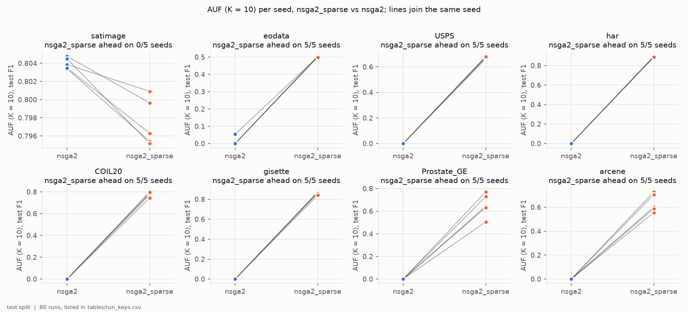
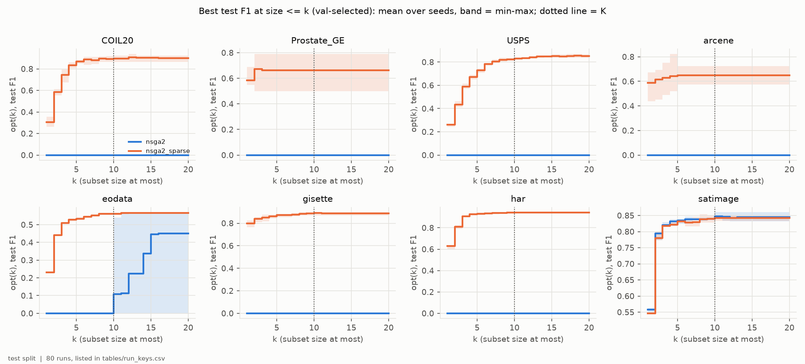
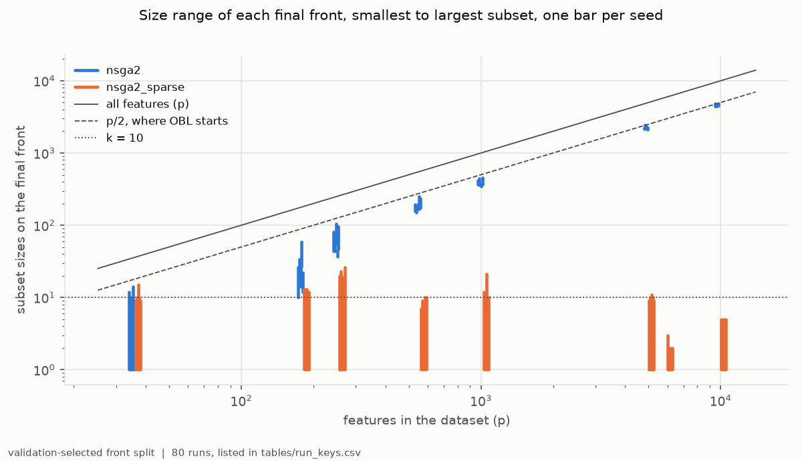
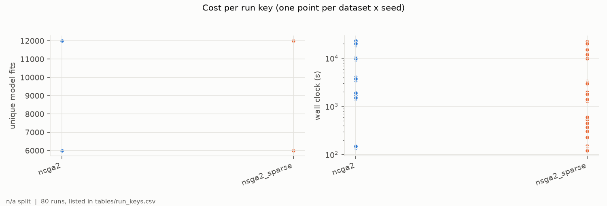

# H1-E02 -- report

*Hypothesis H1. The runs, the criteria as registered, the per-seed numbers and how to reproduce them are in [SUPPORT.md](SUPPORT.md).*

## 1. In brief

### The hypothesis

NSGA-II, a standard evolutionary search, finds poor feature sets when only a
few features may be used. H1 says this is not because the search is bad, but
because of where it starts: every candidate begins with about half of all
features, and the search hardly moves away from there. Start it with a few
features instead, and it should do well with few features.

**How it is judged.** NSGA-II was run twice on each of eight datasets, once
with its usual start (half the features) and once with a sparse start (1 to 30
features), with the same budget of model fits and 5 random seeds each. The
score rewards good accuracy with 10 features or fewer. H1 is confirmed if the
sparse start scores higher in at least 4 of 5 seeds on EOData, the main
dataset, and on at least one other dataset.

### The answer: confirmed

The sparse start scored higher in 5 of 5 seeds on EOData and on all six other
datasets with 182 features or more. With its usual start, NSGA-II never found
a set of 10 features or fewer on those datasets (34 of 35 runs), so it scored
zero. On EOData the sparse start scored 0.50 against at most 0.05. Only on the
smallest dataset, with 36 features, where both starts are already small, was
the usual start slightly ahead.

*Each point is one seed's score (AUF, K = 10, test split); lines join the two starts' runs with the same seed.*

## 2. Findings

One finding at a time: the statement, what it rests on, and the figure that shows it.

### F1 -- With its usual start, NSGA-II never reaches small feature sets on datasets with 182 features or more; with a sparse start it always does.

The score (AUF at K = 10) averages the best test F1 reachable with at most 1,
2, ..., 10 features, and counts zero where a run has no set that small. On
the seven datasets with 182 to 10,000 features, the usual start's smallest set
was 10 to 4,506 features, and in 34 of 35 runs it was larger than 10; its
score is 0 there, except EOData seed 2020 (0.054). The sparse start reached a
single feature in every run.

| dataset | features | usual start | sparse start |
|---|---:|---|---|
| satimage | 36 | 0.803-0.805 | 0.795-0.801 |
| eodata | 182 | 0.000-0.054 | 0.499-0.504 |
| USPS | 256 | 0 | 0.663-0.683 |
| har | 561 | 0 | 0.886-0.895 |
| COIL20 | 1,024 | 0 | 0.743-0.800 |
| gisette | 5,000 | 0 | 0.841-0.875 |
| Prostate_GE | 5,966 | 0 | 0.505-0.771 |
| arcene | 10,000 | 0 | 0.555-0.728 |

The win is therefore a win of reach: the usual start is absent from the region
the score measures.

*AUF (K = 10) on the test split per seed, one panel per dataset; lines join runs with the same seed. The y-axes differ between panels.*

### F2 -- Where both starts reach the same feature counts, the usual start is not worse.

Only on satimage (36 features) do both starts cover the same sizes, from 1 to
about 10-15 features, because half of 36 is already small. There the two
curves of best score against set size lie on top of each other, and the usual
start's AUF is slightly higher in 5 of 5 seeds, by 0.003 to 0.009 (mean
0.0065). The hypothesis predicted no difference here. The lead is consistent,
but small next to the gaps of 0.5 to 0.9 on the other datasets, and it is not
explained.

*Best test F1 among sets of at most k features (chosen on validation), k = 1-20; line = mean over 5 seeds, band = min-max; dotted line = K = 10. A start with no set of size <= k counts zero there.*

### F3 -- Neither start's search moves far from where it began.

On the size axis, each start ends up close to where it began. With the usual
start, the final sets are 5-32% of all features on EOData, and the wider the
dataset, the nearer they stay to the starting half: 41-45% on the three
widest. With the sparse start, no final set has more than 26 features, on any
dataset. That costs the sparse start at the top end. On USPS, COIL20, gisette,
Prostate_GE and arcene, its best set scores below the usual start's best
(gisette 0.869-0.897 against 0.924-0.941), because the larger sets it never
reached are better. On EOData and har it loses nothing: at most 13 and 10
features score as well as the usual start's 22-59 and 176-250.

| dataset | features | usual start: set sizes | sparse start: set sizes | best F1, usual | best F1, sparse |
|---|---:|---|---|---|---|
| satimage | 36 | 1 to 9-14 | 1 to 9-15 | 0.832-0.861 | 0.834-0.850 |
| eodata | 182 | 10-27 to 22-59 | 1 to 9-13 | 0.560-0.569 | 0.564-0.567 |
| USPS | 256 | 37-57 to 45-105 | 1 to 15-26 | 0.868-0.886 | 0.845-0.866 |
| har | 561 | 150-175 to 176-250 | 1 to 7-10 | 0.932-0.940 | 0.935-0.948 |
| COIL20 | 1,024 | 342-370 to 354-455 | 1 to 8-21 | 0.900-0.935 | 0.866-0.921 |
| gisette | 5,000 | 2,104-2,198 to 2,162-2,446 | 1 to 9-11 | 0.924-0.941 | 0.869-0.897 |
| Prostate_GE | 5,966 | 2,445-2,544 to 2,452-2,544 | 1 to 2-3 | 0.792-0.847 | 0.500-0.792 |
| arcene | 10,000 | 4,448-4,506 to 4,482-4,820 | 1 to 4-5 | 0.676-0.825 | 0.574-0.726 |

*One bar per run, from the smallest to the largest set on its final front, at the dataset's feature count (both axes logarithmic). Solid line: all features; dashed: half, where the usual start begins; dotted: 10 features.*

### F4 -- Equal model fits did not mean equal run time; the gap reached 90 times, in both directions.

Both starts spent exactly their budget of model fits (6,000; 12,000 on
arcene). Mean hours per run, usual / sparse: EOData 5.63 / 0.86, gisette 5.30
/ 0.46, har 2.70 / 0.13, USPS 1.02 / 0.15, COIL20 0.50 / 0.07, satimage 0.04 /
0.03, arcene 0.41 / 5.67, Prostate_GE 0.04 / 3.67. On datasets with many rows,
fitting a model on half the features is expensive, and the sparse start is
6-21 times faster. On the two wide datasets with 102 and 200 rows, the sparse
start's population collapsed onto a few tiny sets. Almost every new candidate
had already been fitted, and those cost no fit, so the search ran
250,000-560,000 generations to spend its budget. Ten runs shared the machine,
so these times are rough.

*Left: unique model fits per run. Right: wall clock per run, logarithmic. One point per dataset and seed.*

## 3. Assessment

The experiment supports H1 as registered. Starting NSGA-II from sparse subsets
rather than from opposition-based initialisation raised AUF (K = 10) in 5 of 5
seeds on EOData (0.499-0.504 against 0.000-0.054) and on each of the six other
datasets with 182 to 10,000 features (F1). On the one dataset where both
initialisations already lie in the low-k region, satimage with 36 features,
the ordering reversed by a small margin (0.003-0.009 in 5 of 5 seeds; F2).

The size of the effect needs to be read with care. AUF assigns zero to subset
sizes a run never produced, and the OBL-initialised search produced no subset
of 10 features or fewer in 34 of 35 runs on the larger datasets. The criterion
therefore measured whether each search reached the low-k region, not how well
it searched there. On the first question the result is unambiguous. On the
second, which is the other half of H1's claim, the evidence is limited to
satimage. There the OBL search was level with the sparse one at every k, which
is consistent with "the search is not worse", but it rests on a single small
dataset.

The mechanism the hypothesis names is borne out more broadly than the
criterion requires. Subset size behaves as a nearly driftless quantity under
NSGA-II's operators. Within the budget, the OBL fronts remained at 27-45% of
the feature count on the five widest datasets, and the sparse fronts never
grew beyond 26 features (F3). The initialisation thus decides where along the
size axis the final front lies, in both directions. The sparse start gains
the low-k end and gives up the high-k end, at a measurable cost in best
attainable F1 on five of the eight datasets (F3). Neither initialisation
yields a front that spans the size range.

Three limitations bound the result. First, it is obtained at a single budget
(6,000 fits; 12,000 on arcene), and the OBL size floor may depend on it; the
pilot suggests a tenfold budget moves it only partly. Second, on Prostate_GE
and arcene the validation and test splits hold 20-40 rows, and the sparse
arm's AUF varies by 0.17-0.27 across seeds. That spread is small next to the
margins of 0.5 or more, but limits what the scores there say about subset
quality. Third, the comparison is internal to NSGA-II. Whether its sparse
search is competitive at low k with other selectors is the question of H5 and
H6. A fit budget also does not bound run time (F4): a search whose population
collapses onto cached subsets can run for hours on cheap data.

For H5 and H6 this means NSGA-II cannot be represented by a single
initialisation without conceding part of the front. It should enter either
with both starts, each read in the size range it covers, or with an
initialisation that spans the size axis. That choice is for the PI and is not
made here.
