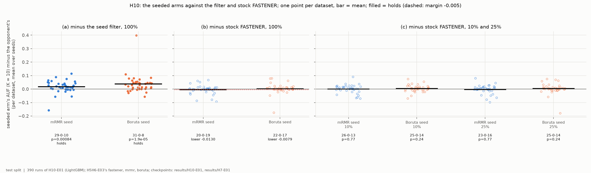
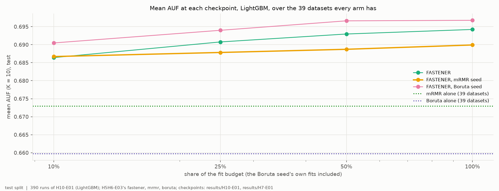
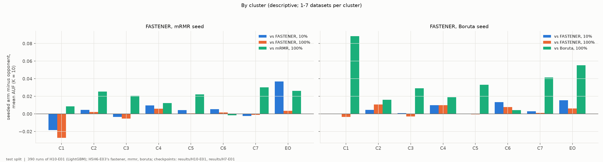
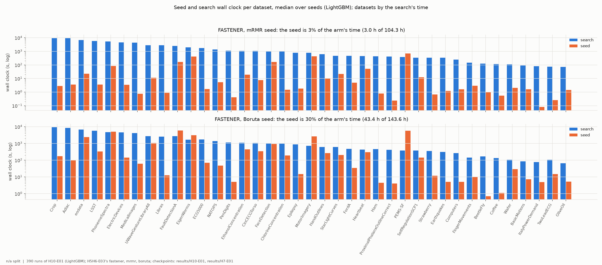

# H10-E01 -- report

*Hypothesis H10, under LightGBM. The runs, the criterion as registered, the numbers and how to reproduce them are in [SUPPORT.md](SUPPORT.md).*

## 1. In brief

### The hypothesis

Across the three H5/H6 grids the leader changes with the dataset: simple
filters lead on the small sets, searches such as FASTENER on the tall ones.
H10 proposes a hybrid: start FASTENER not from five random single features,
as it does now, but from a filter's own answer -- its best 1, 2, ..., 10
features -- and let the search improve on it. The primary seed is mRMR; a
second arm uses Boruta. Each new arm is compared with stock FASTENER and
with its filter, both taken from H5H6-E03, which ran the same datasets,
budgets and classifier (LightGBM).

**How it is judged.** For the mRMR-seeded arm, datasets as the unit, with
AUF (K = 10) on the test split -- the area under the best-test-score-by-size
curve for 1 to 10 features: (a) better than mRMR alone (more wins than
losses, Wilcoxon p < 0.05); (b) no worse than stock FASTENER at the end of
the budget (the one-sided 95% lower bound of the mean difference above
-0.005); (c) better than stock FASTENER at 10% and 25% of the budget (more
wins than losses, Wilcoxon after Holm). H10 holds if all three do. This
experiment decides H10; H10-E02 and -E03 repeat it under the random forest
and the decision tree.

### The answer: not confirmed

The seeded search is clearly better than the filter it starts from (a:
29-0-10, +0.017 AUF, p = 0.0008), but it is not shown to be as good as
stock FASTENER (b: 20-0-19, mean -0.004, lower bound -0.013 against the
margin -0.005), and it is not ahead part-way through the budget (c: +0.000
at 10%, -0.003 at 25%, neither significant). The Boruta seed, reported as
secondary, does better than the mRMR seed on every count but also misses
(b) and (c).

*Each seeded arm's AUF minus its opponent's, one point per dataset; filled points mark the comparisons that hold.*

## 2. Findings

### F1 -- The mRMR seed passes (a) and fails (b) and (c); so does the Boruta seed

| arm | (a) vs its filter, 100% | (b) vs stock FASTENER, 100% | (c) 10% | (c) 25% |
|---|---|---|---|---|
| mRMR seed (primary) | 29-0-10, +0.017, **p = 0.0008** | 20-0-19, -0.004, lower bound -0.013 | 26-0-13, +0.000, p = 0.77 | 23-0-16, -0.003, p = 0.77 |
| Boruta seed | 31-0-8, +0.037, **p < 0.0001** | 22-0-17, +0.003, lower bound -0.008 | 25-0-14, +0.004, p = 0.24 | 25-0-14, +0.003, p = 0.24 |

*Wins-ties-losses over the 39 datasets, mean AUF difference, p (Holm-corrected in (c)); (b) gives the one-sided 95% lower bound of the mean difference, 10,000 paired bootstrap resamples.*

Searching on from the filter's subsets always helps the filter: the seeded
arm is ahead of its own filter on 29 (mRMR) and 31 (Boruta) of 39 datasets.
Against stock FASTENER both seeded arms are level on wins (20-0-19,
22-0-17), and (b) fails on the width of the interval rather than on its
centre: one dataset, OliveOil, costs the mRMR seed 0.094 and the Boruta
seed 0.175. Without it the Boruta seed's mean difference would be +0.007.
H10's title claim -- as good as the better of the filter and the search on
each dataset -- does not hold either: against the per-dataset better of mRMR
and stock FASTENER the mRMR seed is 15-0-24 (-0.011; SUPPORT section 5).

*y = seeded arm's mean AUF (K = 10) minus the opponent's per dataset, mean over seeds; bar = mean; dashed line in (b): the margin -0.005. Test split.*

### F2 -- The mRMR seed barely improves with more budget; the Boruta seed leads stock FASTENER at every checkpoint

Mean AUF over the 39 datasets:

| arm | 10% | 25% | 50% | 100% |
|---|---|---|---|---|
| stock FASTENER | 0.686 | 0.691 | 0.693 | 0.694 |
| mRMR seed | 0.687 | 0.688 | 0.689 | 0.690 |
| Boruta seed | 0.690 | 0.694 | 0.697 | 0.697 |
| mRMR alone / Boruta alone | 0.673 / 0.660 | | | |

From 10% to 100% of the budget stock FASTENER gains 0.008, the mRMR seed
0.003. The mRMR-seeded run does not stay on its seed -- only 9% of its final
front entries of at most 10 features are still one of mRMR's subsets, and
no run keeps the seed as its whole front -- but what it finds instead is
worth less on test than what stock FASTENER finds. The Boruta seed starts
0.004 above stock FASTENER (with its own fits counted) and stays about that
far ahead; the differences are small against their spread (F1).

*Mean test AUF (K = 10) of each arm at 10%, 25%, 50% and 100% of the fit budget (log x), with the two filters alone as dotted lines; 39 datasets.*

### F3 -- The mRMR seed loses on the small C1 sets and gains early on EOData

By cluster, the mRMR seed against stock FASTENER is within ±0.01 on C2-C7 at
both 10% and 100% of the budget. On C1, the seven smallest sets, it is
behind by 0.018 at 10% and 0.027 at 100%, and its gain over mRMR alone
is the smallest of any cluster but C6 (+0.009; C6 -0.001). On EOData it is
ahead of stock FASTENER by 0.037 at 10%, a lead that shrinks to 0.004 by the end. The
Boruta seed is within ±0.016 of stock FASTENER on every cluster at both
checkpoints, and its largest gain over Boruta alone is on C1 (+0.088).

*Per cluster, each seeded arm minus stock FASTENER at 10% and 100% of the budget, and minus its own filter at 100%; 1-7 datasets per cluster (EO = EOData), descriptive.*

### F4 -- Boruta's seed costs few fits but much time: 30% of the arm's wall clock

The mRMR ranking took a median 3 s per run (3.0 h over all 195 runs, 3% of
the arm's time). Boruta charged only 8-99 fits to each run's budget (99 in
128 of 195 runs), but each of its fits is a LightGBM fit on all features: a
median 69 s per run and up to 2.2 h, 43.4 h in all against 100.2 h of
search -- 30% of the arm's wall clock. Counted in fits, the Boruta seed is
nearly free; counted in time, it is not.

*Per dataset, the seed's wall clock and the search's, median over seeds (log y); 8 cores on HPC Vega.*

## 3. Assessment

**H10 is not supported.** Its primary arm, FASTENER seeded with mRMR's top-k
subsets, is significantly better than mRMR alone, but neither shown to be
no worse than stock FASTENER at the end of the budget nor ahead of it at
10% or 25% (F1). The verdict rests on (b) and (c) together: (b) misses by an
interval that one dataset widens, but (c) shows no early lead at all.

**What the experiment shows.** Seeding is a safe way to improve a filter --
on 29-31 of 39 datasets the search beats the filter it starts from, by
0.017-0.037 AUF on average -- but not a way to improve FASTENER. The mRMR
start does not even give the early lead it was meant to give (F2): at 10%
of the budget it is level with stock FASTENER, whose own guided start
reaches nearly its final level by then (as H7-E01 found). The one place a
seed helps early is EOData, as in H7 the dataset where FASTENER's own early
lead was largest (F3). The hybrid's natural risk, overfitting the
validation split on small sets, shows on C1 for the mRMR seed (F3).

**The Boruta seed is the better seed** on every number here -- ahead of
stock FASTENER on wins at every checkpoint and by 0.003-0.004 on average
(F1, F2) -- against the registration's expectation. Its likely reason is
what Boruta's ranking holds: all relevant features ranked by importance
under the same classifier, rather than mRMR's redundancy-penalised order.
But its advantage is small, not significant, and paid for in time (F4).

**Limits.** One classifier; one split per dataset, the smallest test splits
holding 8-12 rows, so that single datasets such as OliveOil move the means;
five seeds; budgets calibrated for stock FASTENER. The checkpoints of the
Boruta seed include its own fits, which are not in its trajectory (offset
as registered). The comparison runs come from H5H6-E03, run on the same
cluster, code and budgets a day earlier.

**What follows.** The PI's choices:

1. Beside this verdict: under the random forest (H10-E02) the mRMR seed
   passes (a) and (b) and fails only (c), with a non-significant early lead
   of +0.009; under the decision tree (H10-E03) it passes only (a). No
   classifier gives H10 as registered.
2. If the hybrid is pursued, the Boruta seed, not mRMR, is the candidate,
   and a test of it would have to be registered anew, with its time cost in
   the comparison.
3. Within H9, H10's part on new datasets can be dropped or kept as a
   replication of a negative result.
