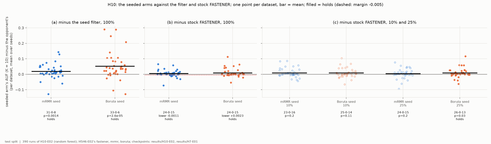
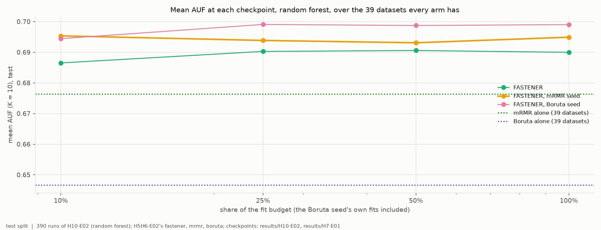
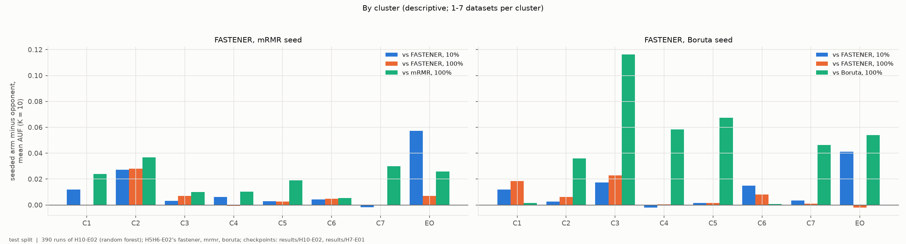
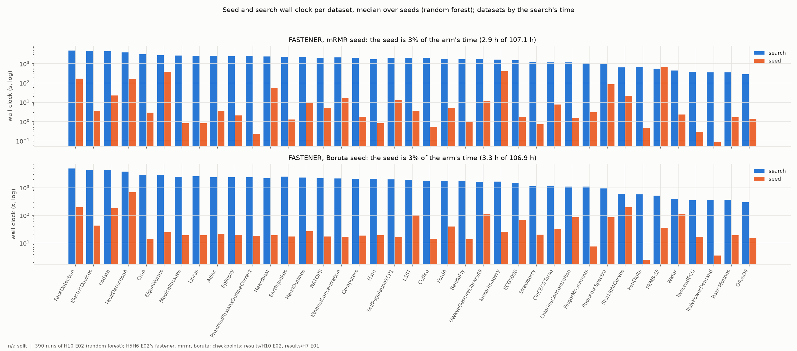

# H10-E02 -- report

*Hypothesis H10, under the random forest. The runs, the criterion as registered, the numbers and how to reproduce them are in [SUPPORT.md](SUPPORT.md).*

## 1. In brief

### The hypothesis

H10 proposes starting FASTENER from a filter's own answer -- its best 1,
2, ..., 10 features -- instead of five random single features. H10-E01
tested it under LightGBM and decides it; this experiment repeats it under
the protocol random forest, on H5H6-E02's grid, and compares the two seeded
arms (mRMR, primary; Boruta, secondary) with that grid's stock FASTENER and
filters.

**How it is judged.** As in H10-E01, datasets as the unit, AUF (K = 10) on
the test split: (a) better than the seed filter alone (more wins than
losses, Wilcoxon p < 0.05); (b) no worse than stock FASTENER at the end of
the budget (one-sided 95% lower bound of the mean difference above -0.005);
(c) better than stock FASTENER at 10% and 25% of the budget (Wilcoxon after
Holm). All three must hold, for the mRMR seed.

### The answer: not confirmed, but closest of the three

Under the forest the mRMR-seeded search passes (a) (31-0-8, +0.019,
p = 0.001) and (b) (lower bound -0.001), and is ahead of stock FASTENER at
10% and 25% of the budget on wins and on average (+0.009, +0.004) -- but not
significantly (Holm p = 0.20), so (c) fails. The Boruta seed passes (a),
(b) and (c) at 25% (Holm p = 0.03), but not at 10%.

*Each seeded arm's AUF minus its opponent's, one point per dataset; filled points mark the comparisons that hold.*

## 2. Findings

### F1 -- Both seeds pass (a) and (b); (c) fails for both, by one checkpoint for the Boruta seed

| arm | (a) vs its filter, 100% | (b) vs stock FASTENER, 100% | (c) 10% | (c) 25% |
|---|---|---|---|---|
| mRMR seed (primary) | 31-0-8, +0.019, **p = 0.001** | 24-0-15, +0.005, **lower bound -0.001** | 23-0-16, +0.009, p = 0.20 | 24-0-15, +0.004, p = 0.20 |
| Boruta seed | 33-0-6, +0.052, **p < 0.0001** | 24-0-15, +0.009, **lower bound +0.002** | 25-0-14, +0.008, p = 0.11 | 26-0-13, +0.009, **p = 0.030** |

*Wins-ties-losses over the 39 datasets, mean AUF difference, p (Holm-corrected in (c)); (b): one-sided 95% lower bound, 10,000 paired bootstrap resamples.*

Under the forest both seeded arms are ahead of stock FASTENER at every
checkpoint, on wins and on average. The mRMR seed's (c) fails on its spread
-- 23-0-16 at 10%, with single datasets from -0.04 to +0.09. Against the
per-dataset better of its filter and stock FASTENER (H10's title claim),
the mRMR seed is 20-0-19 (-0.006) and the Boruta seed 20-0-19 (-0.001)
(SUPPORT section 5).

*y = seeded arm's mean AUF (K = 10) minus the opponent's per dataset, mean over seeds; bar = mean; dashed line in (b): the margin -0.005. Test split.*

### F2 -- Under the forest the seeds give a head start that stock FASTENER never closes

Mean AUF over the 39 datasets:

| arm | 10% | 25% | 50% | 100% |
|---|---|---|---|---|
| stock FASTENER | 0.687 | 0.690 | 0.691 | 0.690 |
| mRMR seed | 0.695 | 0.694 | 0.693 | 0.695 |
| Boruta seed | 0.694 | 0.699 | 0.699 | 0.699 |
| mRMR alone / Boruta alone | 0.676 / 0.647 | | | |

At 10% of the budget both seeded arms are 0.008-0.009 above stock FASTENER,
and none of the three arms improves much after a quarter of the budget, so
the head start is kept: at 100% the mRMR seed is 0.005 and the Boruta seed
0.009 ahead. As under the other classifiers, the seeded runs leave their
seed behind -- 8% (mRMR) and 6% (Boruta) of their final front entries of at
most 10 features are still one of the seed's subsets.

*Mean test AUF (K = 10) of each arm at 10%, 25%, 50% and 100% of the fit budget (log x), with the two filters alone as dotted lines; 39 datasets.*

### F3 -- The early lead is largest on EOData and C2; under the forest the mRMR seed does not lose on C1

By cluster at 10% of the budget the mRMR seed is ahead of stock FASTENER on
EOData (+0.057) and C2 (+0.027), and within 0.012 elsewhere; at 100% it
keeps C2 (+0.028) and is within 0.007 on every other cluster. Unlike under
LightGBM and the tree, it is not behind on C1 (+0.012 at 10%, 0.000 at
100%). The Boruta seed is ahead at the end on C1 (+0.019) and C3 (+0.023),
and its gain over Boruta alone is largest on C3 (+0.116).

*Per cluster, each seeded arm minus stock FASTENER at 10% and 100% of the budget, and minus its own filter at 100%; 1-7 datasets per cluster (EO = EOData), descriptive.*

### F4 -- Under the forest both seeds are cheap: 3% of the arm's wall clock

With forest fits on 8 cores the search itself is slow (104 h per arm over
195 runs), and both seeds are small beside it: mRMR a median 3 s per run
(2.9 h, 3%), Boruta a median 21 s and at most 12 min (3.3 h, 3%), charging
8-99 fits (99 in 152 of 195 runs).

*Per dataset, the seed's wall clock and the search's, median over seeds (log y); 8 cores on HPC Vega.*

## 3. Assessment

**H10's primary arm fails under the forest too, but only on (c).** The mRMR
seed is better than mRMR alone and no worse than stock FASTENER (lower bound
-0.001); its early lead (+0.009 at 10%) is the largest of the three
experiments but not significant (F1). H10's verdict is H10-E01's; this
experiment is the closest any classifier came to the registered criterion.

**What it adds.** The effect of seeding depends on the classifier. Under the
forest the seed's head start is kept to the end, because stock FASTENER
itself gains little after a quarter of the budget (F2); under LightGBM stock
FASTENER catches up and passes the mRMR seed (H10-E01, F2). And the C1
penalty the mRMR seed showed under LightGBM and the tree does not appear
here (F3). The Boruta seed is again the stronger seed: non-inferior, ahead
at every checkpoint, significant at 25%, and nearly free in time under this
classifier (F1, F2, F4).

**Limits.** One split per dataset, the smallest test splits holding 8-12
rows; five seeds; budgets calibrated for stock FASTENER; Holm over two
checkpoints with 39 datasets leaves little power for differences of
0.005-0.01. At 100% the checkpoint procedure reproduced 389 of 390 runs
exactly; the other differs by 0.00004 AUF on the same subsets (SUPPORT).

**What follows.** Across H10-E01 to -E03 the Boruta seed passes (b) under
two classifiers of three and (c) at one checkpoint under one; whether a
Boruta-seeded FASTENER is worth registering as its own hypothesis -- with
its time cost under LightGBM in the comparison -- is the PI's choice.
