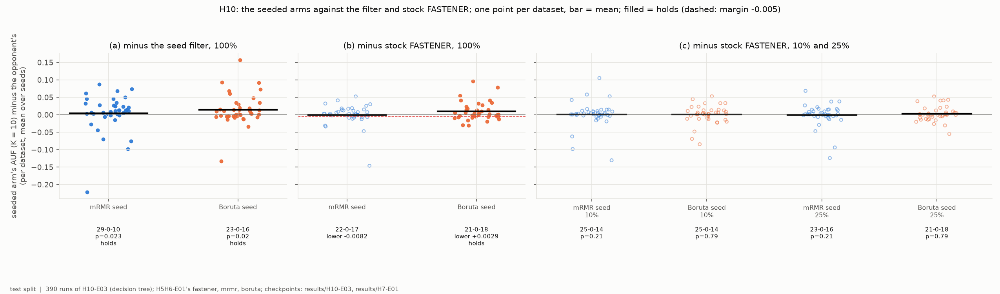
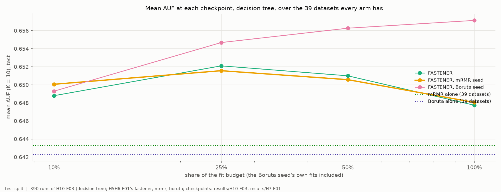
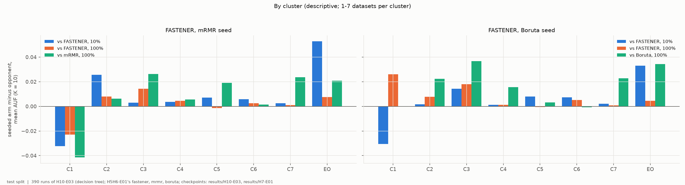
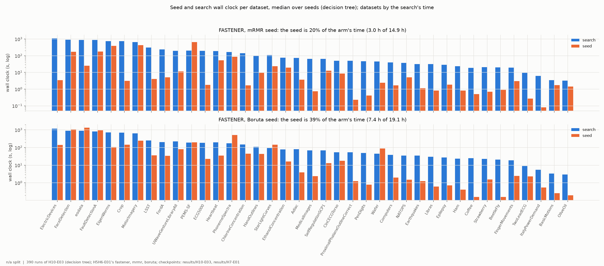

# H10-E03 -- report

*Hypothesis H10, under the decision tree. The runs, the criterion as registered, the numbers and how to reproduce them are in [SUPPORT.md](SUPPORT.md).*

## 1. In brief

### The hypothesis

H10 proposes starting FASTENER from a filter's own answer -- its best 1,
2, ..., 10 features -- instead of five random single features, so that the
search begins where the filter ends. H10-E01 tested it under LightGBM and
decides it; this experiment repeats it under the protocol decision tree, on
H5H6-E01's grid, and compares the two seeded arms (mRMR, primary; Boruta,
secondary) with that grid's stock FASTENER and filters.

**How it is judged.** As in H10-E01, datasets as the unit, AUF (K = 10) on
the test split: (a) better than the seed filter alone (more wins than
losses, Wilcoxon p < 0.05); (b) no worse than stock FASTENER at the end of
the budget (one-sided 95% lower bound of the mean difference above -0.005);
(c) better than stock FASTENER at 10% and 25% of the budget (Wilcoxon after
Holm). All three must hold, for the mRMR seed.

### The answer: not confirmed

Under the tree, as under LightGBM, the mRMR-seeded search beats mRMR alone
(a: 29-0-10, +0.005, p = 0.023) but is not shown to be as good as stock
FASTENER (b: lower bound -0.008) and is not ahead part-way through (c).
The Boruta seed passes (a) and (b) -- it is the only arm in H10 so far that
meets the non-inferiority margin -- but not (c).

*Each seeded arm's AUF minus its opponent's, one point per dataset; filled points mark the comparisons that hold.*

## 2. Findings

### F1 -- The mRMR seed passes only (a); the Boruta seed passes (a) and (b)

| arm | (a) vs its filter, 100% | (b) vs stock FASTENER, 100% | (c) 10% | (c) 25% |
|---|---|---|---|---|
| mRMR seed (primary) | 29-0-10, +0.005, **p = 0.023** | 22-0-17, +0.000, lower bound -0.008 | 25-0-14, +0.001, p = 0.21 | 23-0-16, -0.000, p = 0.21 |
| Boruta seed | 23-0-16, +0.015, **p = 0.020** | 21-0-18, +0.009, **lower bound +0.003** | 25-0-14, +0.000, p = 0.79 | 21-0-18, +0.003, p = 0.79 |

*Wins-ties-losses over the 39 datasets, mean AUF difference, p (Holm-corrected in (c)); (b): one-sided 95% lower bound, 10,000 paired bootstrap resamples.*

The mRMR seed is level with stock FASTENER on average (+0.0003) but with a
wide spread: OliveOil alone costs it 0.146, and without that dataset its
mean difference would be +0.004. The Boruta seed ends ahead of stock
FASTENER by 0.009 on average, with a lower bound of +0.003. Neither seed is
as good as the per-dataset better of its filter and stock FASTENER (mRMR
seed 16-0-23, Boruta seed 12-0-27; SUPPORT section 5).

*y = seeded arm's mean AUF (K = 10) minus the opponent's per dataset, mean over seeds; bar = mean; dashed line in (b): the margin -0.005. Test split.*

### F2 -- Under the tree more search stops paying after a quarter of the budget, except from the Boruta seed

Mean AUF over the 39 datasets:

| arm | 10% | 25% | 50% | 100% |
|---|---|---|---|---|
| stock FASTENER | 0.649 | 0.652 | 0.651 | 0.648 |
| mRMR seed | 0.650 | 0.652 | 0.651 | 0.648 |
| Boruta seed | 0.649 | 0.655 | 0.656 | 0.657 |
| mRMR alone / Boruta alone | 0.643 / 0.642 | | | |

Stock FASTENER and the mRMR seed track each other within 0.002 at every
checkpoint, and lose 0.004 and 0.003 between 25% and 100% of the budget: under
the tree, later fits find subsets that score higher on validation and lower
on test. The Boruta seed keeps improving to the end and is 0.009 above both
at 100%. The mRMR-seeded runs do not stay on their seed: 8% of their final
front entries of at most 10 features are still one of mRMR's subsets (7%
for the Boruta seed).

*Mean test AUF (K = 10) of each arm at 10%, 25%, 50% and 100% of the fit budget (log x), with the two filters alone as dotted lines; 39 datasets.*

### F3 -- On the small C1 sets the mRMR-seeded search ends below mRMR alone

By cluster, the mRMR seed against stock FASTENER is behind on C1 (-0.032 at
10%, -0.023 at 100%) and ahead on EOData (+0.053 at 10%, +0.007 at 100%);
elsewhere it is within 0.026. On C1 it also ends 0.041 below mRMR alone, the
only cluster where the seeded search loses to its own seed filter: on the
seven smallest sets, the search replaces mRMR's subsets with ones that score
higher on validation and lower on test. The Boruta seed starts behind on C1
(-0.030 at 10%) and ends ahead there (+0.026 at 100%), level with Boruta
alone.

*Per cluster, each seeded arm minus stock FASTENER at 10% and 100% of the budget, and minus its own filter at 100%; 1-7 datasets per cluster (EO = EOData), descriptive.*

### F4 -- With cheap fits the seed's time matters more: 20% of the arm's wall clock for mRMR, 39% for Boruta

On one core with tree fits, a whole search took 11.7-11.9 h per arm over
195 runs. The mRMR ranking, a median 3 s per run, added 3.0 h (20% of the
arm's time); Boruta, a median 16 s and up to 26 min, added 7.4 h (39%),
while charging only 8-99 fits to each run's budget (99 in 172 of 195 runs).

*Per dataset, the seed's wall clock and the search's, median over seeds (log y); one core on HPC Vega.*

## 3. Assessment

**H10's primary arm fails under the tree as under LightGBM.** The mRMR seed
improves on mRMR alone (a) but is neither shown non-inferior to stock
FASTENER (b) nor ahead of it early (c) (F1). H10's verdict is H10-E01's;
this experiment says the negative result is not peculiar to LightGBM.

**What it adds.** First, under the tree, the search itself overfits the
validation split as the budget grows: stock FASTENER and the mRMR seed both
peak at a quarter of the budget (F2). That is a property of the protocol
(validation-chosen subsets, small validation splits), not of seeding, and it
matters for how budgets are set. Second, on C1 the mRMR-seeded search ends
below the filter it started from (F3) -- the risk H10 named. Third, the
Boruta seed again does better than the mRMR seed, here enough to pass
non-inferiority (+0.009, lower bound +0.003) and to keep improving where
the others do not (F1, F2) -- but not early, and at 39% more wall clock
(F4).

**Limits.** One split per dataset, the smallest test splits holding 8-12
rows; five seeds; budgets calibrated for stock FASTENER. The comparison runs
(H5H6-E01) ran on the workstation with scikit-learn 1.9.0, these on Vega
with 1.9.1 -- judged equivalent by the PI, so the scores are compared
directly; timings are not compared across the two. The Boruta seed's
checkpoints include its own fits, offset as registered.

**What follows.** As in H10-E01's report: the Boruta seed is the candidate
if the hybrid is pursued, with its time in the comparison; and the decline
of stock FASTENER after a quarter of the budget under the tree is worth a
question of its own -- whether a shorter budget or a stopping rule on
validation would give better test scores.
