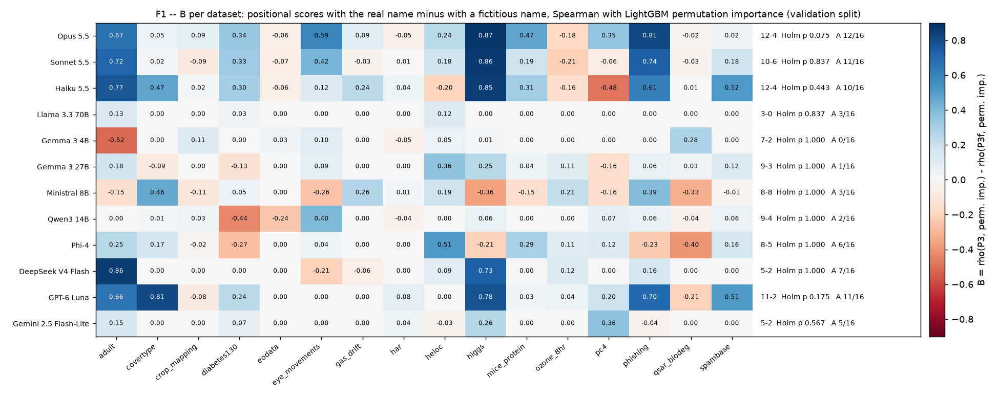
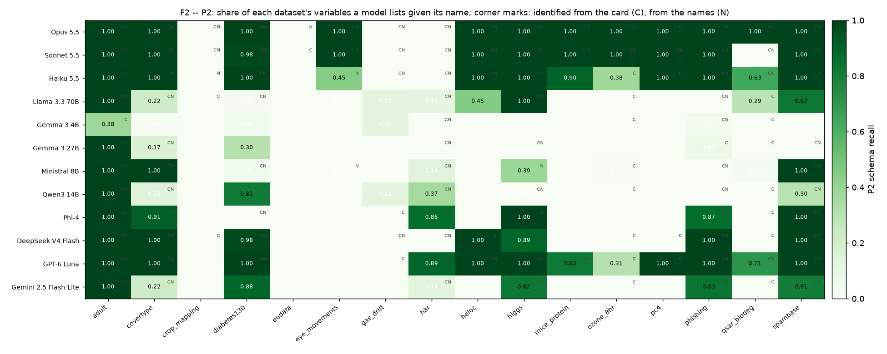
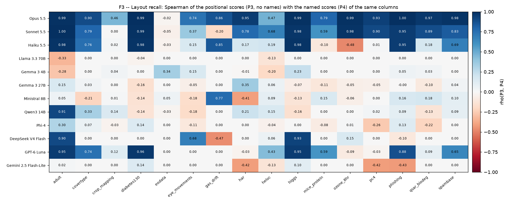
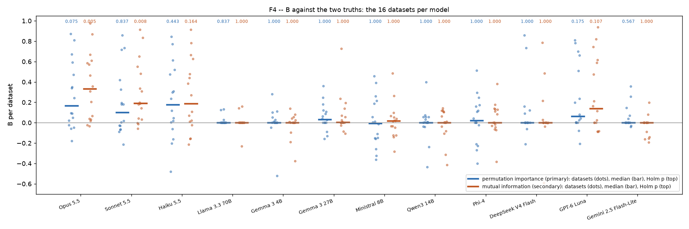
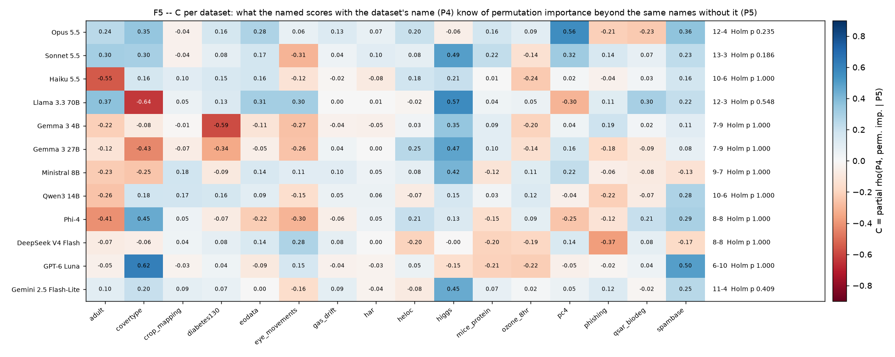

# H12-E01 -- What twelve LLMs know of the H8 datasets

## 1. In brief

**The hypothesis.** Large language models recognise the 16 H8 datasets and
know which of their features matter. This should be knowledge of *the
dataset*, not only of the physics or the domain behind its features. Three
parts, each tested per model over the 16 datasets:

- **A:** given a dataset's name, the model lists its features.
- **B:** given only the name and the feature *positions* (no feature names),
  its relevance scores match the relevance measured on the data better than
  the same prompt with a fictitious dataset name.
- **C (the strict form):** given the feature names, adding the dataset's name
  lets the model track the measured relevance beyond what the names alone
  give.

**How it is judged.** The relevance measured on the data is LightGBM's
permutation importance on the validation split. A holds if the model
recalls at least half of the features on at least 8 of the 16 datasets.
B holds if the per-dataset effect (Spearman with the real name minus with
the fictitious one) is positive on more datasets than negative and
significant (Wilcoxon, p < 0.05 after Holm over the 12 models). H12 is
supported if A and B both hold for at least 7 of the 12 models. It is
"dataset-specific" if C holds as well for at least 7.

**The answer: not confirmed.** A and B hold together for none of the 12
models. A holds for four: Opus, Sonnet, Haiku and GPT-6 Luna. B is the
deciding part. It is positive on most datasets for those four (Opus 12-4,
Haiku 12-4, GPT-6 Luna 11-2, Sonnet 10-6), but no model reaches significance
after Holm. Opus comes closest at Holm p = 0.075. The other eight models
show almost no such knowledge. C holds for no model. The knowledge exists,
but it is strong in only a few large models, and only on a few famous
datasets.

*F1 -- B per dataset (x) and model (y): Spearman of the positional scores
with permutation importance (validation split), real name minus fictitious
name. Right: datasets positive-negative, Holm p, and part A's count.*

## 2. Findings

### F1 -- B fails for every model after Holm; the closest is Opus 5.5 (12-4, Holm p 0.075)

| model | A: datasets with recall >= 0.5 | B: + / - datasets | B: Holm p | H12 |
|---|---|---|---|---|
| Opus 5.5 | 12 | 12-4 | 0.075 | no |
| Sonnet 5.5 | 11 | 10-6 | 0.837 | no |
| Haiku 5.5 | 10 | 12-4 | 0.443 | no |
| GPT-6 Luna | 11 | 11-2 | 0.175 | no |
| the other eight | 0-7 | 3-0 to 9-4 (Ministral 8-8) | 0.567-1.000 | no |

0 of 12 models meet the criterion, so H12 is not supported, and with C
holding for none it is not dataset-specific. The large positive cells sit on
a few datasets. On higgs, phishing and adult, B is 0.67-0.87 for Opus,
0.72-0.86 for Sonnet, 0.61-0.85 for Haiku and 0.66-0.78 for GPT-6 Luna.
Elsewhere it is near zero: eodata, har, crop_mapping, gas_drift and
qsar_biodeg are within ±0.24 for all four models. The fictitious-name
control mostly gave flat scores (Opus 13 of 16, Sonnet 12, Haiku 10, the
GPT-6 Luna 16), and a flat score counts as rho 0. So B is essentially "how
well the positional scores agree with the truth".

### F2 -- The larger models know the datasets by name; the small ones do not

*F2 -- Share of each dataset's variables a model lists when given the
dataset's name (P2). Corner marks: the model named the dataset from an
anonymous card of rows, feature count and class names (C), or from the
feature names alone (N).*

From the anonymous card, Opus names 15 of 16 datasets, Sonnet 16, Haiku 13
and GPT-6 Luna 13. The other eight name 5-13; DeepSeek V4 Flash names 13
and Llama 3.3 70B names 9. Given the name, the four larger models reproduce
the feature list almost entirely: median recall is 1.00 for Opus and Sonnet
and 0.95 for Haiku and GPT-6 Luna. The other eight have median recall
between 0.00 and 0.07. Nobody recalls eodata, the Slovenian Sentinel-2 set:
every model's recall there is 0.00.

The registered grading undercounts the strong models (not planned).
Asked for "the names used in its distributed file", Opus and Sonnet answered
`V1..V561` for har, Sonnet `V1..V41` for qsar_biodeg, and Opus and Sonnet
`f1..f174` for crop_mapping. These are the real headers of the OpenML and
UCI files. The registered match against the restored descriptive names
scores them 0. Counting them as correct, A rises from 12 to 15 datasets for
Opus, 11 to 15 for Sonnet and 10 to 11 for Haiku. A held for these models
anyway, so the verdict does not change.

### F3 -- The large models recall the column order: Opus's positional scores match its named scores (median rho 0.94)

*F3 -- Spearman of each model's positional scores (P3, no feature names)
with its named scores (P4) for the same columns.*

This is H8-E02's layout recall, measured directly. Median over the 16
datasets: Opus 0.94, Sonnet 0.81, GPT-6 Luna 0.28 and Haiku 0.18. Opus is
at 0.86 or above on 11 datasets, including har (0.95), ozone_8hr (0.99) and
qsar_biodeg (0.97), where it could not list the descriptive names. It knows
which position holds which feature even where it knows the file only by
generic headers. The other eight models are near 0. The exceptions are
single datasets: DeepSeek V4 Flash on higgs (0.93) and adult (0.90), Qwen3
14B on adult (0.91). For every model, eodata is at most 0.34.

So the gap between F3 and F1 is not a lack of knowledge of the layout.
Where Opus knows the layout perfectly (har, ozone_8hr, qsar_biodeg), its
named scores themselves do not track permutation importance. B can only be
as good as the model's idea of relevance.

### F4 -- Against mutual information, B holds for Opus and Sonnet (not planned)

*F4 -- B per dataset (dots) and median (bar) under each truth: permutation
importance (primary, blue) and mutual information on the training split
(secondary, orange). Holm p over the 12 models at the top.*

With mutual information as the truth, B is 14-2 for Opus (Holm p 0.005),
13-3 for Sonnet (Holm p 0.008), 12-4 for Haiku (0.164) and 10-3 for GPT-6
Luna (0.107). A and B would then hold for Opus and Sonnet: 2 of 12 models,
still short of 7. The two truths diverge most on the near-perfectly
classified, redundant datasets. LightGBM reaches validation weighted F1
0.99 on har, crop_mapping and gas_drift, where permuting one feature barely
matters and the two truths agree at rho 0.04-0.19 (SUPPORT.md, *Truth*).
The models' idea of relevance is closer to marginal relevance than to what
one fitted LightGBM depends on.

### F5 -- The dataset's name adds little to the feature names (C holds for no model)

*F5 -- C per dataset: partial Spearman of the named scores with the dataset's
name (P4) with permutation importance, controlling for the same prompt
without the name (P5).*

C is 12-4 for Opus (Holm p 0.235), 13-3 for Sonnet (0.186) and 12-3 for
Llama 3.3 70B (0.548). The other nine range from 6-10 to 11-4, with Holm p
0.409-1.000. Median rho with
permutation importance: Opus 0.45 with the name and 0.43 without, Sonnet
0.27 and 0.23, Haiku 0.19 and 0.18. With the feature names in front of
them, the models judge relevance from what the names describe. Knowing
which benchmark it is changes the scores little, and not reliably towards
the measured relevance.

## 3. Assessment

H12 is **not confirmed** as registered: 0 of 12 models meet A and B (F1).
The verdict does not depend on the choice of truth. With mutual information
as the truth, two models would meet it, still short of 7 (F4).

What the experiment does show is narrower:

- **Recognition is real in the large models.** Opus, Sonnet, Haiku and
  GPT-6 Luna name most H8 datasets from a card with no domain words beyond
  the class names (13-16 of 16). They reproduce the feature lists (median
  recall 0.95-1.00, F2), and Opus places relevance on bare positions as it
  does on named columns (median layout recall 0.94, F3).
- **Turning that into relevance knowledge works only on a few famous
  datasets.** These are higgs, phishing and adult, with B 0.61-0.87 for the
  four models (F1). They are the datasets with published feature
  importances: the HIGGS paper's high-level masses, the phishing rules, the
  census variables.
- **It does not go beyond domain knowledge (F5).** The dataset's name adds
  nothing reliable to the feature names. What the models "know" about
  relevance is, as far as this design can see, knowledge of the phenomenon
  the features describe, attached to the dataset's layout when they recall
  it.

This answers the PI's question of physics vs dataset: the dataset knowledge
is mostly knowledge of the **layout**, not of a dataset-specific relevance.

**Limits.**

- 16 datasets per model; one call per probe at temperature 0. Repeated
  sampling is not measured.
- The hypothesis came from H8-E02's observation on these datasets with
  Opus, Sonnet and Haiku. For those three the test is weaker than one on
  new data, although every probe was a new call.
- Permutation importance from one LightGBM is a noisy truth on redundant
  data (F4). It is the registered primary, and the mutual-information
  reading is unplanned.
- Part A's grading undercounts correct generic-header answers (F2). This
  affects only models for which A held anyway.
- Eleven replies were empty (DeepSeek V4 Flash 9, Qwen3 14B 2: reasoning
  used the whole output budget), and eight retries repeated the original
  request. These pairs count as flat scores, as registered (SUPPORT.md).
- "Not detected" for the eight smaller models means not detected in these
  probes at n = 16, not shown absent.

**What follows.** For H8: an LLM prior from the large models can carry real
information on famous benchmarks through memory of their layout. H8-E02's
blind control was therefore leaky on exactly those (higgs, phishing,
spambase). On obscure or wide data (eodata, har, crop_mapping) the prior is
domain reasoning, not memory. A confirmatory test of "dataset-specific
relevance" would need datasets with known, counter-intuitive importances.
Choosing them is the PI's decision.
