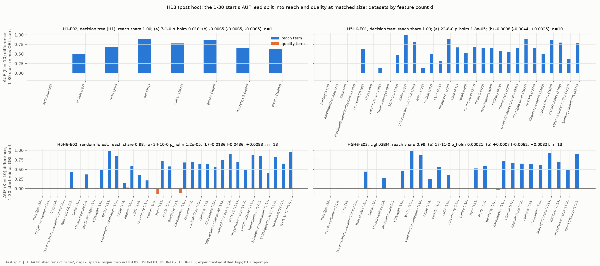
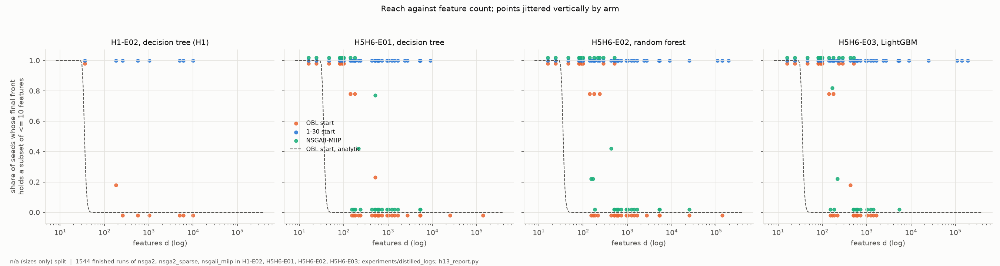
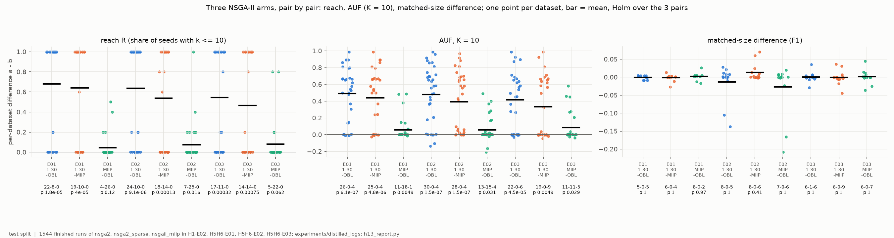
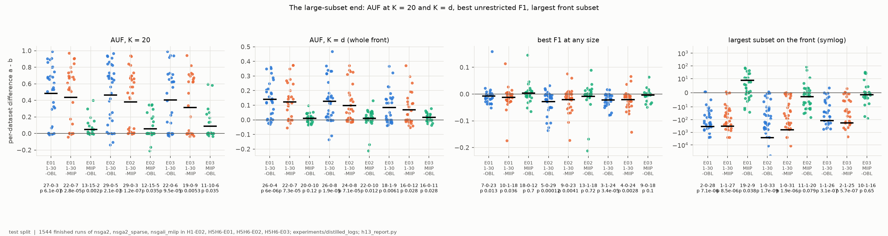
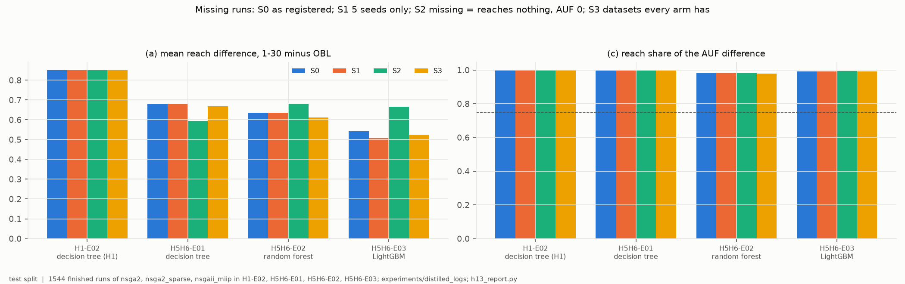
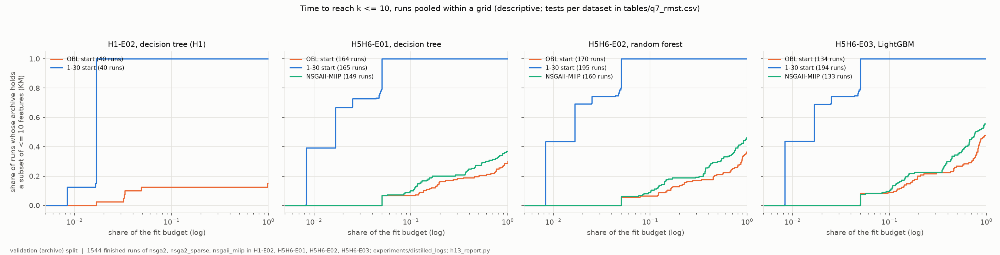
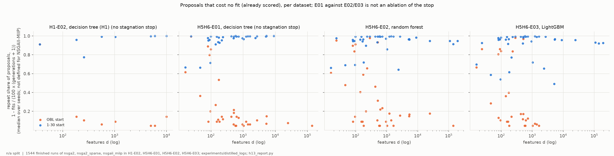
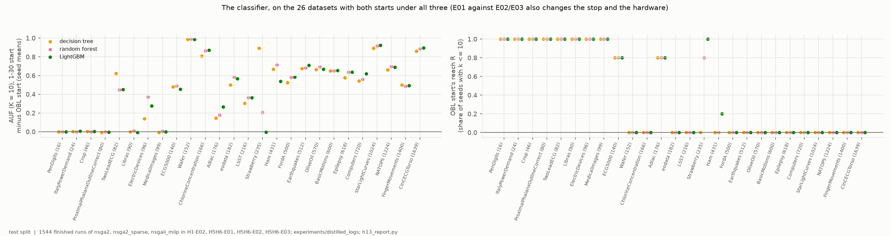

# H13-E01 -- report (post hoc)

*Hypothesis H13. **Post hoc**: the claim was formed after the results it is judged on had been read ([DEC-55](../../DECISIONS.md#dec-55)), so this report says how far the registered reading holds; it does not confirm anything. No runs of its own: 1,544 finished runs of three NSGA-II arms from H1-E02 and H5H6-E01 to -E03, read from `experiments/distilled_logs/`. The record is in [SUPPORT.md](SUPPORT.md).*

## 1. In brief

### The hypothesis

NSGA-II started from the OBL population (every individual near half the
features) scores far below NSGA-II started from random subsets of 1-30
features, when both are scored by AUF at K = 10: the mean test F1 of the best
subset of at most k features, k = 1..10, with 0 wherever the front has no
such subset. H13 says the gap is about **reach**: whether the front returned
holds any subset of at most k features at all. It is not about the quality of
the subsets the two starts return at sizes both of them reach.

**How it is judged.** Per classifier grid (tree, forest, LightGBM), with
datasets as the unit, three parts must all hold:
- (a) the 1-30 start reaches k <= 10 in more seeds than the OBL start on
  more datasets than the reverse, with a Wilcoxon test significant after Holm
  over the four grids;
- (b) at the sizes both starts reach in at least 3 of 5 seeds, the 95%
  interval of the mean test-F1 difference lies within +/-0.02;
- (c) an exact split of each dataset's AUF difference into a reach term and a
  quality term gives the reach term at least 75% of the total.

Supported (post hoc) if all three hold in all three H5H6 grids. H1-E02 is
read beside them.

### The answer: not confirmed (post hoc), on one part in one grid

(a) and (c) hold in all four grids: reach carries **98-100%** of the AUF
difference. (b) holds under the tree and LightGBM. It fails under the random
forest: the interval is [-0.044, +0.008]. Two datasets with 8 and 11 test rows
(BeetleFly, Coffee) put the OBL start 0.11 and 0.14 F1 ahead at matched size;
the other eleven matched datasets lie within +/-0.03. As registered, that is
*not supported*. Whether a matched-size gap carried by two test sets this small
should count is a question this report leaves to the PI (see the
assessment).

*Per grid, each dataset's AUF (K = 10) difference, 1-30 start minus OBL start, split into the reach term (blue) and the quality term (orange), from seed means; datasets by feature count d along x. Test split.*

## 2. Findings

### F1 -- Reach carries 98-100% of the AUF difference in every grid; matched-size quality holds the ±0.02 margin under the tree and LightGBM but not under the forest

| grid | (a) W-T-L, mean R diff, Holm p | (b) mean [95% CI], datasets matched | (c) reach share |
|---|---|---|---|
| H1-E02, tree | 7-1-0, +0.85, 0.016 | -0.0065 (satimage only), 1 of 8 | 0.998 |
| H5H6-E01, tree | 22-8-0, +0.68, 1.8e-05 | -0.0008 [-0.0044, +0.0025], 10 of 30 | 0.997 |
| H5H6-E02, forest | 24-10-0, +0.64, 1.2e-05 | -0.0136 [-0.0436, +0.0083], 13 of 34 | 0.981 |
| H5H6-E03, LightGBM | 17-11-0, +0.54, 2.1e-04 | +0.0007 [-0.0062, +0.0082], 13 of 28 | 0.992 |

The OBL start never reaches k <= 10 in more seeds than the 1-30 start on any
dataset (0 losses). The ties are the small-d datasets where both always reach.
Matched sizes exist only on 1-13 datasets per grid, all with d <= 512. The
check with exactly-k subsets on both fronts agrees: within the margin under
the tree and LightGBM, outside it under the forest ([-0.0421, +0.0115]). Under
the forest the failure comes from Coffee (d = 286, 11 test rows, -0.138) and
BeetleFly (d = 512, 8 test rows, -0.106), the two orange bars below zero in
F1. Under LightGBM the same two give 0.000 and -0.029.

### F2 -- Whether the OBL start reaches k <= 10 is set by d: never at the start beyond d = 36, always by the end up to d = 99, never beyond d = 512

The OBL start holds a subset of at most 10 features only on PenDigits (d =
16), ItalyPowerDemand (d = 24) and one seed of satimage (d = 36). That
matches the analytic probability for 50 complementary pairs (dashed line),
which is below 0.01 from d = 46. Selection then brings the front to k <= 10
within the budget on every dataset with d <= 99. Between d = 152 and 512 some
datasets reach and others don't. Beyond 512, none does. A logistic fit of
reach on log2 d and log2 budget puts the d at which half the runs reach at
163-226 for the OBL start (172 in H1-E02) and 208-268 for NSGAII-MIIP. Budget
and d are correlated by the calibration, and the budget coefficient's
intervals are wide (tables/q2_reach_model.csv). The 1-30 start reaches in all
594 of its runs: every one of its final fronts holds a single-feature subset,
and none holds more than 36 features.

*Per dataset, the share of seeds whose final front holds a subset of at most 10 features, against d (log), per arm; points jittered vertically by arm. Dashed: the analytic probability that an OBL start holds one. Sizes only, no split.*

### F3 -- NSGAII-MIIP's improvement phase adds little reach: +0.04 to +0.08 over the OBL start, against +0.46 to +0.64 for the 1-30 start

The full NSGAII-MIIP also starts from OBL. Against the OBL start its reach is
higher by +0.043, +0.075 and +0.082 (Holm p 0.125, 0.016, 0.062), and its AUF
by +0.058, +0.057 and +0.083 (Holm p 0.005, 0.031, 0.029), under the tree,
forest and LightGBM. The 1-30 start is ahead of it by +0.44, +0.39 and +0.33
AUF. At matched sizes no pair differs after Holm (all Holm p >= 0.41), and
the reach share of each pair's AUF difference is 0.83-0.99.

*Per grid and pair (a - b), one point per dataset (seed means), bar = mean; W-T-L and Holm p over the three pairs below. Left: reach R; middle: AUF (K = 10); right: matched-size difference. Test split.*

### F4 -- The 1-30 start pays at the large-subset end: its best F1 at any size is 0.007-0.029 lower than the OBL start's

Without a size limit, the validation-best subset on the 1-30 start's front
scores lower on test than the OBL start's by a mean of 0.0072 (7-0-23, Holm p
0.013), 0.0285 (5-0-29, 1.2e-4) and 0.0222 (3-1-24, 3.4e-5), and lower than
NSGAII-MIIP's by 0.012-0.021. Its fronts end far smaller: the per-dataset
median difference in the largest subset is 97, 69 and 28 features. The AUF
lead still holds well beyond K = 10: +0.40 to +0.48 at K = 20, and +0.08 to
+0.14 at K = d, the whole front.

*As F3, for AUF at K = 20 and K = d, the best test F1 at any size (subset chosen on validation), and the largest subset on the front (symlog). Test split.*

### F5 -- Missing runs change no part of the criterion and no verdict

Not finished: 47 timeouts under the tree (6 OBL, 30 1-30, 11 MIIP) and 64
under LightGBM (36, 1, 27), none under the forest. The skipped cells take 25
OBL and 35 MIIP runs from each grid. Under S1 (datasets with all 5 seeds), S2
(every missing run counted as reaching nothing, AUF 0) and S3 (datasets
every arm has), (a) and (c) hold in every grid and the verdict is unchanged.
S2 moves the mean reach difference from +0.68/+0.64/+0.54 to +0.59/+0.68/+0.67.
One Holm decision outside the criterion changes: NSGAII-MIIP against OBL in
AUF under LightGBM goes from Holm p 0.029 to 0.055 under S1.

*(a)'s mean reach difference and (c)'s reach share per grid under S0 (as registered) and S1-S3; dashed: the 0.75 threshold. Test split.*

### F6 -- The 1-30 start reaches k <= 10 at generation 0 in every run; the OBL start's archive reaches it in 15-48% of runs by the end, and no run loses it

Reach is read here from the archive: the best subset at each size among all
subsets a run scored. All 594 runs of the 1-30 start reach at generation 0.
For the OBL start, the Kaplan-Meier share reached is 12.5%, 6.7%, 6.5% and
9.0% by 10% of the budget, and 15%, 30%, 36% and 48% by the end (H1-E02, tree,
forest, LightGBM). For NSGAII-MIIP it is 37%, 46% and 56% by the end. Per
dataset, the restricted mean time to reach (up to the full budget) is
shorter for the 1-30 start than for the OBL start on every dataset, by a
mean of 0.72-0.86 of the budget (0.66-0.72 against NSGAII-MIIP). NSGAII-MIIP is faster than OBL on
10-15 datasets and tied on the rest (Holm p 0.002, 1e-4, 1e-4). In all 1,544
runs, the final front holds a subset of at most 10 features exactly when the
archive does. None lost reach.

*Kaplan-Meier share of runs whose archive holds a subset of at most 10 features, against the share of the fit budget spent (log), runs pooled within a grid (descriptive; the tests are per dataset). Validation (the archive is scored on validation).*

### F7 -- The 1-30 start spends 96-99% of its proposals on subsets already scored; the stagnation stop ends a third of its runs before 10% of the budget, without loss of reach

The share of proposed subsets that cost no fit is a median 0.96-0.99 per
dataset for the 1-30 start and 0.10-0.18 for the OBL start. Under the forest
and LightGBM, the stagnation stop (50 generations with no new subset) ends
72 of 195 and 63 of 194 runs of the 1-30 start, at a median 8.8% and 7.9% of
the budget. It ends 10/170 and 9/134 OBL runs, at 75% and 59%. Every stopped
run, in every arm, has reached k <= 10. The tree grids had no stop. They also
differ from E02/E03 in classifier, hardware and code commit, so E01 against
E02/E03 is **not an ablation of the stop**. NSGAII-MIIP's repeat share is not
defined: its improvement phase fits subsets outside the generation count.

*Per dataset, the median over seeds of 1 - fits / (100 x (generations + 1)), against d (log), per arm and grid. No split (counts only).*

### F8 -- The classifier hardly moves the gap: on 26 common datasets the 1-30 start's AUF lead is 0.465, 0.462 and 0.448, and reach carries 99% of it under each

On the 26 datasets where both starts have runs under all three classifiers,
the Friedman test on the lead gives p = 0.007. Pairwise, only tree against
forest differs after Holm (+0.003, Holm p 0.022). The reach share is 0.997,
0.994 and 0.995. The OBL start's reach on its 27 common datasets is 0.36,
0.42 and 0.44 (Friedman p 0.082). The 1-30 start's own AUF is 0.04 lower
under the tree than under the forest or LightGBM (Holm p 1.3e-8 for both).

*On the 26 common datasets (by d along x): left, the 1-30 start's AUF (K = 10) minus the OBL start's under each classifier; right, the OBL start's reach R. Seed means. Test split.*

## 3. Assessment

**What is supported.** On these runs, the AUF (K = 10) gap between the two
starts is reach. In every grid the reach term carries 98-100% of the
difference (F1). The reach difference has no losses on any dataset, with
Holm p 1.8e-05 to 0.016. It survives every treatment of the missing runs
(F5), and changes little with the classifier (F8). The mechanism is visible
in the sizes alone. The OBL start cannot hold a small subset beyond d of
about 40 (F2, analytic and observed). Selection closes the distance within
2,000-12,000 fits up to d of about 100 and rarely beyond 500. NSGAII-MIIP's
improvement phase closes a small part of it (F3). AUF at K = 10 is therefore
an existing measure that, under these budgets, measures reach for any d
above a few hundred: the OBL arms score 0 there because they return nothing
of that size, not because they return something poor.

**What fails, and how to read it.** (b) fails under the forest, so the
registered reading is *not supported* and this report keeps it. The failure
rests on two datasets whose test sets have 8 and 11 rows. On those, one
misclassified row moves F1 by about 0.09-0.13, and the same two datasets
give 0.000 and -0.029 under LightGBM (F1). On the other eleven, matched-size
differences are within ±0.03. Whether to treat this as the claim failing or
as measurement noise is the PI's call. The registered rule is not changed
after the fact. A confirmatory test would fix a minimum test-set size before
it runs.

**What it does not show.** Matched-size quality is defined only where both
starts reach. That is 1-13 datasets per grid, all with d <= 512, a selected
subset (F1). So nothing is known about matched-size quality on large d, where
the OBL arms offer nothing to match. The 1-30 start is not better overall: its
best F1 at any size is 0.007-0.029 lower and its fronts stop by 36 features
(F2, F4). The claim is about these operators (the NSGAII-MIIP port's
balanced mutation and crossover), a population of 100, and the calibrated
budgets. It is not about NSGA-II in general. F7's repeat shares fit the 2k/d
mutation argument (sparse children rarely change), but are not a test of it.
The stagnation stop is confounded with the classifier and the platform (F7).

**Limits.** Post hoc: the claim and the criterion were written after the
end-of-budget results and an exploratory analysis had been read. Five seeds
per cell, 8-39 datasets per grid, mostly UCR/UEA time series. The datasets
are the unit, and seed spread enters only as R, a share of 5.

**What follows.** P2 can cite F1, F2 and F6 for the reach account and F4
for its cost. A confirmatory test needs runs not yet seen. The extended
pilot covers initialisations over all sizes, an OBL budget sweep, the
mutation control and logging of every scored subset. It should fix the
minimum test-set size and the matched-size margin before it runs.

## Addendum (2026-11-02) -- DEC-57, post hoc

*Added after this report; the text above is unchanged. The PI set a rule
for part (b) after reading F1: datasets with at most 50 test rows leave the
matched-size comparison, because there one misclassified row moves F1 by
more than the 0.02 margin ([DEC-57](../../DECISIONS.md#dec-57)). (a), (c)
and every other finding keep all 46 datasets. The registered verdict stays
**not supported (post hoc)**.*

The rule removes BeetleFly (8 test rows) and Coffee (11) from (b) under the
forest and LightGBM; the other datasets with at most 50 test rows had no
matched sizes. Same bootstrap as (b) (10,000 resamples, seed 20200):

| grid | (b) as registered | (b) without <= 50 test rows | datasets | left out |
|---|---|---|---|---|
| H1-E02, tree | -0.0065 (satimage) | -0.0065 (satimage) | 1 | -- |
| H5H6-E01, tree | -0.0008 [-0.0044, +0.0025] | -0.0008 [-0.0044, +0.0025] | 10 | -- |
| H5H6-E02, forest | -0.0136 [-0.0436, +0.0083] | +0.0061 [+0.0003, +0.0126] | 11 | BeetleFly, Coffee |
| H5H6-E03, LightGBM | +0.0007 [-0.0062, +0.0082] | +0.0034 [-0.0017, +0.0109] | 11 | BeetleFly, Coffee |

The exact-size check agrees: +0.0083 [+0.0010, +0.0176] under the forest
(11 datasets) and +0.0045 [-0.0007, +0.0121] under LightGBM (10). Under the
rule, (b) is within +/-0.02 in every grid, so (a), (b) and (c) would all
hold. That reading is post hoc twice over: the claim, and now the rule,
were set after the results were seen. It is a sensitivity reading, not a
verdict.

Tables: `tables/q1_criterion_min_test50.csv` and
`tables/q1_criterion_min_test50_exact.csv`, from
`python experiments/h13_report.py --min-test-rows 50`.
