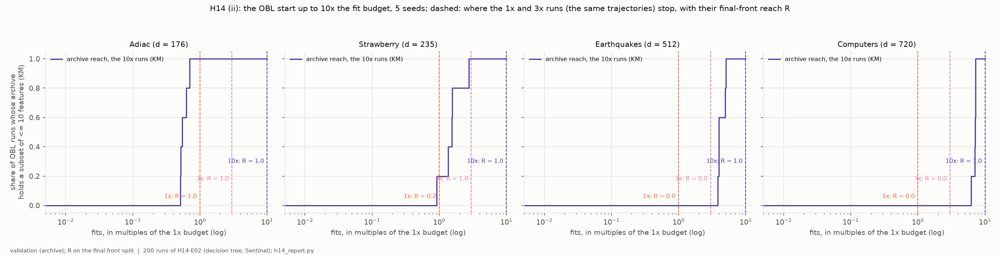
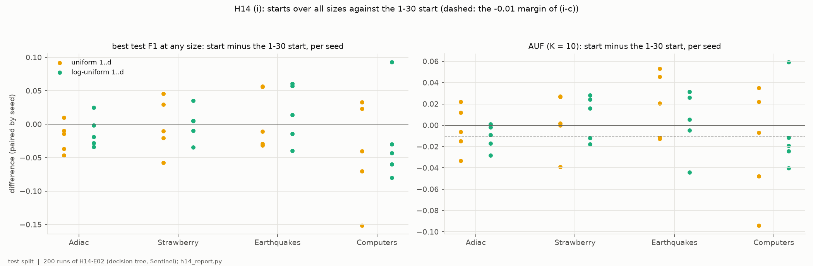
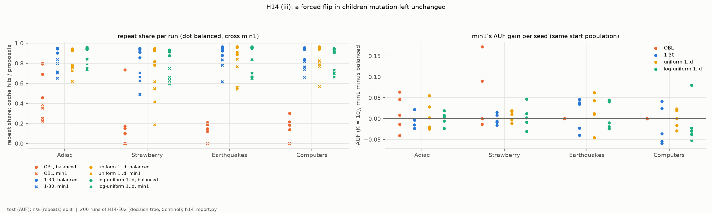
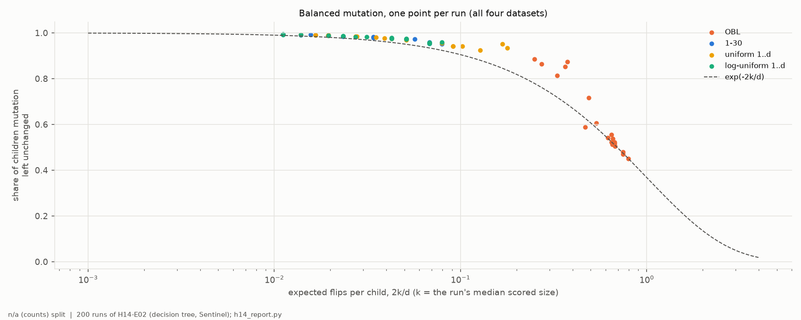
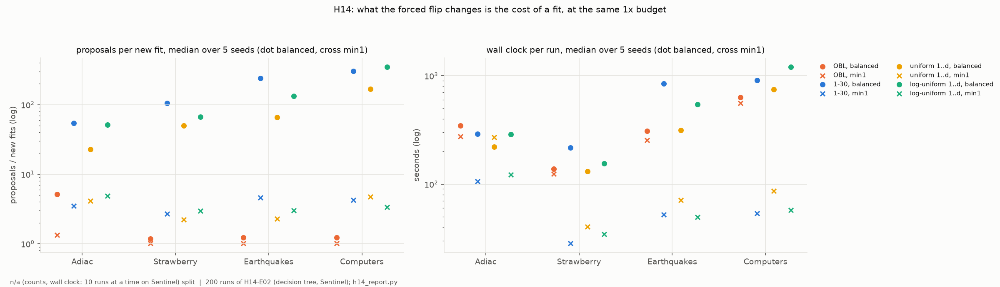

# H14-E02 -- report

*Hypothesis H14, P2's pilot: development datasets whose earlier NSGA-II results had been read, new seeds. Its verdicts guide P2's design and confirm nothing. H14-E02 is the unchanged rerun of the stopped H14-E01 ([DEC-58](../../DECISIONS.md#dec-58)). The record is in [SUPPORT.md](SUPPORT.md).*

## 1. In brief

### The hypothesis

H13-E01 found that the AUF gap between NSGA-II's OBL start (every individual
near half the features) and a start of random 1-30 features is about
**reach**, whether the front holds any subset of at most 10 features. It also
found that the 1-30 start loses some quality at large sizes and re-proposes
subsets it has already scored almost all the time. H14 makes three claims
about that:

- (i) a start whose sizes cover 1..d (uniform or log-uniform) keeps the reach
  and recovers the large-end loss;
- (ii) the OBL start's lack of reach on wide data shrinks with budget but does
  not vanish even at 10x;
- (iii) a mutation that never leaves a child unchanged (`min1`) halves the
  repeats and raises AUF.

**How it is judged.** Four datasets, five seeds, decision tree. A comparison
holds on a dataset if it holds in at least 4 of 5 seeds (paired by seed), and
a part holds if it holds on at least 3 of the 4 datasets.
- (i) needs reach, a best test F1 at any size at least the 1-30 start's, and
  AUF (K = 10) no more than 0.01 below it.
- (ii) needs reach not to fall with budget, and to be below 1 at 10x on
  Earthquakes or Computers.
- (iii) needs the repeat share at most halved and AUF higher, for the 1-30 and
  log-uniform starts.

### The answer: not confirmed, on all three parts

- **(i): reach is kept, the large-end loss is not recovered.** Both wide
  starts reach k <= 10 in every seed, but their best F1 is at least the 1-30
  start's in at most 3 of 5 seeds on every dataset. Their fronts shrink to
  the same handful of features.
- **(ii) fails the other way round.** At 10x the OBL start reaches k <= 10 in
  every seed on all four datasets, Earthquakes and Computers included. On
  those two it reached in no seed at 1x or 3x. Its lack of reach is a matter
  of budget: it needs a median 0.5, 1.5, 4.0 and 7.1 times the budget on
  Adiac, Strawberry, Earthquakes and Computers.
- **(iii): min1 never halves the repeats and does not raise AUF.** The 1-30
  start's repeat share falls from a median 0.94 to 0.73, and its AUF moves by
  -0.003. What it does change is cost: about 5 proposals per new fit instead
  of 176.

*The OBL start: share of runs whose archive holds a subset of at most 10 features against fits in multiples of the 1x budget; dashed, where the 1x and 3x runs stop (they are the same trajectories cut short), with their final-front reach R. Validation (archive); R on the final front.*

## 2. Findings

### F1 -- Starts over all sizes reach k <= 10 in every run but do not recover the large-end loss: best F1 at least the 1-30 start's in 7 and 8 of 20 seeds

Part (i) as registered. (i-a) holds on all four datasets for both starts (5
of 5 seeds each). (i-b) holds on none. The uniform start's best test F1 at
any size is at least the 1-30 start's in 1-2 seeds per dataset (mean -0.0137
over the 20 pairs), and the log-uniform start's in 1-3 (mean -0.0049). (i-c)
holds on one dataset each: Strawberry for the uniform start, Earthquakes for
the log-uniform. AUF differences average 0.0000 and -0.0020, within about
±0.02 per dataset (`tables/pairs.csv`). The reason shows in the fronts.
Whatever the start, the population ends on a handful of small subsets:

| median largest subset on the front | Adiac | Strawberry | Earthquakes | Computers |
|---|---:|---:|---:|---:|
| 1-30 start | 10 | 6 | 7 | 6 |
| uniform 1..d | 11 | 8 | 13 | 8 |
| log-uniform 1..d | 9 | 6 | 8 | 5 |
| OBL start | 26 | 34 | 165 | 269 |

The OBL start keeps wide subsets and is the one ahead at the large end (best
F1 +0.012 over the 1-30 start, higher in 12 of 20 seeds), while scoring 0 at
K = 10 on the two widest datasets.

*Per dataset, one point per seed: the uniform and log-uniform starts minus the 1-30 start (same seed) in best test F1 at any size (left) and AUF at K = 10 (right; dashed, (i-c)'s -0.01 margin). Test split.*

### F2 -- The OBL start's lack of reach is budget: at 10x it reaches k <= 10 in every seed on all four datasets, after a median 0.5x to 7.1x the 1x budget

Part (ii) as registered. Final-front reach R at 1x, 3x and 10x is 1.0, 1.0,
1.0 on Adiac; 0.2, 1.0, 1.0 on Strawberry; 0.0, 0.0, 1.0 on Earthquakes; and
0.0, 0.0, 1.0 on Computers. (ii-a), no fall with budget, holds on every
dataset. (ii-b), R below 1 at 10x on Earthquakes or Computers, fails. The
archive first holds a subset of at most 10 features after a median 0.54,
1.55, 3.99 and 7.10 times the 1x budget. That is roughly linear in d at this
budget: 176, 235, 512 and 720 features. At 10x the OBL start's AUF is
+0.0094 above the 1-30 start's at 1x (higher in 12 of 20 seeds) and its best
F1 +0.0101. Its median run takes 1,480-4,691 s against the 1-30 start's
216-907 s.

The 1x and 3x runs share the 10x runs' seeds and random streams, so they are
the same trajectories cut short. In all 20 dataset-and-seed pairs the 1x
trajectory is the start of the 10x one. (ii-a) therefore holds almost by
construction. The sweep measures where along one trajectory reach arrives, not
three independent budgets.

*As in section 1.*

### F3 -- min1 cuts the repeats of the small-subset starts by about a fifth, never by half, and leaves AUF where it was

Part (iii) as registered. The median repeat share, cache hits over proposals
from the subset log, falls from 0.94 to 0.73 for the 1-30 start and from 0.94
to 0.70 for the log-uniform start. It is lower in every seed (20 of 20), but
never as much as half: (iii-a) holds in 0 of 5 seeds on every dataset. AUF (K
= 10) moves by -0.0028 (higher in 8 of 20 seeds) and -0.0003 (9 of 20), so
(iii-b) holds on no dataset. All 80 mutation pairs started from identical
populations (`tables/start_check.csv`). Beside the criterion, min1 does most
for the OBL start, whose population is still wide: repeats fall from a median
0.196 to 0.001, Strawberry's reach rises from 0.2 to 0.6, and AUF is +0.016
(+0.050 on Strawberry).

The rival explanation registered in H14 holds. With the forced flip, a child
almost never equals a member of the population (5% of proposals against 45%
for the balanced 1-30 start), but 78% of proposals (over all runs) are still subsets
already scored. One flip away from a converged population is mostly a
neighbour scored before.

*Left: repeat share per run, balanced (dots) and min1 (crosses), per start and dataset. Right: min1's AUF (K = 10) minus balanced's per seed, the same start population. Test split for AUF; counts for repeats.*

### F4 -- Balanced mutation leaves children unchanged at the rate 2k/d predicts: 95-99% for the small-subset starts, 48-85% for the OBL start

From the subset log, the share of children that balanced mutation left
unchanged follows exp(-2k/d), the Poisson share of zero flips, at the run's
median scored size k. For the 1-30, uniform and log-uniform starts that is
0.94-0.99 per dataset (`tables/per_arm.csv`), and for the OBL start 0.48-0.85.
That is P2's 2k/d account of why sparse populations stop proposing new
subsets.

*One point per run of the four balanced starts: share of children mutation left unchanged against 2k/d at the run's median scored size (log); dashed, exp(-2k/d). Counts, no split.*

### F5 -- What min1 changes is the cost of a fit: about 5 proposals per new fit instead of 176, and 3-17 times less wall clock

Over all runs, the balanced 1-30 start made 176 proposals per new fit and its
min1 twin 4.7 (`tables/subset_summary.csv`, summed). Its median run took 290,
216, 847 and 907 s on Adiac, Strawberry, Earthquakes and Computers, and with
min1 106, 28, 52 and 54 s, faster in all 20 seeds. The log-uniform start is
alike (min1 faster in 20 of 20). At the same budget and with the same AUF,
min1 makes the small-subset searches far cheaper. It does not make them
better.

*Per start and dataset, median over seeds, balanced (dots) and min1 (crosses): proposals per new fit (left, log) and wall clock per run (right, log; ten runs at a time on Sentinel). Counts and time, no split.*

## 3. Assessment

**What the pilot supports.** It supports three things for P2, at the level a
pilot can.

1. **Reach is cheap and robust.** Any start that puts some individuals at
   small sizes, whether 1-30, uniform or log-uniform, reaches k <= 10 in
   every run (F1).
2. **The OBL start's handicap at K = 10 is the time it takes to walk down.**
   Given 4-7 times the budget on the two widest datasets, it reaches k <= 10
   in every seed and then scores as well as the 1-30 start at 1x (F2). That
   sharpens H13-E01: at a finite budget AUF (K = 10) measures reach, and the
   budget at which OBL catches up grows with d.
3. **The repeats are the 2k/d mechanism (F4), but a forced flip is not the
   cure.** One flip from a converged population mostly lands on a subset
   already scored (F3). The flip buys cost, not quality (F5).

**What it does not support.** All three claims fail as registered.
- (i) fails because a wide start does not keep wide subsets: selection
  collapses every small-friendly start onto the same few features (F1).
  Recovering the large end would need something that keeps them, such as
  niching, an archive or a size-stratified selection. It does not come from
  the start.
- (ii) fails in the direction that matters most for P2's argument (F2). The
  "lack of reach" is not structural up to 10x.
- (iii) fails on both counts (F3).

**Limits.**
- Four datasets of 176-720 features, all seen before; one classifier, the
  tree; five seeds; the analysis written before the runs and applied
  unchanged.
- The budget sweep is one trajectory per seed read at three points, not
  three budgets (F2).
- Fits-to-reach rests on five seeds per dataset.
- With d = 720 the largest here, the trend in d is suggestive, not
  established.
- Wall clock is from ten runs at a time on one machine.
- A confirmatory test would need unseen datasets.

**What follows for P2.**
- Report reach and budget together. Report the budget at which OBL reaches
  k <= 10 (F2) as the measure of the start's cost.
- State the large-end loss as a property of selection, not of the start (F1).
- Present min1 as a cost control, not an improvement (F5).
- The choice of whether and how to follow up belongs to the PI. The options
  include unseen datasets, a size-preserving archive for the large end, and
  more than 10x on wider data.
