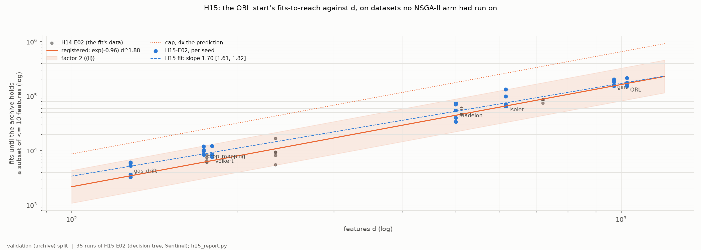
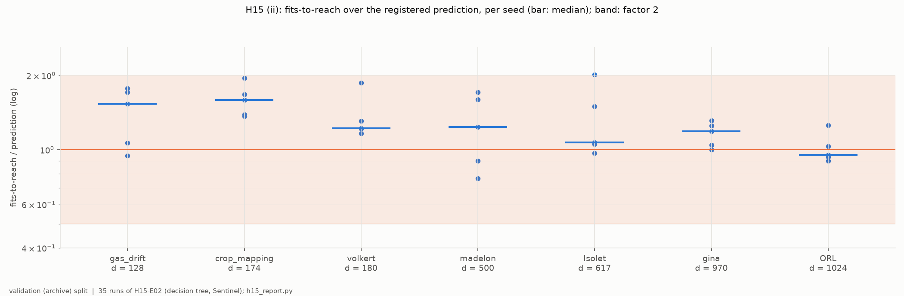
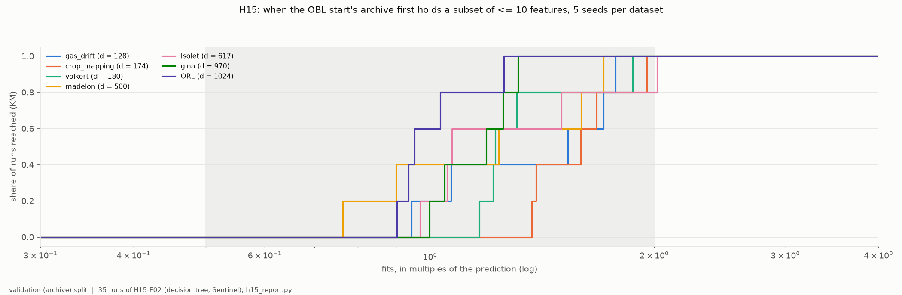

# H15-E02 -- report

*Hypothesis H15, confirmatory: a prediction fitted on H14-E02, tested on seven datasets on which no NSGA-II arm had run, with new seeds. H15-E02 is the unchanged rerun of H15-E01, which no run started ([DEC-60](../../DECISIONS.md#dec-60)). The record is in [SUPPORT.md](SUPPORT.md).*

## 1. In brief

### The hypothesis

NSGA-II's usual OBL start puts every individual near half the features. To
score anything at k <= 10 features, selection has to walk the population down
from d/2, and H14-E02 found that walk is what the OBL start's poor AUF at
K = 10 measures. On four datasets, the fits until the search first scored a
subset of at most 10 features followed **exp(-0.96 + 1.88 ln d)**, about
0.38 d^1.88. H15 registers that line as a prediction and tests it on seven new
datasets, d = 128 to 1,024.

**How it is judged.** Five seeds per dataset, decision tree. Each run stops
once it reaches k <= 10, with a cap of four times the prediction. There are
three parts:
- (i) on every dataset at least 4 of 5 seeds reach before the cap;
- (ii) the median fits-to-reach is within a factor 2 of the prediction on at
  least 5 of 7 datasets;
- (iii) the slope of log fits against log d has a bootstrap 95% interval above
  1, i.e. faster than linear in d.

### The answer: confirmed on all three parts, with a somewhat smaller exponent than predicted

Every one of the 35 runs reached k <= 10, using at most half its cap. The
dataset medians lie 0.95 to 1.59 times the prediction, so all seven are within
the factor 2. The slope over the seven datasets is **1.70 [1.61, 1.82]**:
clearly faster than linear, but its interval leaves out H14's 1.88. The
prediction was a little low at small d and right at large d.

*Fits until the archive first held a subset of at most 10 features against d, log-log, one point per seed: H15-E02 (blue) and H14-E02, the data of the fit (grey); solid, the registered prediction with its factor-2 band; dashed, the line fitted on H15-E02's dataset medians; dotted, the cap. Validation (archive).*

## 2. Findings

### F1 -- All 35 runs reach k <= 10 well before the cap, and every dataset median is within a factor 2 of the prediction

Parts (i) and (ii) as registered (`tables/per_dataset.csv`):

| dataset | d | rows (train) | predicted | median fits-to-reach | range over seeds | ratio |
|---|---:|---:|---:|---:|---|---:|
| gas_drift | 128 | 8,346 | 3,444 | 5,276 | 3,251-6,109 | 1.53 |
| crop_mapping | 174 | 30,002 | 6,127 | 9,758 | 8,389-11,975 | 1.59 |
| volkert | 180 | 30,002 | 6,530 | 7,986 | 7,602-12,213 | 1.22 |
| madelon | 500 | 1,560 | 44,412 | 54,892 | 33,916-75,882 | 1.24 |
| Isolet | 617 | 936 | 65,896 | 70,482 | 63,906-132,956 | 1.07 |
| gina | 970 | 2,080 | 154,019 | 183,226 | 153,828-202,233 | 1.19 |
| ORL | 1,024 | 240 | 170,501 | 162,597 | 153,897-214,244 | 0.95 |

- (i) holds on all seven datasets: 5 of 5 seeds reached each time, and no run
  used more than 0.50 of its cap.
- (ii) holds on all seven. Per seed, the ratio to the prediction runs from
  0.76 to 2.02. Only one seed of 35 is outside the factor 2: Isolet, seed
  2031, at 2.02.
- The prediction is low on six of the seven datasets; the geometric mean
  ratio is 1.24.
- Within a dataset, the seeds spread by a log SD of 0.12-0.35, about H14's
  0.24.

*Per dataset (by d), each seed's fits-to-reach divided by the registered prediction (log), the bar at the median; shaded, the factor 2 of (ii). Validation (archive).*

### F2 -- Fits-to-reach grow as about d^1.70: faster than linear, slower than H14's d^1.88

Part (iii) as registered. The OLS slope of the log dataset median on log d is
1.70, with a bootstrap 95% interval of [1.61, 1.82] (datasets resampled 10,000
times; `tables/slope.csv`). Its lower end is well above 1, so (iii) holds, but
the interval excludes the predicted 1.88. Fitted on the 35 seeds instead of
the medians, the slope is 1.74.

The miss has a pattern: the ratio to the prediction falls as d grows, from
1.53-1.59 at d = 128-174 to 0.95-1.19 at d = 970-1,024 (Spearman -0.89 over
the seven datasets). Pooling H14-E02's four datasets with H15-E02's seven
gives a slope of 1.75 [1.63, 1.93] on the eleven dataset medians.

In this design, d and rows go together: the three smallest-d datasets also
have the most training rows (8,346-30,002), and the ratio rises with rows as
well (Spearman +0.77). Seven datasets cannot tell the two apart. The number
of classes shows no clear relation (Spearman -0.54).

*Per dataset, Kaplan-Meier share of the five runs whose archive held a subset of at most 10 features, against fits in multiples of the prediction (log); shaded, the factor 2. No run was censored. Validation (archive).*

## 3. Assessment

**What is supported.**
- **The relation holds out of sample.** The OBL start's cost of reaching
  k <= 10 grows faster than linearly in d on seven datasets no NSGA-II arm had
  run on: Earth observation, chemical sensors, speech, digit and face
  images, an anonymised AutoML set and synthetic data, with 2-40 classes
  and 240-30,002 training rows. It is predictable to within a factor 2
  from four other datasets (F1).
- **The size of the walk.** At d of about 1,000 the start needs
  154,000-214,000 fits, against the 2,000-12,000 fits of the earlier
  experiments' budgets. That is why it scored 0 at K = 10 on wide data there.
  The 1-30 start pays none of this (H13-E01, H14-E02).
- **For P2, the claim is:** "the OBL start's fits-to-reach k <= 10 grow as
  about d^1.7-1.8". That is H15's own slope, 1.70 [1.61, 1.82], or the slope
  pooled with H14, 1.75 [1.63, 1.93], quoted as fitted. The exponent 1.88 is
  not confirmed; it was the in-sample estimate.

**What it does not show.**
- **Why the walk scales this way.** H15 measures the exponent, not its cause.
- **Whether rows or d drive the residual.** In F2, d and rows go together.
- **Anything about quality at reach.** Runs stop when they reach, so H15 says
  nothing about AUF once the OBL start has reached. H14-E02's +0.0094 at 10x
  rests on four datasets.

**Limits.**
- Decision tree only. Population 100, balanced mutation at 1/d; the walk
  depends on both.
- d from 128 to 1,024. Beyond that it is extrapolation: d = 5,000 would need
  about 2.7 million fits on the H15 line, or 3.3 million on H14's.
- Five seeds per dataset; seven datasets for the slope.
- Rows are capped at 50,000 on crop_mapping and volkert.
- Fits-to-reach is read at the end of the generation that reached, so up to
  100 fits late.

**What follows.**
- P2 can state the OBL start's handicap as a budget that grows about as
  d^1.7, out of sample, rather than as a structural failure.
- Whether to separate rows from d (datasets with many rows at large d, or a
  row-subsampling sweep on one dataset), or to test another classifier, is
  the PI's choice.

