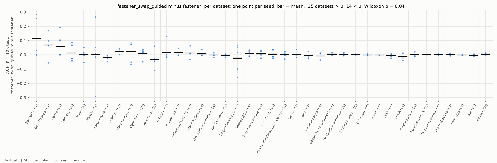
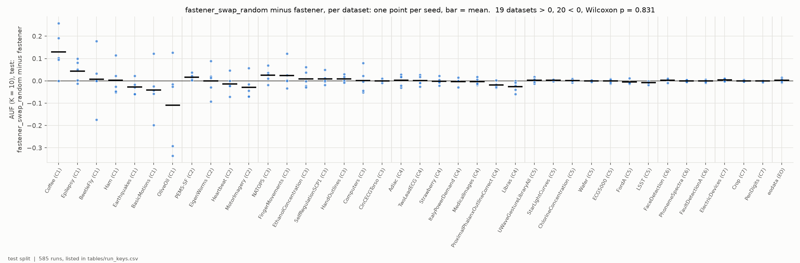
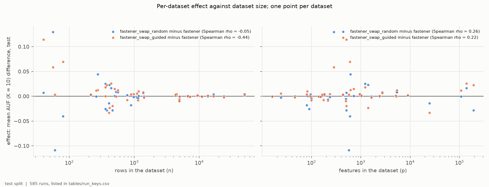
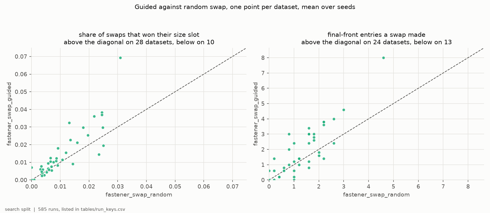
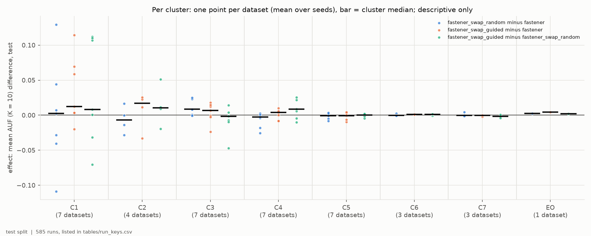

# H2H3-E01 -- report

*Hypotheses H2 and H3. The runs, the criteria as registered, the per-seed
numbers and how to reproduce them are in [SUPPORT.md](SUPPORT.md).*

## 1. In brief

### The hypotheses

FASTENER searches for small feature subsets that classify well. None of its
operators keeps a subset's size while changing its content: mating moves
subsets toward a middle size and pruning only removes features. A **swap**
does exactly that -- it drops one feature and adds another. Both hypotheses
add one swap candidate to FASTENER's pruning step, paid for out of the same
budget of model fits.

- **H2:** *any* swap helps. The swap drops a random feature and adds a random
  one.
- **H3:** a *guided* swap helps. It drops the feature FASTENER already rates
  least important, and adds one chosen by mutual information with the class.

"Helps" means a better score at small subset sizes: the mean, over sizes 1 to
10, of the best test F1 FASTENER offers at that size or below (AUF, K = 10).

**How it is judged.** Each swap arm is compared with unmodified FASTENER on 39
datasets -- 38 time series classification sets spread over seven clusters of
dataset shape, and EOData -- with 5 seeds each. Per dataset, the effect is
the swap arm's score minus FASTENER's, averaged over seeds. A hypothesis is
confirmed if the effect is positive on more datasets than negative and a
Wilcoxon signed-rank test across the 39 datasets gives p < 0.05.

### The answer: H2 not confirmed; H3 confirmed, narrowly

The random swap changes nothing: it is ahead on 19 datasets and behind on 20,
p = 0.83. The guided swap passes its test, ahead on 25 datasets and behind on
14, p = 0.040 -- but the median gain is 0.003, the advantage comes from the
smallest datasets, where one test row can move the score by up to 0.06 to
0.13, and on
the 19 datasets with at least 1,000 rows it is 10 against 9 (F3). The guided
swap does succeed more often than the random one (F4), but not by enough to
beat it on the score (p = 0.28).

*Per dataset (clusters C1-C7, then EOData), the guided swap's test AUF
(K = 10) minus stock FASTENER's: one point per seed, bar at the mean.*

## 2. Findings

### F1 -- The random swap leaves FASTENER's front where it was

The effect of the random swap is positive on 19 datasets and negative on 20,
with median -0.0001 and mean 0.0001; Wilcoxon p = 0.83. The largest effects
are on the small C1 sets in both directions (Coffee +0.129, OliveOil -0.109),
and from C5 onward, where datasets have thousands of rows, every per-dataset
mean lies within about 0.01 of zero. On EOData the swap is ahead on 3 of 5
seeds (+0.002). Dropping the three datasets with the largest gains changes
nothing (16 positive, 20 negative, p = 0.59).

*Per dataset, the random swap's test AUF (K = 10) minus stock FASTENER's: one
point per seed, bar at the mean. 19 datasets above zero, 20 below.*

### F2 -- The guided swap passes its test, with a median gain of 0.003

The effect is positive on 25 datasets and negative on 14; Wilcoxon p = 0.040,
median +0.0031, mean +0.0077. The mean is pulled up by three small C1 sets --
BeetleFly (+0.114), BasicMotions (+0.070) and Coffee (+0.059) -- whose test
splits are 8 to 16 rows. Without those three, the remaining 36 datasets are
22 positive and 14 negative, p = 0.16. On EOData the guided swap is ahead on
4 of 5 seeds (+0.005). A sign test on the same 25-to-14 count, which ignores
how large each effect is, gives p = 0.11.

*As F1, for the guided swap. 25 datasets above zero, 14 below; the spread of
the points shrinks from left (small sets) to right (large sets).*

### F3 -- The guided swap's advantage shrinks as datasets grow

Across datasets, the guided swap's effect falls with the number of rows
(Spearman rho = -0.44, p = 0.005); the random swap's does not (rho = -0.05).
On the 19 datasets with at least 1,000 rows the guided swap is ahead on 10
and behind on 9 (p = 0.68, median +0.0004). Neither arm's effect depends
clearly on the number of features (rho = 0.22 and 0.26). Small datasets are
where scores are noisiest: one test row there can move AUF by up to 0.06 to
0.13.

*One point per dataset: mean effect on test AUF (K = 10) against rows (left)
and features (right), both log scale, for the random (blue) and guided
(orange) swap.*

### F4 -- Guided swaps win their slot more often than random ones, but rarely either way

Both arms propose about 760 swaps per run (median over datasets), which take
about 9-10% of the fit budget. A swap is kept when it beats the subset of the
same size on the front. Guided swaps are kept more often than random ones on
28 of 39 datasets (median 1.0% against 0.8% of proposals; Wilcoxon p = 0.001),
and the final fronts of the guided arm hold more swap-made entries on 24
datasets against 13 (median 1.4 against 1.2 per run; p = 0.005). So the
guidance changes what the swap does -- yet the guided arm's AUF is not
significantly above the random arm's (23 datasets ahead, 16 behind,
p = 0.28).

*One point per dataset, mean over seeds; x is the random swap, y the guided
swap, dashed line where they are equal. Left: share of swaps that won their
size slot. Right: entries of the final front that a swap made.*

### F5 -- By cluster, the guided swap gains only on the small-sample clusters C1 and C2

The datasets were chosen from seven clusters of dataset shape, so each
comparison can be read cluster by cluster. The guided swap is ahead of stock
FASTENER on 6 of 7 datasets in C1, the small lab sets (40-461 rows; median
+0.0125, mean +0.035), and on 3 of 4 in C2, the high-dimensional recordings
with p far above n (259-440 rows; median +0.017). From C5 on -- the clusters
with thousands of rows -- every cluster's median effect lies within 0.002 of
zero for both swaps; on EOData the guided swap's effect is +0.005. The random swap's one leaning cluster is C3, the long signals: ahead
on 6 of 7 datasets (p = 0.047), where the guided swap is not (4 of 7).
Guided against random leans guided in C1, C2 and C4 (5, 3 and 5 datasets
ahead) and random in C3 (2 of 7).

| cluster | rows | datasets | random minus stock | guided minus stock | guided minus random |
|---|---|---:|---|---|---|
| C1 small lab, p >= n | 40-461 | 7 | +0.001 (4 / 3) | **+0.035 (6 / 1)** | +0.034 (5 / 2) |
| C2 p >> n recordings | 259-440 | 4 | -0.007 (1 / 3) | +0.007 (3 / 1) | +0.013 (3 / 1) |
| C3 long signals | 360-1,420 | 7 | +0.011 (6 / 1) | +0.004 (4 / 3) | -0.007 (2 / 5) |
| C4 short series | 360-1,162 | 7 | -0.007 (2 / 5) | +0.001 (5 / 2) | +0.008 (5 / 2) |
| C5 larger sensor, shape | 4,307-9,236 | 7 | -0.001 (3 / 4) | -0.001 (3 / 4) | 0.000 (4 / 3) |
| C6 large audio, industrial | 6,668-13,640 | 3 | +0.001 (1 / 2) | +0.001 (3 / 0) | +0.001 (2 / 1) |
| C7 many short series | 10,992-24,000 | 3 | +0.001 (1 / 2) | -0.001 (0 / 3) | -0.002 (1 / 2) |
| EOData | 50,000 | 1 | +0.002 | +0.005 | +0.002 |

*Mean effect on test AUF (K = 10) over the cluster's datasets, with the
number of datasets ahead / behind.*

None of this is a test: the breakdown was registered as descriptive, with 1
to 7 datasets per cluster, and the table holds 21 comparisons, so about one
p < 0.05 -- such as C3's -- is expected by chance. The clusters are ordered
largely by sample size, and the gains follow it: the two clusters where the
guided swap leads are the two with the fewest rows. This is F3 seen through
the clusters, not a separate effect of the kind of data.

*Per cluster (C1-C7, then EOData): for each comparison, one point per
dataset (mean effect over seeds on test AUF, K = 10) and a bar at the
cluster's median. Blue: random swap minus stock; orange: guided swap minus
stock; green: guided minus random swap.*

## 3. Assessment

H2 is not supported. Adding a random size-preserving swap to FASTENER's
pruning step does not move its low-k front in either direction: the
per-dataset effects split 19 to 20 around a median of zero (F1), and no
subset of datasets shows a consistent sign. The argument behind H2 -- that
FASTENER lacks a size-preserving move -- is true of the algorithm, but supplying
an unguided one does not matter at these budgets. The likely reason is in F4:
about one swap in a hundred wins its size slot, so the operator rarely
changes the front at all.

H3 is supported by its registered criterion, narrowly, and the support is not
robust. The test passes at p = 0.040 with a median gain of 0.003 in AUF (F2).
The gain rests on small datasets: it shrinks with the number of rows (F3),
it vanishes on the 19 datasets with at least 1,000 rows, and removing the
three largest gains -- all on sets with 8 to 16 test rows -- takes the
remaining datasets to p = 0.16. A difference of one or two test rows on such
sets is the size of these gains, so the result is consistent both with a small
real advantage on small data and with noise in the scores of the smallest
sets. Five seeds per dataset do not separate the two. Read by cluster (F5),
the guided swap leads only in C1 and C2, the two clusters with the fewest
rows, and nowhere among the clusters with thousands of rows -- the same
dependence on sample size, not on a kind of data.

The guidance does something real at the level of the operator: guided swaps
are kept more often and leave more entries on the final front than random
ones (F4). What it does not do is turn that into a better front by a margin
the test can see: guided against random is 23 to 16, p = 0.28. The registered
reading credits the guidance only where the guided arm also beats the random
one, so this experiment supports "the guided swap helps a little, on small
data" and does not support "the guidance is what helps".

What the result does not show: an effect on the large-sample sets that
FASTENER was designed for. EOData leans the guided swap's way (4 of 5 seeds,
+0.005) but is a single dataset. The budgets were set per dataset by
calibration so that stock FASTENER had stopped improving; a swap arm could
still behave differently at other budgets. The swap took about a tenth of
each run's fits, so its cost is real even where its effect is not.

For later hypotheses: H6 compares the guided-swap FASTENER with every other
selector. With an effect of this size, H6 is unlikely to separate it from
stock FASTENER. Whether to keep the guided swap
as the FASTENER variant carried forward, given a small and fragile gain at
about a tenth of the budget, is the PI's choice.
