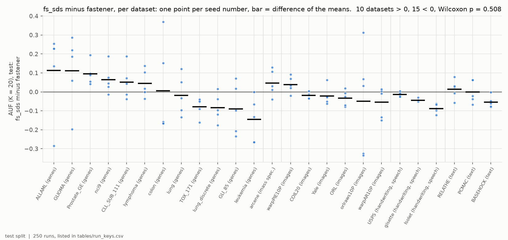
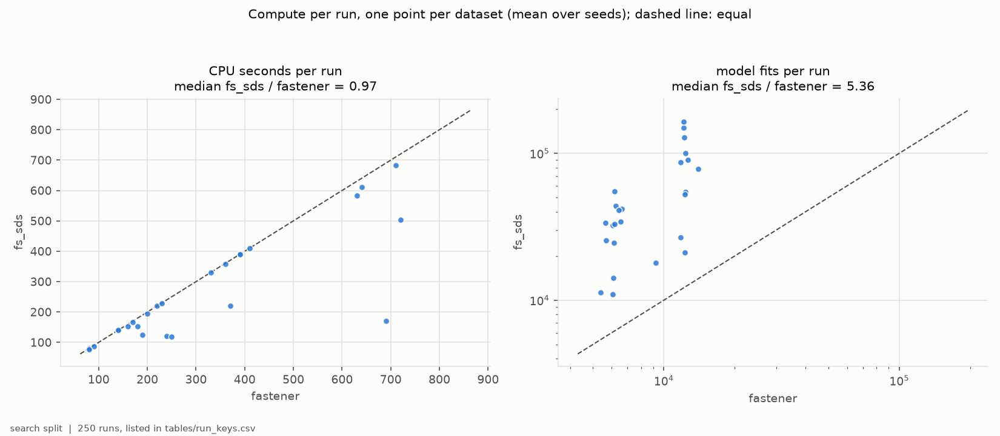
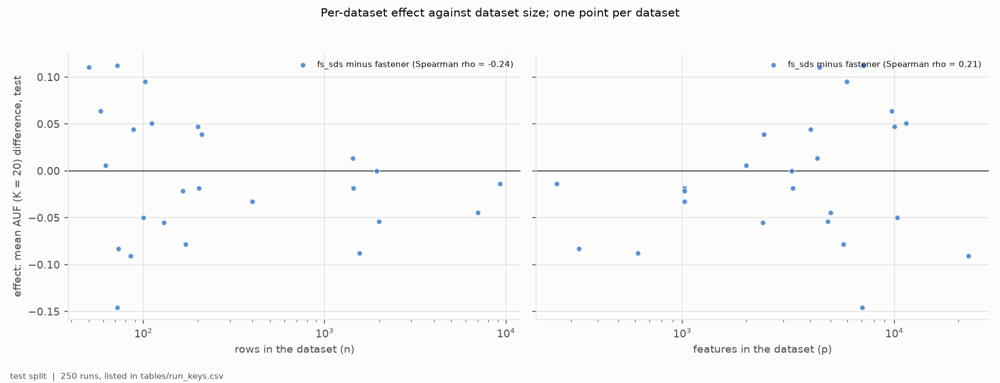
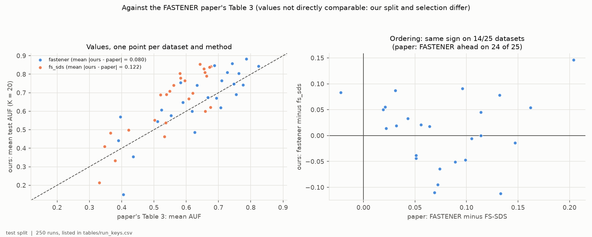

# H4-E01 -- report

*Hypothesis H4. The runs, the criteria as registered, the per-seed numbers
and how to reproduce them are in [SUPPORT.md](SUPPORT.md).*

## 1. In brief

### The hypothesis

The FASTENER paper (Koprivec, Kenda & Sircelj 2020, Table 3) reports
FASTENER ahead of FS-SDS, a swarm-based feature selector, on 24 of 25
benchmark datasets. That comparison had two confounds: FASTENER's search was
driven by a decision tree and FS-SDS's by a different classifier (an ELM), and
the two were given very different numbers of model evaluations. H4 claims that
once both run on the same classifier with the same resources, the published
ordering does not survive -- FS-SDS comes out ahead.

"The same resources" here means the same computing time: on each dataset both
methods stop when their search has used the same CPU time, the time stock
FASTENER needs for the protocol's budget of 6,000 or 12,000 model fits. Scores
are the mean, over feature-subset sizes 1 to 20, of the best test F1 a method
offers at that size or below (AUF, K = 20), the measure of the paper's Table 3.

**How it is judged.** For each of the 25 datasets, each method's score is
averaged over 5 seeds. H4 is confirmed if FS-SDS is ahead on more datasets and
a Wilcoxon signed-rank test across the 25 favours it at p < 0.05; refuted if
the test favours FASTENER; and if neither, the two methods are comparable.

### The answer: not confirmed -- the methods are comparable, and the paper's ordering does not reproduce

At equal compute, FS-SDS is ahead on 10 datasets and FASTENER on 15; the mean
difference is -0.008 in AUF and the Wilcoxon test gives p = 0.51 (F1). So
FS-SDS does not overtake FASTENER, but FASTENER's published lead is gone too:
our ordering agrees with the paper's on 14 of the 25 datasets (F4). The
methods reach their scores in very different ways -- in the same CPU time
FS-SDS evaluates about five times as many feature subsets (F2).

*Per dataset, grouped by domain: FS-SDS's test AUF (K = 20) minus
FASTENER's, one point per seed number, bar at the difference of the means.*

## 2. Findings

### F1 -- At equal compute, neither method is ahead across the 25 benchmarks

FS-SDS's mean AUF is higher on 10 datasets and FASTENER's on 15. The mean
difference (FS-SDS minus FASTENER) is -0.008, the median -0.018, and the
Wilcoxon signed-rank p = 0.51. Averaged over all 25 datasets, FASTENER scores
0.657 and FS-SDS 0.649. The per-dataset differences are large in both
directions -- from -0.146 (leukemia) to +0.112 (ALLAML) -- and so is the
spread over seeds on the small sets, where single seeds differ by 0.3 or
more. FS-SDS is ahead on ALLAML, CLL_SUB_111, GLIOMA, Prostate_GE, RELATHE,
arcene, colon, lymphoma, nci9 and warpPIE10P.

*Per dataset, grouped by domain: FS-SDS minus FASTENER in test AUF (K = 20).
Points pair the two methods' runs with the same seed number; bar at the
difference of the means.*

### F2 -- Equal compute gives FS-SDS about five times the model fits

Both methods stopped on the same CPU time (median ratio 0.97), but FS-SDS
made a median 5.4 times as many model fits as FASTENER (from 1.7 times on
lung_discrete to 13.5 times on nci9). An FS-SDS fit is a single decision tree
on at most 20 features; FASTENER also spends its time on a mutual-information
pass over all features, permutation scoring and its archive. FASTENER used
its full budget on every dataset; FS-SDS used between 25% and 100% of it,
because on 8 wide, short datasets many of its runs for single subset sizes
stopped early when their swarm stopped finding new subsets (GLI_85 used 25%,
leukemia 48%, ALLAML 51%). At equal fits, as H4 was first registered, FS-SDS
would have had a fraction of the computation it had here.

*One point per dataset, mean over seeds. Left: CPU seconds per run, FS-SDS
against FASTENER. Right: model fits per run, log scales. Dashed lines: equal.*

*Note added 2026-10-11: why the fit counts differ, measured. A profile of
1,500 fits on nci9 (9,712 features) put FASTENER at 88 ms of CPU per fit, of
which 2% was fitting trees, 52% its one-off mutual-information pass over all
features, and 39% bookkeeping in pure Python over all p genes per candidate;
FS-SDS took 6.5 ms per fit, 22% of it fitting trees. On USPS (256 features)
tree fits were 76% of FASTENER's time and the gap small (1.8x). The fit ratio
therefore measures FASTENER's overhead on wide data, much of it an
implementation inefficiency, not cheap FS-SDS fits. The bookkeeping was
vectorised in FASTENER clone `3877a1a` (identical fronts for the same seed and
fits); H4-E03 compares the methods at equal fits.*

### F3 -- FS-SDS leads more often on the smallest datasets, but not consistently

On the 12 datasets with fewer than 150 rows, FS-SDS is ahead on 7 (median
+0.025); on the 13 larger ones, on 3 (median -0.019). The trend with dataset
size is weak and not significant (Spearman rho = -0.24 against rows, p =
0.26; rho = 0.21 against features). The small sets are where differences are
least reliable: their test splits are 10 to 30 rows. ALLAML and leukemia,
which have the same shape (72 rows, about 7,100 features, classes of 25 and
47), go opposite ways, +0.112 and -0.146.

*One point per dataset: FS-SDS minus FASTENER in mean test AUF (K = 20)
against rows (left) and features (right), log scales.*

### F4 -- The paper's ordering holds on 14 of 25 datasets; both methods score higher than in the paper

The paper has FASTENER ahead on 24 of 25 datasets; here FASTENER is ahead on
15, and the sign of the difference matches the paper's on 14. Our scores are
higher than the paper's for both methods -- FASTENER by 0.023 on average
(mean absolute difference 0.080), FS-SDS by 0.094 (0.122) -- and the datasets
rank similarly in both (rank correlation 0.81 for FASTENER, 0.77 for FS-SDS).
The values are not directly comparable: this protocol splits 60/20/20 and
selects on validation, where the paper selected on its test split. But
FS-SDS gaining about four times as much as FASTENER is consistent with the
paper's FS-SDS having been held back by its classifier rather than by its
search.

*Note added 2026-10-10, after H4-E02: that reading does not hold. With the
paper's own classifier, the ELM, on both sides, FS-SDS still scores 0.064
above the paper's FS-SDS against 0.009 for FASTENER (H4-E02, F4). The ELM
did not hold the paper's FS-SDS back; the cause lies elsewhere.*

*Left: our mean test AUF (K = 20) against the paper's Table 3, per dataset
and method, dashed line where equal. Right: FASTENER minus FS-SDS in the
paper (x) and here (y); points in the upper right and lower left keep the
paper's ordering.*

## 3. Assessment

H4 is not confirmed: at equal compute, FS-SDS does not overtake FASTENER on
the 25 benchmarks (10 against 15 datasets, p = 0.51; F1). The registered
reading for this outcome is that the clean protocol makes the two methods
comparable, and that is what the data show. The published claim -- FASTENER
ahead on 24 of 25 -- does not hold either: with both searches driven by the
same decision tree and given the same CPU time, the ordering survives on 14
of 25 datasets (F4), and the remaining average gap of 0.008 in AUF is far
inside the spread between datasets.

The two confounds in the paper's comparison pulled in opposite directions.
The classifier confound favoured FASTENER: our FS-SDS, driven by the tree
that also scores it, gains about four times as much over its published values
as FASTENER does (F4). *(Note added after H4-E02: with the ELM on both sides
the gap remains, so the classifier is not its cause; see H4-E02's report.)* The budget confound favoured FS-SDS, and by more than
the paper's numbers suggest. Counted in fits, FS-SDS received far more in the
paper (30,000 per subset size); counted in computation, a FS-SDS fit is so
cheap that equal CPU time already gives it about five times FASTENER's fits
(F2). So "equal fits" and "equal compute" are very different comparisons for
these two methods, and this experiment answers the second.

The result does not say that the two methods select the same features or
behave alike. They trade wins dataset by dataset, often by 0.05 to 0.15 in
AUF (F1). Where FS-SDS leads is not explained by dataset size or width
(F3); the small gene-expression sets, where most of its leads are, have test
splits of 10 to 22 rows, and two datasets of identical shape give opposite
results. Five seeds and these split sizes cannot separate a method effect of
this size from noise on any single small dataset; the 25-dataset test is the
reading that can.

Limits: one classifier (the decision tree), one budget level per dataset,
set by stock FASTENER's cost, and CPU time measured single-threaded on one
machine. On the 8 datasets where FS-SDS's runs stopped early, a larger budget
would not have been used by it, while FASTENER might still improve. The comparison is with the
published FASTENER and FS-SDS as implemented here, not with the authors'
original FS-SDS code and ELM; that variant was not run.

For later hypotheses: H5 compares stock FASTENER with every selector at low
k. FS-SDS should be expected to be competitive there, on the small sets in
particular. Whether H5 and H6 should also run at equal compute rather than
equal fits is the PI's choice; this experiment shows that the choice can
move the comparison by a factor of five in evaluations.
