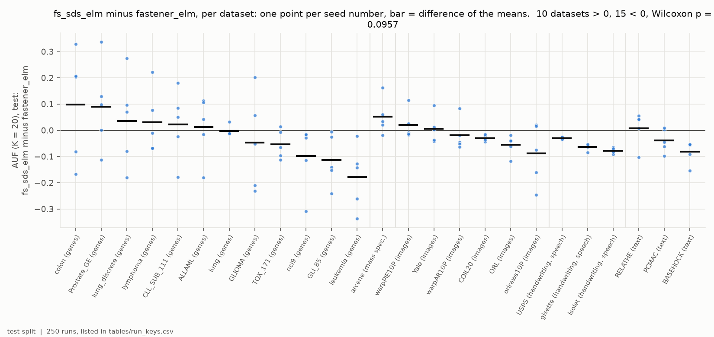
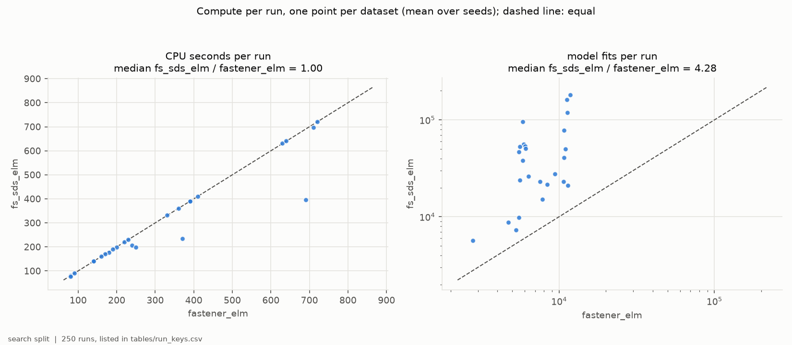
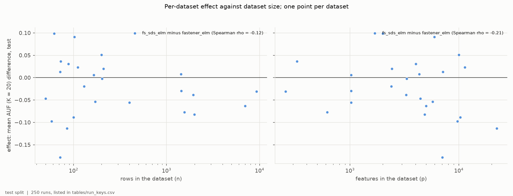
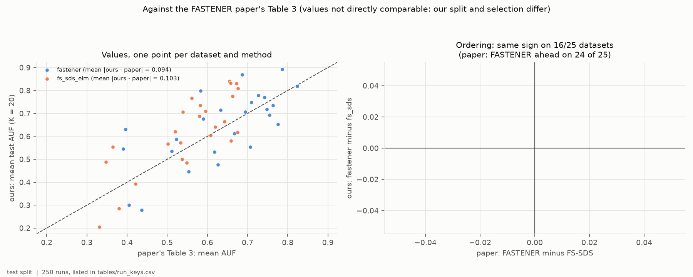
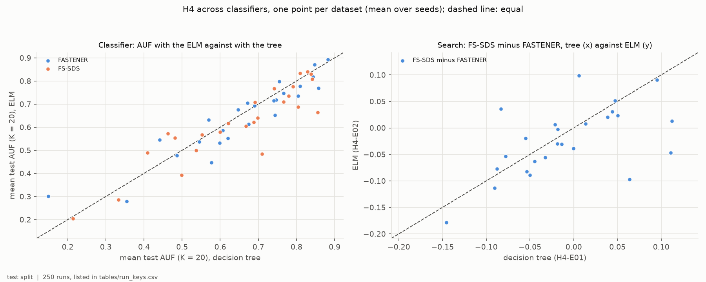

# H4-E02 -- report

*Hypothesis H4. The runs, the criteria as registered, the per-seed numbers
and how to reproduce them are in [SUPPORT.md](SUPPORT.md).*

## 1. In brief

### The hypothesis

The FASTENER paper reports FASTENER ahead of FS-SDS on 24 of 25 benchmark
datasets, but its FASTENER was driven by a decision tree and its FS-SDS by an
Extreme Learning Machine (ELM). H4 claims that with the same classifier and
the same resources the ordering does not survive. H4-E01 tested this with the
decision tree on both sides and found the two methods comparable. This
experiment repeats it with the paper's ELM on both sides: both searches are
driven by the ELM, and both results are scored by it. Each method gets the
same CPU time per dataset as in H4-E01. Scores are the mean, over subset sizes
1 to 20, of the best test F1 a method offers at that size or below (AUF,
K = 20).

**How it is judged.** For each of the 25 datasets, each method's score is
averaged over 5 seeds. H4 is confirmed if FS-SDS is ahead on more datasets and
a Wilcoxon signed-rank test across the 25 favours it at p < 0.05; refuted if
the test favours FASTENER; otherwise the methods are comparable.

### The answer: not confirmed -- with the ELM, too, the methods are comparable

FS-SDS is ahead on 10 datasets and FASTENER on 15; the mean difference is
-0.024 in AUF and the Wilcoxon test gives p = 0.096 (F1). That leans towards
FASTENER more than with the tree (-0.008, p = 0.51) but is not significant.
The paper's ordering holds on 16 of 25 datasets (F4). Which method does
better on a dataset is largely the same with either classifier (F5).

*Per dataset, grouped by domain: FS-SDS's test AUF (K = 20) minus
FASTENER's, both driven and scored by the ELM; one point per seed number, bar
at the difference of the means.*

## 2. Findings

### F1 -- With the ELM on both sides, neither method is ahead across the 25 benchmarks

FS-SDS's mean AUF is higher on 10 datasets and FASTENER's on 15. The mean
difference (FS-SDS minus FASTENER) is -0.024, the median -0.030, and the
Wilcoxon signed-rank p = 0.096. Averaged over all 25 datasets FASTENER scores
0.643 and FS-SDS 0.619. FS-SDS is ahead on ALLAML, CLL_SUB_111, Prostate_GE,
RELATHE, Yale, arcene, colon, lung_discrete, lymphoma and warpPIE10P. As with
the tree, single seeds on the small gene-expression sets differ by 0.3 or
more.

*Per dataset, grouped by domain: FS-SDS minus FASTENER in test AUF (K = 20),
both on the ELM. Points pair the methods' runs with the same seed number; bar
at the difference of the means.*

### F2 -- Equal compute gives FS-SDS about four times the model fits with the ELM

Both methods stopped on the same CPU time (median ratio 1.00); FS-SDS made a
median 4.3 times as many fits as FASTENER (1.4 to 16.5 times). With the tree
the ratio was 5.4. FS-SDS stopped early, its swarms finding no new subsets,
on fewer datasets than with the tree: it used under 95% of its budget on 4
(GLI_85 57%, orlraws10P 63%, leukemia 79%, ALLAML 86%), against 8 with the
tree.

*One point per dataset, mean over seeds. Left: CPU seconds per run, FS-SDS
against FASTENER. Right: model fits per run, log scales. Dashed lines: equal.*

### F3 -- No consistent trend with dataset size

FS-SDS's leads are spread over sizes: of its 10, 6 are on datasets with fewer
than 150 rows and 4 on larger ones (arcene, RELATHE, Yale, warpPIE10P). The
effect does not follow the number of rows (Spearman rho = -0.12, p = 0.58)
or of features (rho = -0.21, p = 0.30).

*One point per dataset: FS-SDS minus FASTENER in mean test AUF (K = 20), both
on the ELM, against rows (left) and features (right), log scales.*

### F4 -- Run as the paper ran it, FS-SDS scores above the paper's FS-SDS

The FS-SDS arm here is the paper's own setting -- FS-SDS driven by the ELM --
and it scores on average 0.064 above the paper's Table 3 (17 of 25 datasets
above; mean absolute difference 0.103). FASTENER with the ELM is 0.009 above
the paper's FASTENER (13 of 25 above; 0.094). The paper's ordering, FASTENER
ahead, holds on 16 of 25 datasets. The values are not directly comparable --
this protocol splits 60/20/20 and selects on validation -- but with the
paper's classifier FS-SDS still gains far more against its published numbers
than FASTENER does. The ELM is therefore not what held the paper's FS-SDS
back.

*Left: our mean test AUF (K = 20) against the paper's Table 3, per dataset
and method; FS-SDS here is the paper's ELM-driven setting. Right: FASTENER
minus FS-SDS in the paper (x) and here (y); points in the upper right and
lower left keep the paper's ordering.*

### F5 -- The classifier changes the scores little and the ordering hardly at all

Across the 2 x 2 of method and classifier (this experiment and H4-E01), the
ELM scores slightly below the tree for both methods: FASTENER by 0.014 on
average (lower on 16 datasets of 25, p = 0.20), FS-SDS by 0.030 (lower on 17,
p = 0.080). Which method leads on a dataset is largely the same with either
classifier: the per-dataset FS-SDS-minus-FASTENER effects have the same sign
on 21 of 25 datasets (Spearman rho = 0.54, p = 0.005).

| comparison, per dataset | datasets > 0 | < 0 | mean | Wilcoxon p |
|---|---:|---:|---:|---:|
| FASTENER: ELM minus tree | 9 | 16 | -0.014 | 0.20 |
| FS-SDS: ELM minus tree | 8 | 17 | -0.030 | 0.080 |
| tree: FS-SDS minus FASTENER (H4-E01) | 10 | 15 | -0.008 | 0.51 |
| ELM: FS-SDS minus FASTENER (H4-E02) | 10 | 15 | -0.024 | 0.096 |

*Left: each dataset's mean test AUF (K = 20) with the ELM against with the
tree, for FASTENER (blue) and FS-SDS (orange). Right: FS-SDS minus FASTENER
with the tree (H4-E01, x) against with the ELM (H4-E02, y). Dashed lines:
equal.*

## 3. Assessment

H4 is not confirmed with the ELM either: at equal compute, FS-SDS does not
overtake FASTENER (10 against 15 datasets, p = 0.096; F1), and by the
registered reading the two methods are comparable. Together with H4-E01, the
answer is the same under both classifiers -- the paper's 24-of-25 ordering does
not hold once both methods share a classifier and a budget (it holds on 14
and 16 of 25), and neither method is ahead overall.

The classifier matters little. The ELM lowers both methods' scores slightly
and neither change is significant (F5), and the datasets on which FS-SDS
leads are largely the same with either classifier (21 of 25 same sign). The
search, not the classifier, decides which method suits a dataset, and that
varies from dataset to dataset rather than favouring one method.

This experiment also corrects a reading from H4-E01. There, FS-SDS scoring
far above its published values while FASTENER scored close to its own was
read as consistent with the paper's FS-SDS having been held back by the ELM.
Here FS-SDS runs on the ELM, as in the paper, and still scores 0.064 above
the paper's FS-SDS, against 0.009 for FASTENER (F4). The difference from the
published FS-SDS numbers therefore lies elsewhere -- in the protocol (split
and selection), in the paper's FS-SDS budget or runs, or in the
implementation -- and these experiments cannot say which. A replication on
the paper's own split and budgets (`run_paper_replication.py`) could.

Limits are H4-E01's: one budget level per dataset, set by stock FASTENER's
cost on the tree; five seeds; test splits of 10 to 30 rows on the smallest
sets, where single seeds swing by 0.3. The ELM is the paper's configuration
and was not tuned.

For later hypotheses: FASTENER and FS-SDS are comparable at equal compute
whichever classifier drives them. The ELM offers no advantage over the tree
for either, so H5 and H6 lose nothing by staying with the protocol's tree.
