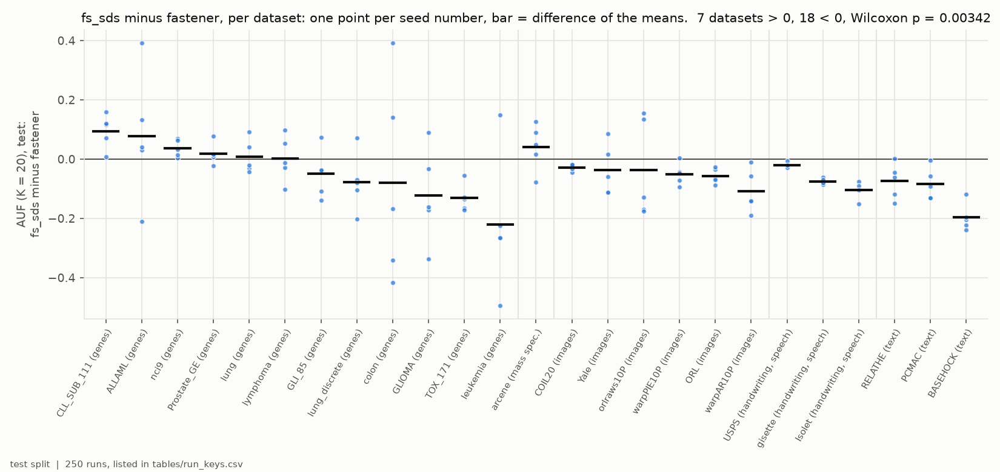
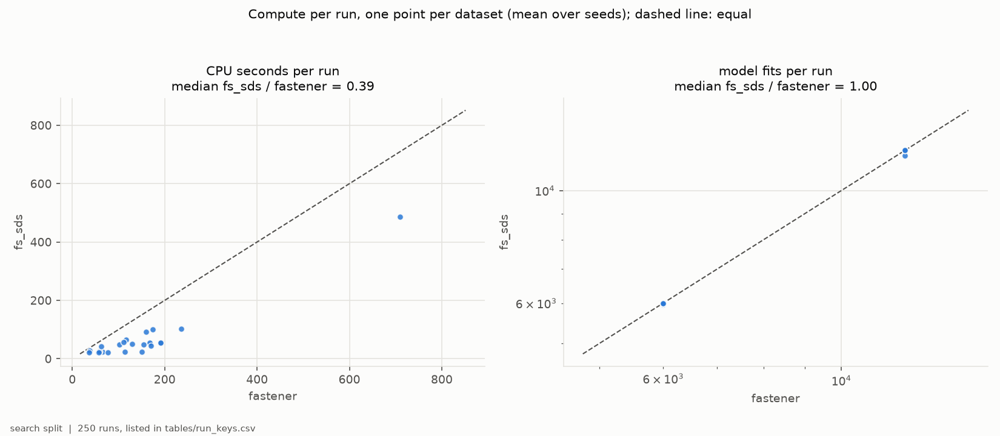
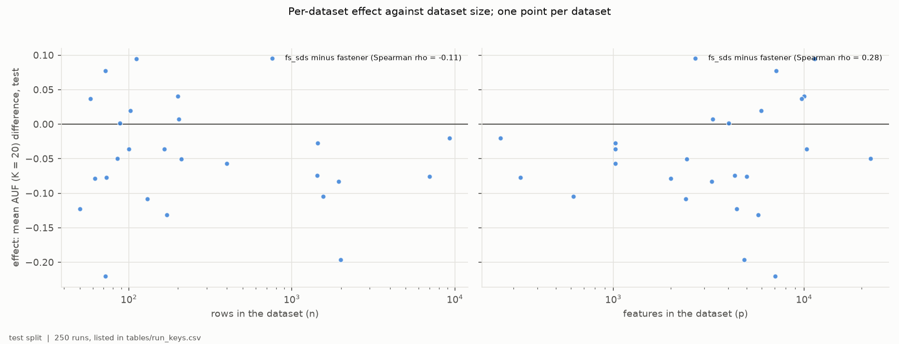
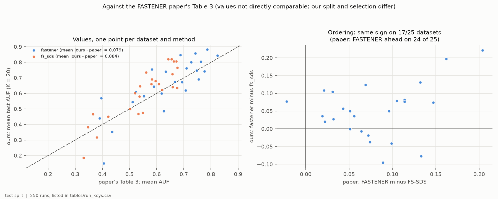
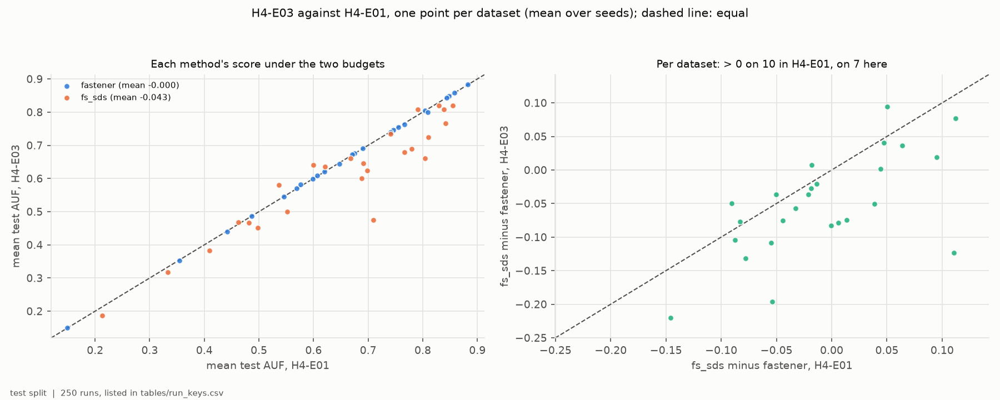

# H4-E03 -- report

*Hypothesis H4. The runs, the criteria as registered, the per-seed numbers
and how to reproduce them are in [SUPPORT.md](SUPPORT.md).*

## 1. In brief

### The hypothesis

The FASTENER paper reports FASTENER ahead of FS-SDS on 24 of 25 benchmark
datasets, in a comparison that gave the two methods different classifiers and
different budgets. H4 claims that with the same classifier and the same budget
the ordering does not survive. Here the budget is the **number of model
evaluations**: each run of either method may fit at most 6,000 feature
subsets (12,000 on 11 harder datasets), FS-SDS's split evenly over subset
sizes 1 to 20. Both methods are driven and scored by the same decision tree.
FASTENER runs with its gene bookkeeping vectorised, which leaves its search
unchanged and only makes it faster. Scores are the mean, over subset sizes 1
to 20, of the best test F1 a method offers at that size or below (AUF,
K = 20).

**How it is judged.** For each of the 25 datasets each method's score is
averaged over 5 seeds. H4 is confirmed if FS-SDS is ahead on more datasets and
a Wilcoxon signed-rank test across the 25 favours it at p < 0.05; refuted if
the test favours FASTENER; otherwise the methods are comparable.

### The answer: refuted -- at equal evaluations FASTENER is ahead

FASTENER is ahead on 18 datasets and FS-SDS on 7; the mean difference is
-0.051 in AUF and the Wilcoxon test gives p = 0.0034 (F1). The direction of
the paper's result holds when both methods get the same number of
evaluations, though not its size: 18 of 25 rather than 24, and the sign
agrees with the paper on 17 datasets (F4). At equal CPU time (H4-E01) the two
were comparable; the whole difference is FS-SDS's evaluations -- held to
FASTENER's count, it loses 0.043, while FASTENER scores the same (F5).

*Per dataset, grouped by domain: FS-SDS's test AUF (K = 20) minus
FASTENER's at equal model fits; one point per seed number, bar at the
difference of the means.*

## 2. Findings

### F1 -- At equal model fits, FASTENER is ahead on 18 of the 25 benchmarks

FS-SDS's mean AUF is higher on 7 datasets (ALLAML, CLL_SUB_111, Prostate_GE,
arcene, lung, lymphoma, nci9) and FASTENER's on 18. The mean difference
(FS-SDS minus FASTENER) is -0.051, the median -0.050, and the Wilcoxon
signed-rank p = 0.0034. Averaged over all datasets FASTENER scores 0.657 and
FS-SDS 0.606. FASTENER's largest leads are on leukemia (-0.22), BASEHOCK
(-0.20) and TOX_171 (-0.13); FS-SDS's on CLL_SUB_111 (+0.09) and ALLAML
(+0.08).

*Per dataset, grouped by domain: FS-SDS minus FASTENER in test AUF (K = 20).
Points pair the methods' runs with the same seed number; bar at the
difference of the means.*

### F2 -- Equal fits held: FS-SDS used about 40% of FASTENER's CPU

Every FASTENER run used exactly its fit budget, and FS-SDS 97.7% to 100% of
FASTENER's fits (a few of its runs per subset size stopped early on
stagnation). At equal fits FS-SDS used a median 0.39 of FASTENER's CPU time
per run (0.16 to 0.76): FASTENER still pays for its one-off mutual-information
pass and its permutation scoring, which are part of the method. With its gene
bookkeeping vectorised, FASTENER used 4.9 CPU-hours over its 125 runs,
against about 11 for nearly the same fits in H4-E01.

*One point per dataset, mean over seeds. Left: CPU seconds per run, FS-SDS
against FASTENER. Right: model fits per run, log scales. Dashed lines:
equal.*

### F3 -- FASTENER's lead does not depend on dataset size

FS-SDS leads on 5 of the 12 datasets with fewer than 150 rows and on 2 of
the 13 larger ones. The per-dataset effect does not follow the number of
rows (Spearman rho = -0.11, p = 0.61) or of features (rho = 0.28, p = 0.17).

*One point per dataset: FS-SDS minus FASTENER in mean test AUF (K = 20)
against rows (left) and features (right), log scales.*

### F4 -- The paper's ordering holds on 17 of 25 datasets

The sign of FASTENER minus FS-SDS matches the paper's Table 3 on 17
datasets. Both methods score above the paper's values -- FASTENER by 0.023 on
average (mean absolute difference 0.079), FS-SDS by 0.051 (0.084) -- and the
datasets rank alike in both (rank correlation 0.815 for each). The values are
not directly comparable, since this protocol splits 60/20/20 and selects on
validation.

*Left: our mean test AUF (K = 20) against the paper's Table 3, per dataset
and method. Right: FASTENER minus FS-SDS in the paper (x) and here (y);
points in the upper right and lower left keep the paper's ordering.*

### F5 -- The budget unit decides the verdict: FS-SDS needs its extra evaluations

The same arms ran at equal CPU time in H4-E01, where FS-SDS made about five
times FASTENER's fits. Held to FASTENER's number of fits, FS-SDS loses 0.043
in mean AUF; FASTENER, which made nearly the same fits in both, scores the
same (mean change 0.000). FS-SDS leads on 10 datasets at equal CPU time and
on 7 at equal fits, and the Wilcoxon p moves from 0.51 to 0.0034.

*One point per dataset, mean over seeds. Left: each method's test AUF
(K = 20) here (equal fits) against in H4-E01 (equal CPU time). Right: FS-SDS
minus FASTENER under the two budgets. Dashed lines: equal.*

## 3. Assessment

H4 is refuted at equal model evaluations: FASTENER is ahead of FS-SDS on 18
of the 25 benchmarks, by 0.051 in mean AUF, and the Wilcoxon test is clearly
significant (p = 0.0034; F1). With the same classifier and the same number of
evaluations, the direction of the paper's result reproduces. Its size does
not: the paper had FASTENER ahead on 24 of 25, here 18, and the sign agrees
with the paper on 17 datasets (F4).

Read with H4-E01 and H4-E02, the answer to H4 depends on what is held equal.
At equal CPU time the methods were comparable, with either classifier; at
equal evaluations FASTENER is ahead. The two budgets differ only for FS-SDS:
FASTENER's equal-CPU budget was set to its own cost of the same fits, so it
scored the same under both (F5). FS-SDS reaches FASTENER's level only with
about four to five times as many evaluations, which equal CPU time gave it
because an FS-SDS evaluation carries far less work around it (F2). FASTENER
is therefore the more sample-efficient search -- it gets more from each
evaluation -- while at equal compute the two are on a par with the current
implementations.

Which comparison matters depends on what an evaluation costs. Where fitting
the model dominates -- large training sets, slow classifiers -- evaluations
are the resource, and FASTENER is ahead. Where the model is cheap and the data
wide, FASTENER's mutual-information pass and permutation scoring cost more
than the fits, and FS-SDS can buy its extra evaluations for the same CPU
time.

Limits: one classifier (the decision tree) at this budget, one budget level
per dataset, five seeds, and test splits of 10 to 30 rows on the smallest
sets, where single seeds swing by 0.3 or more. The comparison with H4-E01 is
descriptive; it pairs two experiments run a day apart on the same code for
FS-SDS and the same search for FASTENER.

For later hypotheses: H5 and H6 run at equal fits, as registered, and on that
footing FASTENER should be expected to lead FS-SDS. Whether H5 and H6 should
also report equal-compute results is the PI's choice.
