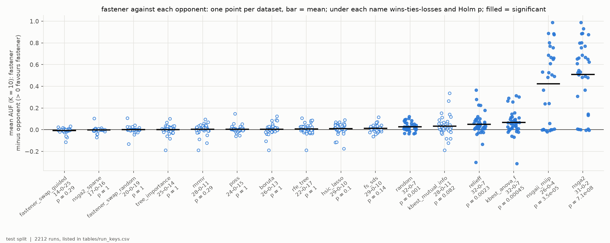
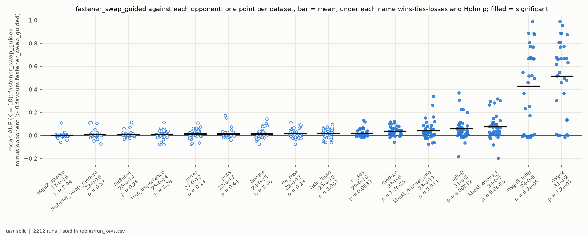
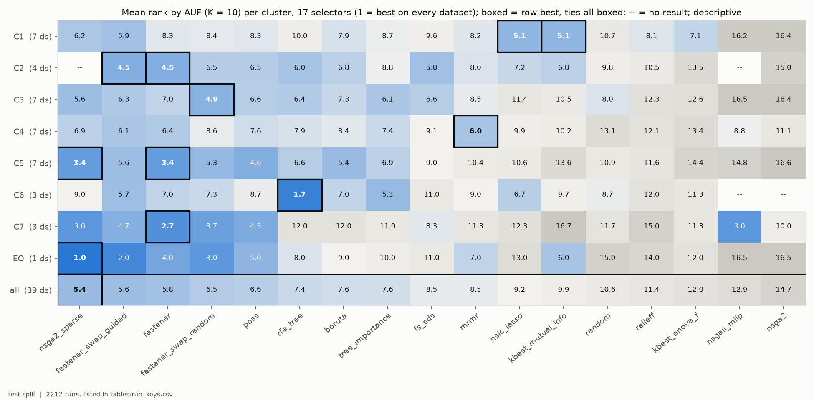
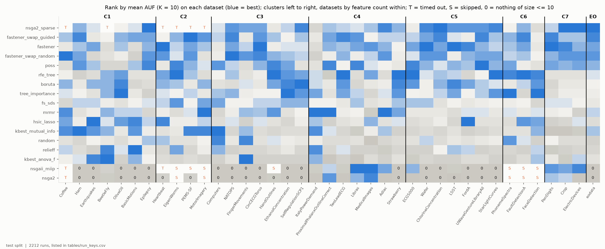
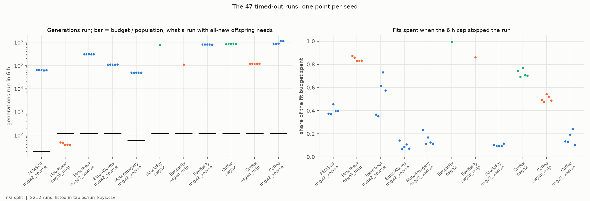
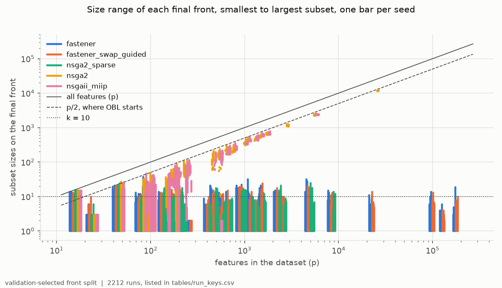
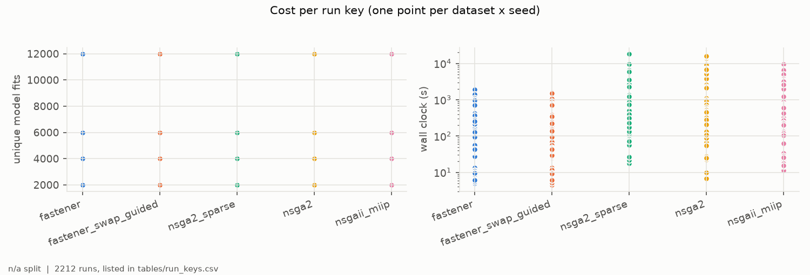

# H5H6-E01 -- report

*Hypothesis H5, H6. The runs, the criteria as registered, the per-seed numbers and how to reproduce them are in [SUPPORT.md](SUPPORT.md).*

## 1. In brief

### The hypothesis

H5 says that stock FASTENER finds better small feature subsets than every
other selector in this repository, when all of them run on the same datasets
under one protocol. H6 says the same of FASTENER with the guided swap.

"Better small subsets" is measured by AUF (K = 10): for each k = 1..10, take
the best subset of at most k features, chosen on validation, and read its test
F1; AUF is the average of those ten scores.

The field is 17 selectors on 39 datasets:

- *selectors:* three FASTENER arms, four other searches, Boruta, random subsets,
  and eight filters and rankers;
- *datasets:* 38 UCR/UEA time-series sets in seven clusters (C1-C7), and
  EOData.

**How it is judged.** For each hypothesis, its FASTENER arm is compared with
each of the 16 others in turn, over the datasets where both have a result. It
must be ahead on more datasets than it is behind, and a Wilcoxon test over the
datasets must be significant after Holm correction -- against **all 16**.
Missing a single one refutes the claim.

### The answer: not confirmed, for either

Both arms lead most opponents on most datasets, but neither is significantly
ahead of most of the field. Stock FASTENER is significantly better than 5 of
its 16 opponents, and is behind the guided swap on 25 of 39 datasets. Guided
FASTENER is ahead of all 16 on wins, but significantly ahead of only 7. The
top of the field is a near tie whose leader changes from cluster to cluster
(F3).

*H5: stock FASTENER's AUF minus each opponent's, one point per dataset; filled points mark the 5 significant pairs.*

*H6: the same for guided-swap FASTENER; 7 pairs significant.*

## 2. Findings

One finding at a time: the statement, what it rests on, and the figure that shows it.

### F1 -- Stock FASTENER is significantly better than only 5 of its 16 opponents, so H5 fails

Per dataset, each arm's score is its AUF (K = 10) averaged over 5 seeds. The
deterministic filters get one run per dataset.

Stock FASTENER has more wins than losses against 15 of the 16 opponents. The
exception is the guided swap, which beats it on 25 of 39 datasets (14-0-25).
Against the random swap the record is 20-0-19.

After Holm correction the difference is significant against five opponents
only:

| opponent | wins-ties-losses | Holm p | note |
|---|---|---|---|
| ANOVA-F ranker | 32-0-7 | 0.00045 | weak filter |
| random subsets | 32-0-7 | 0.0010 | weak filter |
| ReliefF | 32-0-7 | 0.0023 | weak filter |
| NSGA-II | 31-0-2 | 7e-8 | margin is reach, not quality (F6) |
| NSGAII-MIIP | 26-0-4 | 3.5e-5 | margin is reach, not quality (F6) |

The two OBL-started searches trail by 0.42-0.51 AUF. Against the other 11
opponents the mean difference lies between -0.008 and +0.033 AUF, and every
Holm p is 0.08 or more.

*Opponents along x, ordered by mean difference; y = stock FASTENER's mean AUF (K = 10) minus the opponent's, one point per dataset where both have a result; bar = mean; filled = significant after Holm. Test split.*

### F2 -- Guided FASTENER leads every opponent on wins, but significantly only 7 of 16, so H6 fails

Guided FASTENER has more wins than losses against all 16 opponents; it is the
only arm in the field that does. It is significant against seven:

- FS-SDS (29-0-10, p = 0.0033);
- the mutual-information ranker (28-0-11, p = 0.014);
- the ANOVA-F ranker, ReliefF and random subsets;
- NSGA-II and NSGAII-MIIP.

It is not significant against the other nine:

| opponent | wins-ties-losses | difference | Holm p |
|---|---|---|---|
| stock FASTENER | 25-0-14 | mean +0.0077 AUF, per dataset -0.033 to +0.114 | 0.28 (raw 0.040) |
| sparse NSGA-II | 17-0-16 | on the 33 datasets where both finished | 0.94 |
| Boruta, POSS, RFE, tree importance | 22-25 wins, 14-17 losses | -- | 0.28-0.46 |

*As F1, with guided-swap FASTENER as the focal arm. Test split.*

### F3 -- The leader changes with the cluster, and FASTENER arms lead or share the lead in four of the eight

Rank all 17 selectors on each dataset by mean AUF (1 = best), and average the
ranks within each cluster. The leader differs almost everywhere:

| cluster | datasets | leader (mean rank) | next |
|---|---|---|---|
| C1 small lab sets, p >= n | 7 | HSIC Lasso and MI ranker, tied (5.1) | guided FASTENER (5.9) |
| C2 high-dimensional, p >> n | 4 | stock and guided FASTENER, tied (4.5) | FS-SDS (5.8) |
| C3 long physiological signals | 7 | FASTENER, random swap (4.9) | sparse NSGA-II (5.6) |
| C4 short series, mid-sized | 7 | mRMR (6.0) | guided FASTENER (6.1) |
| C5 larger sensor collections | 7 | sparse NSGA-II and stock FASTENER, tied (3.4) | POSS (4.6) |
| C6 large audio / industrial | 3 | RFE (1.7) | tree importance (5.3) |
| C7 very many short series | 3 | stock FASTENER (2.7) | sparse NSGA-II, NSGAII-MIIP (3.0) |
| EOData | 1 | sparse NSGA-II (1) | guided FASTENER (2) |
| **all** | **39** | **sparse NSGA-II (5.4)** | **guided (5.6), stock (5.8)** |

The FASTENER arms lead or share the lead in C2, C3, C5 and C7. Filters lead in
the small sets of C1 and the mid-sized C4. RFE, a tree-based ranking, leads
clearly in C6.

Over all 39 datasets, sparse NSGA-II, guided FASTENER and stock FASTENER are
within 0.4 of a rank of each other. Sparse NSGA-II's 5.4, however, is
averaged over 33 datasets: it has no result on any C2 dataset, nor on Coffee
or BeetleFly (F5).

With 1-7 datasets per cluster this is descriptive: one dataset can move a C6
or C7 mean rank by up to 5.

*Mean rank by AUF (K = 10) of each selector (x) in each cluster (y), over the datasets of the cluster where it has a result; boxed = best in the row; -- = no result in the cluster. Test split.*

### F4 -- No selector is best on more than 7 of the 39 datasets, and the leading margins are small

Fourteen of the 17 selectors are best on at least one dataset:

- RFE on 7;
- stock FASTENER and sparse NSGA-II on 5 each;
- tree importance and mRMR on 4 each;
- guided FASTENER on only 1.

Guided FASTENER is still in the top three on 12 datasets, and sparse NSGA-II
and the random swap on 13 each.

The margins are small: on the median dataset, the best selector is 0.014 AUF
ahead of the fourth best. The heat map has no all-blue row, so every selector
places low somewhere.

*Rank of each selector (y) on each dataset (x), datasets grouped by cluster and ordered by feature count within it; T = timed out on every seed, S = skipped before the run, 0 = no subset of at most 10 features on any seed (AUF 0). Test split.*

### F5 -- 42 of the 47 timeouts were NSGA-II searches that had stopped finding new subsets, not slow ones

Every missing cell belongs to the three NSGA-II arms:

- 12 cells were skipped before the run, as predicted to exceed the cap;
- 47 runs reached the 6-hour cap.

FASTENER and every other selector finished all 39 datasets.

With a population of 100 and every offspring new, a run needs its fit budget
divided by 100 generations, which is 20-120 here.

- *Genuinely slow (5 runs):* NSGAII-MIIP on Heartbeat (24,705 features) ran
  37-49 generations in 6 h and spent 83-87% of its budget.
- *Stalled (42 runs):* the rest ran 48,670 to 1,125,079 generations, 800 to
  9,400 times the number needed, while spending 7-99% of the budget.

The stalled runs had converged: nearly every offspring was a subset already
scored. Repeats cost no fit, so the budget was never reached. The NSGA-II loop
runs until the budget is spent and has no stop for this case. FS-SDS has one:
it stops after 50 sweeps without a new subset.

This is how sparse NSGA-II lost all four C2 datasets, Coffee and BeetleFly. On
Coffee (56 rows), every seed of all three NSGA-II arms stalled. On BeetleFly,
four of five NSGA-II seeds finished their 12,000 fits in about 25 seconds.

*Left: generations each timed-out run completed in 6 h (log scale), one point per seed; bar = fit budget / population, what a run with all-new offspring needs. Right: share of the fit budget spent when it was stopped.*

### F6 -- NSGA-II and NSGAII-MIIP lose on reach: most of their runs never get down to 10 features

NSGA-II and NSGAII-MIIP start from subsets of about half the features
(opposition-based initialisation). The smallest subset on the final front has
more than 10 features in 70% of NSGA-II runs (115 of 164) and 63% of
NSGAII-MIIP runs (94 of 149).

AUF counts a size a run never reached as 0. Their mean AUF is therefore 0.17
and 0.25, against about 0.65 for the leaders.

The exception is the short-series clusters:

- In C4 they reach k <= 10 in 83% and 86% of runs, and NSGAII-MIIP is best on
  two C4 datasets (Libras, MedicalImages).
- In C7 they reach it in every run, and NSGAII-MIIP ties for second (F3).

Every other selector, sparse NSGA-II included, reaches a single feature on
every run.

*Smallest to largest subset on each final front (y, log), one bar per seed, at the dataset's feature count (x, log), for the two FASTENER focal arms, sparse NSGA-II, NSGA-II and NSGAII-MIIP; dashed = p/2, dotted = k = 10. Validation-selected fronts.*

### F7 -- At the same fit budget, the FASTENER arms finish a run 4-8 times faster than the NSGA-II searches

| arm | median finished run | slowest finished run | total, finished runs |
|---|---|---|---|
| FASTENER (three arms) | 89-97 s | 31 min | about 14 h each |
| sparse NSGA-II | 409 s | 5.1 h | 62 h |
| NSGA-II | 598 s | 4.5 h | 132 h |
| NSGAII-MIIP | 682 s | 2.7 h | 79 h |

The NSGA-II totals leave out the 282 hours of the 47 timed-out runs and the
12 skipped cells.

*Left: unique model fits per run (the per-dataset budget, 2,000-12,000). Right: wall clock per finished run (log), one point per dataset and seed; the 47 timed-out runs are not shown.*

## 3. Assessment

**Neither H5 nor H6 holds.** Each needed a significant lead over all 16
opponents; stock FASTENER has one against 5 (F1), guided FASTENER against 7
(F2).

Both arms are significantly better than the weak filters (ANOVA-F, ReliefF,
random subsets) and than the OBL-started searches. Against the OBL-started
searches this is mostly reach: those searches seldom propose a subset of 10
features or fewer (F6).

Against the rest of the field -- sparse NSGA-II, POSS, Boruta, RFE, mRMR,
HSIC Lasso, FS-SDS, tree importance, the MI ranker and the other FASTENER
arms -- the results are close. The focal arm is ahead on 36-74% of datasets,
and the mean differences lie between -0.008 and +0.033 AUF.

**What the experiment does show is a flat top.** Guided FASTENER is the only
selector ahead of every opponent on wins, and it has the highest mean AUF:
0.655, against 0.648 for each of the next three. It is the most consistent
selector in the field rather than a clear best. Its lead over stock FASTENER,
+0.0077 AUF on 25 of 39 datasets (F2), points the same way as H3, but does not
survive Holm correction here.

The leader changes with the cluster (F3): FASTENER arms in C2, C3, C5 and C7,
filters in C1 and C4, RFE in C6. Fourteen of the 17 selectors are best on at
least one dataset (F4). For a practitioner the choice matters less than the
cluster table suggests, since the best selector is a median 0.014 AUF ahead of
the fourth (F4).

**What it does not show.**

- *Cluster leaders are not established.* With 1-7 datasets per cluster no test
  was registered or run.
- *Sparse NSGA-II's first place over all datasets is not a like-for-like
  rank.* It rests on the 33 datasets it finished.
- *Sparse NSGA-II's six missing cells say nothing about its speed or quality
  there.* These are the four C2 datasets, Coffee and BeetleFly. F5 shows they
  are stalls: the search had converged and kept re-proposing subsets it had
  already scored.

Filling those cells could move sparse NSGA-II up or down in C1 and C2. It
cannot rescue either hypothesis, because H5 and H6 also fail against opponents
with complete coverage. For example, guided FASTENER against Boruta is 24-0-15
with Holm p = 0.46.

**Limits.**

- *Model and metric.* Every score is a decision tree's weighted F1, and AUF
  stops at K = 10.
- *Budget.* The fit budget is the H2/H3 calibration's, 2,000-12,000 fits per
  run.
- *Splits.* On the smallest sets the test split is 8-12 rows (BeetleFly,
  Coffee, OliveOil), so one row moves a score by about 0.1.
- *Seeds.* There are five seeds per search and one run per deterministic
  filter. The tests treat datasets, not seeds, as the unit.

**What follows.** Three choices for the PI:

1. *Whether to rerun the 42 stalled NSGA-II cells* (F5) with a stop after
   generations that add no new subset, as FS-SDS already has. That needs a
   code change and a decision before any rerun. It would complete the cluster
   table, not change the verdicts.
2. *Whether the cluster pattern (F3) is worth registering as its own
   hypothesis.* That would need a pre-registered per-cluster test, and more
   datasets per cluster than C6 and C7 have.
3. *Whether to test a claim of the form "guided FASTENER is not worse than any
   selector".* An equivalence or non-inferiority test may be the claim this
   grid can support; H6 as registered asked for strict superiority.
