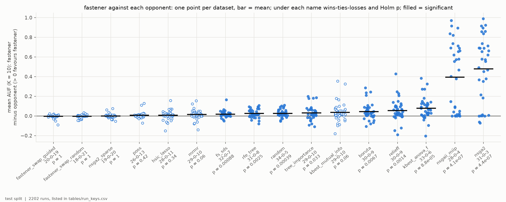
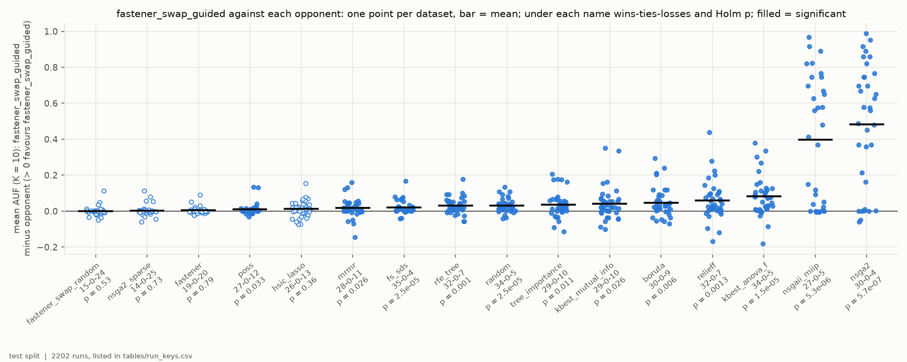
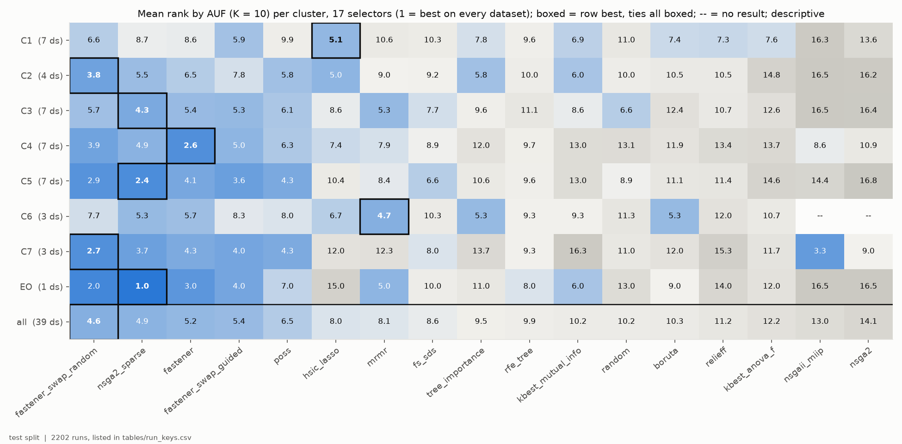
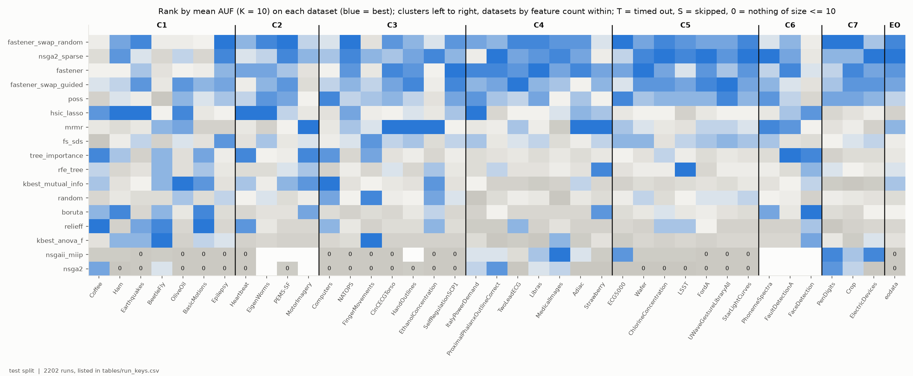
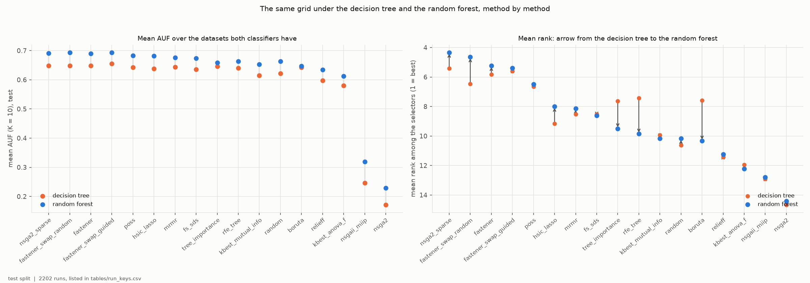
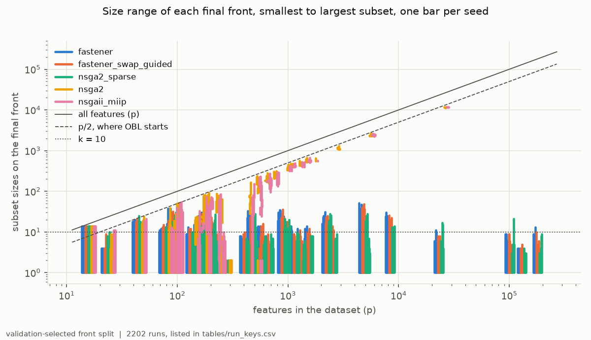
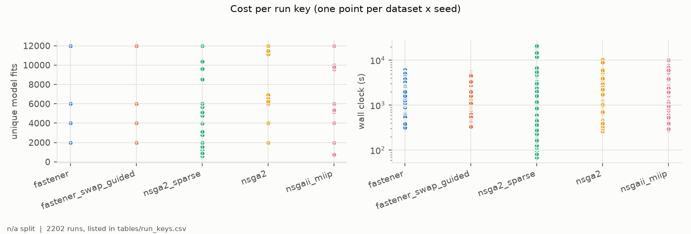

# H5H6-E02 -- report

*Hypothesis H5, H6. The runs, the criteria as registered, the per-seed numbers and how to reproduce them are in [SUPPORT.md](SUPPORT.md).*

## 1. In brief

### The hypothesis

H5 says that stock FASTENER finds better small feature subsets than every
other selector in the repository; H6 says the same of FASTENER with the
guided swap. This experiment repeats H5H6-E01's grid of 17 selectors on 39
datasets (38 UCR/UEA time-series sets in seven clusters, and EOData) with one
change: every method is judged by a **random forest of 100 trees** instead of
a single decision tree. "Better small subsets" is AUF (K = 10): for each
k = 1..10, the test F1 of the best subset of at most k features chosen on
validation, averaged.

**How it is judged.** Each hypothesis's FASTENER arm is compared with each of
the 16 others over the datasets where both have a result. It must be ahead
on more datasets than behind, and significantly so (Wilcoxon, Holm-corrected)
-- against **all 16**.

### The answer: not confirmed, for either

Under the forest both FASTENER arms pull further away from the weaker
selectors than under the tree: stock FASTENER is significantly ahead of 9 of
its 16 opponents (5 under the tree), guided FASTENER of 12 (7). But the top
of the field is still a tie. Stock FASTENER, the guided and random swaps and
sparse NSGA-II are within 0.004 AUF of each other on average, none
significantly ahead of another, and the guided swap is behind the random
swap on 24 of 39 datasets (15-0-24).

*H5: stock FASTENER's AUF minus each opponent's, one point per dataset; filled points mark the 9 significant pairs.*

*H6: the same for guided-swap FASTENER; 12 pairs significant.*

## 2. Findings

### F1 -- Stock FASTENER is significantly better than 9 of its 16 opponents, so H5 fails

Per dataset, each arm's score is its AUF (K = 10) averaged over 5 seeds (one
run for the deterministic filters). After Holm correction stock FASTENER is
significantly ahead of FS-SDS (32-0-7), RFE (31-0-8), random subsets
(34-0-5), the tree-importance ranker (29-0-10), Boruta (30-0-9), ReliefF
(30-0-9), the ANOVA-F ranker (33-0-6), NSGAII-MIIP (28-0-4) and NSGA-II
(31-0-3). The last two trail by 0.39-0.48 AUF, mostly a matter of reach
(F6).

It is not significantly ahead of the other seven. Against the guided swap
(20-0-19), the random swap (18-0-21) and sparse NSGA-II (19-0-20) the records
are even and the mean differences within 0.004 AUF (Holm p = 1). Against
POSS, HSIC Lasso, mRMR and the mutual-information ranker it leads on 26-29
datasets of 39, by 0.007-0.037 AUF, with Holm p of 0.06-0.42.

*Opponents along x, ordered by mean difference; y = stock FASTENER's mean AUF (K = 10) minus the opponent's, one point per dataset where both have a result; bar = mean; filled = significant after Holm. Test split.*

### F2 -- Guided FASTENER is significantly better than 12 of 16, and loses on wins to the random swap and sparse NSGA-II, so H6 fails

Guided FASTENER is significantly ahead of the nine opponents of F1 plus POSS
(27-0-12, p = 0.033), mRMR (28-0-11, p = 0.026) and the mutual-information
ranker (28-0-11, p = 0.026). It fails the criterion twice over: not
significantly against stock FASTENER (19-0-20) or HSIC Lasso (26-0-13,
p = 0.36), and **behind** the random swap (15-0-24) and sparse NSGA-II
(14-0-25) on wins, although its mean AUF is 0.0002-0.003 higher than
theirs: it wins by more where it wins, and wins less often.

*As F1, with guided-swap FASTENER as the focal arm. Test split.*

### F3 -- Under the forest the search methods lead in six of the eight clusters; filters lead only in C1 and C6

Ranking the 17 selectors on each dataset by mean AUF (1 = best) and averaging
within each cluster:

| cluster | datasets | leader (mean rank) | next |
|---|---|---|---|
| C1 small lab sets, p >= n | 7 | HSIC Lasso (5.1) | guided FASTENER (5.9) |
| C2 high-dimensional, p >> n | 4 | random-swap FASTENER (3.8) | HSIC Lasso (5.0) |
| C3 long physiological signals | 7 | sparse NSGA-II (4.3) | mRMR, guided FASTENER (5.3) |
| C4 short series, mid-sized | 7 | stock FASTENER (2.6) | random-swap FASTENER (3.9) |
| C5 larger sensor collections | 7 | sparse NSGA-II (2.4) | random-swap FASTENER (2.9) |
| C6 large audio / industrial | 3 | mRMR (4.7) | sparse NSGA-II, tree importance, Boruta (5.3) |
| C7 very many short series | 3 | random-swap FASTENER (2.7) | NSGAII-MIIP (3.3) |
| EOData | 1 | sparse NSGA-II (1) | random-swap FASTENER (2) |
| **all** | **39** | **random-swap FASTENER (4.6)** | **sparse NSGA-II (4.9), stock (5.2), guided (5.4)** |

The four population searches -- the three FASTENER arms and sparse NSGA-II --
hold the first four places over all 39 datasets, now with complete coverage:
sparse NSGA-II has a result on all 39 (33 under the tree). With 1-7 datasets
per cluster this is descriptive.

*Mean rank by AUF (K = 10) of each selector (x) in each cluster (y), over the datasets of the cluster where it has a result; boxed = best in the row; -- = no result in the cluster. Test split.*

### F4 -- No selector is best on more than 7 of the 39 datasets, and the leading margins are smaller than under the tree

Thirteen of the 17 selectors are best on at least one dataset: sparse NSGA-II
on 7, mRMR and the random swap on 6 each, HSIC Lasso on 5, stock FASTENER on
3, guided FASTENER on 2. On the median dataset the best selector is 0.011
AUF ahead of the fourth (0.014 under the tree).

*Rank of each selector (y) on each dataset (x), datasets grouped by cluster and ordered by feature count within it; S = skipped before the run, 0 = no subset of at most 10 features on any seed (AUF 0). Test split.*

### F5 -- The forest raises nearly every method's AUF, but unevenly: the search methods rise in rank and the tree-based rankers fall

Compared cell by cell with H5H6-E01 (642 dataset-method cells with a result
under both), the forest raises AUF in 78% of cells, by +0.037 on average.
The search methods gain most (+0.038 to +0.046 for the FASTENER arms, sparse
NSGA-II and POSS); the rankers built on a tree gain least -- Boruta +0.004,
tree importance +0.012, RFE +0.023 -- and drop in mean rank, from 7.6 to 10.3
(Boruta), 7.6 to 9.5 (tree importance) and 7.4 to 9.9 (RFE). The order of
the methods is largely kept (Spearman 0.88 between their mean ranks under the
two classifiers), less so dataset by dataset (median 0.66, range -0.45 to
0.97), and the cluster leader changes in six of the eight clusters.

*Left: each method's mean AUF (K = 10) under the decision tree (H5H6-E01) and the random forest (this experiment), over the datasets both have; right: its mean rank among the 17 selectors, the arrow from tree to forest. Methods along x, best rank under the forest first. Test split.*

### F6 -- NSGA-II and NSGAII-MIIP still mostly never reach 10 features

Started from about half the features (opposition-based initialisation), 64%
of NSGA-II runs (of 170) and 54% of NSGAII-MIIP runs (of 160) end with no
subset of 10 features or fewer, against 70% and 63% under the tree. Their
mean AUF is 0.25 and 0.32, against about 0.69 for the leaders. As under the
tree they reach k <= 10 on the short-series clusters (94-100% of runs in C4,
all in C7), and in 0-34% of runs on the other clusters. Every other selector reaches a single
feature on every run.

*Smallest to largest subset on each final front (y, log), one bar per seed, at the dataset's feature count (x, log), for the two FASTENER focal arms, sparse NSGA-II, NSGA-II and NSGAII-MIIP; dashed = p/2, dotted = k = 10. Validation-selected fronts.*

### F7 -- Every one of the 2,202 runs finished inside the 6-hour cap

No run timed out (47 under the tree). With the NSGA-II stagnation stop
(DEC-41), 93 searches ended on it -- 72 sparse NSGA-II, 11 NSGAII-MIIP and 10
NSGA-II runs -- instead of spinning on cached subsets. With FASTENER's bounded
model store (DEC-42) every FASTENER run spent its full budget, in at most 1.7
hours. The median run of every search took 28-35 minutes on 8 cores; the
longest, sparse NSGA-II on HandOutlines, 5.8 hours. In all the runs took 967
job-hours on 8 cores each, against 371 single-core hours for the finished
runs under the tree.

*Left: model fits per run, one point per dataset and seed; the searches below their budget stopped on stagnation. Right: wall clock per run (log), on 8 cores of HPC Vega.*

## 3. Assessment

**Neither H5 nor H6 holds under the forest either.** Both needed a
significant lead over all 16 opponents. Stock FASTENER has one over 9 (F1),
guided FASTENER over 12 (F2). The change of classifier sharpens FASTENER's
lead over the filters, Boruta, FS-SDS and random subsets -- under the tree
it was significant against 5 and 7 opponents -- but does nothing to separate
the four population searches from one another: stock, guided and random-swap
FASTENER and sparse NSGA-II are within 0.004 AUF in the mean, with even win
records and Holm p near 1 (F1, F2).

**What carries over from the tree (D2).** The verdicts, the flat top made of
the same four searches, and the failure of the OBL-started searches to reach
small subsets (F6) all hold under both classifiers. What does not carry over
is the middle of the table and the cluster picture: the forest helps the
searches more than the tree-based rankers, whose mean rank falls by 1.9-2.8
places (F5), and five of the six cluster leaders that change are taken by a search
method (F3). Under the forest a filter leads only in C1 (HSIC Lasso) and C6
(mRMR), on 7 and 3 datasets. A choice of method by cluster made from
H5H6-E01 would, in six of the eight clusters, not be the forest's leader.

**What it does not show.** No cluster leader is established: 1-7 datasets
per cluster and no registered test. The guided swap's higher mean AUF with
fewer wins than the random swap (F2) is a statement about how the differences
are distributed, not evidence for or against the guidance. And these are
two learners, a tree and a forest of trees; a learner of another kind (D2 in
full) could reorder the field again.

**Limits.** Every score is one classifier's weighted F1 on one split per
dataset, the smallest test splits holding 8-12 rows; AUF stops at K = 10;
the fit budgets are the H2/H3 calibration's, 2,000-12,000 fits; five seeds
per search, one run per deterministic filter, datasets as the unit of the
tests. The runs' manifests do not record their commit (SUPPORT.md, *What
happened*): which code each run used is reconstructed from the clone's
history on the cluster.

**What follows.** The PI's choices:

1. *Whether H6 should give way to a weaker claim* -- for example that the
   population searches as a group beat the filters, which both grids would
   support, or a non-inferiority test for guided FASTENER.
2. *Whether the cluster dependence is worth a registered test* under a
   third learner of a different kind, with more datasets in C6 and C7.
3. *Whether to adopt the forest as the protocol classifier* for later
   hypotheses: every method scores higher with it (F5), but it costs about 20
   times the compute.
