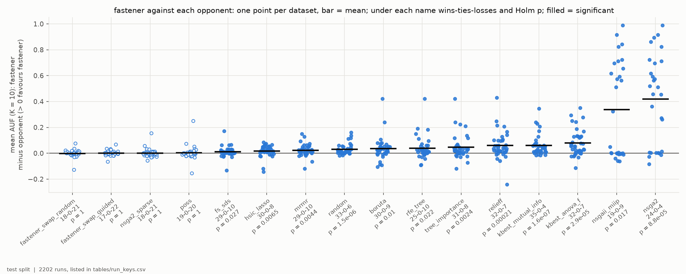
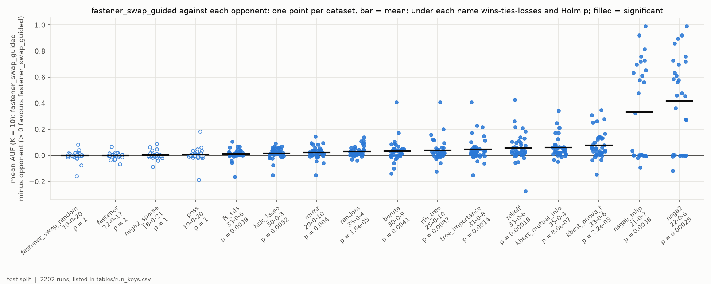
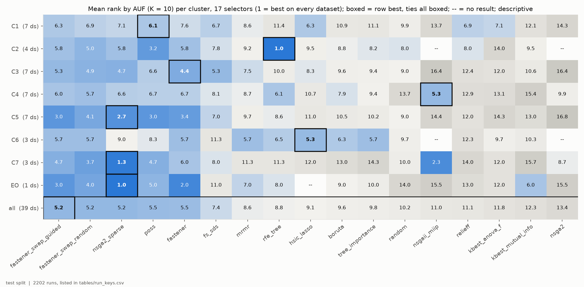
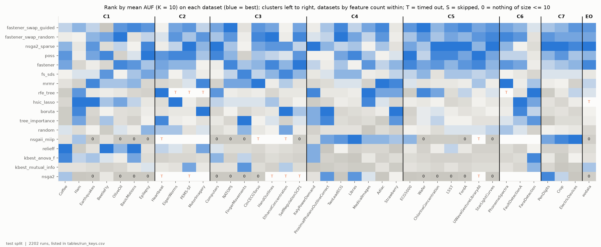
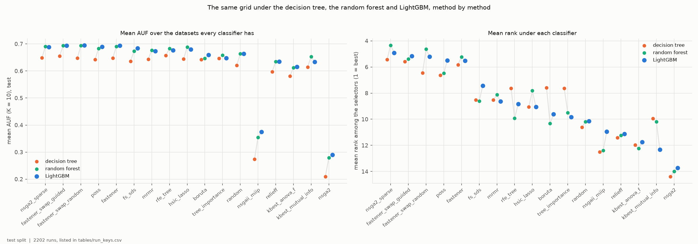
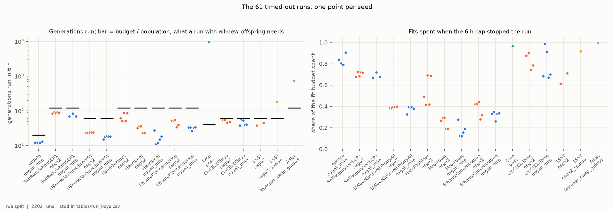
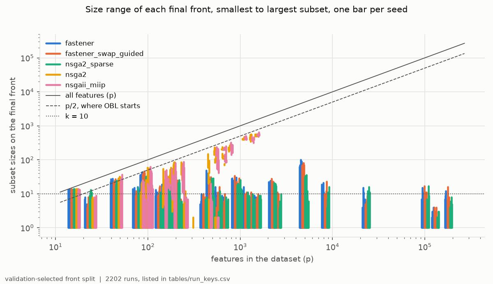
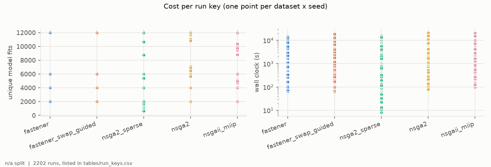

# H5H6-E03 -- report

*Hypothesis H5, H6. The runs, the criteria as registered, the per-seed numbers and how to reproduce them are in [SUPPORT.md](SUPPORT.md).*

## 1. In brief

### The hypothesis

H5 says that stock FASTENER finds better small feature subsets than every
other selector in the repository; H6 says the same of FASTENER with the
guided swap. This experiment repeats the grid of H5H6-E01 (decision tree) and
H5H6-E02 (random forest) -- 17 selectors on 39 datasets: 38 UCR/UEA
time-series sets in seven clusters and EOData -- with a third classifier, of
another kind: **LightGBM**, a boosted ensemble, at its defaults except that
its smallest leaf scales with the training split. "Better small subsets" is
AUF (K = 10): for each k = 1..10, the test F1 of the best subset of at most k
features chosen on validation, averaged.

**How it is judged.** Each hypothesis's FASTENER arm is compared with each of
the 16 others over the datasets where both have a result. It must be ahead
on more datasets than behind, and significantly so (Wilcoxon, Holm-corrected)
-- against **all 16**.

### The answer: not confirmed, for either

Both FASTENER arms are significantly ahead of the same 12 opponents -- every
filter and ranker, Boruta, FS-SDS, random subsets and the two OBL-started
NSGA-II searches -- and of none of the other four: they tie with each other,
with the random swap, with sparse NSGA-II and now also with POSS. Those five
population searches are within 0.006 AUF of each other on average, with even
win records and Holm p = 1. As under the tree and the forest, the top of the
field is flat.

*H5: stock FASTENER's AUF minus each opponent's, one point per dataset; filled points mark the 12 significant pairs.*

*H6: the same for guided-swap FASTENER; 12 pairs significant.*

## 2. Findings

### F1 -- Stock FASTENER is significantly better than 12 of its 16 opponents, so H5 fails

Per dataset, each arm's score is its AUF (K = 10) averaged over 5 seeds (one
run for the deterministic selectors). After Holm correction stock FASTENER is
significantly ahead of FS-SDS (29-0-10), HSIC Lasso (30-0-8), mRMR (29-0-10),
random subsets (33-0-6), Boruta (30-0-9), RFE (25-0-10), the tree-importance
ranker (31-0-8), ReliefF (32-0-7), the mutual-information ranker (35-0-4),
the ANOVA-F ranker (32-0-7), NSGAII-MIIP (19-0-9) and NSGA-II (24-0-4). Its
mean leads over the filters and rankers run from 0.017 (HSIC Lasso) to 0.079
AUF (ANOVA-F), over FS-SDS 0.010; over the two OBL-started searches 0.34-0.42,
mostly a matter of reach (F7).

It is not ahead of the other four population searches, and is **behind** all
four on wins: the guided swap (17-0-22), the random swap (18-0-21), sparse
NSGA-II (18-0-21) and POSS (19-0-20). The mean differences are within
0.005 AUF, and every Holm p is 1.

*Opponents along x, ordered by mean difference; y = stock FASTENER's mean AUF (K = 10) minus the opponent's, one point per dataset where both have a result; bar = mean; filled = significant after Holm. Test split.*

### F2 -- Guided FASTENER is significantly better than the same 12, and loses on wins to three of the other population searches, so H6 fails

Guided FASTENER is significantly ahead of exactly the twelve opponents of F1,
with similar records (FS-SDS 33-0-6, HSIC Lasso 30-0-8, Boruta 30-0-9, ...).
Against stock FASTENER it leads on wins, 22-0-17, but the mean difference is
-0.0006 AUF (median per dataset +0.0008) and Holm p = 1. Against the random
swap (19-0-20), sparse NSGA-II (18-0-21) and POSS (19-0-20) it is behind on
wins, by mean differences of -0.002 to +0.004.

*As F1, with guided-swap FASTENER as the focal arm. Test split.*

### F3 -- Five population searches hold the first five places, and the cluster leader changes again

Ranking the 17 selectors on each dataset by mean AUF (1 = best) and averaging
within each cluster:

| cluster | datasets | leader (mean rank) | next |
|---|---|---|---|
| C1 small lab sets, p >= n | 7 | POSS (6.1) | guided FASTENER, HSIC Lasso (6.3) |
| C2 high-dimensional, p >> n | 4 | RFE (1.0, on Heartbeat only) | POSS (3.25) |
| C3 long physiological signals | 7 | stock FASTENER (4.4) | sparse NSGA-II (4.7) |
| C4 short series, mid-sized | 7 | NSGAII-MIIP (5.3) | random-swap FASTENER (5.7) |
| C5 larger sensor collections | 7 | sparse NSGA-II (2.7) | guided FASTENER, POSS (3.0) |
| C6 large audio / industrial | 3 | HSIC Lasso (5.3) | guided and random-swap FASTENER, mRMR (5.7) |
| C7 very many short series | 3 | sparse NSGA-II (1.3) | NSGAII-MIIP (2.3) |
| EOData | 1 | sparse NSGA-II (1) | stock FASTENER (2) |
| **all** | **39** | **guided FASTENER (5.15)** | **random swap, sparse NSGA-II (5.21), POSS (5.49), stock (5.51)** |

Over all datasets the five population searches take the first five places,
within 0.36 of a rank, and FS-SDS is sixth (7.4). RFE's C2 lead rests on one
dataset: it timed out on the other three (F6). Compared with the tree
(H5H6-E01) and the forest (H5H6-E02), the leader is the same under all three
classifiers only on EOData (sparse NSGA-II); in C5 it is the same under the
forest and LightGBM. With 1-7 datasets per cluster this is descriptive.

*Mean rank by AUF (K = 10) of each selector (x) in each cluster (y), over the datasets of the cluster where it has a result; boxed = best in the row; -- = no result in the cluster. Test split.*

### F4 -- Sparse NSGA-II is best on 10 of the 39 datasets, more than any selector under the tree or the forest; the margins stay small

Twelve of the 17 selectors are best on at least one dataset: sparse NSGA-II
on 10 (among them EOData, Crop, PenDigits, FordA and StarLightCurves), HSIC
Lasso and Boruta on 4 each, mRMR, ReliefF, POSS, RFE and the random swap on
3, NSGAII-MIIP and guided FASTENER on 2, stock FASTENER and tree importance
on 1. No selector was best on more than 7 under the tree or the forest. On
the median dataset the best selector is 0.012 AUF ahead of the fourth (0.014
under the tree, 0.011 under the forest).

*Rank of each selector (y) on each dataset (x), datasets grouped by cluster and ordered by feature count within it; T = timed out on every seed, 0 = no subset of at most 10 features on any seed (AUF 0); blank = skipped before the run. Test split.*

### F5 -- LightGBM scores at the forest's level and orders the methods much as the forest does; the filters move most

Cell by cell against the random forest (628 dataset-method cells with a
result under all three classifiers), LightGBM's AUF is higher in 51% of
cells, by +0.0007 on average: the same level. Against the decision tree it is
higher in 82% of cells, by +0.039. The order of the methods' mean ranks
agrees with the forest's at Spearman 0.92 and with the tree's at 0.89;
dataset by dataset the agreement with the forest has median 0.79 (range
-0.38 to 0.97), with the tree 0.60.

What moves, against the forest, over the datasets all three classifiers have:

| method | AUF, forest | AUF, LightGBM | mean rank, forest -> LightGBM |
|---|---|---|---|
| MI ranker | 0.653 | 0.633 | 10.2 -> 12.3 |
| tree-importance ranker | 0.659 | 0.648 | 9.5 -> 9.8 |
| HSIC Lasso | 0.689 | 0.680 | 7.8 -> 9.1 |
| FS-SDS | 0.673 | 0.684 | 8.6 -> 7.4 |
| POSS | 0.683 | 0.690 | 6.5 -> 5.5 |
| Boruta | 0.647 | 0.660 | 10.3 -> 9.6 |

The FASTENER arms and sparse NSGA-II change by at most 0.005 AUF.

*Left: each method's mean AUF (K = 10) under the decision tree (H5H6-E01), the random forest (H5H6-E02) and LightGBM (this experiment), over the datasets all three have; right: its mean rank among the 17 selectors under each. Methods along x, best rank under LightGBM first. Test split.*

### F6 -- 71 runs reached the 6-hour cap, and unlike under the tree they were slow, not stalled; 15 cells have no result

The timed-out runs were NSGA-II (36), NSGAII-MIIP (27), RFE (4: EigenWorms,
MotorImagery, PEMS-SF, PhonemeSpectra), and one each of guided FASTENER
(Adiac), POSS (Crop), sparse NSGA-II (LSST) and HSIC Lasso (EOData).

Under the tree, 42 of 47 timeouts were NSGA-II searches spinning on cached
subsets; the stagnation stop (DEC-41) removed that. Here the OBL-started
searches were still finding new subsets: in 6 hours they ran 9-95% of the
generations their budget needs and spent 12-99% of it (F6, left and right).
A LightGBM fit on their large, half-full subsets is the cost. The three
single timeouts of other searches stopped at 92-99% of their budgets.

A cell has no result only where every seed timed out: NSGA-II on 6 datasets
and NSGAII-MIIP on 4 (long-series sets of C3 and C5, and Heartbeat
and PEMS-SF in C2), RFE on 4 and HSIC Lasso on EOData. With the 12 cells skipped
before the run, as registered, NSGA-II and NSGAII-MIIP have results on 28
datasets each, RFE on 35, HSIC Lasso on 38; the pairwise tests read only the
datasets both methods have. One timeout, RFE on MotorImagery, was ended by
SLURM rather than by the queue and recorded by hand (SUPPORT.md, *What
happened*). Five PEMS-SF NSGA-II runs and the deterministic cells keep no
trajectory, so the figure shows 61 of the 71.

*The 61 timed-out runs with a trajectory, one point per seed. Left: generations each run completed in 6 h (log); bar = fit budget / population, what a run with all-new offspring needs. Right: share of the fit budget spent when the cap stopped it.*

### F7 -- The OBL-started searches still mostly never reach 10 features

Of the runs that finished, 52% of NSGA-II runs (70 of 134) and 44% of
NSGAII-MIIP runs (58 of 133) end with no subset of 10 features or fewer.
Their mean AUF is 0.31 and 0.39, against about 0.69 for the leaders. As
under the other two classifiers they reach k <= 10 on the short-series
clusters (97-100% of runs in C4, all in C7), in 14-43% of runs on C1 and C5,
and never on C3 or EOData. Every other selector reaches a single feature on
every run.

*Smallest to largest subset on each final front (y, log), one bar per seed, at the dataset's feature count (x, log), for the two FASTENER focal arms, sparse NSGA-II, NSGA-II and NSGAII-MIIP; dashed = p/2, dotted = k = 10. Validation-selected fronts.*

### F8 -- LightGBM halves the cost of a run against the forest, and FASTENER's own work becomes a larger share of it

The median run took 13-15 minutes for the three FASTENER arms, 8.6 for sparse
NSGA-II, 10.4 for POSS and FS-SDS and 22 for NSGA-II and NSGAII-MIIP, on 8
cores. Under the forest every search's median was 27-35 minutes, and
FASTENER was level with POSS and FS-SDS; with a cheaper fit, FASTENER's
mutual information, permutation scoring and archive weigh more, and it is
now 30-50% slower per run than POSS and FS-SDS at the same fit budget.
The filters and rankers took under a minute at the median, RFE 3 minutes
and Boruta 1.5. In all the finished runs took 1,032 job-hours on 8 cores
each, and the 71 timed-out runs about 6 hours each, some 425 more (967 for
all runs under the forest, none of which timed out).

*Left: unique model fits per run, one point per dataset and seed; the searches below their budget stopped on stagnation or at the cap. Right: wall clock per run (log), on 8 cores of HPC Vega.*

## 3. Assessment

**Neither H5 nor H6 holds under LightGBM.** Each needed a significant lead
over all 16 opponents; both FASTENER arms have one over 12 (F1, F2). The
twelve are everything outside the population searches: the eight filters and
rankers, Boruta, FS-SDS, random subsets and the two OBL-started searches.
The four the arms cannot separate from are each other, the random swap,
sparse NSGA-II and POSS, all within 0.006 AUF in the mean and with win
records near even.

**What holds under all three classifiers (D2).** The verdicts; a flat top of
population searches, significantly ahead of every filter and ranker under
LightGBM and of most of them under the forest; the failure of the OBL-started searches to reach small
subsets (F7); and no selector best on more than about a quarter of the
datasets, with a median margin of 0.011-0.014 AUF between the best and the
fourth (F4). Guided FASTENER is not separable from stock FASTENER under any
of the three (Holm p 0.28, 1 and 1).

**What does not.** The cluster leaders: across the three classifiers the
leader of a cluster is the same only on EOData (F3). The middle of the table
moves with the learner -- here the MI ranker and HSIC Lasso drop and FS-SDS,
POSS and Boruta rise (F5) -- while the population searches hardly move.
POSS, sixth under the tree and the forest, joins the top group. The two
ensembles agree with each other a little more than either does with the
tree (method order, Spearman 0.92 against 0.88-0.89; F5) and score at the
same level: the step from a single tree to an ensemble matters more than
the choice between the two.

**What it does not show.** No cluster leader is established: 1-7 datasets per
cluster and no registered test; C2's leader rests on one dataset. The 15
cells without a result (F6) are cost, not quality: NSGA-II, NSGAII-MIIP and
RFE are compared on fewer datasets than the rest. Sparse NSGA-II's ten
first places (F4) do not make it the best on average: its mean rank is
level with the FASTENER arms'.

**Limits.** One classifier's weighted F1 on one split per dataset, the
smallest test splits holding 8-12 rows; AUF stops at K = 10; the H2/H3 fit
budgets (2,000-12,000 fits); five seeds per search, one run per
deterministic selector; LightGBM at its defaults apart from the scaled leaf,
untuned, as were the tree and the forest. Datasets are the unit of every
test.

**What follows.** Three classifiers now give the same verdict and the same
flat top, so a claim about a single best selector is not going to hold on
this grid. The PI's choices:

1. *Replace H6 with a claim the data can carry*: that the population
   searches as a group beat the filters and rankers -- supported under all
   three classifiers by the pairwise tests above -- or a non-inferiority test
   of guided FASTENER against the best opponent with a set margin.
2. *Whether the cluster dependence deserves a registered test* with more
   datasets in C2, C6 and C7: it is the finding that changes most between
   classifiers and is least established.
3. *The protocol classifier for later work*: LightGBM scores at the forest's
   level (F5) at about half its cost per run (F8), but its OBL-started
   searches need more than 6 hours on the long-series sets (F6).
