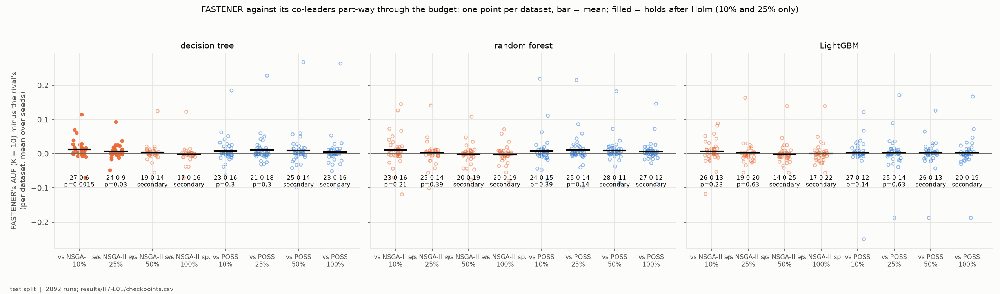
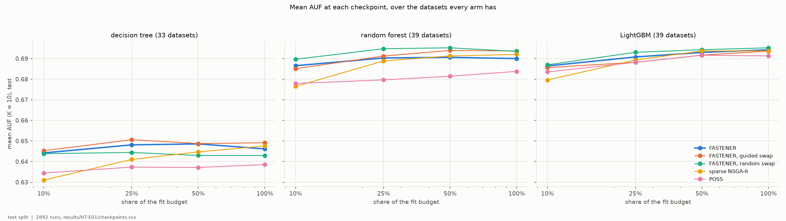
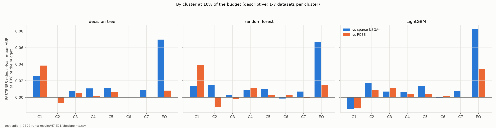
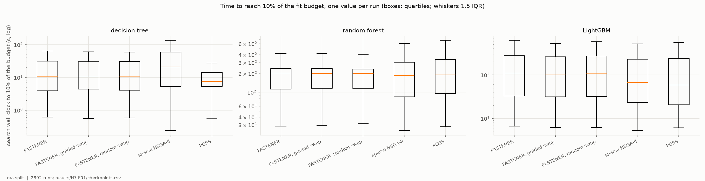

# H7-E01 -- report

*Hypothesis H7. The runs, the criterion as registered, the numbers and how to reproduce them are in [SUPPORT.md](SUPPORT.md).*

## 1. In brief

### The hypothesis

At the end of their fit budget, stock FASTENER, sparse NSGA-II and POSS tie
for the best small feature subsets under all three classifiers tried
(H5H6-E01 to -E03). H7 says FASTENER gets there **sooner**: part-way through
the budget it already offers better small subsets than the other two. If so,
it would be the search to use when model fits are expensive and a search has
to stop early.

The experiment runs no new search. Every search in the three grids logged its
front -- the best subset at each size -- against the number of model fits
spent. At 10%, 25%, 50% and 100% of each run's budget, the front it had then
was refitted and scored once on test, and its AUF (K = 10) computed as
everywhere else.

**How it is judged.** For each classifier, four comparisons: FASTENER against
sparse NSGA-II and against POSS, at 10% and at 25% of the budget, datasets as
the unit. Each must have FASTENER ahead on more datasets than behind and pass
a Wilcoxon test after Holm correction. H7 holds if all four do under at least
two of the three classifiers.

### The answer: not confirmed

No classifier meets all four. Under the decision tree FASTENER is
significantly ahead of sparse NSGA-II at 10% and 25% of the budget (27-0-6,
Holm p = 0.0015; 24-0-9, p = 0.03), but not of POSS; under the forest and
LightGBM no comparison passes. The direction is the predicted one --
FASTENER is ahead on wins at 10% in all six classifier-rival pairs, by
0.003-0.013 AUF on average -- but the lead is small and gone by half the
budget.

*FASTENER's AUF minus each rival's, one point per dataset, at each checkpoint, under each classifier; filled points mark the comparisons that pass after Holm (10% and 25% only).*

## 2. Findings

### F1 -- FASTENER passes two of the twelve registered comparisons, both against sparse NSGA-II under the decision tree

| classifier | vs sparse NSGA-II, 10% | 25% | vs POSS, 10% | 25% |
|---|---|---|---|---|
| decision tree | 27-0-6, +0.013, **p = 0.0015** | 24-0-9, +0.007, **p = 0.030** | 23-0-16, +0.009, p = 0.30 | 21-0-18, +0.011, p = 0.30 |
| random forest | 23-0-16, +0.010, p = 0.21 | 25-0-14, +0.001, p = 0.39 | 24-0-15, +0.009, p = 0.39 | 25-0-14, +0.011, p = 0.14 |
| LightGBM | 26-0-13, +0.007, p = 0.23 | 19-0-20, +0.002, p = 0.63 | 27-0-12, +0.003, p = 0.14 | 25-0-14, +0.003, p = 0.63 |

*Wins-ties-losses for FASTENER over the datasets both arms have (33 under the tree, 39 otherwise), mean AUF difference, Holm-corrected p.*

FASTENER is ahead on wins in 11 of the 12 comparisons, and no rival meets
the criterion against FASTENER either. Under the tree the POSS comparisons
carry a few large per-dataset differences in both directions (about 0.2
and more, on the smallest sets), which keeps them from significance.

*As above: y = FASTENER's mean AUF (K = 10) minus the rival's per dataset, mean over seeds; bar = mean; under each column wins-ties-losses and Holm p (10% and 25%) or "secondary" (50%, 100%). Test split.*

### F2 -- FASTENER's lead is an early one: it is largest at 10% of the budget and gone by 50%

Mean AUF over the datasets every arm has, at each checkpoint:

| classifier | arm | 10% | 25% | 50% | 100% |
|---|---|---|---|---|---|
| decision tree (33) | FASTENER | 0.644 | 0.648 | 0.649 | 0.646 |
| | sparse NSGA-II | 0.631 | 0.641 | 0.645 | 0.648 |
| | POSS | 0.635 | 0.637 | 0.637 | 0.639 |
| random forest (39) | FASTENER | 0.687 | 0.690 | 0.691 | 0.690 |
| | sparse NSGA-II | 0.677 | 0.689 | 0.691 | 0.692 |
| | POSS | 0.678 | 0.680 | 0.681 | 0.684 |
| LightGBM (39) | FASTENER | 0.686 | 0.691 | 0.693 | 0.694 |
| | sparse NSGA-II | 0.680 | 0.689 | 0.694 | 0.694 |
| | POSS | 0.684 | 0.688 | 0.692 | 0.691 |

FASTENER reaches nearly its final level by 10% of the budget (within 0.002
under the tree, 0.004 under the forest, 0.008 under LightGBM). Sparse
NSGA-II starts 0.006-0.013 lower and catches up by 25-50%. POSS stays a
little below FASTENER throughout under the tree and the forest and close to
it under LightGBM. The two swap variants track stock FASTENER (at 10%,
within 0.003 on average, with win records from 18-0-21 to 25-0-14).

*Mean test AUF (K = 10) of each arm at 10%, 25%, 50% and 100% of the fit budget (log x), over the datasets every arm has under that classifier.*

### F3 -- The early lead is largest on EOData, FASTENER's own dataset, under all three classifiers

By cluster at 10% of the budget the differences are mostly within ±0.02 and
change sign between classifiers (C1 favours FASTENER under the tree and the
forest and the rivals under LightGBM). EOData is the exception: at 10%
FASTENER is ahead of sparse NSGA-II by 0.069, 0.067 and 0.082 AUF under the
three classifiers (0.441 against 0.372 under the tree; 0.517 against 0.450;
0.520 against 0.438) and of POSS by 0.008, 0.015 and 0.034. At 25% the lead
over both is still 0.01-0.04. It is one dataset, five seeds, and descriptive.

*FASTENER's mean AUF minus each rival's per cluster at 10% of the budget (EO = EOData), under each classifier; 1-7 datasets per cluster, descriptive.*

### F4 -- Equal fits are not equal time: under LightGBM FASTENER takes longer than its rivals to spend 10% of its budget

Median wall clock to reach 10% of the budget: under the tree 11 s for
FASTENER, 21 s for sparse NSGA-II and 7.5 s for POSS; under the forest
185-203 s for all three; under LightGBM 110 s for FASTENER against 67 s
(sparse NSGA-II) and 59 s (POSS). With cheap fits FASTENER's own work per
fit -- mutual information, permutation scoring -- weighs more, as in
H5H6-E03 (F8 there). Where FASTENER's lead is significant -- over sparse
NSGA-II under the tree -- it also gets to 10% of the budget faster (11 s
against 21 s); under LightGBM a rival given the same wall clock would have
spent more fits.

*Search wall clock to the snapshot used at 10% of the budget (log), one value per run; boxes = quartiles, whiskers 1.5 IQR. The grids' timings: tree single-core on the workstation, forest and LightGBM 8 cores on HPC Vega.*

## 3. Assessment

**H7 is not supported.** It needed FASTENER significantly ahead of both
sparse NSGA-II and POSS at 10% and 25% of the budget under at least two
classifiers; it is under none, and passes only against sparse NSGA-II under
the decision tree (F1).

**What the experiment does show** is the shape the hypothesis predicted, at
a size too small for the registered test. FASTENER reaches nearly its final
level by a tenth of the budget, sparse NSGA-II catches up between a quarter
and a half, and FASTENER is ahead on wins at 10% in all six classifier-rival
pairs, by 0.003-0.013 AUF on average (F1, F2). Its mutual-information-guided
start is a head start, not a better destination. The head start is
clearest against sparse NSGA-II, which begins from random subsets; POSS,
which grows subsets one feature at a time, is a closer early rival. The
largest early lead is on EOData, under every classifier (F3), but that is
one dataset.

**What it does not show.** Advantage per unit of time: the checkpoints are
shares of the fit budget, and under LightGBM FASTENER needs more wall clock
than its rivals to spend the same share (F4). Nor does it show the effect on
fresh data -- H7 re-reads runs whose end-of-budget results were known when
it was registered.

**Limits.** The same as the grids': one classifier's weighted F1 on one split
per dataset, the smallest test splits holding 8-12 rows, five seeds, the
H2/H3 budgets; the checkpoints are fractions of a budget calibrated for
stock FASTENER. The fronts are read from the trajectories, which keep the
first subset found at each validation score; for POSS and sparse NSGA-II
this differs from their final records in 213 of 2,892 runs at 100%, always
between subsets of equal validation score, and on average in the rivals'
favour (+0.004 AUF).

**What follows.** The PI's choices:

1. *H9's part (c)*, which repeats H7 on new datasets, is unlikely to pass as
   registered. It can stay as a replication, or be dropped from H9's claims.
2. *H10 targets exactly this early phase.* A filter-seeded FASTENER starts
   where a filter ends; if it holds, the early lead becomes a guarantee
   rather than a tendency.
3. *A cost-based checkpoint* -- equal wall clock or CPU time instead of equal
   fits, as in H4 -- would answer the practical question F4 raises, and
   could be registered as a follow-up analysis of the same trajectories,
   which record seconds as well as fits.
