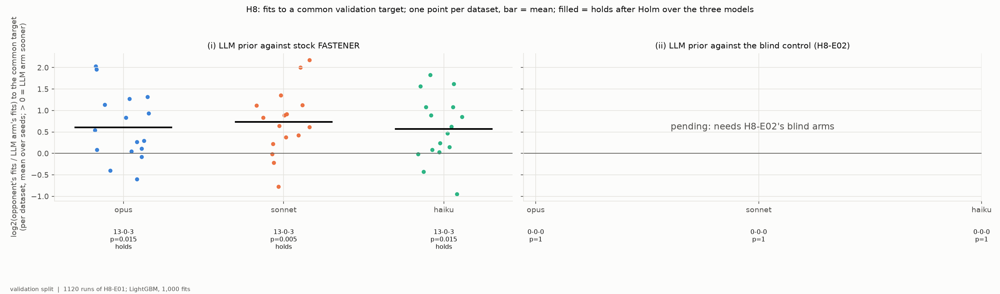
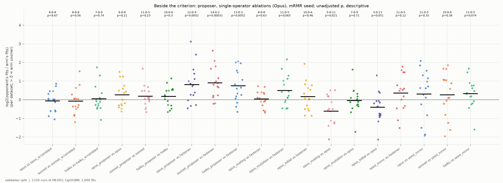
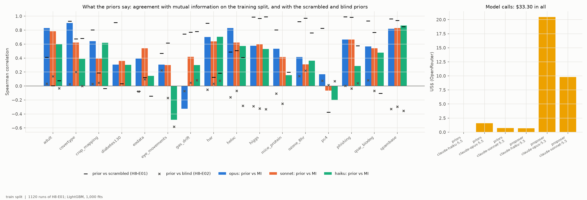
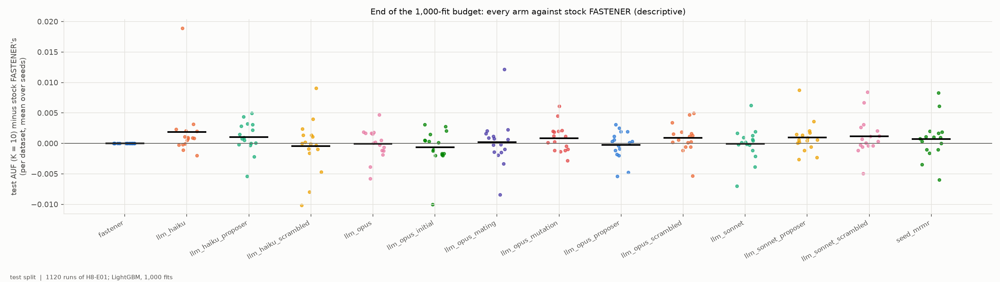

# H8-E01 -- report

*Hypothesis H8. **Update (2026-10-30):** part (ii) and H8's verdict for these three models are in [H8-E02's report](../H8-E02/REPORT.md): not confirmed. Part (ii) fails for every model, and the blind control turned out to recall the datasets' column order. The text below is as written before H8-E02 was in.*

*Part (ii) of the criterion is read against H8-E02 (the strict control, still running), so this report gives part (i) and everything beside the criterion; H8's verdict follows when H8-E02 is in. The runs, the full method -- every prompt as sent -- and the numbers are in [SUPPORT.md](SUPPORT.md).*

## 1. In brief

### The hypothesis

FASTENER is a genetic feature-selection search. It uses the mutual
information of each feature with the class to decide which features a child
subset inherits. H8 asks whether a large language model's knowledge of what
the features *mean* -- read from their names and the dataset's documentation,
without seeing any data -- makes the search reach a good subset in fewer model
fits. Three Anthropic models (Opus 5.5, Sonnet 5.5 and Haiku 5.5, through
OpenRouter) each rated every feature of 16 datasets with named features; the
ratings guided FASTENER's mating, mutation and starting features.

**How it is judged.** Speed to a common target, as in H0: for each pair of
runs (same dataset and seed) the target is the lower of their final
validation scores (AUF, K = 10), and each run counts the model fits it needed
to first reach it. Per dataset the effect is log2(opponent's fits / LLM
arm's fits), so +1 means the LLM arm needed half the fits. H8 holds for a
model if (i) its LLM arm beats stock FASTENER and (ii) it beats the same arm
with a prior from which the features cannot be identified (H8-E02's blind
control), each on more datasets than not and with a Wilcoxon test
significant after Holm over the three models.

### The answer so far: part (i) holds for all three models; part (ii) is pending

Guided by any of the three models, FASTENER reaches the target sooner than
stock FASTENER on 13 of 16 datasets, with about 1.5-1.7 times fewer fits on
average (Holm p = 0.005-0.015). Whether that speed comes from what the
models know about the features is part (ii), which needs H8-E02. The
evidence here is mixed on that point: the registered "scrambled" control,
which hid the names but not the dataset description or the column order,
does just as well as the named prior (F2).

*Effect per dataset of each model's LLM arm against stock FASTENER (left) and against the blind control (right, pending); filled points hold after Holm.*

## 2. How the LLM was used

In short -- the full method, with every prompt and reply as sent, is
SUPPORT.md section 4, *How the language models were used*.

1. **A data dictionary per dataset** (`experiments/priors/dictionaries/`):
   the task, the class names, a paragraph describing the data and how its
   feature names are built, and -- for the five sets stored with generic
   names (har, crop_mapping, gas_drift, ozone_8hr, qsar_biodeg) -- the
   documented name of every column, restored from UCI's own metadata.
   QSAR's descriptors also carry UCI's one-line descriptions. The dictionary
   says what the features are, never which matter.
2. **A relevance prior, one call per dataset and model** (two for har's 561
   features, at most 300 per call): a fixed system instruction asks for a
   score from 0 (useless) to 1 (most useful) per feature "using only your
   knowledge of the domain and the descriptions given; you do not see the
   data", as JSON; the user message lists the task, classes, description and
   every feature as `index: name -- description`. Temperature 0, seed
   20200. A feature left out gets the lowest score given (no prior left any
   out). 96 priors (16 datasets x 3 models x named and scrambled), made and
   committed before any run, for $1.51.
3. **How the prior guides FASTENER** (`fastener/guidance.py`): the prior and
   mutual information are each scaled to a maximum of 1, floored at 0.001,
   and combined as w = MI^0.5 x prior^0.5. *Mating* uses w where it used
   mutual information (to rank and sample the genes a child gets back).
   *Mutation* switches a missing feature on with probability proportional to
   w and a present one off in proportion to max(w) - w, at the uniform
   mutation's average rate (1/n per gene). *The start* is five single
   features drawn from w instead of five at random.
4. **The online proposer** (an extra arm): every 5 generations the model sees
   the task, every feature's name and description, and the current best
   subset of each size with its validation score, and proposes up to 5
   subsets of at most 10 features. They are evaluated from the same
   1,000-fit budget; malformed, duplicate and out-of-range subsets are
   dropped. Every call is logged with its request and full response.
5. **Controls:** stock FASTENER; FASTENER seeded from mRMR's ranking (a
   prior from the data alone, H10's arm); the scrambled prior (names
   replaced by `feature_00` ...; registered as part (ii)'s control, found to
   leak -- F2 -- and replaced by H8-E02's blind prior, which also shuffles
   the order and drops the description); and, with Opus, the prior on one
   operator at a time.

## 3. Findings

### F1 -- Every model's prior makes FASTENER reach the target in about 1.5-1.7 times fewer fits (part (i) holds for all three)

| model | wins-ties-losses | mean log2 ratio | fit ratio | Holm p | median fits to target, LLM arm / stock |
|---|---|---|---|---|---|
| Opus 5.5 | 13-0-3 | +0.61 | 1.53x | 0.015 | 608 / 807 |
| Sonnet 5.5 | 13-0-3 | +0.73 | 1.66x | 0.005 | 484 / 810 |
| Haiku 5.5 | 13-0-3 | +0.57 | 1.49x | 0.015 | 589 / 870 |

*Per dataset mean over five seeds; the fits are per run and seed, over the 80 pairs of each model.*

The gains are largest on diabetes130, phishing, spambase, gas_drift and
higgs (Sonnet: 2.2 to 1.1 in log2, i.e. 2-4.5 times fewer fits). Each
model loses on three datasets, har among them for all three (Opus: har,
covertype, eodata; Sonnet: har, pc4, qsar_biodeg; Haiku: eye_movements,
ozone_8hr, har). The mRMR-seeded FASTENER -- a ranking from the data
instead of an LLM -- is ahead of stock FASTENER on 11 of 16 datasets
(+0.36, p = 0.12, not significant), and the LLM arms are ahead of it on
10-11 of 16 (+0.26 to +0.32, p = 0.07-0.38).

*y = log2(stock fits / LLM arm's fits) to the common validation target, per dataset (mean over seeds); bar = mean; under each column wins-ties-losses and Holm p. Validation split.*

### F2 -- The registered scrambled control does as well as the named prior, because it did not hide the features

The scrambled prior hid the feature names but kept the dataset description
and the column order. Against it, each model's named-prior arm is level:
8-0-8 (Opus, -0.06), 8-0-8 (Sonnet, -0.08), 7-0-9 (Haiku, +0.05). The
scrambled priors explain why: they follow the named ones closely (Spearman
up to 0.99 on higgs and phishing, 0.96 on spambase, for Opus), so they
carried most of the same information. This was found from the priors before
any result was read, and H8's part (ii) is read against H8-E02's blind prior
instead (shuffled order, no description), which correlates with the named
prior between -0.58 and +0.22 (F4; 8 of the 48 blind priors are flat). The named priors agree with mutual
information on the training split only in part: median Spearman 0.57 (Opus),
0.54 (Sonnet), 0.38 (Haiku).

*Every comparison beside the criterion: y = log2(opponent's fits / arm's fits) per dataset; bar = mean; above each column wins-ties-losses and unadjusted p (descriptive). Validation split.*

### F3 -- Most of the speed comes through mutation

With Opus's prior on one operator at a time, against stock FASTENER:
mutation alone +0.49 (11-0-5, p = 0.065), the start alone +0.17 (10-0-6),
mating alone +0.04 (8-0-8). Against the arm with all three, mutation alone
is level (7-0-9, -0.05), while mating alone (5-0-11, -0.61, p = 0.021) and
the start alone (3-0-13, -0.41, p = 0.051) are slower. Guiding mating --
where FASTENER already uses mutual information -- adds little; guiding the
uniformly random mutation, which stock FASTENER does not guide at all, is
where the prior pays.

*As F2: the columns "opus_mating/mutation/initial vs fastener" and "... vs opus".*

### F4 -- The online proposer adds a little speed and most of the cost

Against stock FASTENER the proposer arms are 12-0-4 (Opus, +0.81),
14-0-2 (Sonnet, +0.91, p = 0.0003) and 13-0-3 (Haiku, +0.74); against the
same model's prior arm without the proposer, +0.26, +0.19 and +0.17, not
significant (8-0-8, 11-0-5, 10-0-6). A run called the model 22-25 times and
evaluated 108-126 proposed subsets, of which only 42-64 were new fits (the
rest the search had already seen); 7-14% of the final front's entries were
proposals (Opus 86 of 975, Sonnet 134 of 976, Haiku 71 of 953). The
proposer cost $20.46 (Opus), $9.80 (Sonnet) and $0.70 (Haiku), against
$2.35 for all 144 priors of H8-E01 and H8-E02.

*Left: Spearman correlation of each model's prior with mutual information on the training split (bars), with its scrambled twin (dashes) and with its blind twin (crosses, H8-E02). Right: OpenRouter cost of all calls by source and model. Training split.*

### F5 -- The prior changes how fast, not where the search ends

At the end of the 1,000-fit budget every arm's test AUF (K = 10) is within
0.002 of stock FASTENER's on average (stock 0.797; the arms 0.796-0.798).
The LLM guidance gets FASTENER to the same subsets sooner; it does not find
better ones.

*Each arm's test AUF (K = 10) minus stock FASTENER's per dataset at the end of the budget (mean over seeds); bar = mean. Test split.*

## 4. Assessment

**Part (i) of H8 holds for all three models** (F1), clearly: 13 of 16
datasets, 1.5-1.7 times fewer fits, Holm p = 0.005-0.015. The smallest model
does about as well as the largest. The verdict on H8 waits for part (ii),
which is the question of *why*.

**What the experiment does not yet show** is that the speed comes from the
models' knowledge of the features. Two findings point the other way: the
leaky scrambled prior is as good as the named one (F2), and the gain comes
mostly through mutation (F3), the one operator stock FASTENER does not guide.
Since the weights are w = MI^0.5 x prior^0.5, a prior with little
information still turns mutation from uniform into mutual-information
guided. If H8-E02's blind prior is also as fast as the named one, the result
is a better FASTENER operator -- mutual-information-guided mutation -- rather
than a benefit of LLM knowledge; if the named prior beats the blind one, the
knowledge matters. A follow-up arm with mutation guided by mutual
information alone, no LLM, would separate the two directly.

**The proposer** buys a little extra speed at most of the cost (F4); it is
not significant against the prior alone. **The end result** is unchanged
(F5): all of this is about speed to a target, not about quality at the
budget's end.

**Limits.** One classifier (LightGBM) and 1,000 fits; five seeds; one split
per dataset; the common target is on validation, read from trajectory
snapshots; several of the 16 datasets are well known and an LLM may know
their benchmarks, which the scrambled control was meant to catch and did not
(F2). The models' scores are coarse (often a few distinct values).

**What follows.** The PI's choices: read H8 when H8-E02 is in; and whether to
register mutual-information-guided mutation without an LLM as its own arm or
hypothesis, since F3 suggests it may carry most of this effect.
