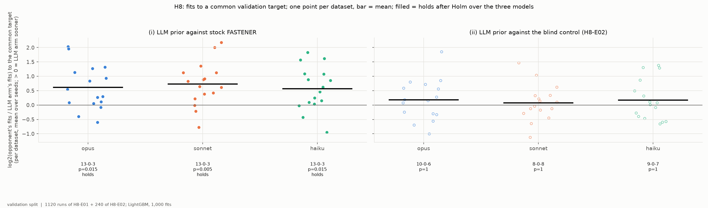
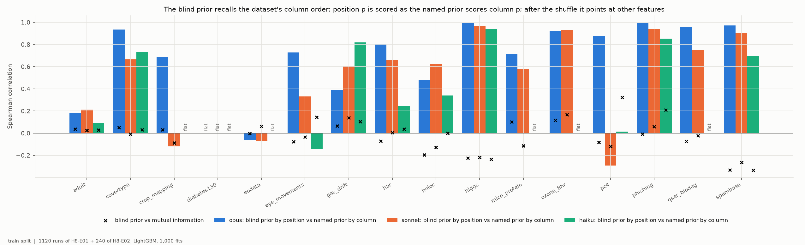
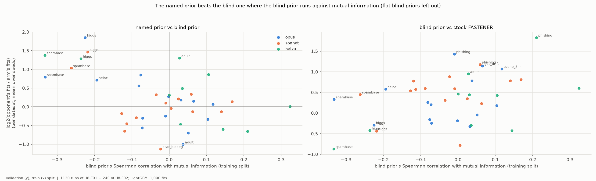
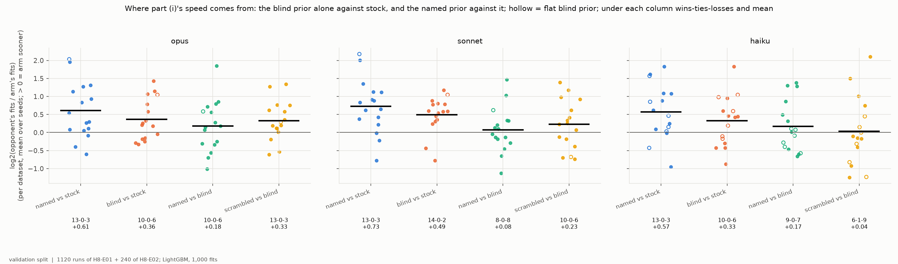
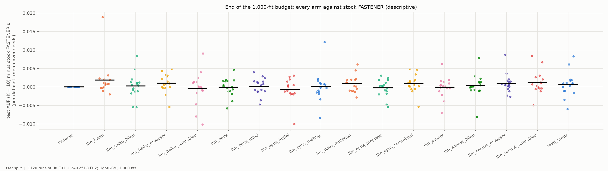

# H8-E02 -- report

*Hypothesis H8, for the three Anthropic models. Section 4 answers whether the blind prior points to a bug (it does not). H8-E02 is the strict control for part (ii) of H8-E01's criterion. This report reads H8-E01's 1,120 runs together with H8-E02's 240, and gives H8's verdict for these models. The method, every prompt as sent, and part (i) are in [H8-E01's report](../H8-E01/REPORT.md). The runs, the blind prompt and the numbers are in [SUPPORT.md](SUPPORT.md).*

## 1. In brief

### The hypothesis

FASTENER is a genetic feature-selection search. It uses the mutual
information of each feature with the class to decide which features a child
subset inherits. H8 asks whether a large language model's knowledge of what
the features *mean* -- read from their names and the dataset's documentation,
without seeing any data -- makes the search reach a good subset in fewer model
fits. In H8-E01, Opus 5.5, Sonnet 5.5 and Haiku 5.5 each scored every feature
of 16 datasets with named features, and the scores guided FASTENER's mating,
mutation and starting features. H8-E02 asked the same models again with the
features hidden: shuffled, named only by their position, with no dataset
description.

**How it is judged.** Speed to a common target, as in H0. For each pair of
runs (same dataset and seed), the target is the lower of their final
validation scores (AUF, K = 10), and each run counts the model fits it needed
to reach it first. Per dataset the effect is log2(opponent's fits / LLM
arm's fits), so +1 means the LLM arm needed half the fits. H8 holds for a
model if its prior with the names beats (i) stock FASTENER and (ii) the same
arm with the blind prior. Each part needs more datasets won than lost and a
two-sided Wilcoxon test significant after Holm correction over the three
models. H8 is supported if both parts hold for at least one model.

### The answer: not confirmed

Part (i) holds for all three models (H8-E01: 13 of 16 datasets, 1.5-1.7
times fewer fits). Part (ii) holds for none. With names, the prior is ahead of
the blind prior by only +0.08 to +0.18 in log2 (1.05-1.13 times fewer fits). It wins on
8-10 of 16 datasets, with Holm p = 1 for every model. Most of part (i)'s speed
survives with the features hidden. The blind control also turned out not to be
blind: the models recall the datasets' column order (F2), which affects how
the margin should be read (section 3).

*One point per dataset: the effect of each model's named prior against stock FASTENER (left, part (i)) and against its blind prior (right, part (ii)). A filled point means the part holds after Holm.*

## 2. Findings

### F1 -- With names, the prior is not significantly faster than the blind prior for any model (part (ii) fails)

| model | wins-ties-losses | mean log2 ratio (95% bootstrap CI) | fit ratio | p | Holm p |
|---|---|---|---|---|---|
| Opus 5.5 | 10-0-6 | +0.18 (-0.15 to +0.52) | 1.13x | 0.43 | 1 |
| Sonnet 5.5 | 8-0-8 | +0.08 (-0.21 to +0.37) | 1.05x | 0.74 | 1 |
| Haiku 5.5 | 9-0-7 | +0.17 (-0.16 to +0.52) | 1.13x | 0.56 | 1 |

*Per dataset mean over five seeds; 95% bootstrap interval over the 16 datasets (`tables/criterion.csv`).*

Averaged over the three models, the named prior is ahead on 9 of 16 datasets
(+0.14). The margin comes almost entirely from two
datasets, higgs (+1.53 averaged over the models) and spambase (+1.07). On
the other fourteen, the named prior is between -0.53 (qsar_biodeg) and +0.31
(diabetes130). F2 and F3 explain why higgs and spambase stand out.

*y = log2(opponent's fits / named-prior arm's fits) to the common validation target, per dataset (mean over seeds); bar = mean; under each column wins-ties-losses and Holm p. Validation split.*

### F2 -- The blind prior is not blind: the models recall each dataset's column order and score each position as if it were that column

The blind prompt shows `feature_00`, `feature_01`, ... in a shuffled order,
with the task and the class names but no description. Read by position, the
blind scores follow the named prior's scores read by column: position p is
scored as the named prior scores the dataset's column p. Spearman
correlations of this "layout recall" are:

| model | median over non-flat blind priors | at least 0.7 | highest |
|---|---|---|---|
| Opus 5.5 | 0.81 | 10 of 15 | 1.00 (higgs) |
| Sonnet 5.5 | 0.63 | 5 of 15 | 0.97 (higgs) |
| Haiku 5.5 | 0.52 | 4 of 10 | 0.94 (higgs) |

Recall is highest on the best-known datasets: higgs (0.94-1.00), phishing
(0.85-0.99), spambase (0.70-0.97), ozone_8hr and qsar_biodeg. The models
recognise the dataset from the task, the class names and the number of
features. Spambase is an example: Opus scores position 6 at 0.8 and position
15 at 0.75, and in the original layout these columns are `word_freq_remove`
and `word_freq_free`. Because the positions were shuffled, this knowledge
lands on other features. The blind priors are therefore unrelated to mutual
information (Spearman -0.33 to +0.32, median 0.00, over the 40 non-flat
priors), and on higgs and spambase they run against it (-0.22 to -0.33 for
all three models). Eight of the 48 blind priors are flat (one score for every
feature): all three on diabetes130, and Haiku's on crop_mapping, eodata,
mice_protein, ozone_8hr and qsar_biodeg. A flat prior leaves only mutual
information to guide the search.

*Bars: Spearman correlation of each blind prior, read by shown position, with the same model's named prior, read by column index. Crosses: the blind prior's Spearman correlation with mutual information on the training split, by actual column. "flat" marks a blind prior with a single score. Training split.*

### F3 -- The named prior beats the blind one where the misplaced prior runs against mutual information, and nowhere else

In 7 of the 48 dataset-model pairs, the blind prior's correlation with mutual
information is below -0.15: higgs and spambase for all three models, and heloc
for Opus. In those 7 pairs the named prior is ahead by +1.22 on average. In
the other 41 pairs it is ahead by -0.04 on average, positive in 20. Over the
40 non-flat pairs, the more the blind prior runs against mutual information,
the larger the named prior's lead (Spearman -0.39, p = 0.012) and the smaller
the blind prior's own gain over stock FASTENER (+0.34, p = 0.031). This
analysis was not registered and is descriptive. Where the hidden prior does
not mislead, knowing the names adds nothing measurable.

*One point per dataset and model (flat blind priors left out). x = the blind prior's Spearman correlation with mutual information (training split). y, left = log2(blind arm's fits / named arm's fits); right = log2(stock fits / blind arm's fits); both to the common validation target, mean over seeds.*

### F4 -- Even the blind prior makes FASTENER faster than stock, by about 60% of the named prior's gain

| model | named vs stock (part (i)) | blind vs stock | blind / named |
|---|---|---|---|
| Opus 5.5 | 13-0-3, +0.61 | 10-0-6, +0.36 (CI +0.10 to +0.64), p = 0.051 | 0.59 |
| Sonnet 5.5 | 13-0-3, +0.73 | 14-0-2, +0.49 (CI +0.24 to +0.71), p = 0.003 | 0.68 |
| Haiku 5.5 | 13-0-3, +0.57 | 10-0-6, +0.33 (CI +0.01 to +0.66), p = 0.051 | 0.57 |

*Unadjusted p, descriptive.*

The guidance weight is w = MI^0.5 x prior^0.5. A prior that carries no
information about the actual columns, or one that misleads, still leaves w
guided by mutual information. Most importantly, it turns FASTENER's uniform
random mutation into a mutation guided by mutual information. H8-E01 found
that this is the operator through which most of the speed comes. The eight
flat blind priors isolate this case, because their guidance is mutual
information alone. Against stock FASTENER they average +0.58, positive in 6
of 8. On diabetes130 the three flat priors give identical runs (+1.05). H8-E01's
leaky scrambled prior, which kept the description and the column order, is
ahead of the blind one by +0.33 (Opus, 13-0-3), +0.23 (Sonnet) and +0.04
(Haiku), which is about where the named prior is (H8-E01, F2).

*Per model, four comparisons: named prior vs stock FASTENER, blind prior vs stock, named vs blind, scrambled vs blind. y = log2(opponent's fits / arm's fits) to the common validation target, per dataset (mean over seeds); bar = mean; hollow = a dataset whose blind prior is flat. Validation split.*

### F5 -- The blind prior, like the named one, changes the speed and not the end result

At the end of the 1,000-fit budget, the blind arms' test AUF (K = 10) is
0.7966 (Opus), 0.7969 (Sonnet) and 0.7968 (Haiku) on average over the 16
datasets. Stock FASTENER's is 0.7965, and the named-prior arms' are
0.7964-0.7984 (H8-E01, F5).

*Each arm's test AUF (K = 10) minus stock FASTENER's per dataset at the end of the budget (mean over seeds); bar = mean. Test split.*

## 3. Assessment

**H8 is not confirmed for the three Anthropic models.** Part (i) holds clearly
(H8-E01: 13 of 16 datasets, 1.5-1.7 times fewer fits). Part (ii) fails for
every model (F1): the named prior is ahead of the blind one by +0.08 to +0.18
in log2, with confidence intervals that include zero, and Holm p = 1. The
models' knowledge of what the features mean is not shown to be what makes
FASTENER faster. Most of the speed, about 57-68% of part (i)'s mean effect,
is still there with the features hidden (F4). It is largest when the prior is
flat and mutual information guides the search alone (+0.58 in 6 of 8). These
results agree with H8-E01's reading: the gain comes mostly through mutation
(H8-E01, F3), the one operator that stock FASTENER leaves uniform, and any
prior multiplied into w makes that operator follow mutual information.

**The control was weaker than intended, and in the direction that favours
H8.** The blind prompt hid the names, the description and the order, but not
the task, the class names or the number of features. From these the models
recall each dataset's documented column order (F2). After the shuffle, the
blind prior is the models' knowledge placed on the wrong features, not the
absence of knowledge. Such a prior is expected to slow the blind arm relative
to a truly uninformed one, not to speed it up, so part (ii) was tested against
a handicapped opponent. It still failed. The one place where the named prior wins clearly, higgs and
spambase (F1, F3), is where the misplaced prior runs against mutual
information. That lead measures the damage the misplaced prior does, not a
benefit of the names over an uninformed prior. A cleaner control would hide
the task too, or use an uninformed prior (flat or random scores). The flat
blind priors behave like that control, and they are the fastest blind arms
(F4).

**What the result does not show.** It does not show that an LLM's knowledge
can never help FASTENER. Here the knowledge enters through a weight whose
mutual-information factor does most of the work, at one value of lambda
(0.5). The names also may help on datasets the models do not know, or where
mutual information misleads. The F3 relation is post hoc and rests on 7
pairs from three datasets. The evidence is one classifier (LightGBM), one
budget (1,000 fits), five seeds and 16 datasets, several of them well-known
benchmarks (F2 shows the models know them).

**What follows.** The verdict on H8 as registered for H8-E03 is read over all
twelve models, with H8-E03's nine non-Anthropic models and their own blind
arms. F2 applies to them too: their blind priors should be checked for layout
recall before part (ii) is read. Two choices belong to the PI:
- whether to register, for H8-E03 or a new hypothesis, an uninformed control
  (flat prior, i.e. mutual-information guidance alone, or random scores). The
  flat priors here suggest this arm carries most of the effect;
- whether to register mutual-information-guided mutation without an LLM as
  its own FASTENER operator. H8-E01's F3 and this report's F4 both point to
  it.

## 4. Why the blind prior is about as fast: is there a bug? (investigation, 2026-10-30)

*Written after the report above, at the PI's request, to answer whether the blind prior's behaviour points to a bug in the code or the method. The numbers come from the committed priors and the training split only, not from any run: `python experiments/h8_blind_diagnosis.py`, which writes `tables/weight_agreement.csv` and `tables/blind_top_positions.csv`.*

**There is no bug in the code.** Three checks:
- *The prompt does not leak.* It is `Task:`, `Classes:`, then `0: feature_00 ... 56: feature_56` ([methods/](methods/), `prior_spambase_*_blind.txt`). It has no names and no description. The listed indices are always 0..n-1 in order, so the shuffle exists only in how the scores are mapped back.
- *The mapping is right.* Position p's score goes to column `perm[p]` (`llm_guidance.LLMFeaturePrior.__call__`). The runs read exactly the committed priors (SUPPORT.md, checks after the fetch).
- *It is not a cache artefact.* Every blind call is a separate, paid call with its own request key and its own reply. Read by index, only 4-44% of the blind scores equal the named ones (spambase and higgs, Opus and Haiku).

Two separate things explain what was seen. Both come from the design, not from a mistake.

### 4.1 The models recognise the dataset and recall its column order

"Spam e-mail, 57 features" is UCI spambase, and "signal vs background, 28 features" is HIGGS. Given only the task, the class names and the number of features, the models score the positions as the columns they remember. The blind prior's top positions, read as the original columns (`tables/blind_top_positions.csv`):

| dataset, model | top blind positions | as the original columns |
|---|---|---|
| spambase, Opus | 6, 51, 52, 15 | `word_freq_remove`, `char_freq_!`, `char_freq_$`, `word_freq_free` |
| spambase, Haiku | 6, 52, 15, 51 | the same four |
| higgs, Opus | 27, 25, 26, 24 | `m_wwbb`, `m_bb`, `m_wbb`, `m_jlv` (the high-level features of the HIGGS paper) |
| higgs, Haiku | 27, 25, 23, 26 | `m_wwbb`, `m_bb`, `m_lv`, `m_wbb` |

So the shuffle did its job: the remembered knowledge lands on the wrong columns. The leak did not help the blind arm. It made the blind prior confident and misplaced rather than neutral, and that is why the named prior wins clearly only on higgs and spambase (F2, F3).

### 4.2 The guidance weights are mostly mutual information, whatever the prior

This is the main reason the arms are close, and it follows from the registered design. The weight is w = MI^0.5 x prior^0.5 (lambda 0.5), and the LLM priors are coarse, with a few distinct values. As a factor in w, the named prior's max/median is 1.49 (median over the 48 dataset-model pairs), against 2.07 for mutual information. The weights each arm actually used (`tables/weight_agreement.csv`; "top tenth" is the overlap of the top 10% of features, at least 3):

| comparison of the final weights w | Spearman, median (10th-90th percentile) | top tenth shared, median |
|---|---|---|
| named prior vs blind prior | 0.89 (0.72-0.96) | 64% |
| named prior vs mutual information alone (flat prior) | 0.95 (0.88-0.98) | 75% |
| blind prior vs mutual information alone | 0.93 (0.82-1.00) | 67% |

The named, blind and MI-only arms therefore push mutation and the starting features in nearly the same direction. Part (i)'s speed-up comes mostly from replacing FASTENER's uniform mutation with mutation guided by mutual information (H8-E01, F3), and any prior multiplied into w brings that along. The flat blind priors, which are mutual information alone, were the fastest blind arms (F4).

### 4.3 The gaps in the method

1. **Part (i) mixes two things.** "LLM prior vs stock" also switches on MI-guided mutation and starting features. No arm had mutual-information guidance alone to separate the two. The flat blind priors stood in for it by accident, on 8 pairs.
2. **At lambda = 0.5 the prior can only shift the weights a little** (4.2). Given how coarse the priors are, part (ii) had little room to show an effect from the names.
3. **The blind control still identifies well-known benchmarks** through the task, the class names and the number of features (4.1).

### 4.4 What would fix it (for the PI; none of these needs model calls)

- **An MI-only arm (flat prior):** the right baseline for part (i), and the reference any prior has to beat.
- **A permuted named prior:** each named prior's scores shuffled across the columns. It keeps the coarseness and the score distribution but carries no knowledge, so it is a cleaner part (ii) control than a blind prompt.
- **A higher lambda, up to 1.0 (the prior alone):** tests whether the knowledge has any power of its own.

H8-E03 is registered with the same blind prompt and lambda. Its larger models are likely to recall layouts in the same way (check `blind_layout_recall` in `tables/prior_agreement.csv` for its priors). Any of the arms above would need a dated revision before H8-E03's runs start.
