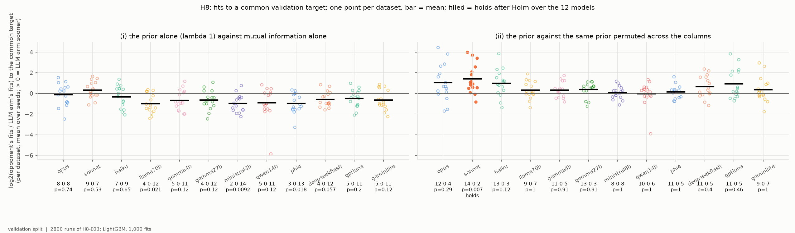
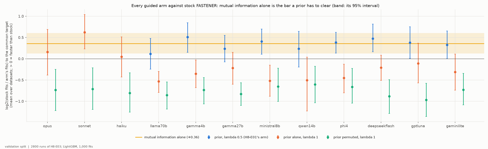
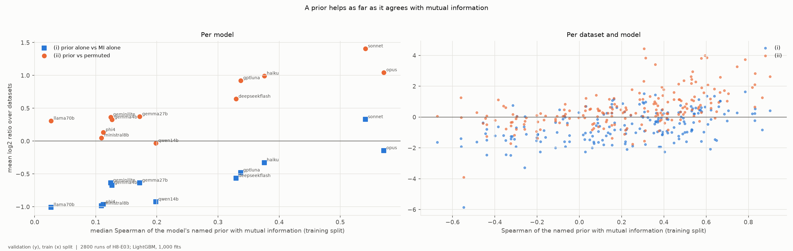
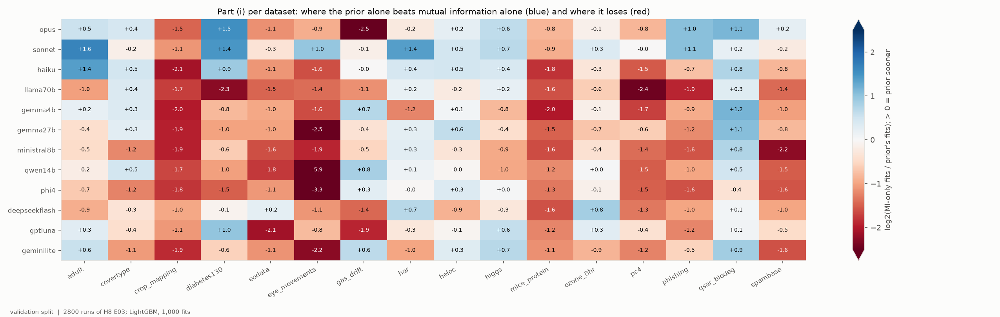
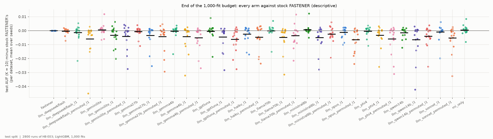

# H8-E03 -- report

*Hypothesis H8, the experiment that decides it: twelve language models, with controls that separate what a model knows from the guidance FASTENER gets anyway. It was revised before any run ([DEC-53](../../DECISIONS.md#dec-53)), after [H8-E02](../H8-E02/REPORT.md) showed that H8-E01's design could not make that separation (H8-E02, section 4). How the priors are made, with every prompt as sent, is in [H8-E01's report](../H8-E01/REPORT.md). The runs, the arms and the numbers are in [SUPPORT.md](SUPPORT.md).*

## 1. In brief

### The hypothesis

FASTENER is a genetic feature-selection search. H8 asks whether a large
language model's knowledge of what the features *mean* -- read from their
names and the dataset's documentation, without seeing any data -- makes the
search reach a good subset in fewer model fits. Each model scores every
feature of 16 datasets with named features (its *prior*), and the scores
guide FASTENER's mating, mutation and starting features.

H8-E01 and H8-E02 found that guiding FASTENER with any weights helps,
mainly by turning its random mutation into a guided one. Most of that help
comes from mutual information, a measure of how much each feature says about
the class, computed from the training data. H8-E03 therefore asks the
sharper question. Twelve models took part: Anthropic's Opus, Sonnet and
Haiku 5.5, and nine models from other vendors, from Gemma 3 4B up to GPT-6
Luna.

**How it is judged.** As in H0 and H8-E01, by speed to a common target. For each
pair of runs (same dataset and seed), the target is the lower of their final
validation scores (AUF, K = 10), and each run counts the fits it needed to
reach it first. Per dataset the effect is log2(opponent's fits / prior's
fits), so +1 means the prior needed half the fits. For each model, with Holm
correction over the twelve:
- **(i)** the prior alone (λ = 1) beats mutual information alone. A
  model's knowledge has to be a better guide than what the data already
  says.
- **(ii)** the prior beats the same scores permuted across the columns, which
  is the same prior on the wrong features. The gain has to need the
  knowledge.

Each part needs more datasets won than lost and a significant Wilcoxon test.
H8 is supported if both parts hold for at least one model.

### The answer: not confirmed

Part (i) holds for no model. The best prior, Sonnet's, is ahead of mutual
information alone by +0.33 in log2 on average (9 of 16 datasets, Holm p =
0.53). The nine non-Anthropic priors are behind it by 0.48 to 1.01. Part
(ii) holds for Sonnet only (14 of 16 datasets, +1.41, Holm p = 0.007). Opus,
Haiku and GPT-6 Luna are close (+0.92 to +1.04) but not significant after
Holm. The large models' priors do carry knowledge of which features matter,
but none of them guides the search better than the data's own mutual
information.

*One point per dataset: each model's prior alone against mutual information alone (left, part (i)) and against its permuted twin (right, part (ii)). A filled point means the part holds after Holm over the twelve models.*

## 2. Findings

### F1 -- No model's prior beats mutual information alone; only Sonnet's beats its own permuted twin

| model | (i) prior vs MI alone: W-T-L, mean (95% CI), Holm p | (ii) prior vs permuted: W-T-L, mean (95% CI), Holm p |
|---|---|---|
| Opus 5.5 | 8-0-8, -0.14 (-0.67 to +0.34), 0.74 | 12-0-4, +1.04 (+0.24 to +1.89), 0.29 |
| Sonnet 5.5 | 9-0-7, +0.33 (-0.06 to +0.71), 0.53 | **14-0-2, +1.41 (+0.76 to +2.08), 0.007** |
| Haiku 5.5 | 7-0-9, -0.33 (-0.84 to +0.17), 0.65 | 13-0-3, +0.99 (+0.39 to +1.62), 0.12 |
| GPT-6 Luna | 5-0-11, -0.48 (-0.90 to -0.08), 0.20 | 11-0-5, +0.92 (+0.27 to +1.64), 0.46 |
| DeepSeek V4 Flash | 4-0-12, -0.57 (-0.91 to -0.20), 0.057 | 11-0-5, +0.64 (+0.14 to +1.14), 0.40 |
| the other seven | 2-5 wins of 16, -0.64 to -1.01 | 8-13 wins of 16, -0.03 to +0.37, Holm p 0.91-1 |

*Per dataset mean over five seeds; 95% bootstrap interval over the 16 datasets.*

For part (i), the three Anthropic priors are level with mutual information,
and the nine others are slower. For three models (Llama 3.3 70B, Ministral
8B and Phi-4), the prior is significantly *slower* than mutual information
after Holm (p = 0.009-0.021). For part (ii), the large models' priors are
much better on the right features than on the wrong ones. Only Sonnet's
margin survives the correction for twelve models.

*y = log2(opponent's fits / prior's fits) to the common validation target, per dataset (mean over seeds); bar = mean; under each column wins-ties-losses and Holm p. Validation split.*

### F2 -- Mutual information alone is the guidance to beat: it speeds FASTENER up, and no prior adds to it

Against stock FASTENER (`tables/beside.csv`):

| arm | against stock FASTENER |
|---|---|
| mutual information alone (no LLM) | 12-0-4, +0.36 (+0.12 to +0.61), p = 0.034 |
| prior + mutual information, λ = 0.5 (H8-E01's arm), nine models | 9-12 wins of 16, +0.12 to +0.51 |
| prior alone, λ = 1 | Sonnet 14-0-2, +0.62 (p = 0.008); Opus +0.16, Haiku +0.05; the nine others -0.11 to -0.53 |
| prior permuted, λ = 1 | 10-15 losses of 16, -0.60 to -0.97 for every model |

Guiding mutation and the starting features by mutual information alone,
with no language model, makes FASTENER reach the target about 1.3 times
sooner. H8-E01's arm combines a prior with mutual information. For the nine
new models it does about as well as mutual information alone: against it,
5-11 of 16 datasets won, -0.26 to +0.07, no p below 0.15. This confirms what
H8-E02 found for the Anthropic models: the prior's part of the combined
weight adds nothing measurable. A prior on its own is slower than stock
except for Sonnet's. A prior on the wrong features (permuted) is much slower:
misplaced guidance is worse than none.

*Each guided arm against stock FASTENER, per model: mean over datasets of log2(stock fits / arm's fits), with 95% bootstrap intervals. The band is mutual information alone, with its interval. The λ = 0.5 arm ran for the nine new models only (the Anthropic models' is in H8-E01). Validation split.*

### F3 -- A prior helps as far as it agrees with mutual information, and the models that know the datasets agree most

The agreement is the median Spearman correlation of each model's prior with
mutual information on the training split. It ranges from 0.03 (Llama 3.3
70B) to 0.57 (Opus). Across the twelve models it tracks both parts of the
criterion: Spearman 0.93 with part (i) and 0.82 with part (ii). Over the 192
dataset-model pairs the correlations are 0.45 and 0.59. The four models
whose priors agree most (Opus 0.57, Sonnet 0.54, Haiku 0.38, GPT-6 Luna 0.34)
have the four largest part (ii) margins (+0.92 to +1.41). They are also the
four models that H12-E01 found able to list the H8 datasets' features from
their names ([H12-E01](../H12-E01/REPORT.md), part A). DeepSeek V4 Flash (0.33)
follows at +0.64. The other seven agree at 0.03-0.20 and are at -0.03 to
+0.37.

Part of the link with part (i) is built in. A prior that agrees with mutual
information guides much like it, so it can come close to mutual information
but not pass it. Part (ii) has no such link: it compares a prior only with
itself.

*x = Spearman correlation of the named prior with mutual information on the training split (left: the median over datasets, per model; right: per dataset and model). y = the effect of part (i) (squares, blue) and of part (ii) (circles, orange): left, the mean over datasets; right, per dataset (mean over seeds). Validation split for y.*

### F4 -- The best priors beat mutual information on some datasets and lose clearly on others

Averaged over the four models with the most knowledgeable priors (Opus,
Sonnet, Haiku, GPT-6 Luna), the prior alone is ahead of mutual information on
diabetes130 (+1.22), adult (+0.96), higgs (+0.57) and qsar_biodeg (+0.55). It
is behind on crop_mapping (-1.43), mice_protein (-1.19), eodata (-1.17) and
gas_drift (-1.14). The four wins are on datasets whose features have
descriptive names (patient records, census answers, physics quantities,
chemical descriptors). The four losses are on datasets of many similar
measurement channels (spectral bands over time, protein levels, gas-sensor
readings), whose names say little about which channel matters. Averaged
over all twelve models, the prior is clearly ahead only on qsar_biodeg
(+0.54), whose descriptors carry UCI's own one-line descriptions. It is near
zero on adult, har and heloc (+0.05 to +0.08) and behind on the other twelve
datasets.

*Part (i) per dataset (x) and model (y): log2(MI-only fits / prior's fits), mean over seeds; blue = the prior alone is sooner. The colour scale is capped at ±2.5; Qwen3 14B on eye_movements is -5.9. Validation split.*

### F5 -- The prior alone also costs a little at the end of the budget

At the end of the 1,000-fit budget, mutual information alone ends level with
stock FASTENER in test AUF (K = 10): 0.7969 against 0.7965. The λ = 0.5 arms
end at 0.7949-0.7972. The priors alone end slightly lower (0.7900-0.7955),
and so do the permuted priors (0.7900-0.7940). This is a small but consistent
loss of up to 0.0065. Guidance that ignores the data steers the search away
from some subsets that turn out to be good.

*Each arm's test AUF (K = 10) minus stock FASTENER's per dataset at the end of the budget (mean over seeds); bar = mean. Test split.*

## 3. Assessment

**H8 is not confirmed.** It needed a model whose prior both guides the search
better than the data's mutual information and needs its knowledge to do so.
No model's prior beats mutual information (F1, part (i)). The best, Sonnet's,
is level with it at +0.33, with an interval that includes zero. This closes
H8 together with H8-E01 and H8-E02. In those experiments the prior's speed-up
over stock FASTENER was mutual-information guidance in disguise (H8-E02,
section 4). Here, with mutual information as the opponent, the prior has
nothing left to add.

**What is supported: the large models do know something.** Their priors are
much faster on the right features than on the wrong ones (F1, part (ii)). This
holds strongly for Sonnet, and nearly for Opus, Haiku and GPT-6 Luna. The
size of that knowledge follows how well a prior agrees with mutual
information. The models with the most of it are the ones H12-E01 found to
know these datasets (F3). The knowledge is real, but it is a rough guess at
what mutual information measures exactly from the data: on datasets with
descriptive feature names it sometimes does better (F4), and on datasets
of many similar measurement channels it does much worse. The nine
non-Anthropic models, open-weight and small closed ones, mostly lack it.

**What this means for FASTENER.** The useful change is MI-guided mutation and
starting features, with no language model: 12 of 16 datasets, about 1.3 times
fewer fits to the target, and no loss at the end (F2, F5). It costs one mutual
information computation, which FASTENER already makes for mating. An LLM prior
costs model calls, adds nothing on top of mutual information at λ = 0.5, and
on its own is slower and ends slightly worse (F2, F5).

**What the result does not show.** It does not rule out a prior that
helps where mutual information is weak, for example with tiny training sets,
many redundant features, or interactions that mutual information misses. The
16 datasets are mostly tall, so mutual information is well estimated. Only two
mixtures were tried: λ = 1 and λ = 0.5. A prior that adds a little to mutual
information at another λ cannot be excluded, but at λ = 0.5 there was no sign of
one. The priors are coarse (often 5-15 distinct scores), and one prompt was
used. Part (ii)'s permuted control is strict about knowledge but easy to beat:
a prior with any information beats its permutation, so part (ii) shows that
the prior is informed, not that it is useful. The evidence is one classifier
(LightGBM), one budget (1,000 fits), five seeds and one split per dataset.

**What follows.** These choices belong to the PI:
- whether to close H8 as not confirmed, with H8-E01, H8-E02 and H8-E03 read
  together;
- whether to register MI-guided mutation and starting features as a FASTENER
  operator, as a hypothesis of its own with stock FASTENER as the opponent,
  on datasets beyond these 16. F2 here, H8-E01's F3 and H8-E02's F4 all point
  to it.
