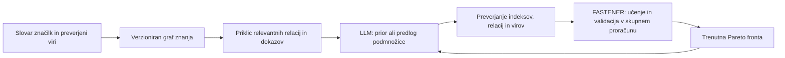

# FASTENER – delovni publikacijski načrt 2026–2027

**Pripravljeno za:** Klemen Kenda, Institut »Jožef Stefan« (IJS)  
**Datum:** 31. oktober 2026  
**Različica:** 1.3 – kritični pregled novosti P2/H1 in priprava ločenega raziskovalnega repozitorija

> **Status dokumenta:** Posodobitev 31. oktobra 2026 temelji na ciljnem pregledu lokalne kode FASTENER-ja, registra eksperimentov, poročil H1-E02, H2/H3, H8-E01–E03, H10-E01–E03, H11-E01 in H12-E01 ter sorodne literature. Iz tabel H2/H3 so ponovno izračunani število zbirk, smeri razlik, povprečja in mediane; p-vrednosti so povzete iz poročila. Pri H1 so ponovno preverjene smeri in povprečja 40 parnih razlik ter ničelne vrednosti AUF, pregledani pa tudi operatorji in najbližja literatura. Rezultati H8/H10/H11/H12 so povzeti iz poročil; pri H11 so ključne številke preverjene tudi v izvornih tabelah H10. Eksperimenti niso bili ponovno izvedeni. To je presoja izvedljivosti in publikacijske samostojnosti, ne celovita reprodukcija ali sistematičen pregled literature. Pogoji revij, pogodbe IJS, JOSS in konferenčni roki ostajajo nepreverjene navedbe starejšega načrta.

**Glavni priporočili:** naključni in vodeni swap obravnavati v **enem skupnem, pogojno samostojnem članku P7**; trenutni dokazi ne utemeljujejo dveh člankov o posameznih operatorjih. **LLM + graf znanja s Sidorelo dodati kot samostojen predlog P10**: tehnično izvedljiv prek obstoječih vmesnikov, raziskovalno obetaven, vendar brez že dokazane prednosti in z nujno razmejitvijo od sorodnih del.

**Nova odločitev za P2:** redka inicializacija sama nima dovolj novosti za predlagani samostojni članek. H1 privzeto vključiti v P3; samostojen P2 o pokritosti velikosti podmnožic ohraniti le pogojno, po novem pilotu. Decembrska oddaja P2 se umakne iz osnovne časovnice. Podrobna presoja je v [ločenem direktoriju P2](P2%20-%20Cardinality%20Coverage%20in%20Evolutionary%20Feature%20Selection/README.md).

## 1. Cilj in osnovna strategija

Prednost imajo samostojni revijalni članki. Za manj obsežne, vendar raziskovalno utemeljene prispevke pridejo v poštev tudi manj zahtevne oziroma manj vplivne revije. Konference ostanejo dodatna možnost za krajše zgodbe na meji revijalne objave, predvsem kadar so blizu Ljubljane.

Načrt zasleduje štiri cilje:

1. Iz obstoječega in nastajajočega dela izluščiti čim več vsebinsko samostojnih raziskovalnih prispevkov.
2. Najmočnejši zgodbi razvijati za ambicioznejši reviji: širšo primerjalno študijo in analizo mehanizmov LLM-vodenega iskanja.
3. Stroške zmanjšati z ustreznimi pogodbami IJS oziroma z načini objave brez obveznega APC.
4. Programsko opremo in morebitni podatkovni vir obravnavati kot ločena prispevka, če izpolnjujeta pogoje ciljnih revij.

Oznake **H1–H12 pomenijo raziskovalna vprašanja oziroma eksperimentalne sklope**, ne strogo potrditvenih hipotez. V člankih naj bodo ugotovitve opisane z velikostjo učinkov, negotovostjo in omejitvami; oznake »potrjeno« in »ovrženo« praviloma niso primerna osnovna struktura.

### 1.1 Kaj pomeni »pet variant«

V [registru konfiguracij](../experiments/run_sota.py) je mogoče izločiti **pet aktualnih osnovnih konfiguracij brez LLM-ja**:

| Različica | Kaj spremeni | Publikacijska vloga |
| --- | --- | --- |
| `fastener` | Trenutni osnovni algoritem; MI-križanje, naključna mutacija, odstranjevanje glede na permutacijsko pomembnost | Referenca v P3, P4, P6 in P7; izvirna metoda je bila objavljena leta 2020 |
| `fastener_swap_random` | Naključno odstrani eno izbrano in vstavi eno neizbrano značilko | Kontrola v P7 za učinek same zamenjave |
| `fastener_swap_guided` | Odstrani permutacijsko najšibkejšo značilko in vstavi neizbrano s tehtanim vzorčenjem po MI | Glavni primer vodene zamenjave v P7 |
| `fastener_seed_mrmr` | Začetna populacija iz gnezdenih podmnožic razvrstitve mRMR | Skupaj z Boruta v P6 |
| `fastener_seed_boruta` | Začetna populacija iz razvrstitve Boruta; upoštevati tudi njene učne stroške | Skupaj z mRMR v P6 |

To **ni celotno število implementiranih konfiguracij**. Poleg teh obstajajo zgodovinska `fastener_2020`, statistična kontrola `fastener_mi_only` brez LLM-ja, LLM-priorji, spletni predlagalnik podmnožic in druge kontrole. Če mRMR/Boruta združimo v eno družino in dodamo LLM, dobimo pet širših družin: osnovna, naključni swap, vodeni swap, inicializacija s filtri, LLM-vodenje. Število družin zato ni število člankov. [README komponente](../fastener/README.md) navaja starejši inventar z dne 30. oktobra; za dodatne modele in kontrole H8-E03 je merodajen trenutni register.

Trenutni osnovni algoritem uporablja `include_top_genes=True, allow_self_mating=False`; rezultatov zgodnjih različic z drugimi zastavicami ne združujemo brez označitve. Izvirni članek [Koprivec, Kenda in Šircelj (2020)](https://www.mdpi.com/1099-4300/22/11/1198) je izhodišče za vse nove prispevke, ne nova publikacijska enota.

## 2. Predlagani portfelj člankov

Oznake P1–P10 spodaj so oznake publikacijskih predlogov. Ločene so od oznak eksperimentov H1–H12. P10 še nima registriranega eksperimentalnega sklopa.

| Oznaka | Raziskovalni sklop | Predlagana vsebina | Ciljna oddaja iz dosedanjega načrta | Ključni pogoj |
| --- | --- | --- | --- | --- |
| P1 | H4 | Kako izbira računskega proračuna spremeni primerjavo FASTENER in FS-SDS | December 2026 | Posplošljiv metodološki prispevek, dovolj neodvisen od P3 |
| P2 | H1 + morebitni novi pilot | Pokritost velikosti podmnožic pri evolucijskem izboru značilk | Brez samostojnega roka; privzeto vključitev v P3 | Sedanja inicializacija ni dovolj nova; samostojnost le ob novem, posplošljivem metodološkem rezultatu |
| P3 | H5–H7 in H9 | Širša primerjalna študija selektorjev značilk | Februar–marec 2027 | Razširitev in neodvisna validacija H9 |
| P4 | H8-E01–E03 | Mehanizmi in meje LLM-vodenega evolucijskega iskanja | Marec–april 2027 | Skupna razlaga začetne pohitritve, nezadostno slepe kontrole in primerjave z MI-only; neodvisna validacija |
| P5 | H12-E01 | Prepoznavanje zbirk, priklic razporeda stolpcev in znanje o pomembnosti značilk | April–maj 2027, pogojno | Nov nabor zbirk in ponovljeni pozivi; sicer vključitev v P4 |
| P6 | H10-E01–E03 + H11-E01 | Inicializacija FASTENER-ja z mRMR/Boruta: kakovost, zgodnja korist in celotni strošek | Maj 2027, pogojno | H11 je post hoc ponovna analiza H10; predhodno registrirana neodvisna validacija |
| P7 | H2/H3 | En skupni članek: kdaj se zamenjava značilk pri fiksni velikosti izplača | Maj–junij 2027 ali konferenca, pogojno | Mehanistične ablacijske študije, dodatni proračuni in neodvisna validacija; sedanji učinek je majhen in krhek |
| P8 | Programska oprema | FASTENER kot odprtokodni raziskovalni paket | December 2026–marec 2027, če je pripravljen | Preverjena upravičenost za JOSS in urejen paket |
| P9 | Eksperimentalni podatki | Kuriran, ponovno uporaben podatkovni vir eksperimentov | Po pripravi in objavi podatkovnega paketa | Samostojna uporabnost podatkov, dokumentacija in pravice za deljenje |
| P10 | Nov sklop; s Sidorelo | Vodenje FASTENER-ja z LLM in eksplicitnim grafom znanja | Pilot november–december 2026; ciljna oddaja druga polovica 2027 | Dokaz dodane vrednosti relacij glede na MI, LLM brez grafa in enako informiran besedilni RAG |

To je največ **osem raziskovalnih predlogov (P1–P7 in P10), en programski članek in pogojno en podatkovni članek**. Po pregledu P2 osnovni scenarij vsebuje sedem raziskovalnih kandidatov, saj je H1 predviden znotraj P3. Deset oznak ne pomeni desetih zagotovljenih objav. P7 ostaja ena publikacijska enota; P10 je nov raziskovalni projekt, ne že pripravljen rokopis.

Če H4 ne zadošča za samostojen članek, se vključi v P3. H1 se vanj vključi že po trenutnem priporočilu; nov pilot lahko pozneje upraviči razširjeni P2. Če H2/H3 ali H10/H11 ne zadoščata za revijo, se izbere krajši samostojen konferenčni prispevek ali vključitev v vsebinsko najbližji članek. Če P10 ostane samo dodatna različica priorja brez dokaza o vlogi grafa, se vključi kot razširitev P4. P10 ima več prostora za nov metodološki prispevek kot ločevanje obeh swap operatorjev, vendar zahteva več novega dela.

**Vključitev H8, H12 in H11:** vsi trije sklopi so del portfelja. H8-E01–E03 so eno eksperimentalno jedro P4; H12 je kandidat P5 z neposredno povezavo na kontrole H8; H11 dopolnjuje P6 in ne dodaja nove publikacijske enote ali neodvisnih tekov. Negativen rezultat skupnega kriterija ne izniči uporabnih delnih ugotovitev, vendar jih je treba jasno ločiti od potrditvenih sklepov.

## 3. Vsebina, meje in manjkajoči dokazi

### P1 – H4: poštenost primerjalnih eksperimentov

**Navedba iz dosedanjega pogovora:** trije eksperimenti H4 naj bi bili zaključeni. FASTENER in FS-SDS naj bi bila pri enakem procesorskem času primerljiva, pri enakem številu učenj modela pa naj bi imel FASTENER prednost. Izvorni rezultati pri pripravi tega dokumenta niso bili ponovno pregledani.

**Predlagani prispevek:** pokazati, kako operacionalizacija računskega proračuna vpliva na sklepe primerjalnih raziskav. Samostojen članek mora pojasniti tudi, za katero praktično vprašanje je posamezni proračun primeren.

Pred samostojno oddajo je treba razjasniti merjenje časa, strojno opremo, paralelizacijo, stroške posamezne evaluacije in morebitno predpomnjenje. Smiselno je preveriti, ali ugotovitev velja širše od ene primerjave dveh implementacij.

**Meja do P3:** P1 ima metodologijo merjenja in interpretacijo proračuna za glavni rezultat. P3 uporablja utemeljen protokol pri širši primerjavi metod. Sama različna naslova člankov še ne zadoščata za vsebinsko neodvisnost.

### P2 – H1: pokritost velikosti podmnožic, pogojno

**Presoja:** sedanja zgodba »zamenjamo gosto inicializacijo z redko« ni dovolj nova za samostojen metodološki članek. Privzeta odločitev je vključitev H1 v P3. Samostojni P2 bi zahteval bistveno razširjeno raziskavo, ne samo dodatnih zbirk.

**Delovni naslov:** *Cardinality Coverage in Evolutionary Feature Selection.* Pripravljen je [direktorij P2](P2%20-%20Cardinality%20Coverage%20in%20Evolutionary%20Feature%20Selection/README.md) za samostojen repozitorij `fastener-p2-cardinality-coverage`; GitHub repozitorij še ni ustvarjen. V njem so pregled literature, revizija dokazov H1, bibliografija, posnetek tabele z izvorom in predlog pilota.

**Kaj je že raziskano:** [Miyandoab et al. (CEC 2024), algoritem 2](https://arxiv.org/html/2407.17795v2), poda enakomerno izbiro kardinalnosti in nato naključnih indeksov brez ponavljanja. Lokalni začetek 1–30 je posebni primer tega postopka; celotni algoritem avtorjev se sicer razlikuje. Tudi [Deniz in Kiziloz (2019)](https://shura.shu.ac.uk/30147/) raziskujeta začetne populacije, [Kropp et al. (2022)](https://www.sciencedirect.com/science/article/pii/S2210650221001875) pa redko vzorčenje za NSGA-II. [Podrobni pregled osmih ključnih del](P2%20-%20Cardinality%20Coverage%20in%20Evolutionary%20Feature%20Selection/RELATED-WORK.md) vključuje še intervalne začetke, informirano razdeljevanje populacije in novejša dela do leta 2026. Globina dostopa je označena; ni trditve o izčrpnosti.

**Preverjeni H1-E02:** osem zbirk, pet semen, populacija 100, 6.000 učenj oziroma 12.000 na arcene. Iz [tabele](../experiments/reports/H1-E02/tables/H1_auf10_per_seed.csv) je potrjenih 5/5 zmag redkega začetka na vsaki od sedmih zbirk z vsaj 182 značilkami. OBL ima tam AUF pri K = 10 enak nič v 34/35 tekov; po [poročilu](../experiments/reports/H1-E02/REPORT.md) končne fronte ne dosežejo merjenega območja. Na satimage zmaga OBL 5/5, povprečno za 0,0065 AUF. Velik učinek zato večinoma meri dosegljivost majhnih podmnožic; ne dokazuje boljše kakovosti pri isti velikosti. Redki začetek po poročilu izgubi pri največji doseženi F1 na petih zbirkah.

**Bistvena omejitev posploševanja:** `run_nsga2` uporablja operatorje iz lokalnega porta NSGAII-MIIP brez MI-izboljševalne faze. Pri njegovi mutaciji SSOM je za 0 < k < d pričakovani premik velikosti nič, iz lokalne kode pa sledi pričakovano število obratov 2k/d. Uravnoteženje pričakovanih dodatkov in odstranitev že opisujejo [Li et al., §4.3](https://andali89.github.io/homepage/pubs/2025_NSGAIIMIIP_manuscript.pdf); ni nova teorija P2 in ne opisuje celotnega NSGA-II s selekcijo. H1 veljavno izolira inicializacijo v konkretni konfiguraciji, ne pokaže vedenja vseh izvedb NSGA-II. Pri novih poskusih je treba upoštevati tudi predpomnilnik in kasneje dodano pravilo stagnacije.

**Možna nadaljnja smer:** ločiti pokritost območja, kakovost ob primerljivih velikostih in napredek glede na začetno populacijo ter preveriti interakcijo začetka, mutacije in proračuna. [Predlog pilota](P2%20-%20Cardinality%20Coverage%20in%20Evolutionary%20Feature%20Selection/RESEARCH-PLAN.md) vsebuje 120 razvojnih tekov, primerjavo s širšo enakomerno kardinalnostjo in drugo mutacijo ter merila za nadaljevanje. To je novo, še neizvedeno delo. Če ostane ugotovitev omejena na lokalno konfiguracijo ali ponovi že znan učinek začetka, H1 ostane v P3; samostojna oddaja P2 nima določenega roka.

### P3 – H5–H7/H9: širša primerjalna študija

**Navedba iz pogovora:** obstajajo zaključeni sklopi s klasifikatorji Decision Tree, Random Forest in LightGBM; H9 je predviden za preverjanje na novih zbirkah.

**Predlagani prispevek:** primerjava kakovosti, velikosti izbranih podmnožic, stabilnosti in računskega vložka ter razlaga, v katerih okoliščinah posamezne metode delujejo dobro.

Ključni naslednji koraki so H9, dosleden protokol izbire parametrov in ločitev podatkov za razvoj metod od podatkov za vrednotenje. H1 po trenutni presoji vključiti kot utemeljitev konfiguracij in opozorilo glede pokritosti merjenega območja. Če pozneje nastane samostojen P2, njegov novi osrednji rezultat jasno razmejiti; enako velja za P1.

### P4 – H8: mehanizmi LLM-vodenja

**Predlagani prispevek:** ugotoviti, iz česa izvira korist LLM-vodenja: iz semantičnega znanja, statističnih signalov, splošnega usmerjanja iskanja ali drugih lastnosti postopka.

**Celotni sklop H8 je zaključen in ga je treba brati skupaj:**

| Eksperiment | Ključni rezultat iz poročila | Vloga v P4 |
| --- | --- | --- |
| [H8-E01](../experiments/reports/H8-E01/REPORT.md) | Trije LLM-priorji, mešani z MI, dosežejo skupni validacijski cilj s približno 1,5–1,7-krat manj učenji kot osnovni FASTENER; vsak vodi na 13/16 zbirkah, Holm p = 0,005–0,015 | Pokaže korist celotne konfiguracije, še ne njenega semantičnega dela |
| [H8-E02](../experiments/reports/H8-E02/REPORT.md) | Prior z imeni ne premaga slepe kontrole pri nobenem od treh modelov (Holm p = 1); kontrola kljub skrivanju imen ohrani možnost priklica razporeda stolpcev | Razkrije omejitev kontrole in motivira neposredno primerjavo z MI-only ter permutacijo ocen |
| [H8-E03](../experiments/reports/H8-E03/REPORT.md) | Nobeden od 12 priorjev ne izkaže prednosti pred MI-only po korekciji; Sonnetov prior premaga svojo permutirano različico | Loči informiranost priorja od njegove dodane uporabnosti za iskanje |

Pohitritev pomeni manj učenj do cilja, določenega kot nižji od končnih validacijskih AUF obeh primerjanih tekov; ne pomeni enake pohitritve v pretečenem času ali izboljšanja končne testne kakovosti. Stare navedbe »part (ii) pending« v telesu H8-E01 so zgodovinski zapis in jih nadomestita H8-E02/E03.

**Preverjeno stanje:** [H8-E03 je že zaključen](../experiments/reports/H8-E03/REPORT.md): 12 modelov, 16 zbirk, pet semen, primerjava priorja pri λ = 1 z MI-only in s permutiranim priorjem. Noben prior ne izkaže prednosti pred MI-only po Holmovi korekciji; samo Sonnetov izkaže prednost pred svojo permutirano kontrolo. Rezultat ne dokazuje enakovrednosti in ne izključuje koristi pri drugih nalogah ali proračunih. Utemeljuje pa članek o tem, koliko pripisane koristi LLM-ja izvira iz že razpoložljivih statističnih signalov.

**Pomembna implementacijska podrobnost:** `fastener_mi_only` ni enak osnovnemu FASTENER-ju. Poleg križanja usmerja tudi mutacijo in začetne značilke; v sedanjem registru nastane iz ravnega priorja pri λ = 0,5, torej uporablja uteži sorazmerne `sqrt(unit(MI))`. Primerjave morajo ohraniti enake operatorje, transformacijo uteži in začetne populacije, sicer učinka semantike ni mogoče ločiti od učinka vodenja.

**Pozitivni rezultat, ki ga je smiselno ohraniti:** MI-only proti osnovnemu FASTENER-ju v H8-E03 vodi na 12/16 zbirkah, povprečni log2-količnik učenj je +0,36 (95-% interval +0,12 do +0,61; poročani p = 0,034), kar ustreza približno 1,28-krat manj učenjem do cilja. Končni povprečni testni AUF je 0,7969 proti 0,7965. To je spremljajoča analiza, ne izpolnitev primarnega kriterija H8 in ne dokaz enakovrednosti končne kakovosti. Je kandidat za neodvisno validacijo statističnega vodenja mutacije in začetne populacije znotraj P4/P3, ne avtomatično nov članek.

**Spletni predlagalnik prav tako vključiti:** H8-E01 ne pokaže značilne dodatne pohitritve glede na isti prior brez predlagalnika. Na tek je izvedenih približno 22–25 klicev, od ocenjenih predlogov pa le 42–64 zahteva novo učenje; ostali so že znani. To je rezultat o mejni koristi in strošku predlogov, ki utemeljuje stroge kontrole P10, ne dokaz splošne neučinkovitosti predlaganja.

**Meje dokazov in naslednji korak:** H8 uporablja LightGBM, 1.000 učenj, pet semen in eno delitev na vsaki od 16 večinoma velikih zbirk. Za širše sklepe preveriti nove zbirke, drugo delitev/klasifikator, majhne učne vzorce, redundanco in interakcije ter ponovitve pozivov. Pri dodatnem iskanju λ nastavitve izbrati na razvojnem delu. Dokaz, da prior premaga permutacijo, potrdi korist pravilne razporeditve ocen v tem preizkusu; sam ne dokazuje prednosti pred statističnim vodenjem.

Naslednji korak je analiza in pisanje iz zaključenega H8-E03, nato ciljne neodvisne kontrole. Samostojnost P4 zahteva razmejitev od [LLM-Select (TMLR 2025)](https://arxiv.org/abs/2407.02694), ki že uporablja imena značilk in opis naloge, ter od novega [empiričnega pregleda Memar et al. (prednatis, oktober 2026)](https://arxiv.org/abs/2610.28556). Posebnost P4 naj bodo operatorji evolucijskega iskanja, računski proračun in vzročna razmejitev virov izboljšanja. **P10 ločeno preverja vrednost eksplicitnih relacij in zunanjih virov znanja.**

P4 potrebuje kontrolo mehanizma, ne samo ugotovitve, da neka različica doseže boljši rezultat.

### P5 – H12: znanje LLM-jev o zbirkah

**Predlagani prispevek:** raziskati razliko med poznavanjem imen zbirk, semantično interpretacijo imen značilk in sklepanjem o novi nalogi.

**Preverjeno stanje:** [H12-E01 je zaključen](../experiments/reports/H12-E01/REPORT.md). Štirje od dvanajstih modelov dosežejo merilo priklica značilk, vendar noben ne doseže kombiniranega merila A + B, merila C za dodatno vrednost imena zbirke pa prav tako ne doseže noben. To je podlaga za analizo omejitev prepoznavanja zbirk; samo po sebi še ne zagotavlja samostojnega članka.

| Del H12 | Kaj preverja | Rezultat in omejitev |
| --- | --- | --- |
| A – priklic značilk | Iz imena zbirke navesti vsaj polovico značilk na vsaj 8/16 zbirkah | Merilo dosežejo štirje modeli; njihov mediani priklic je 0,95–1,00. To kaže prepoznavanje sheme, ne pomembnosti značilk |
| B – pomembnost iz položajev | Ali realno ime zbirke izboljša ujemanje ocen za neimenovane položaje s permutacijsko pomembnostjo glede na izmišljeno ime | Po Holmovi korekciji ne uspe noben model; najbližji Opus ima p = 0,075 |
| C – dodatna vrednost imena | Ali ime zbirke doda informacijo o pomembnosti, ko so imena značilk že podana | Merila ne doseže noben model; ne gre za dokaz odsotnosti učinka |

**Samostojno zanimiv mehanizem:** Opusove ocene golih položajev so močno povezane z njegovimi ocenami poimenovanih stolpcev (mediana Spearman ρ = 0,94; Sonnet 0,81). To ni korelacija z dejansko napovedno pomembnostjo. H12 tako pojasni, zakaj skrivanje imen v H8 ni nujno odstranilo informacij o zbirki: model lahko prikliče razpored stolpcev, ne da bi zanesljivo poznal njihovo pomembnost za dani model in vzorec.

**Primarni in raziskovalni izid ostaneta ločena:** referenca H12 je permutacijska pomembnost enega LightGBM na validaciji. Pri naknadni zamenjavi reference z MI del B uspe Opusu in Sonnetu (Holm p = 0,005 in 0,008), vendar 2/12 še vedno ne doseže zahtevanih 7/12 za A + B. To motivira raziskavo razlike med marginalno pomembnostjo in pomembnostjo za konkretni model ob redundanci; ne spremeni primarnega sklepa. Zabeležiti tudi podcenjevanje pravilnih generičnih imen stolpcev pri ocenjevanju A in prazne odgovore; po poročilu popravilo generičnih imen ne spremeni tega, kateri modeli dosežejo A.

**Za samostojen P5:** novi, manj prepoznavni podatki in nadzorovane naloge, pri katerih se napovedna pomembnost razlikuje od običajnih domenskih pričakovanj; ponovljeni pozivi ter vnaprej določen način ocenjevanja imen, položajev in pomembnosti. H12 je nastal iz opažanja H8-E02 na istih 16 zbirkah, zato novi pozivi niso povsem neodvisna validacija za prvotne tri modele. Ločiti ponovitve klicev od novih podatkov in preveriti več meril pomembnosti brez naknadnega izbiranja ugodnega. Iz rezultatov ne smemo sklepati, da poznamo učne podatke LLM-ja ali da smo dokazali kontaminacijo testnih podatkov.

Če H12 ostane samo manjša kontrola znotraj H8, je primernejša vključitev v P4. Samostojen članek potrebuje lasten problem, protokol in osrednje ugotovitve.

### P6 – H10/H11: mRMR in Boruta

**Predlagani prispevek:** pojasniti, kdaj začetna populacija iz mRMR ali Boruta pomaga FASTENER-ju, kako se učinek spreminja s klasifikatorjem in koliko stane priprava začetnih podmnožic. Sedanji H10/H11 preizkuša inicializacijo z gnezdenimi podmnožicami velikosti 1–10, ne vodenja skozi celotno iskanje. Ohraniti **oba filtra** v enem članku.

**Preverjeno stanje:** [H10-E01](../experiments/reports/H10-E01/REPORT.md), [E02](../experiments/reports/H10-E02/REPORT.md) in [E03](../experiments/reports/H10-E03/REPORT.md) so zaključeni na 39 zbirkah s petimi semeni; primarna inicializacija je mRMR, sekundarna Boruta. [H11-E01](../experiments/reports/H11-E01/REPORT.md) je **post hoc ponovna analiza istih tekov**, ki Boruta postavi v ospredje po ogledu rezultatov. Ni nova neodvisna potrditev ali dodaten nabor eksperimentov.

H10 zahteva hkrati: (a) boljšo končno kakovost od samostojnega filtra, (b) neinferiornost glede na osnovni FASTENER z enostransko 95-% spodnjo mejo povprečne razlike nad −0,005 AUF in (c) prednost pred osnovnim algoritmom pri **obeh** točkah 10 % in 25 % proračuna, s Holmovo korekcijo. Primarni klasifikator je LightGBM. H11 isti kriterij uporabi za Boruta; ohranjeni kriterij ne odpravi naknadne izbire glavne različice.

**Rezultati za Boruta-seeded FASTENER (H11):**

| Klasifikator | ΔAUF proti Boruta; p | ΔAUF proti osnovnemu; spodnja 95-% meja | Holm p pri 10 % / 25 % | Skupni kriterij |
| --- | --- | --- | --- | --- |
| LightGBM | +0,037; p < 0,0001 | +0,003; −0,008 | 0,24 / 0,24 | (b) in (c) nista dosežena |
| Random Forest | +0,052; p < 0,0001 | +0,009; +0,002 | 0,11 / 0,030 | (c) ni dosežen pri 10 % |
| Decision Tree | +0,015; p = 0,020 | +0,009; +0,003 | 0,79 / 0,79 | (c) ni dosežen |

Razlike so povprečja po zbirkah, končna kakovost je testni AUF pri K = 10. Številke iz H11 izvirajo iz tabel `criterion.csv` H10-E01–E03; p-vrednosti in intervali v tej posodobitvi niso ponovno izračunani. Neuspeh testa neinferiornosti pod LightGBM ni dokaz inferiornosti. Odstranitev OliveOil, ki močno vpliva na interval, ostane analiza občutljivosti in ne nov primarni sklep.

**Kaj to pomeni za P6:** nadaljevanje iskanja iz Borutinega izbora izboljša samostojni filter; pri gozdu in drevesu doseže uporabljeno mejo neinferiornosti glede na osnovni FASTENER. Prednost pri obeh zgodnjih proračunih ni izkazana. Tudi mRMR-inicializacija izboljša svoj filter pri vseh treh klasifikatorjih, vendar ne doseže celotnega kriterija. Boljši izid Boruta glede na mRMR zato ni podlaga za trditev o splošno uspešni hibridizaciji. Sklepi H11 ostanejo raziskovalni.

**Strošek je del zgodbe:** po H11 priprava Boruta porabi približno 30 % skupnega pretečenega časa njene različice pod LightGBM, 3 % pod Random Forest in 39 % pod Decision Tree (agregati obstoječih enojedrnih tekov). Največ 99 dodatnih učenj za Boruta je vključenih v skupni proračun, vendar enako število učenj ni enak časovni strošek. Članek mora poročati oboje.

**Pogoj za samostojen P6:** pred novimi rezultati določiti glavno inicializacijo, merila, proračune in obravnavo časa priprave; nato preveriti nove zbirke, po možnosti v sklopu H9, ter ponovljene delitve. Nova semena na istih zbirkah ocenijo naključnost iskanja, ne neodvisne posplošljivosti na druge naloge. Če ostane le post hoc ugotovitev na istem naboru, H10/H11 vključiti kot sklop o inicializaciji v P3. H11 trenutno ne utemeljuje ločenega članka poleg P6.

### P7 – H2/H3: operatorji za zamenjavo značilk

**Presoja:** smiselna je **ena skupna raziskava naključnega in vodenega swap operatorja**, ločena od širše primerjave P3, če razloži mehanizem in pogoje uporabnosti. Trenutni rezultati zadoščajo za izhodišče krajše empirične zgodbe; prepričljivost samostojnega revijalnega članka še ni zagotovljena. Naključni swap ima predvsem vlogo ablacijske kontrole in trenutno ne utemeljuje svojega članka. Tudi vodeni swap brez te kontrole ne omogoča verodostojne razlage izboljšanja.

**Delovni naslov:** *When Do Cardinality-Preserving Swaps Pay Off? Random and Information-Guided Local Search in FASTENER.*

#### Kaj dejansko kažejo podatki

[H2H3-E01](../experiments/reports/H2H3-E01/REPORT.md) primerja tri konfiguracije na 39 zbirkah (38 UCR/UEA + EOData), s petimi semeni in po zbirkah kalibriranim enakim proračunom učenja modelov. Primarna metrika je testni AUF pri K = 10; enota primerjave je zbirka po povprečenju semen.

| Primerjava | Pozitivna / negativna razlika | Mediana ΔAUF | Povprečje ΔAUF | Wilcoxon p iz poročila |
| --- | --- | --- | --- | --- |
| Naključni swap − osnovni | 19 / 20 | −0,00006 | +0,00013 | 0,83 |
| Vodeni swap − osnovni | 25 / 14 | +0,00313 | +0,00766 | 0,040 |
| Vodeni − naključni swap | 23 / 16 | +0,00097 | +0,00753 | 0,28 |

Števila in opisne statistike so preverjeni iz [H2_per_dataset.csv](../experiments/reports/H2H3-E01/tables/H2_per_dataset.csv) in [H3_per_dataset.csv](../experiments/reports/H2H3-E01/tables/H3_per_dataset.csv). Navedene p-vrednosti niso nov izračun niti nova korekcija za več primerjav.

Vodeni swap porabi približno desetino proračuna; sprejetih je približno 1,0 % njegovih predlogov proti 0,8 % naključnih. To kaže razliko v delovanju operatorjev, ne dokazane prednosti v testni kakovosti. Na 19 zbirkah z vsaj 1.000 vrsticami je vodeni swap proti osnovnemu 10 : 9, mediana +0,0004, p = 0,68. Po izločitvi treh največjih pozitivnih razlik je p = 0,16; to je analiza občutljivosti, ne nadomestno primarno merilo. Največje razlike so na zelo majhnih testnih vzorcih. Tudi kasnejši primerjavi z [Random Forest](../experiments/reports/H5H6-E02/REPORT.md) in [LightGBM](../experiments/reports/H5H6-E03/REPORT.md) ne pokažeta jasne ločitve obeh swap variant od osnovne; uporabljata isti nabor zbirk in zato nista neodvisna zunanja validacija.

**Dovoljen sklep:** operator spremeni dinamiko iskanja, vendar je dodana napovedna korist pri teh proračunih omejena in negotova. p = 0,040 za vodeni proti osnovnemu in p = 0,83 za naključni proti osnovnemu ne dokazujeta razlike med operatorjema; zanjo je pomembna neposredna primerjava p = 0,28. Neznačilnost prav tako ne dokazuje enakovrednosti.

#### Novost in meja do predhodnih del

Zamenjava ene izbrane z eno neizbrano značilko ni nov splošni operator. FS-SDS iz GECCO 2017 jo uporablja v svoji difuzijski fazi; to je razvidno iz [avtorske implementacije](https://github.com/mohmaj/SDS-FS/blob/main/SDSFS.py) in iz lokalnega [opisa ponovne implementacije](../experiments/fs_sds.py). [MIBNI (Barman in Kwon, 2017)](https://journals.plos.org/plosone/article?id=10.1371/journal.pone.0171097) prav tako združuje MI-izbor in naknadne zamenjave. To ni isti mehanizem kot FASTENER-jeva kombinacija permutacijske odstranitve in MI-vstavitve, vendar preprečuje široko trditev, da sta swap ali kombinacija MI in swap nova.

Tudi osnovna bitna mutacija lahko po naključju ohrani velikost podmnožice. Novost v FASTENER-ju je **namenski operator z zagotovljenim ohranjanjem velikosti**, vključen v obrezovanje Pareto fronte, s ponovno uporabo že izračunanih informacij. Obetaven prispevek je razlaga, kdaj se njegova poraba proračuna izplača in zakaj več sprejetih predlogov ne prinese nujno boljšega končnega rezultata. Samo dodajanje operatorja in majhna razlika v eni tabeli sta šibka podlaga za nov metodološki članek.

#### Kaj bi P7 okrepilo v samostojen članek

1. **Ločiti oba vira vodenja:** štiri kombinacije odstranitve (naključna / permutacijska) in vstavitve (naključna / MI), poleg osnovnega algoritma brez swap. Sedanji H2/H3 primerja le dve diagonalni kombinaciji. Ohraniti enako pogostost predlogov in skupni proračun.
2. **Preveriti strošek in čas delovanja:** kakovost pri 10 %, 25 %, 50 % in 100 % proračuna; število predlaganih, dejansko učenih, sprejetih in na končni fronti ohranjenih zamenjav; čas in izrinjene običajne evaluacije. Proračuni H2/H3 so bili kalibrirani na konvergenco osnovnega algoritma in ne odgovorijo na vprašanje zgodnje koristi.
3. **Razločiti mehanizme:** sintetične naloge z nadzorovano redundanco in interakcijami ter nov nabor resničnih zbirk; MI sam po sebi ne zajame vseh interakcij. Ponovljene delitve podatkov naj preverijo občutljivost zelo majhnih testnih vzorcev. Dodatna semena na istih podatkih niso nove neodvisne zbirke.
4. **Ustrezne reference:** preprost iskalnik po sosedstvu ene zamenjave in ustrezna MI/mRMR kontrola; za splošne trditve o evolucijskih operatorjih tudi drugi optimizator. Drugi optimizator ni obvezen za jasno omejen članek o FASTENER-ju.
5. **Vnaprejšnja merila:** intervali zaupanja in praktično pomembna velikost učinka, primarne primerjave in korekcija večkratnega testiranja; za trditev o enakovrednosti vnaprej določena toleranca in ustrezna analiza. Delitev po velikosti zbirk naj ostane raziskovalna, dokler ni neodvisno preverjena.

**Odločitev o oddaji:** ob ponovljivem mehanističnem rezultatu razviti skupni revijalni P7, tudi če je rezultat pretežno negativen. Če razširitev ne prinese dovolj samostojnega spoznanja, H2/H3 vključiti v P3 ali pripraviti en krajši konferenčni članek. V P3 ostane pregled končne kakovosti metod; v P7 so osrednje nove ablacijske študije in potek iskanja. Istih glavnih tabel ne uporabiti kot osrednjega prispevka obeh člankov. Ločena članka o naključnem in vodenem swap bi zahtevala dve različni raziskovalni vprašanji in nova neodvisna rezultata; trenutni načrt tega ne podpira.

### P10 – LLM + graf znanja: načrtovani članek s Sidorelo

**Presoja izvedljivosti:** tehnična izvedljivost minimalnega prototipa je visoka, raziskovalna novost in izboljšanje kakovosti pa sta odprti vprašanji. V pregledani kodi ni implementiranega grafa znanja, povezovanja značilk s pojmi ali preverjanja grafnih dokazov. [Starejši seznam prispevkov](../experiments/CONTRIBUTIONS_TO_METHODS.md) graf omenja kot prihodnjo smer. Obstoječi vmesniki pa omogočajo prototip brez spremembe osnovnega optimizatorja. To je **nov skupni projekt s Sidorelo**, ne preimenovanje že izvedenega H8.

**Delovni naslov:** *Knowledge-Grounded Evolutionary Feature Selection: Graph-Conditioned LLM Guidance for FASTENER.*

**Osrednje vprašanje:** ali eksplicitne, preverljive relacije med značilkami omogočijo boljše predloge podmnožic in učinkovitejše iskanje, kot ga dosežejo MI, LLM brez grafa ali isti viri znanja v navadni besedilni obliki?

#### Sorodna dela in realna vrzel

| Primarni vir | Kaj že pokriva | Zahtevana razlika P10 |
| --- | --- | --- |
| [LLM-Select, TMLR 2025](https://arxiv.org/abs/2407.02694) | Izbor na osnovi imen značilk in opisa naloge | Eksplicitne relacije in njihova uporaba med iskanjem |
| [Jaworsky et al., 2023](https://pmc.ncbi.nlm.nih.gov/articles/PMC10654272/) | Izbor povezanih značilk z domenskim grafom znanja pri zdravstvenih anketah | Ločiti prispevek LLM-ja od samega KG in pokazati vpliv na evolucijsko iskanje |
| [Chen et al., AAAI 2026](https://ojs.aaai.org/index.php/AAAI/article/view/39180) | LLM-semantika, heterogeni semantični/statistični graf in GAT za večpogledni večoznačni izbor | Zunanji graf z izvori, preverljivi predlogi in iskanje fronte ob omejenem proračunu; sama kombinacija LLM + graf + izbor ni nova |
| [InterFeat, 2026](https://pmc.ncbi.nlm.nih.gov/articles/PMC13133114/) | Statistični izbor, KG, literatura in LLM za odkrivanje zanimivih biomedicinskih značilk | Meriti izboljšanje iskanja napovednih podmnožic; ne omejiti prispevka na naknadno razlago ali rangiranje zanimivosti |
| [RAFG, Zhang et al., 2026](https://link.springer.com/article/10.1007/s10115-026-02792-4) | Priklic zunanjega znanja, LLM-ustvarjanje značilk in preverjanje pričakovane uporabnosti z empiričnimi spremembami | P10 naj najprej izbira med obstoječimi značilkami in izolira vpliv relacij; samo RAG in povratna informacija iz modela ne zadoščata |

**Predlagana, še nedokazana vrzel:** uporaba grafa z navedenimi izvori za predlaganje kombinacij med večciljnim evolucijskim iskanjem, skupaj s kontrolami, ki ločijo učinek dodatnih informacij, grafnih relacij in LLM-ja. Ciljni pregled ni dokaz svetovne prvenstvenosti. Pred rokopisom je treba primerjati celotne metode in najbližje izvedljive algoritme; ne uporabljati trditve »prvi LLM + KG za izbor značilk«.

H8-E03 daje dobro motivacijo: enodimenzionalni semantični prior ni pokazal prednosti pred MI. **Raziskovalna domneva P10** je, da relacije o izvoru, odvisnostih, skupinah meritev in komplementarnosti prinesejo informacije, ki jih samostojna ocena vsake značilke ne izrazi. Dodajanje grafa tej domnevi še ne zagotovi uspeha.

#### Minimalna arhitektura in kaj že obstaja

| Sestavni del | Obstoječa podpora | Potrebno novo delo |
| --- | --- | --- |
| Kontekst in statični prior | [`GuidanceContext.metadata`, `feature_prior`](../fastener/guidance.py); mešanje z MI | Preslikava značilka → pojem, priklic dokazov in KG/LLM-ocena; preveriti pokritost in negotovost |
| Predlogi kombinacij med iskanjem | `subset_proposer(ProposalContext)`, fronta z validacijskimi ocenami in porabljenimi učenji | Predlagalnik, odvisen od izbrane množice, ki uporablja relacije in poda ID-je virov/poti |
| Proračun in sledljivost | Isti `max_model_fits`, `proposal_log`; [eksperimentalni zapis in ponavljanje klicev](../experiments/llm_guidance.py) | Dodatni dnevnik grafnih dokazov, različice KG, pozivov, modela, žetonov in časa priklica; obstoječi dnevnik ne preverja izvora razlage |
| Operator swap | [`SwapStrategy`](../fastener/item.py) je razširljiv | Grafno pogojeni swap je možna kasnejša ablacijska različica; ni potreben za prvi prototip |

Prototip naj najprej uporabi `feature_prior` in `subset_proposer`; v prvi različici lahko graf hrani kot datoteko z vozlišči in robovi, brez posebne grafne podatkovne baze. Statični prior stisne graf v eno oceno na značilko in zato sam ne predstavlja relacij znotraj podmnožice. **Glavni kandidat za nov prispevek je predlagalnik kombinacij**, ki upošteva že izbrane značilke, redundanco in komplementarnost. Pri kontrolah morata ostati število predlogov in razpored klicev enaka.

Predlagana shema KG vsebuje vozlišča za značilko, merjeno količino, instrument, časovno/statistično transformacijo in pojem naloge; robove npr. `measures`, `derived_from`, `same_measurement_family` in z virom podprto `relevant_to`. Vsaka zunanja trditev naj vsebuje vir, različico/datum in status preverjenosti. Statistične povezave iz podatkov naj bodo ločene od domenskih trditev in ocenjene samo na učnem delu. Domenska povezava ni samodejno vzročna povezava ali dokaz napovedne pomembnosti; manjkajoč rob ni dokaz nepovezanosti.

LLM sme predlagati relacijo, vendar je njegov nepodprti predlog označen kot hipoteza. Preverjanje obstoja grafne poti potrdi sledljivost, ne resničnosti trditve ali zvestobe razlage. Za to potrebujemo pregled izvornega dokaza in intervencijske kontrole, npr. odstranjevanje ali premešanje robov. Zavrnjeni ali neuspešni predlogi se zabeležijo; iskanje nadaljuje z osnovnimi operatorji. Ohraniti možnost raziskovanja tudi za značilke brez KG-pokritosti.

**Obseg prvega članka:** ohraniti obstoječi cilj kakovost–število značilk. Strošek pridobivanja značilk je lahko dodatna meritev. Pravi tretji cilj, nadomestni modeli za ocenjevanje, novo ustvarjanje značilk in dolgoročni spomin med nalogami zahtevajo večje spremembe ter naj ne bodo pogoj za prvi pilot. Če bi jih vključili, bi morali ponovno določiti arhiv fronte in primerjalni protokol.

#### Pilot s Sidorelo in podatki

Za praktično izhodišče predlagam **EOData in crop_mapping**, ker že obstajata v raziskovalnem okolju in imata domensko razložljive meritve. [Slovar EOData](../experiments/priors/dictionaries/eodata.json) opisuje spektralne pasove, vegetacijske indekse, časovne statistike in teren. To omogoča konkreten KG o izvoru in transformacijah meritev. Ne pomeni pa, da preverjen graf ali preslikava vseh značilk že obstajata; pri obeh zbirkah ju je treba najprej preveriti. EOData in crop_mapping ostaneta razvojni zbirki, saj sta bili že uporabljeni v H8.

**Predlog delitve dela, ki še ni dogovor:** Klemen vodi integracijo FASTENER-ja, proračune in analizo; Sidorela sooblikuje shemo KG, preslikavo značilk in preverjanje virov; oba določita raziskovalna vprašanja, ablacijske kontrole in rokopis. Če ima Sidorela primernejšo domeno ali že kuriran graf, se pilot prilagodi po pregledu pokritosti in dostopa. Razpoložljivost njenih podatkov ali časa ni predpostavljena.

Pilot lahko obsega dve razvojni zbirki × osem konfiguracij × pet semen × dva klasifikatorja = **160 iskalnih tekov**. Pri 1.000 učenjih na tek je zgornja meja 160.000 učenj, brez dodatnih ponovitev delitev in priprave priorjev. To je začetni načrt, ne ocena potrebnih ur ali denarja; najprej izmeriti en reprezentativen tek, strošek klicev, velikost priklicanega konteksta in čas kuriranja. Za objavo razširiti na neodvisne naloge: bodisi več smiselnih domen bodisi dobro utemeljen domenski članek z zunanjim prostorskim/časovnim preverjanjem. Dve razvojni zbirki ne zadoščata za splošno trditev.

#### Odločilne kontrole in merila

Osem osnovnih konfiguracij pilota:

| Konfiguracija | Kaj razloči |
| --- | --- |
| 1. Osnovni FASTENER | Skupna referenca |
| 2. FASTENER z MI-only vodenjem | Korist statističnega vodenja brez LLM-ja in KG |
| 3. KG-vodenje brez LLM-ja | Preprosta pravila/relacijski predlagalnik na istem grafu |
| 4. LLM brez KG | Isti model, opis značilk, prior in razpored predlogov brez zunanjih dokazov |
| 5. LLM z besedilnim RAG | Isti korpus virov, primerljiv obseg konteksta in politika priklica brez grafnega iskanja |
| 6. LLM + pravi KG | Celotna predlagana metoda |
| 7. LLM + kontrolno premešan KG | Ohraniti vozlišča, tipe robov in po možnosti stopnje, porušiti relevantne povezave; preveriti prispevek strukture |
| 8. Velikostno usklajeni naključni predlogi | Enak razpored in velikosti kandidatov; preveriti korist vsebine predlogov |

Za odločitev o članku dodati ločitev **prior samo / predlagalnik samo / oba**, postopno redčenje in onesnaženje grafa, anonimizacijo imen zbirk ter drugo različico/model LLM-ja. Poleg običajnega besedilnega RAG je koristna stroga kontrola, ki prejme **iste priklicane trditve** v ploski obliki: tako lahko ločimo boljši priklic od koristi relacijskega sklepanja. MI-only in relevantni statistični selektorji, vključno z mRMR, morajo ostati resne reference. Najbližji objavljeni KG/LLM-selektor naj se vključi, kjer se naloga in dostopna implementacija ujemata; pri razlikah v večoznačnem/večpoglednem problemu ne prikazovati neprimerljivega neposrednega rezultata.

**Vrednotenje:** primarno testni AUF pri vnaprej določenem K in proračunu; dodatno krivulja kakovosti glede na učenja/čas, stabilnost izbora, veljavnost in sprejem predlogov, delež preverljivih virov ter stroški priprave KG, priklica in LLM-ja. Hitrost do cilja meriti pri vnaprej določenem skupnem cilju, z jasno obravnavo nedoseženih ciljev. Prikazati enaka učenja in skupni pretečeni čas; ugodnejše število učenj še ni nižji skupni strošek. Razlikovati enkratni strošek kuriranja od stroška ponovne uporabe.

**Neodvisnost dokazov:** KG in slovarje zamrzniti pred končnim vrednotenjem; zunanji viri ne smejo vsebovati odgovorov za testne primere ali rezultatov primerjanih tekov. Znane splošne domenske povezave s ciljem so dovoljene in zabeležene. Statistične robove, MI in izbor nastavitev oceniti znotraj razvojnih/učnih delitev; testni del ostane nedostopen priorju, priklicu in predlagalniku. Pri EO podatkih preveriti prostorsko/časovno ločitev. Poročati intervale po neodvisnih zbirkah oziroma nalogah, ne šteti semen in grafnih perturbacij kot novih zbirk.

**Pogoj za nadaljevanje v samostojen P10:** preverjena pokritost KG in ponovljiv prototip, nato jasen, neodvisno potrjen odgovor, kaj dodajo relacije. Za trditev o boljši izbiri mora celotna metoda doseči vnaprej določeno praktično prednost pred MI-only, LLM brez KG in besedilnim RAG ob primerljivem proračunu. Možen je tudi članek o mejah ali sledljivosti, vendar mora imeti lastne preverjene rezultate o zvestobi dokazov in vplivu kakovosti KG; lepše razlage same ne zadoščajo. Če učinek izgine ob uskladitvi informacij in proračuna, se sklep ustrezno omeji ali delo priključi P4.

**Meje portfelja:** P4 pojasni implicitno znanje LLM-ja in splošno vodenje iskanja; P5 prepoznavanje zbirk; P7 lokalne zamenjave; P10 eksplicitne relacije, njihov izvor in uporabo med iskanjem. P10 lahko uporabi njihove reference, potrebuje pa novo eksperimentalno jedro. Za pilot ni treba čakati na objavo P4 ali pozitiven rezultat P7.

## 4. Predlagane revije

Spodnja razporeditev ohranja kandidatke iz pogovora in dodaja P10. Celotna ustreznost revij, indeksiranje, način objave in upravičenost do kritja APC niso neodvisno potrjeni. Za P10 je bil preverjen vsebinski obseg Applied Intelligence, kot je pojasnjeno pod tabelo.

| Prispevek | Prednostna kandidatka iz dosedanjega načrta | Druga kandidatka oziroma možnost |
| --- | --- | --- |
| P1 – H4 | SN Computer Science | International Journal of Machine Learning and Cybernetics |
| P2 – H1 | Izbira odložena do dokaza samostojnega prispevka | Prejšnji kandidatki IJMLC / SN Computer Science nista več aktivni oddajni cilj |
| P3 – H5–H7/H9 | Applied Soft Computing | Swarm and Evolutionary Computation |
| P4 – H8 | Applied Intelligence | Knowledge-Based Systems |
| P5 – H12 | Neural Computing and Applications | Applied Intelligence |
| P6 – H10/H11 | SN Computer Science | International Journal of Machine Learning and Cybernetics |
| P7 – H2/H3 | SN Computer Science | Primerna konferenca v okviru Informacijske družbe |
| P8 – programska oprema | Journal of Open Source Software (JOSS) | Odločitev po pregledu upravičenosti |
| P9 – podatkovni vir | Data in Brief | Odločitev po pripravi podatkovnega paketa |
| P10 – LLM + KG, s Sidorelo | Applied Intelligence, če nastane nov preverjen mehanizem | Knowledge-Based Systems kot kandidatka po dodatnem preverjanju obsega |

Za P10 [uradni obseg Applied Intelligence](https://link.springer.com/journal/10489/aims-and-scope) izrecno vključuje evolucijsko računanje, izbor značilk in sklepanje na osnovi znanja ter poudarja izvirne metodologije. Zato je vsebinska kandidatka; samo povezava obstoječih komponent ali uporaba na drugi zbirki ne zadošča. To ni potrdilo o verjetnosti sprejema ali kritju stroškov. Uradna stran obsega Knowledge-Based Systems pri preverjanju ni bila dostopna, zato ta možnost ostaja predlog za nadaljnji pregled.

V pogovoru so bile kot dodatne možnosti navedene tudi **Computer Science and Information Systems (ComSIS)**, **Journal of Universal Computer Science** in **Algorithms**. Prej navedeni faktorji vpliva in cene se v tem izvozu ne obravnavajo kot potrjeni aktualni podatki. Pred uporabo slovenske revije **Informatica** je treba razjasniti njeno aktualno indeksiranje; predhodnega opozorila iz pogovora ne gre obravnavati kot dokončno preverjen status.

Nižji faktor vpliva ni zanesljivo merilo lažje sprejemljivosti. Izbiro je treba opreti predvsem na tip prispevka, obseg dokazov in uredniško usmeritev. Prav tako posamezna revija v drugem stolpcu ni nujno manj zahtevna rezervna možnost.

## 5. Dogovori IJS in stroški objavljanja

V dosedanjem pogovoru so bile navedene naslednje možnosti za leto 2026. Tabela ohranja navedbe, da se pri nadaljnjem preverjanju ne izgubijo; **ni potrdilo o kritju konkretnega članka**.

| Založnik | Prejšnja navedba za leto 2026 | Kaj je treba preveriti za načrtovane članke |
| --- | --- | --- |
| Springer Nature | Neomejeno kritje APC v upravičenih hibridnih revijah | Konkretna revija, vrsta članka, afiliacija, veljavnost pogodbe in pogoji za 2027 |
| Elsevier | Neomejeno kritje v približno 1.640 hibridnih revijah | Aktualni seznam upravičenih revij in veljavnost za sprejem članka |
| Wiley | 148 vavčerjev za konzorcij | Veljavnost podatka, upravičenost in razpoložljivost kvote |
| IEEE | 30 vavčerjev za konzorcij | Veljavnost podatka, vključene publikacije in razpoložljivost kvote |

**Oddaja decembra 2026 ne zagotavlja uporabe pogojev za leto 2026.** Razjasniti je treba, kateri dogodek šteje za upravičenost po posamezni pogodbi, in preveriti pogoje za članke, sprejete v letu 2027. Hibridni model revije sam po sebi ne dokazuje vključitve v pogodbo.

Pred dokončno izbiro revije je treba pri pristojni službi IJS pridobiti odgovor na štiri vprašanja:

1. Ali je konkretna revija vključena v veljavno pogodbo?
2. Ali sta dopisni avtor in vrsta članka upravičena do kritja?
3. Kateri datum določa upravičenost in kakšni so pogoji za leto 2027?
4. Ali obstaja kvota, obvezno doplačilo ali dodatni strošek?

V pogovoru je bila kot kontakt navedena **Helena Klančnik, helena.klancnik@ijs.si**. Kontakt v tem koraku ni bil ponovno preverjen. Nobeno sporočilo ni bilo poslano.

Če kritje odprtega dostopa ni na voljo, je treba preveriti tudi morebitno naročniško objavo brez obveznega APC in dovoljeno različico za repozitorij. To je vprašanje pogojev konkretne revije.

## 6. JOSS in zgodovina FASTENER-ja

Uporabnik je navedel začetek razvoja v letu 2019 oziroma 2020. V prejšnjem pogovoru sta bila dodatno navedena prvi commit **8. marca 2020** in objava paketa na PyPI najpozneje **27. novembra 2020**. Pri pripravi tega dokumenta datuma nista bila ponovno preverjena.

V kontekstu sta bila podana naslednja neposredna vira:

- [FASTENER na GitHubu](https://github.com/klemenkenda/FASTENER)
- [FASTENER na PyPI](https://pypi.org/project/fastener/)

Dolga zgodovina projekta podpira smiselnost zgodnje priprave za JOSS. Sama starost commita pa še ne dokazuje, koliko časa je bila koda javna, kakšen je obseg javnega razvoja ali ali paket izpolnjuje vse aktualne pogoje revije.

V prejšnjem pogovoru je bil naveden pogoj več kot šestih mesecev javne razvojne zgodovine in možnost neenakomerne aktivnosti. **To besedilo pogojev je treba preveriti v aktualnih navodilih JOSS, preden se upravičenost šteje za potrjeno.**

### Kontrolni seznam priprave

- [ ] Pregled aktualnih pogojev JOSS, javne zgodovine razvoja in obsega raziskovalne programske opreme.
- [ ] Jasna licenca, avtorstvo in navedba predhodnih različic ter publikacij.
- [ ] Ponovljiva namestitev iz čistega okolja.
- [ ] Dokumentiran primer uporabe in jasen opis namena paketa.
- [ ] Smiselni testi ključnega delovanja in urejeno preverjanje sprememb.
- [ ] Dokumentacija API, odvisnosti in pričakovane omejitve.
- [ ] Urejena izdaja in arhiviranje različice, na katero se nanaša članek.
- [ ] Kratek rokopis z raziskovalno potrebo, primerjavo obstoječega programja in opisom prispevka.
- [ ] Dokazi o dejanski raziskovalni uporabi, kolikor jih zahteva aktualni postopek.

**Načrt:** tehnični pregled novembra, priprava izdaje in rokopisa decembra, oddaja takoj po razjasnitvi pogojev in odpravi bistvenih pomanjkljivosti. Ciljno okno december 2026–marec 2027 je načrt, ne napoved sprejetja. Predhodno navedeno odsotnost stroškov JOSS je treba ob oddaji potrditi v aktualnih navodilih.

## 7. Tedenski načrt: november in december 2026

Časovnica po pregledu P2 predvideva eno pogojno raziskovalno oddajo, P1, do konca leta 2026. Samostojnost H4 je še treba preveriti. H1 je privzeto del P3; morebitni pilot P2 ni obveznost za decembrsko oddajo. Potrebni so čas za pisanje, sodelovanje soavtorjev in računski viri.

| Teden | Datumi | Glavna naloga | Pričakovani izhod |
| --- | --- | --- | --- |
| 1 | 2.–8. november | Preveriti samostojnost H4, umestiti H1 v P3 in odločiti o smiselnosti pilota P2; pregledati JOSS in opredeliti pilot P10 | Struktura P1, meja do P3 in enostranski koncept P10 za uskladitev s Sidorelo |
| 2 | 9.–15. november | Pisati P1, pripraviti ključne slike in statistične prikaze | Prvi osnutek H4 |
| 3 | 16.–22. november | Dokončati osnutek P1, pripraviti metodološki del P3 z H1 | H4 za notranji pregled; jasno opisane konfiguracije P3 |
| 4 | 23.–29. november | Upoštevati pripombe na P1, nadaljevati P3 | P1 pripravljen za oddajo |
| 5 | 30. november–6. december | Oddati P1, nadaljevati P3 in analizo zaključenega H8-E03 | Prva raziskovalna revijalna oddaja, če H4 upraviči samostojnost |
| 6 | 7.–13. december | Urediti glavne pomanjkljivosti paketa in gradivo P3/P4 | Kandidat za izdajo FASTENER-ja |
| 7 | 14.–20. december | Priprava rokopisa JOSS; presoja morebitnega pilota P2 | Osnutek JOSS; odločitev o nadaljevanju P2, če pilot obstaja |
| 8 | 21.–27. december | Urediti P3/P4 in pripravljeno spremljajoče gradivo | Brez obvezne oddaje P2; JOSS le ob izpolnjenih pogojih |
| 9 | 28. december–3. januar | Rezerva, analiza eksperimentov, presoja pripravljenosti JOSS | Urejen prehod v delo za 2027 |

Prejšnji cilj dveh raziskovalnih oddaj do konca 2026 je po pregledu novosti P2 umaknjen. Morebitni JOSS se šteje posebej in ne nadomesti druge raziskovalne oddaje. Če H4 ne zadošča za samostojen članek, se ustrezno popravi tudi cilj P1.

### Vzporedno raziskovalno delo

- **November:** sinteza zaključenih H8-E01–E03 in H12-E01 za P4/P5; priprava protokola H9 in neodvisne validacije H11 z vključenim časom inicializacije; za P7 določiti manjkajoče ablacijske primerjave.
- **December–januar:** izvedba oziroma zaključevanje H9 ter analiza rezultatov.
- **November–december:** tehnična priprava JOSS.
- **P10, november:** s Sidorelo uskladiti domeno, dostop do virov, shemo KG, preslikavo značilk in mejo do P4; popisati najbližja sorodna dela.
- **P2, pogojno:** najprej odločitev o koristnosti in strošku predlaganega pilota. Dokler novega prispevka ni, nadaljevati vključevanje H1 v P3.
- **P10, december:** če sta graf in čas na voljo, prototip ter omejen pilot iz razdelka P10; ob koncu meseca odločitev o razširitvi. Pilot ni nova obveznost pred oddajo P1.
- **Ves čas:** razmejitev glavnih rezultatov, slik in tabel med članki ter zapis novih odprtih raziskovalnih vprašanj.

H8-E03 ni več načrtovana računska naloga. Razpored H9, novih kontrol P7 in pilotov P2/P10 je odvisen od izmerjenih stroškov ter razpoložljivosti sodelavcev. Datumi pomenijo delovne cilje; če priprava KG tekmuje s P1 in prednostnim delom P3/P4, se pilot P10 premakne v januar.

## 8. Načrt za leto 2027

| Obdobje | Glavna prioriteta | Dodatna naloga |
| --- | --- | --- |
| Januar | Dokončati H9 in analizo za P3 z vključitvijo H1 | Oddaja JOSS, če je paket pripravljen; pogojna presoja razširjenega P2 in odločitev o P10 po pilotu |
| Februar–marec | Oddaja P3, priprava P4 | Neodvisne kontrole H8/H12 in validacija H11 za P6; ciljne ablacijske študije P7 |
| Marec–april | Oddaja P4 | Vrednotenje samostojnosti P5; razširitev P10 na neodvisne naloge, če pilot upraviči nadaljevanje |
| April–maj | P5 in P6, če rezultati upravičijo samostojna članka | Odločitev revija/konferenca/vključitev v P3 za P7 |
| Maj–junij | Priprava oziroma oddaja skupnega P7, če je samostojen | Analiza P10; kuriranje podatkov za morebitni P9 |
| Julij–december | P10: rokopis s Sidorelo in ciljna oddaja po neodvisni validaciji | Odzivi na recenzije; morebitni P9 |

**Štetje ciljev:** ob oddaji P1 leta 2026 ostane šest raziskovalnih kandidatov za 2027 (P3–P7 in pogojni P10), s H1 znotraj P3. Razširjeni P2 bi bil dodaten kandidat šele po novem dokazu samostojnosti; ni rezervirana oddaja. Združitve P5, P6 ali P7 število zmanjšajo. JOSS in podatkovni članek se vodita posebej. Naključni in vodeni swap se ne štejeta dvakrat.

Načrt naj spremlja ločeno pripravo rokopisov, prve oddaje, ponovne oddaje in sprejete članke. Ponovna oddaja istega članka drugi reviji ni nov raziskovalni članek.

## 9. Konferenčne možnosti

Prednost imata Ljubljana in Opatija zaradi uporabnikove želje po razmeroma bližnjih dogodkih. Mainz ostaja vsebinska možnost, vendar ga ne obravnavamo kot bližnjo regionalno konferenco.

**Vsi datumi in roki v naslednji tabeli so preneseni iz prejšnjega pogovora in pri tem izvozu niso ponovno preverjeni. Pred odločitvijo je nujen pregled uradnega razpisa.**

| Dogodek | Lokacija | Prej navedeni termin | Prej navedeni rok | Možna uporaba |
| --- | --- | --- | --- | --- |
| MIPRO 2027 | Opatija, Hrvaška | 31. maj–4. junij 2027 | Povzetek 2. november 2026; članek 30. november 2026 | Samostojen krajši prispevek, če je skoraj pripravljen in ustreza izbrani sekciji |
| EvoApplications / EvoStar 2027 | Mainz, Nemčija | 31. marec–2. april 2027 | Podaljšani rok 16. november 2026 | Tematsko ustrezna možnost za evolucijske operatorje; morebitno oddaljeno udeležbo je treba potrditi |
| Informacijska družba 2027 | Ljubljana, Slovenija | 11.–15. oktober 2027 | V dosedanjem načrtu ni potrjenega roka | Prednostna lokalna rezervna možnost za H2/H3 ali drugo krajšo samostojno zgodbo |

Če so zgodnji roki MIPRO oziroma EvoStar pravilni, konferenčna priprava neposredno tekmuje s pisanjem P1 in pripravo P3/P4. Uporabimo jo le, če je prispevek že dovolj zrel ali če zavestno prilagodimo drugo časovnico.

Pri Informacijski družbi je treba izbrati konkretno konferenco oziroma sekcijo in preveriti njen razpis. Termin celotne multikonference sam po sebi ne določa roka in pogojev izbranega zbornika.

## 10. Odločitvena pravila za največ samostojnih objav

Za vsak kandidatni članek je treba napisati en odstavek, ki odgovori na vprašanje: **Kaj bo bralec izvedel iz tega članka, česar ne izve iz drugih načrtovanih člankov ali obstoječih objav FASTENER-ja?**

| Vprašanje | Če je odgovor pritrdilen | Če odgovor še ni dovolj jasen |
| --- | --- | --- |
| Ima prispevek lastno raziskovalno vprašanje in osrednji rezultat? | Nadaljevati samostojen rokopis | Izostriti vprašanje ali združiti |
| Je rezultat dovolj podprt in posplošljiv? | Izbrati primerno revijo | Dodati ciljno usmerjene eksperimente |
| Bi članek ostal smiseln brez ponovitve glavnih tabel drugega članka? | Meja je obetavna | Ponovno razmejiti vsebino |
| Je prispevek manjši, vendar zaključen in samostojen? | Preveriti revijo za tak obseg ali konferenco | Nadaljevati raziskavo |
| Podatkovni paket omogoča ponovno uporabo zunaj prvotnega članka? | Razvijati P9 | Objaviti podatke kot spremljajoče gradivo |

Namen teh pravil je povečati število legitimnih objav, ob tem pa ohraniti jasen prispevek vsakega članka. Končnega števila ni smiselno določiti pred presojo dokazov in novosti.

## 11. Prvi konkretni koraki

1. Kritični pregled H1 in najbližje literature je opravljen: H1 vključiti v P3 in odločiti, ali je predlagani pilot P2 vreden vložka. Dokončati pregled H4. Za P7 zapisati protokol štirih kombinacij odstranitve/vstavitve, dodatnih proračunov in neodvisnih podatkov.
2. Odločiti, ali H4 ostane samostojen metodološki članek ali se vključi v P3.
3. Pripraviti strukturo H4 in vključitev H1 v P3 ter razdelitev glavnih slik in tabel; samostojnega rokopisa P2 še ne načrtovati kot obvezno oddajo.
4. Uporabiti celotni H8-E01–E03 in H12-E01 pri strukturi P4/P5. Za P6 ohraniti H10 in post hoc H11 skupaj ter pred izvedbo H9 določiti protokol njune neodvisne validacije; že zaključenih eksperimentov ne načrtovati znova.
5. Pregledati paket FASTENER glede na aktualne pogoje JOSS.
6. Potrditi pogodbe IJS za konkretne revije in predvideno leto upravičenosti.
7. Preveriti uradne konferenčne razpise, preden se zgodnji roki vključijo v obvezni urnik.
8. Za P10 s Sidorelo uskladiti enostranski koncept, domeno, KG-vire in delitev dela; nato zamrzniti pilotni protokol, oceniti stroške in šele zatem registrirati nov eksperimentalni sklop.

Izhodiščni oddajni načrt je po pregledu P2 spremenjen: najprej H4, če upraviči samostojnost, nato P3/P4. H1 ostane pomemben rezultat za pravilno interpretacijo primerjav, vendar se ne šteje kot skoraj pripravljen samostojen članek.

## 12. Viri in sledljivost

**Izhodišče:** različica 1.0 je povzemala prejšnji pogovor. Različica 1.1 je dodala ciljni pregled kode, obstoječih rezultatov in literature; različica 1.2 podrobnejšo sintezo H8-E01–E03, H12-E01 ter H10/H11; različica 1.3 preverja H1, novost P2 in usklajuje časovnico z vključitvijo H1 v P3. Vsi pregledi so z dne 31. oktobra 2026. Publikacijska priporočila in načrta novih pilotov P2/P10 so presoja na osnovi teh virov, ne že doseženi raziskovalni rezultati.

**Pregledani lokalni različici:** eksperimentalni repozitorij `e8f91c4ce4add8c00a4205258d9ae2879c5e9876`; komponenta `fastener/` `047e1fb362089c6bb930c7817431981d7dd6ca3d`. To sta različici kode ob pregledu, ne nujno različici zgodovinskih tekov; za vsakega veljajo njegovi manifesti.

| Podlaga | Uporaba pri posodobitvi |
| --- | --- |
| [Register variant](../experiments/run_sota.py), [README](../fastener/README.md), [swap operatorji](../fastener/item.py) | Razmejitev petih osnovnih konfiguracij, dodatnih LLM-konfiguracij in implementacije operatorjev |
| [Vmesniki vodenja](../fastener/guidance.py), [optimizator](../fastener/fastener.py), [LLM dokumentacija](../fastener/docs/llm-guidance.md), [primer](../fastener/docs/examples/08_llm_guidance.py) | Tehnična izvedljivost P10 in ločitev že obstoječih zmožnosti od načrtovanega razvoja |
| [H1-E02](../experiments/reports/H1-E02/REPORT.md), [podporna evidenca](../experiments/reports/H1-E02/SUPPORT.md), [NSGA-II konfiguracija](../experiments/sota_baselines.py), [operatorji](../experiments/nsgaii_miip.py) | P2: preverjanje 40 parnih razlik, pokritosti velikosti in omejitev posploševanja; ločeni repozitorij hrani tabelo in kontrolne vsote virov |
| [H2/H3 poročilo](../experiments/reports/H2H3-E01/REPORT.md) in spremljajoče tabele | Ponovni izračun opisnih razlik; presoja majhnega in krhkega učinka ter stroška swap |
| [H5/H6 Random Forest](../experiments/reports/H5H6-E02/REPORT.md), [LightGBM](../experiments/reports/H5H6-E03/REPORT.md) | Dodatni kontekst za omejeno ločljivost swap variant |
| [H8-E01](../experiments/reports/H8-E01/REPORT.md), [E02](../experiments/reports/H8-E02/REPORT.md), [E03](../experiments/reports/H8-E03/REPORT.md) | P4: pohitritev celotne konfiguracije, omejitve kontrol, MI-only in stroški predlagalnika; motivacija P10 |
| [H12-E01](../experiments/reports/H12-E01/REPORT.md) | P5: priklic značilk in razporeda stolpcev, merila A/B/C, omejitve neodvisnosti in merjenja pomembnosti |
| [H11-E01](../experiments/reports/H11-E01/REPORT.md) ter tabele [H10-E01](../experiments/reports/H10-E01/tables/criterion.csv), [E02](../experiments/reports/H10-E02/tables/criterion.csv), [E03](../experiments/reports/H10-E03/tables/criterion.csv) | P6: post hoc Boruta-inicializacija, kriteriji (a)–(c), stroški in potreba po neodvisni validaciji |
| [Register poročil](../experiments/reports/LIST.md) | Status zaključenih sklopov; H11 ponovno uporablja H10 |
| [Slovar EOData](../experiments/priors/dictionaries/eodata.json), [prihodnje smeri](../experiments/CONTRIBUTIONS_TO_METHODS.md) | Kandidatna domena P10; graf je prihodnje delo |

**Zunanji primarni viri:** neposredne povezave in vsebinska razmejitev so pri ustreznih trditvah v razdelkih 1.1, P2, P4, P7, P10 in 4. Bibliografsko jedro P2 in globina pregleda sta v [njegovem pregledu literature](P2%20-%20Cardinality%20Coverage%20in%20Evolutionary%20Feature%20Selection/RELATED-WORK.md). Drugi pregled zajema izvirni FASTENER (2020), avtorskega FS-SDS, MIBNI (2017), LLM-Select (2025), KG-izbor Jaworsky et al. (2023), LLM/GNN-izbor Chen et al. (2026), InterFeat (2026), RAFG (2026) in prednatis Memar et al. (oktober 2026). Pri novih LLM/KG-delih je to pregled opisanega pristopa in prispevkov, ne reprodukcija njihovih rezultatov. Javni povezavi projekta ostajata [GitHub](https://github.com/klemenkenda/FASTENER) in [PyPI](https://pypi.org/project/fastener/).

**Še odprto:** celovita reprodukcija eksperimentov, sistematična primerjava novosti z najbližjimi metodami, izvorne pravice in kakovost KG-virov, neodvisni podatki za P7/P10, dogovor s Sidorelo ter aktualna navodila revij/JOSS, pogodbe IJS in konferenčni razpisi. Ta posodobitev spremeni publikacijski načrt; ne registrira novih eksperimentov in ne izvaja novih LLM-klicev ali učenja modelov.
